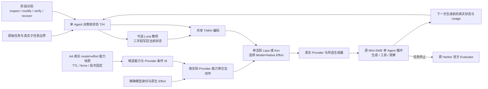

# ModelRouter · 研究总纲、相关工作与方法设计

**2026-11-12接续已结束**：[新监督与训练](../results/iterations/20261111-v9-rq4-joint/)覆盖两个合法Train验证阶段截止、各七个有效候选；两架构各18更新已保存。新GLM Max/Dynaconf与Terra High/Hikari通过原评价器，两个偏好分别Luna Xhigh、Terra High。随后[2题×27策略完整结果](../results/benchmark/rq1/terminal-bench-2.0/20261111-v9-joint-followup/review.md)全部54位置结束：42通过/2失败/10缺评分、74原Trial，模型+教师已知$0.73402850。两任务历史已观察且独立于新训练/选择；覆盖原始/训练、教师、三模型参照、开始/阶段/逐生成和T/M/H。

本批新训练Laya ON与Kev OFF/ON均2/2，相对固定Terra High参考费降低15.13%–34.25%，相对固定Luna High增加225.67%–320.35%。Laya ON训练后更省参考费但更慢；Kev ON从1/2升至2/2却更贵，新Kev主组全选Terra Medium。六个有效教师对未增加通过数；原始Laya教师参考费下降7.42%。RQ1整体净收益继续缺完整实收与资源USD；RQ4后续重点为两个验证截止之外的阶段监督及可重复贡献。RQ2精确返回/AA缺项、RQ3真实子任务边界与RQ5跨机制工作负载分别继续，单Agent范围保持。

**2026-11-11正式RQ1**：[Terminal-Bench 2.0完整批次](../results/benchmark/rq1/terminal-bench-2.0/20261108-v9-rq1-glm/review.md)的89题×17策略×seed42全部结束，614位置有官方评分、899缺评分；固定四并发、Router两并发，原Harbor/Verifier、4096输出、AA v7与原GPU锁。事前确定的两原始实体和11-08各17更新GLM研究代表保持。同题且费用齐全的13/19题中，固定Terra High通过10/14题、训练Kev OFF/ON通过7/11题，后者参考费均更高。完整现金净收益仍缺供应商实收与资源单价。原4条H截断保存输入已沿唯一Serializer完成原生编码，丢失Token为0；该收尾编码尚无新训练及完整Episode。后续补多任务合法联合监督、单Agent阶段/子任务边界/粒度、T/M/H消融和独立工作负载，不以本批结果挑权重。

**2026-11-08 · 新增近邻文献与研究方向讨论（未变更正式 RQ）**：[Whose turn is it? 中文技术笔记](../literature/notes/whose-turn-is-it-2610.19292.zh.md) 已核对并登记 [官方原 PDF 链接](https://arxiv.org/pdf/2610.19292) 和中文解读。该文实证研究零样本、二候选、**用户轮次级**表格 Agent 路由、历史依赖、缓存切换方向与回本成本；这些概念不能作为我们 V9 的首创声明。V9 保留真实 Harbor 单 Agent 每次生成机会可选 Model×Native Effort、Laya/Kev、T/M/H、Provider 缓存 Usage、教师和终局账本；候选差异化集中在独立任务验证过的**缓存机会成本×实际质量/恢复×完整 Episode 净收益**，而非堆输入或新建 KV Infra 服务。用户重新提出 K=3/5/7 与同 K 不同池组成作为 RQ2 拟议恢复范围；**当前正式 RQ2 仍为固定 K=3**，本次仅记研究讨论，尚未批准替换正式五 RQ/图表或声称 K=5/7 已可用。论文 PDF 二进制尚未导入仓库；链接归档见 [论文库条目](../external/research/papers/59_Whose_Turn_Is_It_PDF_LINK.md)。

**当前研究方法与证据（2026-11-08）**：唯一Harbor→ModelRouterMiniSweAgent→DefaultAgent与原Evaluator、共享T/M/H、Laya/Kev原生前向、Luna教师和Model×Native Effort继续复用。11-07[完整报告](../results/iterations/20261107-v9-full-method/review.md)属于旧HY4池。新GLM池已有1条五候选联合偏好+16辅助；Laya/Kev各17更新已保存，两个代表在独立评价终局前确定。

GLM开发非流式4096已取得实际工具与官方Reward 1；独立constraints-scheduling三档均1，返回Effort未报告。该题Laya原始/训练/无教师=1/1/1，CPU Kev=1/1/0；只有原始/训练Kev触及Agent时限。全部49尝试已结束，33有效终局/21个1/12个0，16无Reward。sanitize Laya1→0、修复后Kev0→0；text五个有效终局全0，三项缺Reward。模型+教师已知参考费$1.45700272，实收与资源美元价未知，训练及完整净收益未建立。旧polyglot已观察，query-optimize原Verifier超时；保持原用途。现行五RQ为整体质量—总成本、固定K=3联合档位、单Agent阶段/真实子任务/粒度、系统消融、工作负载收益边界；详见[本轮报告](../results/iterations/20261108-v9-k3-training/review.md)。

当前研究池目标为 **Luna、GLM-5.3-Flash、Terra**，规划 15 个 Model×Native Effort 候选。每批实际候选严格依精确 Provider/model 身份、原生 Effort、可用性、工具和上下文能力生成；15 是规划数，不把缺失或未支持动作伪造成可运行候选。旧 HY4 请求、训练和结果保留其历史身份。

AA 沿原 capabilities 实现 TTL、force、STALE 与同批固定快照。v7共130条独立指标：Luna/Terra各六档，GLM仅Max，Low/High缺测；Index5.0.1，取得时间2026-11-07T13:47:04.783836Z，三个真实AA release页面为来源。授权API完整数据、模型revision及官方发布时间尚缺。原17训练行34项编码保持；最终共享指标定义令241保存前缀截断48→0，Laya最长8173Token且AA分数/来源不符0，四实体原生前向无截断。49个Episode输入版本保持，修复后训练及完整比较仍缺。工具/生成使用1000/800字符摘要，不代表全部原始轨迹；教师状态FULL含缺失/关闭标记。

11-07 报告的真实执行显示：两 Trainer 各 18 次更新，Train 有 2 条联合 S1、每类 8 条 S2/S3 辅助材料，但两条 S1 来自同一个截止；正式三题没有用于梯度或调参。更新 Laya 的 Terra 切换在相同输入下原始 Laya 也会作出，不能归因于训练。更新 Kev 有真实切换，但三题均触及 Agent 时限，不能据此宣称分工或完整净收益。其它 RQ 与成本缺口按报告原数值和 UNKNOWN 保留。

本文件以下带日期内容是研究历史。若旧段落仍提及 Sol、HY4、Flash、多个 Agent、角色、handoff 或旧 RQ3 方案，以本节及论文图表规划当前段落为准；不得将历史实验身份改写成新池结果。

**11-06正式研究起点变更**：当前主线是真实K=3 Luna／HY4／Terra联合模型与原生档位、缓存连续性、原始与训练Router、Luna轨迹教师，以及含资源开销的完整Agent净收益。首批原Harbor开发实测见[本批结果](../results/iterations/20261106-v9-k3-real/review.md)，历史性质见[统一入口](../results/README.md)。供应商返回身份不等于底层权重证明，发送档位不等于计算强度因果验证，同模型连续不等于每次缓存命中，完整Reward与静态概率不互换。RQ1完整效果、RQ2池与Effort、RQ3拆分及粒度、RQ4真实消融、RQ5工作负载边界继续分别推进；旧40条Model-only不转成新联合标签，旧模拟不升级为结果。

首批10个主位置得到6个原官方Reward，仍只有两模型身份有效。动态16次全选Luna low、620.979秒CPU路由；第二题同成功但比固定Luna费用高，第一题供应商缺失反事实不能支持选择收益。已有真实任务成功与缓存读取观察，没有训练贡献、档位差异、跨模型缓存因果收益、独立分工或完整净收益证据；新联合Train0。下一优先是有效三模型比较与有信息量的任务／档位监督，再做有限原始／训练与教师对照和真正独立任务。原38组接续另有未明进程终止，不把旧训练完成或概率输出代替这些五RQ问题。

**11-06联合选择执行更新**：后续动态实验恢复原Model×Native Effort目标，现有原Checkpoint按完整组合评分并输出模型、档位和组合概率，在线状态保留每档能力证据及上次所选、请求、返回档位。Provider不以渠道默认值覆盖选择。默认新模型池Luna/Terra/HY4；前两者各6档，HY4沿负责人要求只暴露none服务默认，不把不传参数当成关闭思考。旧40条Model-only质量/费用观察与原STEP权重保留，不能证明新三模型联合选择或档位泛化。本地接口更新没有产生新监督、训练或正式Episode，仍需同模型不同合法档位的真实质量—费用比较与独立完整净收益评价。

**11-06实验模型直接调用**：负责人已取消生成和教师中的模型替换，新实验按选中精确ID请求真实候选，同模型端点切换不改变模型。旧Qwen映射及对应费用只作为历史通路资料，不能代替Sol/Luna质量反事实或净收益证据。本地映射实现与配置已删除，服务器未部署或重启。当前Qwen配置网关连接超时、server3原9002/9010无监听，只得到连接负结果，停止原因和模型能力均未知；不形成新的质量标签或实验成绩。

**11-06完整任务机会新证据**：[本批研究](../results/iterations/20261106-v9-complete-opportunities/review.md)。原官方三题各一条Luna完整生成轨迹，恢复后的原Verifier确认漏洞367＋6全过、汇总2/2、Nginx1/8；原Harbor日志传输错误仍使原Reward为空，恢复验证不能取代原完整Episode。新增的是Luna可完成性与部署环境负结果，Sol仍502所以未形成新的双模型质量—费用互补。三题开发暴露不入Train/盲评价，原生009/010的类别差异没有双候选真值，不是独立分工或净收益。

监督目标压缩、完整完成误判压过局部进展仍有已保存直接证据，状态表示及Encoder的唯一因果解释未建立。正式40、原辅助方法及权重保持，无新Train信息支持011。每步有历史费用机会，但实际兑现和必要性未证明；开始/转折实验臂与RQ4精确参照、T/M/H同权重遮蔽及监督父权重方案待负责人决定。RQ1总成本前沿、RQ2池/Effort、RQ3任务拆分及相关粒度对照、RQ4正式消融、RQ5独立边界仍未闭环。原38组安全接续是并行未完成主线，不用K2负结果替代或搁置其诊断。

**11-06验证与工作负载边界**：Rust恢复成功却暴露原固定ID/兼容补丁/库命令不对应；原71项全过不是固定75/75，保留UNKNOWN且未改变原定义。JS解析缺失、Go初始编译停止与Sol生成502各自保留，不产生虚假质量标签。当前缺口仍是有效工作负载上的真实反事实、同一方法的独立质量/费用双向选择，以及含Router开销的完整净收益；监督、表示和学习方法不能唯一归因。具体后续Dev选题已落到Python业务修复、日志结构化汇总、Nginx自然转折三个官方任务，没有执行新Episode、预设模型赢家或调整现行每步协议。

**11-06整体价值与粒度依据**：[新结果](../results/iterations/20261106-v9-routing-granularity/review.md)。旧八条动态轨迹的自然转折没有改变模型类别，50次路由中42次相邻重复、切换0；开始或阶段调用子集减少费用开销的可能性尚未由新Episode验证。Router占旧墙钟5.7%–54.1%，初始化、暖调用、调用频率和资源现金费应分开评价。有限模型费机会仍支持K2，但不能由无开销的理想任务目录证明高频动态必要。优先高价值质量关键编译/解析/部署及等质量提取/配置任务；建议负责人批准任务开始与自然转折两种研究臂，保持现行V9。新三任务各方法事前仍一致Sol，供应商异常、Parser缺失及初始编译失败不变成模型质量真值。可靠独立双方向选择、含Router开销完整净收益以及RQ1–RQ5尚未闭环，原监督、Serving和训练计划不因本批粒度分析改变。

**11-05完整任务价值与研究方向**：[本批结果](../results/iterations/20261105-v9-global-value/review.md)。8个既有真实任务中4项双方成功且Luna参考费更低、2项记录中只有Sol成功，支持继续研究K2机会；六题事先知道结果的条件模型费差额约35%，不能代替Router完整Episode。八题动态50次/680.960秒/切换0，同成功题全部比固定Luna贵；高频CPU路由开销可能抵消费用节省，GPU加速也不代表免费。机会频率、同轨迹可安全切换位置、稳定性与资源美元费未知，任务级/自然转折低频路由属于待确认研究建议，五RQ及现行V9方法不变。

原监督压缩局部关系、完整预测与动作矛盾、成本结构有直接证据；6000字符摘要或Encoder是主要失败原因仍未确定。新四任务110动作恢复、当前均Inspect，固定范围大多已完成；Sol三个502和scikit Luna返回身份不符使双候选关系UNKNOWN，异常不转成质量标签。NestJS目标Luna有效动作只提供单方记录，不能证明费用赢家。原40及Train参考范围不变，16同状态新CPU前向类别未变，无新的训练或完整Dev依据。当前科研推进是限定机会空间和经济边界、保留真实结果并明确学习缺口，不是已经证明跨任务动态净收益。

**11-05质量信息与决策链的新增负结果**：[本批研究](../results/iterations/20261105-v9-quality-action/review.md)。真实Modify不保证截止点仍有修复机会；10状态中5项原固定已全过，Docformatter剩余旧P2P、Setuptools剩余F2P两组可信配对均无改善，原40正式偏好保持。新增合法Train无进展观察使B4 30/F2P 11，但未提高留出关系或最终动作；没有新的独立质量—费用双方向证据。

局部目标偶尔正确不必然进入最终质量选择：完整关系误判满足要求会压过局部分支。原单P2P观察只支持恒定先验，不能由数值有效推成状态可分；名义卡与真实协议重放仍缺独立因果收益。没有新的神经训练、完整Dev或净收益，K2两项证据及原五RQ缺口保持；原队列、Serving、数据身份和未知成本保留。原源码仅处理真实缺失结果及单标签拟合问题，不改变在线状态表达或动作目标。

**11-05新增质量真值与迁移负结果**：[本批研究](../results/iterations/20261104-v9-cross-task-relations/review.md)。真实Modify中的APIFlask、Datumaro、Hikari提供3条合法Sol质量偏好（Train1/事前仓库留出2），正式40；Relé提供NEITHER且无改善负例。新增局部严格优势与完整赢家重合，既有Stingray/Narwhals额外机制仍分别仅一项。F2P Train10仍只有相同/Sol优势，P2P恢复/回归信息不足有实际依据，不将局部数据量增加称为迁移收益。

同一固定Encoder/参照、无留出拟合或调参，原生/A/B4新留出正式动作均1/2、B4关系1/2，新Train不改变预测，固定Sol2/2；010每候选修复辅助目标联合2/2与完整关系/动作是不同目标，尚无最终条件选择收益。CWD对齐没有改变类别，表示与学习方法的主导原因仍不能唯一确定。没有新的同质量费用机会、STEP011或完整Dev，K2可靠独立双方向选择及含Router开销净收益两项仍缺。五RQ原定义不变，Inspect/NativeEffort/K3正式监督仍0，原权重和健康队列保持。

**11-04局部学习与独立条件选择的实际边界**：[本批完成结果](../results/iterations/20261104-v9-local-quality-learning/review.md)。八状态恢复340原动作，Dynaconf当前Modify确有目标F2P剩余故障，Sol30/30对Luna29/30形成新合法Train质量偏好1，正式37。局部差异与正式赢家重合，仍未新增超出单赢家的独立局部机制。Vuex Luna测试未运行、PennyLane初始6/6而无候选请求，两项没有新的完整双候选真值；不把UNKNOWN当失败或初始成功当预测正确。

局部集合确实保留完整一步目标丢失的信息，但额外Train信息仍仅Stingray F2P、Narwhals P2P各1；B4旧7观察009/010仍2/7、1/7。新Train参考A22/B4 27/F2P8，F2P Head任务留出5/8、6/8不能证明整个Encoder泛化。实际输入重放的局部改善伴随009完整关系退化、动作不变，且发生在Dyn结果之后；摘要/真实阶段也无可靠独立改善。任务资格和仓库祖先资格分别保留，实际梯度成员未知不是零；旧研究观察不称最终测试。数据合法不等于已有新训练依据，本批不训STEP011、不替Serving、不扩完整Dev。质量—费用双方向独立选择及含Router开销的完整净收益仍是K2两核心证据，V9五RQ未完成。四请求353386 Token/$0.4537541仅参考费，实收/缓存/完整资源费用未知。

**11-04局部质量信息与关系选择负结果**：[新证据](../results/iterations/20261104-v9-repair-quality/review.md)。四个新原故障状态完成真实单步Sol/Luna比较，包含当前Modify与两个Recover；全部未完成，原36正式偏好保持。Narwhals中Sol恢复一个原已失败P2P、Luna无改善，完整通过目标将两种局部结果映为同一NEITHER，直接证明该目标不能保留这项差异；不将其重新命名为原F2P或正式质量赢家。

原A/B17/B4在新状态的关系与动作分开评价，009/010的B4新两个仓库留出均0/2，原旧两项0/2保留。无正式赢家的动作正确率null；009在一个祖先仓库已见的Train局部观察较好，不构成可迁移双方向证据。新状态没有Token窗口截断，但6000字符摘要仍省略长写命令中段；内容取舍存在不等于因果作用已证明。当前样本和目标信息不足有证据，状态表达与完整动态闭环的贡献未能独立确定；不新训011、不扩完整Dev、不替Serving。K2可靠未见条件选择、完整净收益两项以及V9五RQ仍缺真实闭环，Inspect/Effort/K3事实不变。

**11-04真实Modify与监督机会**：[实际分析](../results/iterations/20261104-v9-modify-candidates/review.md)。原prepare从已观察工具组得到两个当前Modify，源码写入成功、前缀完整；这只证明阶段覆盖，不证明还有待修复的业务故障。主要修复后的原复现通过，完整固定Verifier未知，两项不生成正式质量/费用目标。晚期Recover可能来自错误复现预期、导入路径或工具定位失败，不能把这些现象当作候选模型质量失败。任务L4且旧步骤无匹配，与仓库已有祖先L2暴露同时成立；按本批仓库留出不等于全流程新仓库。无新双模型质量信息、独立选择改善或完整净收益，本轮不改变Encoder/训练方向、不新训011或Dev。正式36及五RQ、Inspect/Effort/K3边界保持。

**11-04可见阶段与抽样语义**：抽样可依据原轨迹下一写动作定位截止，但这种Modify标签不是决策时已观察阶段。当前阶段必须沿原在线规则从截止前真实命令、退出状态和输出得出，并逐条保留历史阶段；不能将未来动作种类赋给整个前缀。本轮Chai/W3C分别Recover/Inspect，四状态没有当前Modify覆盖。Provider未使用抽样阶段，原质量/费用结果保持；原context/prepare共用反馈规则及compact当前phase传播已实际完成，四保存前缀正式转换一致。新增8前向选择不变、独立关系仍0/2，不能归因出阶段错误造成全部迁移退化，也不能将新数据转换等同于新模型泛化。[本轮结果](../results/iterations/20261104-v9-recover-modify/review.md)

**11-04新状态、真实关系与泛化边界**：[本轮研究](../results/iterations/20261104-v9-recover-modify/review.md)。A6000用户空间Docker已使四新L4 Train来源的真实动作和固定原测试可执行。Chai提供同过低费Luna偏好1，三新状态均双失败无局部改善；不把Recover路径诊断、Inspect读取或Provider限流当成质量独胜。原偏好36中步骤质量19、步骤费用8、任务费用9分别保留。完整历史/原版本和截止恢复，不泄漏原参考修复；公开轨迹完整原运行时仍未知。

真实请求输入使2/8原生选择相对构造输入改变，但未提供新的独立模型分工。B17不能表达双失败；原Torch四类B4加一个合法Train双失败后，新两个仓库留出关系仍0/2。动作选择正确、关系正确和当步完成不能互代；双失败没有正式赢家，不能给动作正确率填0或1。010 A的任务留出21/21含旧Encoder已见旧任务，不是全模型泛化。009保持旧费用线索有原保存数据支持，当前没有新可靠质量—费用双方向改善，不训练、不扩Dev、不替Serving。K2可靠条件选择与完整净收益两结论未证明，五RQ及Inspect/Effort/K3边界不变。原测试虚拟化与SSH时间、Router分析子段、参考模型费和供应商实收分别记录。

**11-03候选表示与质量语义**：[新研究](../results/iterations/20261103-v9-encoder-migration/review.md)。009至010整体任务CLS与候选区分可分别变化；pipdeptree CLS相似度.9926，候选差向量-.2699并接近Sol质量样本。010训练中Luna质量独过和费用同过更集中，支持最终赢家目标压缩不同质量依据的解释，但尚未证明唯一因果。阶段与来源覆盖不足，一条Recover质量Train全Luna、TRA-001质量Train四条全Sol，不能从几何独立确定阶段线索。

保持009的原Torch线性参照保留旧费用与部分质量关系，mpmath仍错、总旧三观察动作2/3不优于固定Sol2/3；010 Head任务留出动作20/20也只有13/20关系正确，Encoder已见使其不能作为全模型未见证据。新独立状态与局部质量信息0，不训练、不扩Dev。原Serializer补两个真实步骤计数、四次前向选择不变，不重复Context或旧S1分析。A6000 Docker权限尚待管理员授予syy，SSH资料无需再提供；新采集未执行，K2两核心证据和五RQ继续保留，完整净收益没有证明。

**11-03 STEP010迁移机制**：[最新结果](../results/iterations/20261103-v9-step010-transfer/review.md)。现有权重交叉对照显示，Encoder变化足以保留pipdeptree错误费用翻转；换010其余分类组件而保留009 Encoder则选择正确。相同20训练状态质量14/费用6、Sol9/Luna11，训练Sol选择数下降，不能归给统一Sol偏置。原S1人类偏好评价和当前一步Verifier语义分开，旧009/010输入与温度口径不同；统一原Trainer口径仍退化.6881至.6720，而不是旧混合口径的差值。

原6000字符Context中长命令尾部、组合命令真实错误和步数误标Modify已原位处理；有效16状态前向选择保持原样，不能由摘要改善推断质量改善。工具可执行、局部修复、原Verifier完成、信息探索和最终费用选择均是不同研究对象。局部目标没有新的独立改善，新标签/Trainer/Dev均0；原Serving与35偏好保持。A6000 Docker认证缺项使定向采集尚未执行，既有授权继续有效、不回本地Docker。可靠未见质量—费用选择和完整净收益仍是K2两项核心证据，V9五RQ未全部完成。

**11-03离线—在线与新的负面泛化证据**：[本轮结果](../results/iterations/20261103-v9-offline-online/review.md)。保存在线状态真实GPU重放仍八步全Sol，三类拟合的类别排序可以解释实际动作；消息顺序与Serializer正常、没有分词裁剪，在线早期读数据/依赖错误与离线诊断后修改分布不同。6000字符摘要保留最近反馈但没有完整当前文件和长命令，不能从这些差异单独证明因果。候选顺序真实源码错误按模型ID处理，正常/倒序/跨任务前向一致；旧Dev本来Sol在前，历史结果不改。

B在旧pipdeptree选对低费Luna，却将真实双过误判为Luna独过；动作选择准确与质量关系准确须分别报告。C留出ro-crate双失败预测对应相似失败表示，但Sol训练通过略多于未通过，不能归因单纯多数偏置。D留出Build后没有无改善训练类别，其分数0有明确数据机制；四条局部样本不支持复杂辅助训练。局部集合是动作后质量信息，不可泄漏到动作前表示。

新四任务在答案前指定用途，原Train、祖先L4范围与固定原测试保持。Vetiver与独立PlasmaPy真实Sol质量赢家新增2，原正式33不改、总35；拒绝与Provider异常不计质量失败。必要STEP010原参数与目标、20条20正确，却四新状态全Sol、旧独立pipdeptree费用由对变错，未训练PlasmaPy选对在009中已有。新增单方向正确不构成新的双方向迁移，固定Val准确率.5526下降不触发继续拟合。本轮不新完整Dev、不晋升Serving，可靠独立条件选择与完整净收益仍是K2两缺口。五RQ及Inspect/Effort/K3无正式监督事实不变，负结果不等于技术不可行。

**11-03当前局部关系与独立分工**：[当前结果](../results/iterations/20261103-v9-local-relations/review.md)。旧music21虽未修复F2P，但Sol恢复已有P2P失败1，满足两个修复维度和无新增回归下的辅助严格优势。新Sphinx修复F2P4对0，也是局部优势，双方未完成不造正式赢家。Build双无改善；pipdeptree初始收集错误使局部集合未知，动作后双27/27仍产生合法费用偏好。ro-crate17/17对14/17新增Train质量Sol1，正式偏好共33。

B原17条同一固定Encoder参照在未见ro-crate与pipdeptree分别选Sol/Luna，三个旧Encoder均2/2，支持小样本质量—费用分工；不再要求Luna质量独胜。A006/007也2/2，不能唯一归因于质量目标或估计长期概率。扩展C/D仍有错误完成与局部类别，信息丰富不等于迁移。一次009训练后19条18正确，Val准确率升但校准指标变差，真正未见mpmath仍错；旧Moto/Tox祖先L2、Qiskit候选L3与完全未见须分开。原Harbor新Dev三策略实际评价B参照，Serving不晋升。

K2状态分工已有有限独立信号，可靠泛化和完整净收益尚无充分结论；完整V9五RQ的总体效果、模型池、任务拆分、系统消融和工作负载尚未全部回答。Inspect正式步骤、Native Effort、K3正式监督仍0；模型参考费、供应商实收和资源USD分开。

新bn-fit-modify官方三策略最终均成功，但动态B原17条八步只选Sol，切换0，Router19.046秒；动态参考费高于固定Sol，较低墙钟存在镜像准备冷热差异，不证明净收益。独立前缀分工没有转化为该闭环Episode的模型分工，不由此替换Serving或扩大相同Dev。全轮36请求、292442已知Token，已知参考费$.28447344；Luna断连和Sol403用量未知，不填零。

**11-03晚期Modify研究**：[本轮结果](../results/iterations/20261103-v9-modify-quality/review.md)。真实历史写入恢复后，mpmath出现Sol完整一步质量优势，Click出现Luna等质量费用优势；Stingray双方失败但Sol修复集合8严格包含Luna2，无新P2P失败。这表明晚期状态确有较早期读取更丰富的质量信息。原29不改，正式新增2；局部支配未进入原正式目标。

原完整一步目标在Inspect阶段不能评价信息价值，在分阶段Modify中把不同修复集合压为同一失败。C仅拆两个完成输出仍丢失局部差异；45行拟合与12真实GPU前向未证明迁移，008新4状态仍全Luna、独立质量0/4。四独立质量观察全Sol，固定Sol4/4；没有未见Luna质量优势，不能将整体偏向Sol称双方向选择。新增质量继续仓库留出、局部辅助目标仅研究信号，没有新Trainer/Dev或Serving替换。K2两核心结论、V9五RQ及Inspect/Effort/K3缺口保留。8有效请求204230Token/$0.26692865参考费；实收与完整资源费未知，公开轨迹运行时Git版本未报告。

**11-03逐候选质量研究**：[本轮结果](../results/iterations/20261103-v9-candidate-outcomes/summary.json)。原29赢家不变，真实双方未完成可以提供两个候选当次Verifier结果辅助目标，异常不能编码为模型失败。使用原Encoder/Torch分别预测Sol/Luna完成类别；相同质量预测才讨论模型费率，双未完成允许不确定。该实验未校准稳定成功概率，也未改变正式STEP_LEVEL_PREFERENCE。

新仓库按原Train资格、固定来源顺序及事前训练/仓库留出用途进行真实双候选验证。新增状态均在首次诊断文件写入前，覆盖仓库差异，但决策阶段仍集中；原一步完成目标不能直接评价诊断信息价值或最终Episode质量。旧训练状态的任务/仓库head留出与真正新仓库观察分开，重复轨迹及多截止不增加独立任务数量。逐候选未完成识别不等于可迁移的两模型质量选择；缺少未见双向分工与完整净收益，K2两核心证据及V9五RQ仍未完成。训练和Dev是否继续依据本轮实际证据，不因数据量增长宣称能力提升。

**11-03跨任务接续的科学结论**：[最新结果](../results/iterations/20261103-v9-cross-task-quality/summary.json)核对三组真实动作：Tox两次Luna完整200、读取动作执行0，原验证未完成与Sol184声明ID全过构成合法的一步质量差异，不能概括整个模型的任务能力。Pydantic的Callable导入错误来自有效生成并执行的源码；Canvas503和旧200重复command覆盖修复均为候选质量未知。只补一次Canvas有效Luna，原20/22与Sol相同，两报错字符串大小写失败，没有新偏好。不从Provider异常编模型质量失败，也不选取歧义字段代模型作决定。

原28与Tox新增1保留=29，步骤质量15（Sol10/Luna5）/等质量费用5全Luna/任务费用9全Luna；20步骤来自17任务，三任务多截止。质量胜者更贵10/15，单赢家目标的质量与价格确有冲突，但008训练质量12/12与费用5/5均正确，不能断言它主要只拟合费用。未知repo/phase、Inspect步骤质量/Effort/K3缺口不改。

方法A原目标及00817/17保持；B在相同Encoder表示/原Torch上学习Sol独过、Luna独过、双过三种已观察关系，再按预测双过选择较低模型费率，类别不是成功概率。原训练入口保存候选信任与未知终局，新增小型固定Encoder拟合函数供A/B复用，不建新模型系统。按任务整体排除全部截止：006 B质量6/12低于固定Sol7/12，007/008更高head留出分含Encoder已见同状态信息；这些分数不证明全模型独立泛化。候选以ID对齐，原一条Luna/Sol倒序仅是探针初稿的实验错误，原Serializer/Trainer无此问题。

Moto/Qiskit/Tox三个祖先未训练质量状态均Sol赢家，原006/007/008分别3/3、0/3、0/3，B各3/3、2/3、1/3，固定Sol3/3。新独立Luna赢家0；008还把Tox关系误判双过，不能以最终选择分数替代质量关系能力。因此本轮无新原Trainer Run/STEP009、无新Dev，原Val/权重未变，旧动态失败不重跑也不改写收益。缺少独立双方向条件选择及完整Episode净收益是K2的两核心问题；完整V9五RQ仍未闭环。数据、目标与表示问题均有实证边界，尚不能唯一断言某种捷径或方法技术不可行。

两轮10物理请求/8有效生成/1歧义/1传输失败，193569已知Token/$0.23481747模型参考费；reasoning已计输出，503Token/实收/资源完整费未知。GPU约2.054GB allocated峰值与8.713秒成功特征前向只属分析子段，不能当完整动态运行开销。原代码与脱敏研究结果按本轮请求定向发布，Serving不重启、不替权重，不扩大Dev或增加研究限制。

**11-03跨任务质量监督证据**：[本轮结果](../results/iterations/20261103-v9-cross-task-quality/summary.json)完成用户任务一。28原偏好中步骤质量14（Sol9/Luna5）、步骤等质量费用5（全Luna）、任务等质量费用9（全Luna）；STEP008参与梯度12质量+5费用，初始Inspect任务费用不当步骤诊断质量。现有准备入口已分preference_basis，Trainer仍用同一步目标和未加权soft_ce_loss。质量主要Verify、TRA-001质量原4条全Sol，费用全Luna；来源/阶段/模型语义集中支持数据分布问题，但不能唯一识别学到哪种捷径。长期完成概率不由单次原验证通过估计。

三个新原Train仓库按故障与用途事前选择：Pydantic训练候选，Tox/CanvasAPI独立Train观察；不按赢家改变用途。原完整历史/原镜像base/独立容器/固定ID、轨迹CC-BY-4.0/仓库MIT保持，历史诊断脚本不执行、教师0、参考不泄漏。Pydantic补齐原环境所需pytest-timeout后保存Sol代码15/16、LunaCallable收集错误；CanvasAPI Sol20/22、有效Luna缺RateLimitExceeded，均无正式赢家。Tox Sol184/184、Luna缺get_version_info收集失败，新增合法一步质量Sol1；整条命令两范围外失败不称Episode成功。Tox一次必要有限重复仍同结果，不增加独立状态或训练标签；Canvas503未知费用保留、只补一次，不为Luna赢家筛选或追加生成。

累计29偏好/20步骤，质量15（Sol10/Luna5）/费用5；新梯度0/训练0。旧Moto/Qiskit与新Tox均独立Sol质量赢家，STEP008事前均选Luna，0/3、固定Sol3/3；17/17训练拟合未迁移，未取得新独立Luna质量赢家。此次没有新完整Dev收益证据，Inspect步骤质量/实际Effort/K3仍0，原独立动态失败保持；五RQ不变，不由小样本负结果断言技术不可行。9请求/8完整/179008Token/0.232794545USD参考费，1次未知及实收/资源费分开，reasoning只计一次。

**11-03训练条件区分与独立负面证据**：[本轮执行](../results/iterations/20261103-v9-state-conditions/review.md)在相同17状态的组件交换中，006→007共同margin方向占88.96%，主要随Encoder变化；共享scalar bias相减抵消。原Encoder单一线性对照训练13/16但按任务整体留出3/16，未证明可泛化的线性信息，不能据此断言数学不可分。质量/费用目标分别分析，标签不改。

Trestle/Qiskit两个新原Train/许可明确来源取得Luna等质量费用1、Sol质量1，累计28偏好/19步骤；来源phase未知，Inspect/实际Effort/K3仍0。只在原预算内调整当前工具/最近失败反馈取舍，旧17相关失败行72→74；原Trainer007父、17状态三轮27更新形成008训练17/17、Sol7/Luna10。Moto/Qiskit事前不参与梯度，真实Sol赢家均被选Luna，0/2，不优于固定Sol2/2；Val Acc0.6809下降、Loss/Brier/ECE改善。继续训练、数据和表示同时变化，不能唯一归因，原加载温度范围处理下概率校准未建立。

原checkpoint加finally清理且保持异常传播/GPU锁；新独立git-multibranch完成原Harbor Docker/未改Evaluator三策略，Sol成功、Luna和动态008 CUDA失败。动态4步全Luna、无切换/fallback，Router16.135秒，复用1.935/1.085/1.174秒；动态失败更便宜不证明质量—成本收益。单卡路由后949MiB/0%，动态峰值和资源账单未知；22完整请求/211745Token/0.21791663USD参考费、实收未知。训练分工与实际泛化/收益明确分开，不晋升Serving、不追加参数扫描或大批量Dev。

本轮P0–P5已执行，K2核心仍缺独立条件选择与完整净收益；五RQ不变。研究优先级据此是跨任务可迁移状态/监督、事前选择异类故障与阶段质量目标、独立状态分工后的完整Episode收益；不是继续以Loss下降为主，也不因负结果宣布技术不可行。Inspect信息价值、K3、实际Effort和教师净收益保持缺真实证据，不造新目标。

**11-03状态偏置与真实成本新证据**：[本轮执行](../results/iterations/20261103-v9-separation-cost/review.md)旧15目标=12任务/11仓库、质量11/等质量费用4，共同14状态Sol概率均下降但排名不变，窗口截断0；测量特征中心化秩14，不能证明不可分。Planet/Moto两独立Train仓库取得新Sol质量目标2（原范围23/23对22/23、176/176对175/176），累计26偏好/17步骤，Moto事前不参与梯度。原Trainer唯一调整为Encoder共同更新，STEP007三轮24次后训练7/16→9/16，但17状态全Luna且Moto选错，Val准确率略升、Loss/Brier/ECE变差。类比例可解释正确数上升，尚无状态分工，Encoder不更新不是充分原因，也不把一次负结果称为技术不可行。

正式源码原位复用laya.load/SDPA与原Checkpoint进程/GPU锁，CPU初始化27.817→4.979秒、旧状态前向17.984/20.216→12.455/13.395秒且概率不变；STEP007正式逐步GPU首次总段12.282秒、复用0.985–1.328秒，无fallback、每步释放GPU、不影响Serving。GPU常驻单段不冒称整Episode成本，资源货币费用未知。没有状态分工，按本轮要求不扩大新Dev，K2动态质量—成本净收益未证明。研究优先级据新证据为独立状态可学区分信息、跨任务/阶段真实监督、形成分工后的完整Dev净收益；五RQ及原Inspect/K3/Effort目标边界不变，当前本轮执行已完成。

**11-03独立Go质量与新Dev负面证据**：[本轮执行](../results/iterations/20261103-v9-independent-train/review.md)将Argo4594的公开观察前缀关联到真实原环境与新Sol/Luna比较，原F2P1/P2P889中Sol890/890、Luna889/890，新增独立仓库质量目标Sol1；Luna载荷解码错误可由原TestController及实际补丁说明。PrettyTable新状态双方191/193，不造偏好。累计24偏好/79行、15步骤；明确phase的Modify2含质量1，Argo为未知phase的Modify采样，含来源采样合计3含质量2，Inspect/K3/Effort0。STEP003编码诊断与STEP004/005负面结果沿用；STEP006原Trainer/服务器CPU完成三轮24更新，仅15步骤参与损失。20次真实CPU无fallback，新15目标全Sol6/15，同旧14目标仍5/14，平均目标概率0.480900→0.486029/NLL0.746901→0.731267；有学习信号，没有选择改善，也没区分各因素因果贡献。

两个新独立Dev沿原Harbor Docker/未改Evaluator完成六个Episode，动态STEP006与固定Sol均成功2/2，固定Luna1/2；动态20次全Sol、切换0、fallback/Provider错误0。固定Sol/动态/Luna参考费0.161107300/0.170223400/0.012113075USD，Agent执行336.337/745.134/487.269秒；动态Router433.296秒含初始化60.392/前向371.224、18次复用，资源费未知。镜像准备时间另列，不因Token或缓存随机差声明收益。本批新增标签的赢家原模型本来已选Sol，动态仍无便宜模型选择，质量—成本收益未成立；两个任务不足以证明跨来源泛化或完整V9。62完整生成/983210Token/0.450076775USD参考费，实收未知62。账户请求归属与未知费用直接处理原Provider，原监督定义与共享服务不改；本轮指定工作均执行，研究负面结果不等于技术不可行。

**11-03新增Train与学习原因证据**：[本轮执行](../results/iterations/20261103-v9-labels-and-learning/review.md)四组真实状态比较新增三个步骤目标，其中SQLparse原Verify中Sol331/331、Luna328/331形成质量差异；Records24/24、Schema后续116/116形成Luna等质量费用目标，Schema此前双方115/116无目标。累计23偏好/78行，真实Modify目标2含质量1；Inspect/K3/实际Effort0，原方法及分割不改。

STEP003 native目标正确、候选两顺序均偏Sol、head变化约0.135%。STEP004原lr1e-4更新三轮后近期四状态1/4且全Sol；首次错误基础模型身份已排除，原位重建权重e03并取得实际cfg。STEP005仅14真实步骤参与损失、三轮21更新、全14状态5/14且全Sol，Val561 Loss0.6005；同14个Train目标平均概率0.480900→0.487943、负对数似然0.746901→0.725240，但选择正确数未变。去除旧64行也未改变选择，混合比例不是充分因果解释，旧Val稳定不代表步骤学习成功。STEP005未进入Dev或Serving。独立Dev扩展三个原任务、九个策略Episode，同原Harbor Docker/未改Evaluator；动态COBOL/Git成功、HTML失败，2/3、15次全Sol、无切换/fallback。模型参考费动态0.089363200/Sol0.098045100/Luna0.015671745USD，没有候选改变，收益未证。COBOL Luna原输出重放评价与完整Episode分开，原502未知不算模型败者；HTML原XSS子项跳过/超时通过不能解释为完整安全证明。五RQ和K2研究范围保持，三项执行已完成，负面结果不改写。

> **版本 v1.6｜更新：2026-11-03｜原研究起点：2026-10-09；H1–H7 与历史证据保留**
>
> **目的**：为论文与开源实现建立可检验的研究命题、近邻工作边界、方法设计和实验协议。项目实际进度见 [PROJECT_STATUS.md](PROJECT_STATUS.md)，跨 Agent 决策记录见 [PLANNING_MEMORY.md](PLANNING_MEMORY.md)。
>
> **证据纪律**：论文/官方材料、现有仓库文献、E0 Agent 审计、我们提出的假设分开表述。**未运行的实验不得写成结果；“未见完全相同方案”不等于“首创”。**

**11-03真实质量与独立动态证据**：[本轮记录](../results/iterations/20261103-v9-quality-supervision/review.md)完成四Train状态及一PyBaMM Test观察的同状态Sol/Luna真实比较；当前账户四个Luna端点与现用Sol均完整返回精确候选ID，非Alias，物理权重身份未查看。async-timeout较晚Modify中Luna修改业务文件、原32项全通过且P2P29保持，Sol只读取且29/32，新增原STEP_LEVEL_PREFERENCE/MODEL_ONLY质量标签1；其余Train比较双方未完成，不产标签，PyBaMM双6/6仍Test不进Train。累计20偏好（任务9/步骤11），有效Modify1/Inspect0；没有引入局部进展或Inspect独立信息价值目标。

沿原Trainer从STEP002完成STEP003：75行=旧74+新1，1轮10次head更新，Encoder未更新，Val561 Accuracy0.6898/Loss0.5940/Brier0.4084/ECE0.0376。对新增赢家F11/STEP002/STEP003真实CPU输出均选Sol，Sol概率0.5640/0.5587/0.5589、fallback=false；参数更新和指标微变不等于学会新质量标签。原STEP001字节仍缺，权重只在服务器且Serving未替换。

一个独立distribution-search同原任务环境的三策略上游Harbor Docker/未修改官方Evaluator全部reward1，固定Sol/Luna/动态参考模型费0.0180706/0.005740635/0.0152233USD，Job166.208/235.985/161.303秒。动态3次全Sol、切换0，初始化30.021秒/前向10.566秒/复用2次；与固定Sol的费用差不能归因于不同候选选择，较固定Luna更贵，尚无动态收益证明。前6个账户/传输失败Episode无原终局，保留且不算质量败者。58请求中50完整返回、8Usage未知，已知497681Token/0.632776675USD参考费，完整总费用及实收未知；教师0，真实K3/NativeEffort目标仍0。五RQ及原方法范围不变，单题结果不概括完整V9或跨来源泛化。

**11-02离线诊断新增证据**：[124条保存输入分析](../results/iterations/20261102-v9-deepseek-dev/offline_router_analysis.md)确认输出映射与严格argmax一致，Sol最小领先0.029；状态123种且概率随任务/反馈变化，不能说模型完全未读取状态。稀疏K=2一步head训练与真实Terminal/逻辑K=3分布变化是有依据的泛化不足解释，因素因果占比未知。右截断41条使部分计数/身份丢失，唯一formatter将其前移后完整124/124；值和候选保持，部分长history仍裁、新输出未实测，不能当动态收益。

CPU的3081.16秒是原Adapter/system_one总段；重编码输入2395–5120Token、与旧时延r0.986941，长序列encoder与两层全序列head是主要测量方向，不把相关性当层内profile。原已eval/no_grad、线程8；新增inference_mode尚无同机模型速度对照。19目标/74行只支持有限K=2 head材料，步骤质量4:4加Luna成本2、verify9/recover1，不涵盖inspect/modify动态质量、K=3/有效Effort或教师净收益。此次无新实验、训练、服务器操作或研究主线；五RQ与正式证据边界保持。

**11-02 DeepSeek运行证据**：复用原Provider/Registry、Harbor/mini完成9个Dev任务19 Episode。固定实际DeepSeek与三逻辑身份动态ALIAS_SMOKE分开，原Verifier9次、7成功/2失败/10未知。Git/HF/POV-Ray三组完整同协议为固定3/3、动态2/3，按成功数分摊模型参考费动态略高且Trial更长；财务/MTEB的处理版本不同，只作观察。原工具30秒和Verifier不变，命令超时改为原Agent工具观察，6次反馈版本均取得Verifier终局。详见[批次证据](../results/iterations/20261102-v9-deepseek-dev/review.md)。

124次真实CPU路由全Sol、无切换/fallback，10次初始化和114次复用；前向仍耗时3081.16秒。教师1成功/4次实际消费，只向Router提供三字段，开启后同题总费/时长增加，净收益未知。227请求中223Usage，已知同系列公开参考费0.10950165USD、逻辑映射1.0058892USD，实收/资源/完整费用未知。实际发送high未获应用档位回报，不能生成Native Effort答案；Alias不证明正式三模型质量差异。

本轮Dev/Alias新增Train目标0、参数更新0；既有19 Model-only、74行待训练材料、STEP_001/F11/R11及Serving原权重保持。03:36:36 F14独立维护284/420块、36352/107404步、最新Loss0.50280873，首轮/Val未完，不作父、不干预。AA v4 Max不当low，Flash缺口保持。完整链路已具有官方终局，RQ1完整资源成本、RQ2真实K=3/Effort、RQ3任务拆分、RQ4教师/能力卡收益、RQ5泛化仍需研究；SWE-bench Verified原生入口未完成。五RQ八图十二表不改。

**11-02前一工作包方法与证据**：真实比较保留捕获的Router视图，在线复用步骤目标说明与候选顺序；QID本身不进入模型，说明、选项、任务及工具状态进入。Episode内复用原Adapter和专属SSH进程，成功Dev后4路由前向外共0.0477秒；这是已发生的运行成本改善，不是任务质量提升或新服务。

本轮新增一步质量Luna1与等质量成本Luna1，累计19 Model-only、步骤10、11标签任务；六对双失败仍只有观察，任务与步骤目标分开。distribution-search固定Sol/Luna/新Laya原Verifier reward1/0/1；新Laya仍全Sol且比固定Sol贵，COBOL新Laya超时/reward0，未证明动态泛化收益。教师开关单题都成功，1请求/1消费，轨迹与缓存不同，净收益未知。详见[真实运行结果](../results/iterations/20261101-v9-runtime-quality-dev/review.md)。

正式Model×Native Effort与K=3目标仍0，AA v4的Max指标不能代表low。74行S1+步骤材料已准备但未训练；原V9_LAYA_STEP_001-e01、F11/R11代表和Serving原权重保持。01:08:59F14独立维护241/420块、最近12块有限，但首轮/Val未完成，不干预或作父。以下旧执行状态按日期保留。五RQ、八图十二表、Dev/Final隔离与原假设结构不改，本轮有限K=2结果不填成正式三模型效果。

**服务器边界（12:57台北）**：另项维护的F14现行冷启到块25/420、3200/107404步，最近12块Loss有限；旧NON_FINITE_LOSS归档不覆盖当前状态，未完成Val、不作父。原队列文件仍暂停，但既有handoff等待F14退出，本轮未创建或操作。Kev无新训练、Serving仍F05/原Adapter，实验权重不自动上线。

**独立静态评价完成（11-01）**：用户已选TwinRouterBench 520题/970步，微调前导入权重与原Val前三采用相同原始选项/状态、温度1.0及真实CPU前向，8/8完成。F11-e01 20.515464分相对微调前7.010309分提高13.505155个百分点；R11 18.969072分相对微调前13.298969分提高5.670103个百分点，NLL/Brier/ECE也改善，但全部版本低于恒选low的71.030928分，外部四档表现仍较弱。它不代表完整Agent成功率、三模型最优动作或五RQ总体收益，不用于Test调参、新训练或Serving晋升；完整指标见[独立评分](../results/iterations/20261031-twinrouterbench-independent/review.md)。独立静态评价不增加动作监督，当前Train模型目标见下段。

**2026-11-01 当前证据范围**：四个已有训练任务的新失败前缀新增步骤目标4条（Sol质量3/Luna等质量成本1），新增来源任务0。累计17条MODEL_ONLY目标、9任务，任务级9/步骤级8、Sol4/Luna13；步骤覆盖8任务/7仓库、Sol4/Luna4，其中7质量差异/1等质量成本。任务级成本目标不复制到各步骤。旧196/186可组合213/186，原材料不重加工。Provider已记录实际effort参数，但Sol请求low报告max、Luna未报告应用档位，实际原因未知；确认的Model×Native Effort/同模型Effort/K=3仍0。原Verifier未知、API中断或双方失败不生成胜者。结果见[本轮记录](../results/iterations/20261101-v9-quality-step-supervision/review.md)。

**动态与教师证据范围**：本轮新Laya在独立Dev custom-memory-heap-crash完成7次真实CPU路由、全Sol、切换0/fallback0，概率0.5042–0.5476；未人为改变推理权重。新Laya和固定Sol工具30秒超时，无原Verifier终局；固定Luna reward0/CTRF5/6，不能形成质量赢家。三策略模型费Laya/Sol/Luna为0.1809328/0.1367668/0.00188939USD，完整成本未知，Dev不入Train。之前工具验证通过不替代Episode成功，原artifact为空，不重建或重跑。本轮教师0，原低频三字段与两参考保持；上一轮1成功/4次消费/0.013086USD仍未证明净收益。Serving仍旧权重，单次自然切换、固定Val稳定和此次选择Sol均不证明动态改善。

**输入与有限接续证据**：原Context/Serializer统一真实比较编码，Laya1024裁17/17状态，5120保留17/17完整canonical视图、两候选与价格；完整原消息另存。Kev最大状态3700Token、8K可容纳，R11父384不适配。Laya从F11-e01用64旧S1+8步骤模型目标训练1轮/9更新，仅原pointer head、lr2e-5，encoder不更新；任务成本、教师和Effort目标不训练。固定S1 Val561项Accuracy0.6898保持，Loss/Brier/ECE从0.5941/0.4085/0.0378至0.5938/0.4083/0.0362，不能替代独立Agent收益。Kev未新训练，F11/R11代表不变。旧四档语义/分布分析保留，独立八版本不重评或调参，本轮新权重未在该集评价；AA Max不能作low实测分。8个步骤任务支持有限接续，尚不足以证明联合档位泛化。

**2026-10-31 历史证据范围**：本轮从ad1d392接续，在已有TRA-002的公开SWE-smith训练任务TextFSM上取得1组有效K=2完整Episode对照与2个真实步骤前缀对照。Sol/Luna low两Episode均通过原96项，任务级质量相等下的模型费偏好为Luna；前缀7中Sol一步通过、Luna调用镜像不存在的apply_patch而未改码，得到1条即时修复偏好。前缀6两者失败只作观察。新可训练动作目标共2条，同属1个任务，完整K=3最优标签仍0；不能据此宣称动态Router、三模型或五RQ总体收益。结果见[真实监督记录](../results/iterations/20261031-v9-real-route-supervision/review.md)，旧成功/失败题未重跑。

**教师证据范围**：五次旧失败及真实Sol low/2048空正文均说明JSON Object不能避免reasoning占满输出额度。原Assessor缩短观察/固定参考视图并只做事实摘要，low/4096、context8000、首次约3生成、后续间隔至少3生成，验证/重复错误优先阶段变化。新step3真实前缀完整JSON，1462输入/1528输出含1435 reasoning、0.0189335USD，未执行新Router或工具；单次有效输出不证明稳定收益，价格仍约为本次Luna完整Episode的4.23倍。两固定参考不变，旧短评按信号变化清除并保留截止步，不修改Agent计划、工具或模型选择。

**AA v4 与数据监督**：新两条固定AA v4，Sol/Luna Max各10项，Intelligence v5.0原分54.5087338138148/27.7552004938153；low/none/托管Flash及Coding/Agentic综合指数仍缺测，本轮未刷新。原390实体、四条教师和已纠正未知终局的382行视图不变，Train196/Val186可复用并加2条真实动作目标；原13,214候选不算新增独立样本。任务级、步骤级、观察终局、辅助与无标签由原Prepare分别处理；候选结果/偏好不进入决策前输入。旧S1和RouterBench保留原身份，后者许可仍未明确。

**训练与研究范围**：台北20:42:35两组活动训练0，原队列PAUSED_USER_REQUEST，F01–F13与Kev R01–R16完训/固定Val完成；F11-e01/R11及原Serving权重不变。旧F14非有限失败保留，遗留控制器的新F14/F15初始化UnboundLocalError与F16进入训练前停止分别记录。旧V9负结果保留，当前只新增数据目标，不更新任何模型参数；仅1个训练任务不足以开始有意义的继续微调。后续保留旧S1，明确Laya encoder/head、Kev LoRA/pointer head的待更新部分和输入覆盖，用原固定Val四指标及独立真实Dev判断收益，五RQ、八图十二表不变。

**10-31 fix-git 历史证据**：同题两Trial和事后补充的完整结果、失败与费用保留于 [PROJECT_STATUS历史段](PROJECT_STATUS.md#2026-10-31--历史fix-git-三身份-alias-官方开发接续)，不继续复制历史详述，不改写为独立科研两样本。

**2026-10-30 历史证据范围**：单 Luna none/low 官方开发 Episode 已 reward=1.0、CTRF 2/2，14 次真实路由、0 fallback；该结果不证明独立三模型选择、教师净收益或五 RQ 总体结论。映射实验真实请求走 Qwen3.8-27B，逻辑选择身份与教师目标身份保留；费用按真实用量乘目标身份价格，后端价格和供应商实收另列，缺失不影响映射实验。三原目录 `mapped_cost_accounting` 的结果和完整金额状态见 [PROJECT_STATUS](PROJECT_STATUS.md)。Flash 使用原 snapshot `20261018` 的 OpenRouter 公开 USD 参考价；阿里官方 v2 只有 CNY，USD 未确认。供应商研究池当前列出状态单独记录，仅关系独立真实模型质量证据，不作为映射实验条件。原代码配置部署后Laya/Kev真实非回退前向通过，权重不变；Kev长前缀超时及82.28秒CPU时延不属于科学效果或时延达标证据，F14非有限损失仍不用于父候选选择。API 不设总 Token 或美元预算，服务器资源规则、训练不中断及 Final 隔离保留。计费资料见 [数据台账](../data/DATA_SOURCE_AND_POLICY_REGISTRY.md#当前托管-api-身份与计费政策2026-10-30)。

**10-30 20:05历史证据范围（旧额度已取消）**：官方Oracle通过仅证明容器/Verifier通路；Luna真实Episode的9生成、18工具和3教师提供行为及用量证据，但路由回退、预算不足和缺少Verifier使终局收益不可测。双动作真实前缀前向仅涉及K=1、同Luna none/low，不能回答K=3独立模型选择或最优Effort监督。配置价估算与完整现金费用分开，后者仍缺。五RQ、八图十二表及先前训练负结果保持，正式效果/消融表不填该次结果；原实现和数据状态见 [PROJECT_STATUS](PROJECT_STATUS.md) 当前入口。

**10-30证据边界更新**：AA v2为PARTIAL，LunaMax27.7552属于AA5.0参考，不能代入none动作、旧v4.3.2或托管Flash成绩。三候选短摘要与详细卡同一formatter分层保留，Laya当前窗口只覆盖前者及任务/教师/最近反馈，Kev同样本完整；训练材料仍v1，新布局未重新训练。原模型两项内部Val不足以证明动态路由/教师收益，F14数值异常不参与父选择。官方 Oracle 与单 Luna 开发 Episode 已通过；独立三模型证据仍缺，官方价模型费用已核算保存，供应商 bill 未知；五RQ/八图十二表保持，当前实测统一见 [PROJECT_STATUS](PROJECT_STATUS.md)，以下10:40以前结果按历史版本阅读。

**10-30 10:40 执行证据更新**：Laya `V9_LAYA_001` 与 Kev `KEV-V9-001` 均完成两轮及各自原固定 Val，新实体未上线。Laya 总体 Accuracy 48.23% → 49.51%，S2/S3 改善、S1 四项退步；Kev 四项退步。两者均 `FEATURE_PARTIALLY_TRAINED`，4 条稀疏教师和缺测能力卡实际进入训练，Laya 仍裁 6 条完整状态。当前证据支持输入消费和内部指标对照，尚不能证明教师、能力特征或独立三模型的任务收益。保存的 Laya 第 2 轮真实 CPU 加载/前向通过；F14 数值异常另记，不因新 Run loss 有限就视为恢复。AA、独立模型、完整费用及正式容器成绩仍缺，五 RQ/八图/十二表不填推算结果。详细结果与外部条件见 [PROJECT_STATUS](PROJECT_STATUS.md) 首页，以下旧执行状态按日期阅读。

> **原结果回复约定（2026-10-10，历史保留）**：当时顺序为「整体进度 → 当前阶段小步骤 → 下一步计划 → 可复制执行提示词 → 通俗说明」，全文与原新对话提示词见 [PLANNING_MEMORY.md 第 10 节](PLANNING_MEMORY.md#10-新会话恢复协议长期生效)。现行交付按用户当前要求；研究方法仍以本文件为依据，详细执行阶段只在 [PROJECT_STATUS.md](PROJECT_STATUS.md) 维护。

> **历史论文 RQ（2026-10-13，已由 V8/V9 接续）**：[汇报三 V5](../../汇报/汇报三/ModelRouter论文实验与图表规划.md) 纳入候选模型池与公开前沿迁移，分别比较选池与路由收益；H1–H7 和批准决策保持原义。仅做当前科研需要的实现与验证，提交、推送、PR、CI 只按当前明确请求执行。

原 `benchmark CLI → Harbor Job/Trial → ModelRouterMiniSweAgent → DefaultAgent` 继续作为唯一正式执行链；V9 三候选参数已接入原 run/resume，真实上游解析和实例构造通过，后续单 Luna none/low 已取得官方 reward=1.0 与 CTRF 2/2，独立三模型结果仍缺。映射实验的三逻辑身份共用 Qwen3.8-27B 后端，后端请求/返回身份、价格和供应商实收另列，不能充当独立三模型质量证据。

## 2026-10-16 · 五 RQ 历史研究逻辑（现行定义见本节表格）

> **权威详细实验与图表**：[汇报三 V9](../../汇报/汇报三/ModelRouter论文实验与图表规划.md)。本节只记研究命题与科学边界；原 H1–H7、Q-ID 和训练证据保留，V5/V7/V8 的旧编号按日期理解。

| 现行 RQ | 科学命题 | 需要固定/区分 |
|---|---|---|
| **RQ1 Overall Performance** | 在真实单 Agent 任务中，完整 ModelRouter 是否相较固定、混合和同类路由策略改善成功率—完整 Episode USD 前沿？ | 同任务、同池、同 Harness、终局评价和费用口径；动作/信息/训练机制归 RQ4 |
| **RQ2 Pool** | 哪些模型身份、多少个 K 组成路由池才更值得？公开静态模型前沿是否迁移至真实 Agent 成本—成功率？ | K=模型身份数，另报告每模型原生 Effort 支持与 `Σ_m\|E_m\|`；同 K 比成员，再比 K |
| **RQ3 Single-Agent Granularity** | 单 Agent 的阶段识别、真实子任务边界和生成路由粒度，怎样影响完整任务成功率与费用？ | 同一原任务、模型池、Router、Harness 与评价口径；分开报告阶段状态、来源中实际存在的子任务边界，以及每次生成/任务开始/阶段转折/子任务边界等 F |
| **RQ4 Systematic Ablation** | Model×原生 Effort 联合动作、决策前信息和不同合法训练监督/微调配置，哪些真的提高整任务成功率—费用？ | 固定池、任务、Harness、预算与终局；分为动作结构、T/M/H 单/双/三组信息及 S1/S2/S3 监督/数据消融，报告净收益和负结果 |
| **RQ5 Workload Boundary** | 动态路由收益对预先可观察的任务类别、规模及实际子任务结构是否存在稳定差异？哪些情形下不优于简单策略？ | 固定池/Router/生成粒度；按任务级可观察属性分层，不能用事后 Trace 冒充先验属性 |

**研究主张**：单 Agent 的状态信息只包含决策前可观测任务/阶段/真实子任务、候选模型能力与经济条件，以及上下文/工具/验证/缓存/时间反馈。T/M/H 是输入组，不是 Agent 角色或协作结构；合法 Model×Native Effort 为动作。

**RQ4 和 RQ5 的真正区别**：RQ4 固定任务/池/G，改变内部动作结构、可选状态信息或训练配方，检验**方法组件有无价值**；RQ5 固定 Router/池/G，改变预定义工作负载，检验**哪些任务条件下路由值得使用**。RQ2/3 则改变池或任务拆分。真实 Episode 决定最终结论，Laya/Kev 离线 Accuracy 不能替代真实任务指标。

**当前准备缺口**：RQ3 的正式单 Agent 阶段/真实子任务边界/生成粒度对照尚未完成；`inspect/modify/verify/recover` 是阶段识别标签，不自动产生任务拆分或子任务边界。RQ4 的动作、T/M/H、教师及 S1/S2/S3 可比消融不完整；RQ5 仍需独立任务分层。11-07 后续八部分结果仍由主 Agent 按原八部分科研要求补足。

## 2026-10-18 · V9 研究结构历史决策（RQ3 已于 2026-11-07 更新）

历史决策确立了 RQ1 Overall、RQ2 Pool、RQ4 Systematic Ablation、RQ5 Workload Boundary。本文件 2026-11-07 当前定义把 RQ3 更新为单 Agent 阶段、真实子任务边界与生成路由粒度；旧 RQ3/RQ4 的角色、协作和任务拆分设定仅按研究历史保存，不再构成当前方法。

**RQ4 当前主问题**：A 比较固定动作、Model-only、Effort-only、分层和 Joint；B 比较 T（任务/实际子任务/阶段）、M（候选能力/经济性）、H（上下文/缓存/已发生工具与验证反馈）；C 比较合法 S1/S2/S3 和可比 Laya/Kev 训练配置。所有对照用真实 Task Success 与完整 Episode USD；不引入角色/协作状态变量，也不伪造未执行动作结果。

**RQ5 当前主问题**：固定 Router/池/生成粒度，按事前可观察任务类别、规模及源数据中真实存在的子任务结构，比较动态路由相对强简单基线的任务级净收益；不使用角色/协作结构分层。

**现行图表**：RQ1 Fig.3–4 / T3、T10；RQ2 Fig.5/T6；RQ3 Fig.6/T7；**RQ4 Fig.7/T4、T5、T8、T11**；RQ5 Fig.8/T9。具体空白表及实验策略以 [汇报三 V9](../../汇报/汇报三/ModelRouter论文实验与图表规划.md) 为准。

## 2026-10-29 · V9 现行方法与实现职责（要求同步，结果另记）

### 2026-11-07 · 现行 Fig.2 方法定义

**单 Agent 边界**：原任务仅由原 Harbor→ModelRouterMiniSweAgent→mini-SWE-agent 执行。每次需要模型生成时，按当前决策前状态与实际合法候选调用同一个 Router；工具输出本身不触发生成路由。阶段标签 (`inspect/modify/verify/recover`) 只描述当前执行阶段，不构成拆分。子任务仅来自原任务定义或真实执行材料中可定位的目标边界。

**RQ3 研究轴**：G 表示原任务整体或已有的真实子任务边界；F 表示 Router 的生成决策粒度，例如任务起点、实际阶段转折、实际子任务边界或每次模型生成。G 与 F 分开比较，阶段标签不能推导不存在的子任务。只记录真实存在的任务边界和调用，不设 Agent 数量、角色、协作或 handoff 变量。

**决策状态与循环**：T 包含任务目标、已有子任务边界、阶段和步数；H 包含已观察消息、工具/验证、缓存/Usage/时间；M 包含模型身份、能力证据、价格、Provider 支持及上下文/工具条件。可选 Luna 教师只读截止前的合法前缀与原固定参考，输出 `progress_summary/main_blocker/next_milestone` 并进入同一状态编码。Router 先依实际 Provider 能力形成每批合法集合，再由单活跃 Laya 或 Kev 选 `(model,native_effort)`；所选生成器交给原 Agent 执行。新输出和费用反馈只影响下一决策。终局由原 Harbor Evaluator 给出。

**当前池与图源**：目标池 Luna、GLM-5.3-Flash、Terra，规划 15 个组合；实际合法项由 Provider 能力确定。AA 快照按 TTL 更新、可 force 刷新，单个批次固定快照。流程图源如下；它是当前方法示意，不是实验结果：

**现行研究版本**：保留 V9 五 RQ、8 图/12 表；RQ3 已更新为单 Agent 阶段识别、真实子任务边界与生成决策粒度。更早的任务拆分、多 Agent 角色与协作方案只作为历史证据。三核心 RQ/把消融归 RQ1 的建议仍按当时状态保留，不覆盖现行编号。

**当前模型池与动作数**：Registry唯一登记Luna、GLM-5.3-Flash、Terra及15个联合动作。GLM Low/High/Max请求被接受，返回Effort未报告；Luna曾请求Max返回xhigh。每批记录请求与返回身份、实际文本/工具、Usage和官方Reward。旧HY4/Flash/Sol结果保留历史身份。

**Native Effort 能力卡**：共享Serializer用模型公共字段与逐档数组保留130项分数、13条精确AA身份及来源/版本。8个新真实状态×两Encoder共16项均FULL；Laya总输入6524–8092 Token，Kev6727–8194 Token。Laya窗口8192/512，Kev原生状态容量65536。原始消息另存。

**最小轨迹教师**：现有 Agent 在合法模型生成边界请求同一 Router 选择 `(model,native_effort)`，工具执行仍由原 Harness 完成。外置教师只加工当前轨迹前缀，首版对照两条许可适用、成功证据明确、与 Final 隔离的固定公开摘要（高效完成/失败恢复），不建在线检索服务。约三次生成或阶段/重复失败/停滞事件触发只作为 Dev 起点。输出固定 `progress_summary, main_blocker, next_milestone`，另记截止 `decision_id`、实际教师与参考 ID、Token、费用、时延和状态；顶级教师与 Qwen 联调教师分开记录，不用联调身份证明顶级教师效果。

**实际编码要求**：行 27359–27361 明确要求三字段进入 `PreDecisionState` 及 Laya/Kev 实际 state 文本/编码；写入 JSON、日志或 API 返回值不能证明模型消费。离线使用真实决策前前缀、相同语义和触发规则生成摘要，训练标签仍来自合法既有监督，不能由教师猜测最优动作。新特征尚未学习记 `FEATURE_NOT_TRAINED`；这一状态允许既有路由联调，但不能据此宣称新字段提升任务效果。后续继续微调、权重载入、教师到下一次路由的消费证据分别记录，当前 API 前向结果只见 Status。

**AA 能力更新**：`refresh.ensure_current()`从Registry派生全部合法组合，默认TTL86400秒，支持force，刷新失败保留实际取得时间及STALE。正式启动取得最新数据，同批及Episode使用确定的snapshot_id；生成前不逐次联网。AA原分、单位、版本与缺测进入M组，训练标签来自真实任务结果。

**唯一职责归属**：新增方法集中在 `our-project/code/src/modelrouter/v9/`；行 28185、28201–28203 要求旧系统只保留必要调用接点。同一功能一个正式实现，不另建 Agent 循环、Trainer、队列、Serving 或监测服务。

| 原位置/模块 | 职责 | 与旧系统的接点 |
| --- | --- | --- |
| `v9/runtime` | 决策前状态、连续上下文和共享T/M/H序列化 | 原 Agent 生成边界调用；任务状态仅维护一份 |
| `v9/teacher` | 触发、两条固定参考摘要、三字段短评及来源/费用 | 输出进入 runtime 和训练编码；不执行工具、不选生成模型 |
| `v9/capabilities` | AA逐档采集、TTL/force、STALE和能力卡 | 训练/实验批次固定 `snapshot_id`，在线使用有效快照 |
| `v9/training` | 合法前缀和监督对齐、新特征编码、继续微调配置 | 交给现有 Trainer/控制器自然接续，无第二训练循环 |
| 旧 Provider / Agent / Serving | 真实请求、原工具/Evaluator 执行、已有路由模型前向 | 必要参数传递和调用接点；不混放 V9 方法实现 |
| 旧 Trainer / 队列 / telemetry | 优化器、训练运行、自然交接、原 usage 账本和展示 | 使用 V9 数据/配置，复用原记录，不重复计价或建立第二状态来源 |

**训练、缓存与成本边界**：健康训练和正在使用的服务权重不干预，早先 F13 与最新原链 F14 快照按时点记录；旧 F14 与已完成的 V9 两项训练分别记录。代表权重用各自同协议 Val 加独立 Dev Episode 选择，不跨架构按最低 Loss 排名。上下文保存已发生消息/工具结果，模型切换额外重发 Token 与实际 KV/缓存用量分别记录；映射实验按所选逻辑目标身份价格乘真实 input/output/cache 用量，教师按配置教师目标身份计价。Qwen 后端请求/返回身份、后端价格和供应商实收另列，缺失不影响映射实验；映射结果不能写成独立物理模型质量对照。离线教师制作费用归数据/训练，在线教师含推理 Token 的费用归 Episode；Mac 不存 Laya/Kev 权重，所有执行者、教师及重试按实际 API 用量记录，不设累计 Token 或默认美元上限；Final 不参与训练、选池、调参或教师输入。

**真实评测范围**：正式执行链为 Harbor `DefaultAgent` → ModelRouterMiniSweAgent → mini-SWE-agent，并使用 Harbor 原 Evaluator。SWE 与 Terminal 的任务、Evaluator、划分和成绩独立。宿主、模拟压力和身份联调标签只用于识别保留的历史记录；已删除的 `sandbox/canary_verifier.py`、`experiments/harbor` 同名 shim 及旧 Mock `pwd`/`fix-git` 假分数不是可运行或推荐的入口。11-07 报告中的既有 Episode 保留原身份；此后新增正式 Harbor 实验为 0。

**当前材料与监督限度**：唯一实体 390 行，Train 198/Val 192；S1/S3 各 Train/Val 64，S2 Train 70（原 64+6 真实前缀）/Val 64，前缀文件仅为相对符号链接。六前缀来自 `gruebel_pycep_pr109`、`fonttools_fonttools_pr2313`，每题截止 0/3/7，不与两条固定公开 Train 成功参考 `roniemartinez_latex2mathml_pr163`、`cloudtools_troposphere_pr2024` 重合，原 Train 资格保留；三身份 choice 目标仍 0。离线从初始 0 发展为原 Assessor 2 请求/2 成功、4 条可用三字段（2 新、2 复用）、2 条未触发，汇总 `PARTIAL`、`GENERATED=4 / NOT_GENERATED=386`。AA 来源 Sol 404、Luna 200 但解析失败、Flash 404，Key 缺失，实测能力记录仍 0、current 保留缺测快照；不把状态加工当最优动作监督或新特征学习。

**控制链与教师证据的限度**：单题 Alias 9 次生成/13 次 Bash/7 项 unittest 已成功终局，Laya 全程 `fallback=false`、Checkpoint `epoch_01`，仅选 Sol 逻辑身份。在线 Teacher 3/6 成功，其余超时/解析失败继续；先前两次三字段送到下一 Router，实际教师与新离线教师均为 `self-dploy/Qwen3.8-27B`。顶级教师效果/新特征学习仍无证据，保留 `FEATURE_NOT_TRAINED`；额外 Luna/Flash 短 Provider 验证不算新 Agent 任务。离线两请求 prompt 13,766+completion 949=14,715 Token，reasoning 678 已含于 completion，cached 0 已报告、USD null；结果复用与物理缓存分开。这一离线子集可报告已知用量，所有请求完整 usage/美元费用仍 null。

**实际编码的负结果与唯一格式实现**：旧 LayaState 经 holding Tokenizer 观测为 2,762/2,827 Token，state预算940，任务位置2,733/2,798，任务文本被裁，历史负结果保留。唯一V9 formatter与原Schema薄调用已由 [final编码与训练prefix分词记录](../results/iterations/20261029-v9-alias-smoke-tools/input_encoding_validation.json) 确认最终任务、三教师字段、候选卡和缓存/身份关键字段进入编码。新顶层`recent_tool_validation`于18:44 UTC/02:44台北仅验证原step5：Laya1024/head512、状态预算940下，512字符真实工具结果仅末128字符在Token `[879,930)`为`FULL`；任务、三教师、三候选卡及缓存/当前和前次身份均`FULL`，长`history_snippet`仍裁。Kev原native编码2147 state/2224 total、不截短、候选键3个，本次未新增Kev API前向。原`context.py`单文件已原位部署，未重启Serving/模型；源cached3136只记字段保留。此前final/198 Train测量继续保留，本次只测step5，不证明全部历史完整或新特征学习。离线/在线复用同一表示，不另建格式或训练循环。 04:20原step5的旧`/v1/systemone`直传调用链、同发送正文native编码及响应1024输入Token进一步支持该范围；未捕获旧进程Token IDs、普通`/route`未验证、长history仍裁，未重跑Episode，详见同一JSON的`live_transport_validation`。

**Native 前缀回放与权重身份**：成功目录 `router_input_replay.json` 已记录 Laya 新输入选 `gpt-6-luna`、`epoch_01`、`fallback=false`；Kev 首次 20 秒客户端窗口超时并走模拟 fallback，一次 60 秒窗口重测约 53,516 ms 真实前向成功，选 `gpt-6.1-sol`、`fallback=false`，两路均有三候选真实概率。Kev ID `1001bb4d826a52d1f399e183466143f4da7b741b` 为 Serving 导入适配器，不能称 R11 候选。回放、已保存的分词/native编码范围、源码部署和仍待完成的同义训练分别记录，不重跑同题、不增加正式/科学成绩。18:46 UTC/02:46台北同源Laya真实API前向`fallback=false`，选Luna，概率Luna0.4005/Sol0.3519/Flash0.2476，模型前向1961.71ms、客户端1985.07ms，checkpoint仍`epoch_01`。主Agent本次新增Router1/生成0，135calls及575783/256135/168082预算不变。 04:20直传验证另增Router1/生成0，响应仍epoch_01/0.4005/0.3519/0.2476，不替代新Kev Val或增加正式成绩。

**新任务失败与运行条件边界（10-30 接续回报）**：`20261029-v9-kev-alias-smoke` 的另一 `duration` 题完成 2 次真实生成/3 次 Bash 后，第 3 次路由 60 秒超时，默认原 PolicyModel 在 fallback 后退出，原回报 `FAILED/验证1`、日志保留。Serving `2291306` 未重启/换权重；`KevAdapter` 启动未传 `device`、默认 CPU/`torch_cpu`，step0/step1 真实前向 18,802/38,674 ms，step2 工具 history 长度回报 3,835（单位未报）时超时。短前缀回放成功不能代表长工具历史已可用；教师失败后继续也不能替代 Router 回退后的真实行为。首个 Bash 的 `find /` 上游 30 秒超时、后续 `ls/pwd` 定位和未改外部数据分别保留；无容器隔离的 Host 测试不证明安全性或正式基准效果。

**输入调整要求与当前证据**：复用唯一原 Runtime，保留真实初始 CWD 要求，按已有 `router_context_chars` 缩工具视图，保留 task/teacher/raw mini 消息；工具视图缩短不改变 Agent 原始轨迹。原失败目录 [input_latency_validation.json](../results/iterations/20261029-v9-kev-alias-smoke/input_latency_validation.json) 已记录 step2 任务 1,019 字符全保留、工具摘录 3,835→1,280 字符、任务/工具字符预算 2,300，7 条 mini 消息/教师/能力/缓存与身份连续状态保持。原适配器 CPU 前向 37,771.85 ms、`fallback=false`，真实概率 Flash 0.7234/Sol 0.1468/Luna 0.1298，选择逻辑 Flash；该单次回放 `teacher_assessment=null`、卡片缺测、Token 未实测、生成请求 0，不把状态保持当有效教师或学习证据。原失败不覆写，成功 invoice 不重跑，不增第二格式/Agent 循环/服务。

**重跑的正、负结果须一起保留**：`20261030-v9-kev-alias-smoke-compact` 已结束，[metrics.json](../results/iterations/20261030-v9-kev-alias-smoke-compact/metrics.json) 与 [verification.txt](../results/iterations/20261030-v9-kev-alias-smoke-compact/verification.txt) 记录 10 次生成、13 次真实 Bash、10 次真实 Kev 路由全部 `fallback=false`，CPU 前向 20,430.85–37,243.64 ms，解决本次原 60 秒路由超时。全部逻辑选择 Flash、实际 Qwen、Serving 导入适配器不变。教师 5 请求/2 成功，3 失败依次 TimeoutError/JSONDecodeError/TimeoutError，成功短评在 steps3/4/5 实际送入 Router；消费证据不等于学习或教师效果。代码仍有 7 个 subtest errors（7 方法/4 通过），10 步 `LimitsExceeded`、`FAILED`、`resolved=false`、验证退出 1；不能写成功 Agent。失败教师缺测使完整用量/费用 null，原测试未改、任务/两份 Python 源码/patch 在 artifacts，临时目录已清理。无官方或科学成绩，`FEATURE_NOT_TRAINED` 保留。

**训练与执行链的当前边界**：现有 [prepared/summary.json](../code/data/v9/prepared/summary.json) 写 Laya 2 Epoch、`max_len=1024/head_max_len=512`，Kev 2 Epoch、`max_state=8192`；父R11原1 Epoch/384，与在线Serving导入适配器分开。此前已保存的198条Train分词已测，本次未重测该批材料；Laya1024保留4教师核心但完整state裁6条；全198条完整编码至少需8143，8192推荐尚未启用，192条Val仅核身份/数量而未测长度。首批服务器部署已完成：37 个源码/数据/相对链接对象、6,993,920 字节，16 个 V9 Python 模块及 schemas/registry/common/390 行材料；common 重复实现已换薄别名、`common is canonical=True`，root 正式链保留，Laya 4 处历史差异随增量补丁保留。原 Python 和 `_material` 实读 198 Train/4 教师/2 refs、相对链接有效，GPU/Serving 未重启。此前source部署为40个文件/链接加原Laya/Kev增量，首批数量/字节保留历史，后续总字节未报；配置、解析与部署成功不证明训练成功。本轮预算 `575783/256135/168082`、此前15个新增Provider请求/135calls未变，本次主AgentRouter1/生成0，预留不作实际用量且停止新增生成式请求不变。

**真实训练入口的负结果（历史保留）**：原candidate_queue/ledger登记`KEV-V9-001`、父R11实体及内部四指标score106.74866622586939、16原R候选完成。登记QUEUED与第1次worker13266的FAILED均为历史：0.145秒退出1，未加载GPU模型/消费训练输入；路径执行dispatcher.py使sys.path[0]位于modelrouter/training，bare import kev误落training/kev，官方kev.train未导入。train.log/attempt/cursor及189项组合测试保留，不以测试成功覆盖真实失败。

**第2次反向OOM与资源等待历史、第四次完成及负结果**：同一原wrapper两行模块入口已部署、40项窄测通过，官方 `kev.train` 实导入为 `external/kev/kev/train.py`。worker16722先RUNNING，8K输入进入真实反向计算后Torch CUDA OutOfMemory、自然退出1；进程13.54 GiB、再分配60 MiB时仅59.94 MiB空闲，日志Epoch0/Step20/100/Loss0.993。13266入口失败和16722反向OOM分别保留，两次失败没有产出两轮完成权重或固定Val；第四次结果另列，Serving仍旧权重。原资源分支已按已观察占用下限加原2 GiB余量增量部署，CLI验证`WAITING_FOR_GPU`；01:43的12,668/15,973 MiB保留历史，02:11空闲12,698/需15,973 MiB为当时等待，旧384输入`required=12103`不适用于8K。CLI25201曾沿原`main_loop(wait_for_resources=True, v9_only=True, ...)`保留，主Agent确认27184无worker并结束；服务器源码`CLI_WAIT/EXIT_RESET=true`已验证，前三次FAILED分别为导入、8K反向显存不足、已有目录，原CLI25201已自然退出；第四次worker50518于2026-10-30 03:25:31完成2 Epoch/100 steps、自然退出0，模型已保存于A6000；原dispatcher50514同秒自动开始固定Val attempt1；2026-10-30 04:23:20台北完整结束，控制器自然退出0，`status/training_status=COMPLETED`、`evaluation_status=EVALUATED`。新候选为`FEATURE_PARTIALLY_TRAINED`（4条稀疏教师、三新身份监督目标仍0），原Serving仍旧权重/`FEATURE_NOT_TRAINED`，未传Mac或上线Serving，训练指标、真实198记录/396完整passes及保存证据见 [PROJECT_STATUS](PROJECT_STATUS.md) 训练表。原输出保留与第四次接续参数已确认，不另建loop/Runner/定时任务。F14/ComfyUI/Serving未被干预；F14运行推进、损失持续非有限，有效优化更新未确认，具体诱因未知；先前Laya8.87 GiB、ComfyUI24.25 GiB占用及ComfyUI`<A6000_HOST>:8188`监听、运行队列1/pending0历史回报保留，图像任务活跃，`127.0.0.1`不通属绑定地址，未卸载/干预。 固定Val8436记录/9330问题完整完成，拒绝/裁减0、`test_used=false`；相对原C03四指标均退步，内部score92.38703579133796。V9组仅1条，rank1不表示优于C03；新权重仍只在A6000、未上线Serving，正式Harbor/RQ成绩仍空白。原时间同步及内部留存更新已完成、apply=False释放/删除均0；F14只读证据见 [PROJECT_STATUS](PROJECT_STATUS.md) 的F14段，Laya自然接续仍待。

**第2次失败的接纳量、预期量与实际输入曝光**：原Loader全部接纳198条记录，两轮预期396条次；失败目录仅`training_config.json`，其中输入曝光0为启动时统计。失败后完整输入曝光和独立覆盖UNKNOWN；Epoch/Step/Loss日志不提供逐记录累计消费量，不把0、198或396作已完成训练。该次UNKNOWN保留，不用第四次的198实际记录/396完整passes覆盖；第四次两轮完成、固定Val已完成，固定Val四指标对C03均退步，不提供新特征增益证据，正式RQ成绩仍空白。

**原Provider/账本接点与待学习证据**：必要接点已补`alias_mapping/query_raw`，V9 AliasProvider服务器构造成功、账本根`<SERVER_PROJECT_ROOT>`，未发API请求或读Key、不新增client服务；Alias/账本补齐已验证且无新API，不能以构造成功证明认证或真实生成。Laya hook在盘但F14内存不读，下一自然child两轮边界生效；旧exit处理已由服务器源码`EXIT_RESET=true`确认，不干预健康worker，不另建Trainer/队列。step5近期工具真实末128字符已验证，长history仍裁；接口/分词及失败反向记录不单独证明新特征学习；第四次已两轮完成，新候选为`FEATURE_PARTIALLY_TRAINED`，原Serving旧权重的`FEATURE_NOT_TRAINED`保留。 现行结果见 [PROJECT_STATUS](PROJECT_STATUS.md) 的训练/Val/评分记录。F14只读证据见 [PROJECT_STATUS](PROJECT_STATUS.md) 的F14段；原Serving健康接口不作为F14数值状态证据。

> 以下为 2026-10-28/29 的远端规划记录，不是 10-30 新实测。初始模型身份仍为 Sol、Luna、托管 `qwen3.8-flash`，不得替换为 27B 或 Flash-Next；其中 AA 52/38（v4.3.2）和 Qwen USD 价仅保留当时的来源陈述，未由本地证据复核，不用于当前能力快照、训练输入或实际账单。当前证据以本文最新记录及 `PROJECT_STATUS.md` 为准，早期权限描述不撤销后来的人类授权。

## 2026-10-29 · V9 三档初始池、能力数据持续更新与增量微调（本轮新决策）

**五 RQ 已最终再确认**：保持 RQ1 整体成功率/完整费用、RQ2 模型池、RQ3 任务粒度、RQ4 系统消融、RQ5 工作负载边界，保留 Fig.1–8 和 T1–T12。三 RQ/消融并入 RQ1 只是已经讨论但未采纳的历史备选。

**最新负责人确认的初始 K=3 模型身份（2026-10-29 最新口径）**：逻辑身份为 `gpt-6.1-sol`（研究高档）、`gpt-6-luna`（中档）、`qwen3.8-flash`（第三档托管 Qwen3.8-Flash）；映射实验实际请求后端为 Qwen3.8-27B。实验费用按真实 input/output/cache 用量乘所选逻辑身份价格；Sol 采用 v2 已保存官方 `2/10/0.1/2.5`，Flash 当前参考 `0.15/0.47/0.016` 来自 OpenRouter，厂商 USD 价格仍由资料分支核对。三档是研究角色，独立物理模型质量证据另列；后端价格、返回身份和供应商实收缺失不影响映射实验继续。AA v4.3.2 已核的 Sol Max 52、Luna Max 38 是综合指数，AA 曾测的 Flash-Next 40 属不同开源变体，生产 `qwen3.8-flash` 的同版本指数本轮未核到，按 `NOT_MEASURED` 保存；不能把 Flash-Next 分数复制过来。官方来源：https://developers.openai.com/api/docs/models/gpt-6.1-sol 、https://developers.openai.com/api/docs/models/gpt-6-luna 、https://docs.qwencloud.com/developer-guides/getting-started/latest-model 、https://docs.qwencloud.com/developer-guides/getting-started/model-prices；AA：https://artificialanalysis.ai/models/releases/gpt-6-1-sol 、https://artificialanalysis.ai/models/releases/gpt-6-luna 。

**可刷新的本地模型能力证据**：在现有 `our-project/code/` 下复用/扩展原 Provider/模型 Registry 与数据准备代码，保留已取得的原始能力数值、AA index 和 Benchmark score、`metric_unit`、`index_version`、`evaluated_effort`、`source_id/url`、采集时点、`evidence_status`。首次抓取 AA **官方授权 Data API** 并落盘带版本快照；**每次运行专门的能力数据刷新脚本时，均重新请求**，成功就保存新快照、失败则继续使用最后成功的带时间/错误状态版本（无凭据或额度不足不能谎称 refreshed），不每次 Router 推理联网；训练与已开始的 Agent Episode 始终绑定同一 frozen snapshot。官方当前接口文档：https://artificialanalysis.ai/data-api/docs/reference ，免费层可能只覆盖 headline 指数与价格，缺少逐 Benchmark/逐 Effort 数据时须保留 `NOT_MEASURED`，不能杜撰分数。密钥只读自本地环境、不得纳入 public Git；API 数据使用/再发布须遵守许可证和署名。该任务由未来本地 Agent 实际编码、抓取并报告，本轮仅文档。

**继续微调**：保持目前 Laya/Kev 已授权健康训练和自动 Val；各自同协议固定 Val 先选在盘的优秀候选，再用独立 Dev Agent 完整 Episode 的成功率/费用选择值得加训的初始权重。新输入数据首先需合法来源、正确信息截止时间、有效模型×Effort 监督和训练/推理一致编码；**在现有最佳可加载权重上继续微调**而非将当前训练打断或从零训练所有组合。若采用 LoRA/Adapter，研究报告如实描述实际更新的参数范围，不将 Adapter 微调写成全参数微调。新的加训实际运行尚未获本轮授权。

**简化轨迹教师保持原 10-28 设计**：低频顶级教师+两个固定合规公开成功示例；无实时向量检索。保留五 RQ 结构。六文档仅清理重复段和失效要求、保留历史科学结果和决策；不按字符数大刀阔斧压缩。

## 2026-10-28 · V9 方法精简与真实 mini-SWE-agent 试测前置审计（讨论方案）

**现行研究版本仍保留 V9 五个 RQ**：RQ1 总体效果、RQ2 模型池、RQ3 单 Agent 阶段/子任务边界/生成粒度、RQ4 系统消融、RQ5 工作负载边界。三核心 RQ/把消融归 RQ1 的建议是未采纳的论文组织讨论，不改变 8 图与 12 表。

**最小轨迹教师**：在现有 Agent 的每个**合法模型生成边界**可请求单一 Router 选择 `(model,native_effort)`，不是每条工具命令都独立路由。外置教师**不是第二个 Agent/Router**，也无需在线向量检索服务。使用一个可用的顶级推理模型，在积累约三次生成调用后，或阶段转折/重复失败/明显停滞时，在下一次路由之前更新短评；不需要则不调用。参考仅有两条经许可、成功证据及数据分割核验的**固定公开 TRAIN/DEV 成功轨迹摘要**（高效完成与失败恢复），不能包含当前封存题目的未来解答。输入现有任务/子任务、真实工具/模型调用前缀与验证、预算、两条固定案例；教师输出给 Router 的最少语义字段为 `progress_summary, main_blocker, next_milestone`，调用证据另存截止 `decision_id`、模型/参考 ID、Token、推理成本、时延和状态。数值阈值只是 Dev 起点，教师隐藏推理 Token 也必须计费。

**模型与 Effort 能力卡**：按精确 provider/model/revision/endpoint/native_effort 记录；每个 Benchmark 优先**原始分与原始单位**，正确率/通过率才是百分比，AA `Intelligence Index` 是综合指数**不是成功率百分比**。模型级分不得假冒单独 Effort 实测，无成绩为 `NOT_MEASURED`；可根据同 AA 版本固定参考分布派生综合低中高标签，分项专业能力保持连续原分而不预置独立三档。新版本/价格/合法 Effort 变化时更新，正式比较使用固定的能力证据快照。开发期模型池目标 K=3 个不同经济定位且实际可用的模型身份，最后由 RQ2 研究组成。

**训练与测试**：现有健康 Laya/Kev 队列不改；各自同协议固定 Val 选实际可加载的候选，不跨架构直接按 Loss 排名；独立 Dev Agent 完整 Episode 比较后，再决定新字段继续微调的主线。新输入字段必须有合法训练样本、缺失掩码和训练/推理同义编码；文档字段不是已实现训练。不可用封存 Final 选模型或调参，旧缺失权重仅在不可替代关键实验确需时重训。

**SWE-bench 试测核验**：mini-SWE-agent 是执行框架；SWE-bench Lite/Verified 是软件修复任务集，项目原有 Terminal-Bench 2.1 + Harbor + mini-swe-agent 是另一套任务/评测协议。官方参考：https://mini-swe-agent.com/latest/usage/swebench/ 。本轮只要求本地 Agent 只读核查真实入口、权重加载/回退、Provider 工具支持、Docker/uidmap、verifier、成本账本和数据隔离，然后再考虑少量简单开发题；不自动运行试测。

## 2026-10-22 · V9 输入设计补充：外置轨迹评审与按 Effort 的模型能力证据（待实测）

**现行 RQ 保留 V9 五项结构**：RQ1=总体效果、RQ2=模型池、RQ3=单 Agent 阶段/真实子任务边界/生成决策粒度、**RQ4=系统消融**、RQ5=任务适用边界。外置教师不是新增选路 Router，不单独增加 RQ；它的任务收益、真实额外 USD 和延迟放 RQ4，未见模型/模型池变化放 RQ2。

**研究动机与演进**：工具执行成功/失败不足以判断当前执行是否合理。2026-10-22 初稿曾提出检索多条相似顶级成功轨迹及多项合理性短评；后续已简化为两条固定公开成功摘要和三核心字段。保留当前工具使用、已验证进度、重复劳动、验证/恢复事实，参考命令顺序无需一致，也不能把某条路径当唯一正确过程。教师仍是待验证的输入加工器。

### 运行时输入字段与实际编码（现行要求）

| 对象 | 字段 | 边界 |
| --- | --- | --- |
| `task_state` | `task_id, task_summary, task_domain, source_defined_subtask_id, stage, step_index, remaining_steps, context_tokens, elapsed_seconds, remaining_time_seconds, remaining_budget_usd` | 单 Agent 决策前状态；子任务仅对应原始任务或真实执行材料中可定位的边界 |
| `tool_trace` | `recent_tool_events[{tool_name, tool_intent, args_digest, observed_exit_code, observation_summary, observed_at}], progress_milestones, verification_status, recovery_attempts, redundant_action_evidence` | 已发生的工具行为和真实返回；退出码不是合理性标签 |
| `external_trajectory_assessment` | `progress_summary, main_blocker, next_milestone` | 真实进入决策 state 和模型编码；是教师推断，不能作终局成功/最优动作标签 |
| `assessment_provenance` | `assessed_through_decision_id, teacher_provider, teacher_model_id, teacher_native_effort, reference_trajectory_ids, reference_split, trigger_reason, generated_at, teacher_tokens, teacher_cost_usd, teacher_latency_ms, status` | 两条固定参考；实际教师用途与身份、离线制作/在线 Episode 费用分开；过期或缺失显式记录 |
| `continuity` | `previous_model_id, previous_native_effort, context_tokens, reported_cached_read_tokens, estimated_prefix_overlap, session_affinity, estimated_switch_penalty` | 连续消息、重发上下文与物理缓存双记；实测、估计和切换预测分开 |
| `legal_actions[]` | `action_id, provider, model_id, revision, deployment_id, native_effort, available_now, supports_tools, context_limit, price_snapshot_id, benchmark_evidence_refs` | **先硬约束过滤再评分**；每档 Effort 必须真实支持 |
| 实际学习状态 | `FEATURE_NOT_TRAINED`；训练/推理使用的 state 文本、编码位置和缺失表示 | 三字段和能力卡进入同义训练/推理表示；API 接受字段只证明接口行为 |

### 外部轨迹评审的调用方式

1. Agent Harness 只提供截至当前 `decision_id` 的观察和工具/验证事实；首版参考固定两条合法公开成功摘要。Final 的答案、未来工具轨迹、未来 verifier 或结局均不能进入参考或教师输入。
2. 教师一次调用输出 `progress_summary/main_blocker/next_milestone`，连同截止步骤和来源进入 runtime 的实际编码；教师不执行工具、不选 `(model,effort)`，不向生成 Agent 提供参考解法。
3. 约三次生成或阶段/重复无进展/验证卡住触发作为 Dev 起点，频率、摘要长度、实际教师/档位及费用以 Dev 实测确定。缺参考、调用失败或摘要过期时明确缺失状态，已有合法执行继续；不增第二 Agent 循环。
4. RQ4 对比 **无评审 / 确定性结构摘要 / 外置大模型评审摘要**，报告真实终局、完整 Episode USD（在线教师输入输出/缓存及推理费用）和时延。离线教师数据制作费用另列；参考轨迹和教师推断不能构成未执行候选的胜负标签。

### 候选模型与每档推理强度的能力证据

每个候选保留真实 `provider, model_id, revision, deployment_id, native_effort`，加版本化 `capability_evidence[]`。一条能力证据至少保存 `benchmark_id, benchmark_version, metric_name, raw_score, score_scale, normalized_score, eval_split, harness_id, evaluator_revision, measured_effort, sample_count, eval_date, source_url, license_status, evidence_status`。**SWE-Bench Pro、LiveCodeBench、BFCL 是候选来源示例，具体榜单版本、可用分数和可比性尚待审查**。

- 同型号的 low/medium/high 若分别有同协议实测，才能填写各档分数；缺失标为 `NOT_MEASURED`，不能自动把模型级分数复制到每档，也不能把人工“强/中/弱模型”当真实能力标签。
- 原始分、标准化分、分数方向、评测任务数、置信度及评测/价格日期要可追溯；不同 Harness、任务集和协议不可当作统一量表直接排序。
- 模型输入/输出/缓存单价、上下文、工具与可用性在独立 Provider Registry 按实际版本维护，不能按模型名字猜；Provider 的原生 Effort 与能力分档是两种完全不同的东西。
- 给现有 Laya/Kev 接口追加 JSON 字段只能证明参数被接收；须给出合法训练视图覆盖、实际编码和线上同义表示的证据。新特征未学习标 `FEATURE_NOT_TRAINED`，真实 Agent 效果未测标 `NOT_EVALUATED`。

## 摘要

ModelRouter 研究长程**单 Agent**任务中的状态感知、模型与 Provider 原生推理档位联合路由。在每个模型生成边界，系统从真实运行时获取任务进度、阶段、来源中真实存在的子任务边界、上下文、工具/验证/恢复、缓存、时间预算和 Provider 可用性，构建当下合法的 `(model, native_effort)` 候选，并由单活跃 Laya 或 Kev 选择下一动作；原 Agent Harness 继续执行工具和验证。

与仅比较一次 API 请求的价格不同，研究关注动作对**整任务成功、后续执行路径、成本剩余量和缓存/会话连续性**的延迟影响。通过可重放 Agent Harness、真实 usage 账本、任务终局判定和同状态分支实验验证质量—成本收益。

**研究贡献须由真实实验支持；状态字段数量和架构图不提供效果证据。**

**2026-10-09 E-DESIGN 原决定**：早期来源与资源 Q-ID 仅保留研究历史；现行模型池、AA 更新、运行状态及费用事实以上方 2026-11-07 状态和 [PROJECT_STATUS](PROJECT_STATUS.md) 为准。

## 1. 研究问题和形式化

给定任务 `T`，在步骤 `t` 的路由器观测 `s_t`，从可用候选 `A_t` 中选择 `a_t=(m_t,e_t)`，并满足约束集合 `G_t`。路由器不决定工具的语义正确性，Agent Harness 继续执行任务并产生下一状态与终局 `Y`。

- `s_t`：决策前已知的 Agent Runtime 观测与派生信息。
- `A_t`：带 provider/model/revision/effort/capability/price/context 的动态动作列表。
- `G_t`：可用性、预算、上下文、隐私、权限、工具循环/会话连续性等硬约束。
- `a_t`：一个真实可执行的候选动作。
- `Y`：终局任务是否成功、质量分、整任务费用、时延及执行轨迹。

### 1.1 任务级目标

主评价是**在质量与安全约束下减少整任务成本**，不是“每次都选便宜模型”。可以将策略目标表达为：

~~~text
minimize_policy   E[ C_episode | policy ]
subject to        P(task_resolved | policy) >= quality_floor
                  every action in valid_candidates(state)
                  privacy / budget / continuity constraints
~~~

任务级 `C_episode` 是从开始到终止的真实调用与执行费用；可同时报告 `cost_per_resolved = total_cost / number_resolved`、成功率与 Pareto 曲线。训练中的 `cost_to_go(t)` 是决策点后观察到的剩余费用，不等于尚未执行动作的真实反事实值。

**边界**：主路由器是 Model × Effort 选择器，不等于 vLLM worker 负载均衡器、Agent 拓扑搜索器或跨模型 KV 转换系统。相关技术可用于状态和硬约束，但不能混淆贡献。

### 1.2 Admission-only 与运行时路由

- **Admission-only**：任务开始时 `t=0` 选一次配置并固定全程；作为历史方案和强基线。
- **Runtime state-aware**：在允许的模型调用边界根据新状态重新选择；这是当前主线。
- **Safe switch**：工具循环或 provider 有状态约束时，不能任意换模型；必须通过 hard constraint 或安全 reset 边界执行。

## 2. 真实单 Agent 状态表示

| 状态组 | 决策前可观察内容 | 典型数据源 | 需防止的错误 |
|---|---|---|---|
| Task/Subtask/Stage | 类型、原任务中真实子任务目标边界、阶段与进度 | 原任务和单 Agent Harness | 阶段只作识别；不由阶段、Agent 数或生成次数臆造拆分 |
| Context/Memory | 输入 token、窗口占用、增长、压缩次数、摘要状态 | provider usage / context manager | 读取未来总 token |
| Tool/Environment | 最近工具类型、错误、重试、环境变化 | tool trace | 事后测试结果回流 |
| Verification/Recovery | 当前测试失败、验证结果、失败连续性、恢复阶段 | tests / evaluator | 将最终评测标签混入状态 |
| KV Cache/Continuity | 当前物理模型/会话、reported cached tokens、估计 prefix overlap、切换成本、锁 | provider/harness | 假定跨模型 KV 可直接共享 |
| Temporal/Execution | 已走步数、elapsed time、剩余预算、截止时间 | scheduler/ledger | 使用未来完成时长 |
| Provider/Availability | model/effort 能力、限流、延迟观测、上下文上限、价格版本 | capability registry | 选择不存在的配置 |

**工程原则**：State Builder 应确定性、可测试、可回放；状态字段必须记录观测时刻与来源。敏感文本可由脱敏统计或本地 embedding 替代，是否保留原文必须由数据许可决定。

## 3. 动态候选动作与硬约束

### 3.1 Candidate Registry

每个候选至少包括：

- `provider`、`model_id`、`revision`、`effort_label`（可为 null/unsupported）；
- 支持的上下文长度、工具调用、结构化输出、流式能力；
- 实际可用状态、并发/速率限制、部署位置；
- 输入/输出/缓存读取/写入的价格快照与单位；
- 物理缓存会话/路由 sticky 规则；
- capability evidence 和最后核验时间。

**不能把不同 provider 的 low/medium/high/xhigh 当作天然等间距数值，也不能把不支持 effort 的 Ollama 模型虚拟扩成多个动作。** 训练可学习语义，但必须保留 provider-specific 标识。

### 3.2 硬约束优先于模型偏好

先按现有必要约束确定合法动作，再由单活跃 Laya 或 Kev 选择。预算、权限、隐私、上下文、可用性和服务连续性照现有真实限制执行；无合法动作时明确原因，不能静默换未批准的外部模型。不因增加教师或能力字段新增审批/等待流程。

### 3.3 缓存/切换代价

- `reported_cache_read_tokens`：provider 实际回报的缓存读取；**物理事实**。
- `estimated_prefix_overlap`：路由器可估计的文本/前缀重合；**估计值**。
- `cache_write_tokens`、`cache_age`、`session_affinity`、`switch_penalty_estimate` 分开记录。
- 缓存命中率依赖 provider、模型、前缀、TTL、部署实例和工具循环状态；**不假定 KV 跨模型、跨后端可直接迁移**。
- 缓存带来的收益必须计入真实任务账本，并对比无缓存状态或无 sticky 规则的消融。
- 同一份消息上下文保留目标、已发生工具返回和已完成工作；另记实际模型/端点、上下文重发及额外 Token/费用。文本前缀相同、逻辑 Alias 切换和实际 KV 命中分别记录。

## 4. 单活跃 Laya 或 Kev 主路由器

### 4.1 为什么选择 Kev-4B

[Kev-4B 官方模型卡](https://github.com/jaredpalmer/kev/blob/main/docs/model-cards/kev-4b.md)确认：

- 基座：`Qwen/Qwen3.5-4B-Base`，32 层（24 Gated DeltaNet + 8 full attention）。
- 固定基座 + LoRA（rank 16、alpha 32，约 33.8M 可训练参数）+ pointer head。
- 输入：一个 state 文档 + 类型化问题及候选选项；输出：选项概率分布，**非自由文本生成**。
- 以 prefill-only 方式运行；每个问题独立 row，state 可共享；不能假定任意增加问题/候选不增加开销。
- 官方模型卡注明 Kev 1.0 权重修订；早期 `@qwen3` 是旧代 checkpoint，不应混用。
- 官方 serving 显存约 14.3GB；训练 H100 的显存/时间数据**不能直接外推到 A6000**。
- 模型可服务长状态，但**官方经实验验证的有效上下文长度为 8,192 tokens**；不得把 65k serving 支持写成同等质量已验证。

Kev-4B 是原研究起点之一，任务级质量、延迟与候选泛化仍待验证。A6000 历史短训练证据和限制见 [Q-010](EXPERIMENT_QA.md)，无需因此重复安装或试跑；该汇总不支持最优模型或任务效果提升结论。当前 Laya/Kev 加载与训练状态见 Status。

### 4.2 V9 计划架构：单 Agent 外部轨迹评审 → 单一 Router

~~~text
 Real Agent / Harbor (task, prior tools, verification, usage)
                        |
         Deterministic pre-decision State Builder
                        |
             +----------+-----------+
             |                      |
   observed tool history     model pool / Provider Registry
             |               identity, effort, capability, price
             v                      |
  Optional EXTERNAL Teacher         v
  - 2 fixed success examples       hard legal-action filter
    from TRAIN/DEV (no retrieval)    |
  - one LLM call: progress_summary  |
    main_blocker / next_milestone   |
             |                      |
     short structured assessment    |
     + cutoff / provenance / cost   |
             |                      |
             +----------+-----------+
                        |
           shared state text / actual encoding
                        |
            Single active Laya OR Kev Router
                 ranks legal (model, native_effort)
                        |
             generator in existing Agent Harness
                        |
          tool + verifier + provider usage / episode cost
                        |
             next pre-decision state (feedback)
~~~

**注意**：外部教师只给三字段短评，原 Agent 执行工具，单活跃 Router 选择动作。教师调用可关闭做消融；Final 内容不能进入输入。在线教师 Token/USD/时延计入 Episode，离线制作成本另列；新特征未学习标 `FEATURE_NOT_TRAINED`。此图描述要求，不表示教师已部署或新权重已验证。

### 4.3 V9 新特征继续微调策略（尚无新结果）

1. 从真实 Harness 产生带决策前状态的样本；
2. 构建候选集合和合法性标记；对 option 顺序做随机化防位置偏差；
3. 仅用可观测动作的真实终局与 cost-to-go 监督已选动作的 outcome 模型；未选动作保持 missing；
4. 若要学习跨动作选择，优先用**同状态分支 rollout**获取配对动作结果，或用有明确假设的离线策略估计并报告偏差；
5. 复用 V2.1/L1 和既有 Laya/Kev 数据、权重及训练记录；教师三字段和能力特征必须进入实际 state 编码，使用合法标签与原 Trainer/控制器在健康训练自然结束后接续；
6. 固定独立 Val/Dev/Final 身份，报告 Brier/ECE、实际编码、新特征训练状态和任务级质量成本；Final 不参与选择或继续微调。

**不能**将一个行为策略采集的单条轨迹直接复制为所有候选动作的监督标签。

### 4.4 2026-10-10 P3：官方训练支持与方法范围

本节依据已读取的官方源码：Kev commit `fc4a17e194bca35a48c57211392ec49ea54a94ac`，Laya commit `1adc59f7e371deb601fcfa18a14e25db238addcc`。源码提供的方式与本项目已完成的训练须分开记录。

| 实现 | 已有方式 | 源码依据 |
|---|---|---|
| Kev | LoRA 与 pointer head、`--init_from` 续训、replay；另有全参数训练。支持硬标签或软目标交叉熵，硬标签分支可选平滑、Brier 或 focal，并可为有序 score 加评分项；另有 anchor KL 与选项排列 KL。软目标分支会提前返回，不叠加上述硬标签附加项。 | [损失定义](https://github.com/jaredpalmer/kev/blob/fc4a17e194bca35a48c57211392ec49ea54a94ac/kev/train.py#L41-L76)、[训练参数](https://github.com/jaredpalmer/kev/blob/fc4a17e194bca35a48c57211392ec49ea54a94ac/kev/train.py#L372-L419)、[全参数训练](https://github.com/jaredpalmer/kev/blob/fc4a17e194bca35a48c57211392ec49ea54a94ac/kev/full_ft.py#L1-L23) |
| Laya | `choice/score/noul` 类型化标签微调；可训练编码器与决策部分，或以 `freeze_encoder` 固定编码器。正式循环提供 `soft-ce` 和 `rlcd`；后者在已知目标上加入带噪 logits 的策略梯度项。支持选项顺序扰动与温度标定。 | [配置](https://github.com/NandhaKishorM/laya/blob/1adc59f7e371deb601fcfa18a14e25db238addcc/laya/train.py#L63-L119)、[损失](https://github.com/NandhaKishorM/laya/blob/1adc59f7e371deb601fcfa18a14e25db238addcc/laya/train.py#L492-L518)、[训练循环](https://github.com/NandhaKishorM/laya/blob/1adc59f7e371deb601fcfa18a14e25db238addcc/laya/train.py#L648-L736) |

**尚未接入的任务级目标**：Laya 的 RLCD 奖励来自目标分布上的 [proper scoring rules](https://github.com/NandhaKishorM/laya/blob/1adc59f7e371deb601fcfa18a14e25db238addcc/laya/common.py#L719-L745)，没有在该微调流程采集 Agent 环境回报；已有 [TD(lambda) 函数](https://github.com/NandhaKishorM/laya/blob/1adc59f7e371deb601fcfa18a14e25db238addcc/laya/common.py#L748-L763) 未被正式训练循环调用，`act_head` 输出也被 [`_forward`](https://github.com/NandhaKishorM/laya/blob/1adc59f7e371deb601fcfa18a14e25db238addcc/laya/train.py#L635-L646) 丢弃。两者已核验的正式训练入口均未接入整任务成功率与费用联合损失、连续费用分位数目标或真实动态路由强化训练。可把可信二元结果表示为类型化问题，但这仍需相应标签和明确的监督含义。

**证据适用范围**：短训练和模型概率重载不能证明任务级收益、可靠标定或优化器状态恢复。Laya 无独立评估文件时会使用 [标定子集评估](https://github.com/NandhaKishorM/laya/blob/1adc59f7e371deb601fcfa18a14e25db238addcc/laya/train.py#L1095-L1101)，损失变化不能直接解释为泛化提升。Kev 的 [缓存复制代码](https://github.com/jaredpalmer/kev/blob/fc4a17e194bca35a48c57211392ec49ea54a94ac/kev/model.py#L350-L356) 对多项状态调用 `.copy()`，与本轮已核实环境的 Tensor/bool 状态类型不一致；已有短训练记录不能证明该缓存路径可用。

## 5. 数据策略

### 5.1 三层数据

| 层 | 来源 | 可以做什么 | 不能做什么 |
|---|---|---|---|
| 生产调用先验 | CCH 聚合、Blog GPT 明细 | 价格/Token/effort/cache/latency 分布，部署可行性 | 推断未选模型在同任务的 resolved |
| 开放 Agent 轨迹 | Open-SWE-Traces、SWE-Gym、TwinRouterBench 等 | 任务/步骤/工具/终局结构、离线协议 | 假定存在完整 Model × Effort 成对反事实 |
| 本项目受控轨迹 | 固定 Harness、任务快照、不同合法动作分支 | 直接比较动作对后续任务成功与成本影响 | 无预算、无固定 continuation 的无控制对比 |

数据使用前固定版本、任务 ID、许可证、价格快照、模型版本、工具环境与时间窗口。

**2026-10-09 Q-007 外部证据更新（仅方案，未训练）**：负责人要求第一学习阶段从 A（公开 Agent 轨迹）开始，不代表后续仅用公开数据。NVIDIA [Open-SWE-Traces](https://huggingface.co/datasets/nvidia/Open-SWE-Traces) 官方卡片记录软件工程轨迹、消息/工具、任务 ID 与 resolved，并允许 SFT；可用于决策前状态及已执行动作条件下的结果学习，**不能直接提供所有 Model×Effort 候选的反事实与物理 KV 缓存账本**。[CMU agent_trajectories](https://huggingface.co/datasets/cx-cmu/agent_trajectories) 含多模型/benchmark/奖励，训练许可待核；[SWE-Gym](https://huggingface.co/datasets/SWE-Gym/SWE-Gym) 为真实任务与环境；[AgentSuite trajectories](https://huggingface.co/datasets/AgentSuite/multi_challenge-trajectories) 可研究异构模型配置，但 thinking on/off 不等于所有 effort；[Finding the Right Fit](https://huggingface.co/datasets/yixuanli97/finding-the-right-fit) 明确禁止训练、蒸馏和微调，仅能分析。

**训练数据要求**：八组状态均纳入可选 Schema，字段标记 observed_at、真实值/估算值和缺失状态；同任务所有前缀与多模型记录统一 train/val/test 侧，未来最终结果/标准补丁不得做决策前特征。阶段 A 可以学观察性 P(resolved | 前缀、已执行动作、当时行为策略)，有可信账单才学已观察的剩余费用；真正 action choice 胜负需未来同状态合法动作比较标签，不能伪造未观察结果。完整变量矩阵与阶段学习建议见 [EXPERIMENT_QA.md](EXPERIMENT_QA.md) Q-007。

### 5.1a Q-007-R1 数据分层与训练加工研究（2026-10-09）

训练数据分成 Agent 轨迹（Open-SWE-Traces、SWE-smith-trajectories）、静态任务-模型结果（LLMRouterBench、RouterBench、TwinRouterBench tier、Arena 双模型偏好）、缓存 usage/成本先验，以及按版本维护的厂商能力/价格/政策规则。LLMRouterBench/RouterBench 训练许可证未核实、CMU 访问受限、Finding the Right Fit 禁训练。真实轨迹能学观察到的成败/成本，静态同题结果能学模型能力先验，但**不等于** Agent 同状态不同 model×effort 的反事实。

预处理：锁定来源 revision、许可和散列值 → task/repo 去重与先划分后抽决策前 prefix → 八组 state + measured/estimated/missing → 合法动作与能力注册 → 已观察的成功/真实费用、静态模型评分、确定规则标签分层 → Kev typed noul/score/choice 数据视图；绝不从未来结果泄漏输入或伪造物理 KV 命中。缓存 TTL、effort 支持和价格/限流由动态外部注册表及硬约束保证，不依赖 Kev 参数记住。详情、来源与候选数据量见 [EXPERIMENT_QA.md](EXPERIMENT_QA.md) Q-007-R1。此为研究方案，尚无实际训练数据。

### 5.1b Q-007-R2 多维数据来源与 Harness 边界（2026-10-09）

Mooncake FAST25 toolagent/conversation 的真实请求时间、输入/输出长度与匿名散列值前缀是**可复用机会**，并非真实 provider cached-token 命中；只有实际 usage 属 measured，KV simulator 属 simulated，文本重叠属 estimated。BurstGPT/阿里 xMaaS 补时间服务负载，仍缺长程 Agent 的 task resolved。LoCoMo、LongMemEval / V2、MemoryAgentBench、LongBench 是 Context/Memory 候选；MARBLE、MASBench、AgentWorld 是多 Agent 协作候选。OpenSquilla Harness-Native Agentic Routing 的真正价值在于统一执行循环产出状态/选择/结果/成本数据，可研究借鉴但不新建本项目第二个 Agent 框架。

Provider registry 纳入 OpenAI、Anthropic、Google Gemini、xAI、OpenRouter、DeepSeek、阿里 Qwen/百炼、火山豆包、Moonshot Kimi、腾讯 Hunyuan/TokenHub、百度千帆、智谱 GLM、MiniMax、StepFun、硅基流动，以及 Mistral、Cohere、Together、Groq、Fireworks、自托管 vLLM/SGLang 的 Qwen/DeepSeek/GLM/Kimi 等。具体缓存/effort/TTL/价格要区分原厂 API、第三方托管与开源权重实例，保留 source verified/pending 状态，**未知不是不支持**。动态服务条款/模型可用性与价格在外部确定性 Registry 中生效，不由 Kev 参数固化。完整官方来源和状态见 EXPERIMENT_QA.md 的 Q-007-R2。

**当前只完成候选数据目录**：未确认所有训练许可、未处理真实数据、未确定样本数或启动任何工程/实验。

### 5.2 最小 Schema

~~~text
Task: task_id, task_type, repo_or_env_id, split, success_evaluator
Episode: episode_id, task_id, agent_harness_version, seed, start/end
Decision: episode_id, step_id, observed_at, state_snapshot,
          candidate_actions, hard_constraints, behavior_policy,
          selected_model, selected_effort
Usage: provider_raw_usage, input_tokens, output_tokens,
       reported_cache_read_tokens, cache_write_tokens,
       estimated_prefix_overlap, cost_value, cost_currency,
       price_catalog_version, latency_ms
Outcome: tool_status, verifier_status, final_resolved,
         episode_cost, episode_latency, observed_cost_to_go
Provenance: source, schema_version, model_revision, privacy_flags
~~~

**成本计量**：输入、缓存读取、缓存写入、输出、reasoning tokens 的收费规则按 provider 区分；使用带日期/版本的价目表。没有可靠 USD 单价时保留原单位，不强行换算。

### 5.3 防泄漏

- 按 task/repository/时间切分，不能只按调用行随机切分；
- 同一任务的全部轨迹前缀不能跨 train/validation/test；
- 训练集构造必须以 `observed_at` 截断可见信息；
- 不能用最终总 token、最终 resolved、后续失败/修复次数作为决策前特征；
- 对跨模型、跨 Harness、跨任务类别和动态候选池设置外推测试；
- 独立校准集，不在测试集上调阈值、选超参或重写任务；
- 审计 benchmark 污染和模型先前见过的代码库。

## 6. 相关研究与差异定位（截至 2026-10-09）

| 工作 | 公开来源 | 核心内容 | 与本项目差异/需要对照 |
|---|---|---|---|
| FrugalGPT | https://arxiv.org/abs/2305.05176 | 级联/成本优化 | 以请求级为主；作为经济性基线 |
| RouteLLM | https://arxiv.org/abs/2406.18665 | 强弱模型请求路由 | 缺真实长程状态与任务后续影响 |
| Route-to-Reason | https://arxiv.org/abs/2505.19435 | 模型与推理策略联合选择 | Model × Effort 近邻，需对照 Agent 状态与任务级成本 |
| TwinRouterBench | https://arxiv.org/abs/2605.18859 | 静态前缀 + 动态 SWE-bench 任务级路由评测 | **重要评测基线**；已覆盖真实 Agent 逐步路由，不能声称这一点新 |
| Harness-Native Agentic Routing | https://arxiv.org/abs/2607.11399 | Harness 状态、数据飞轮、冷启动 ranker | **最直接问题近邻之一**；本项目须证明 Kev + effort + cache/cost-to-go 的额外价值 |
| ProgRouter | https://arxiv.org/abs/2608.25992 | 多 Agent 进度驱动的在线选择 | 已覆盖状态/进度/成本；需正面比较 |
| HM-ROUTER | https://arxiv.org/abs/2609.32213 | 联合选择模型与 Harness，组合泛化 | 本项目不是 Harness 路由；但可借鉴候选组合泛化评测 |
| Unified AI Gateway | https://arxiv.org/abs/2609.06940 | 模型、位置、KV 处理联合系统决策 | 系统/请求级 KV 优化；本项目是任务级 Agent 模型决策 |
| vLLM Session-Aware Agentic Routing | https://github.com/vllm-project/vllm-project.github.io/blob/main/_posts/2026-06-02-session-aware-agentic-routing.md | 会话锁、工具循环与缓存切换成本 | 连续性工程约束与缓存观测重要参考 |
| NVIDIA Dynamo KV-aware Routing | https://docs.dynamo.nvidia.com/dynamo/knowledge-base/concepts/system-architecture/kv-aware-routing | worker 放置、KV 重叠和负载 | 不等于跨模型 Model × Effort 选择 |
| EarlyEval | https://arxiv.org/abs/2609.02783 | 轨迹前缀成败预测、早停与防泄漏协议 | 借鉴 task split / prefix split / 校准；不是主路由器 |
| LLMRouterBench | https://github.com/ynulihao/LLMRouterBench | 多模型请求级路由数据与评价 | 适合能力先验，缺完整 Agent 任务轨迹 |
| Kev-4B | https://github.com/jaredpalmer/kev/blob/main/docs/model-cards/kev-4b.md | 开放的 typed decision/pointer 模型 | 作为模型实现底座，不可将原架构归为本项目发明 |

**重要学术风险**：2026 年多篇工作已研究 harness state、Agent step routing、质量—成本权衡。新意不能表述为“首次在 Agent 中考虑状态”或“首次研究任务级成本”。合理主张应是**联合 Model × Effort、可执行动态候选池、缓存/连续性与延迟任务回报的统一决策和严格验证**，并通过消融和最近邻基线支持。

### 6.1 旧研究报告与当前方法的关系

`our-project/literature/report.md`（2026-09-15）重点研究 **admission-time 事前预测总费用分布**；`IMPLEMENTATION_RESEARCH.md` 给出 GBDT/MLP MVP。它们仍是高价值的**历史证据和 admission-only 对照设计**。当前主方法已转向**运行时状态 + Kev-4B**。不要直接复制旧报告中“KV 缓存延后、动态 handoff 延后”作为最新方法决策；但可以保留其关于成本重尾、分位数、泄漏和评测偏差的警示。

### 6.2 真实路由训练论文的方法链比较与后续学术写法（2026-10-09；仅研究建议）

负责人追问：数据先选/清洗/微调是否合理，其他路由论文怎么训练，Kev 与生成式微调如何区分、论文图与外部 Harness 怎样组织。**结论**：数据选择→清洗→训练是必要但不充分的三步，之前还必须定义路由决策、动作可行域、标签的实际因果/观察语义，训练后仍需受控同状态数据与 Agent 端到端验证。Q-007 仍是数据源审议阶段，以下方法**未获负责人批准执行**。

| 直接相关论文与出处 | 论文真实训练/数据流程 | 对 ModelRouter 的适用性与边界 |
|---|---|---|
| [FrugalGPT](https://arxiv.org/abs/2305.05176) (TMLR 2024) | 分析模型质量/费用后设计请求级多模型级联 | 成本/级联传统基线，不等于 Agent 全任务成本 |
| [RouteLLM](https://arxiv.org/html/2406.18665) (ICLR 2025) | Arena 成对偏好→矩阵分解/SW-ranking/BERT/causal classifier 训练；gold/judge 扩充、阈值选择及分布外测评 | 需在同任务同评价协议下形成真 model preference；训练模型不一定大；公开偏好≠长程 Agent 成功 |
| [BEST-Route](https://proceedings.mlr.press/v267/ding25d.html) (ICML 2025) | 动态选模型和重复采样计算预算 | 近邻 test-time compute，不可声称首次联合模型与计算 |
| [Route-to-Reason](https://arxiv.org/abs/2505.19435) (WWW 2026) | 共同学习 model 与 reasoning strategy 表征，预测成功/Token，按预算选动作 | **Model×Effort/推理策略联合选择直接近邻**，本项目须证明 Agent/Harness/cache 的新增效果 |
| [Budget-Aware Agentic Routing](https://arxiv.org/html/2602.21227) (2026 preprint) | always-small/large 边界 profiling → 难度分类/成本有效轨迹 → BoSFT → BoPO 在线优化 → hard budget decoding | 动态 Agent 序列决策和任务级成本最直接近邻；**不能只拿 SFT 当完整因果路由监督**；是否用 RL 尚未决定 |
| [TwinRouterBench](https://arxiv.org/html/2605.18859) (2026) | 强模型成功 Agent 轨迹→调用前缀→greedy sequential-locking 降档实验→执行验证 tier 标签→静态离线/动态真实执行两轨评测 | **标签构造近邻**；目标 tier 为固定 pool/协议下的局部估计，非任何 model×effort 的全局最优；静态 train 与正式 held-out 要隔离 |
| [OpenSquilla / Harness-Native Agentic Routing](https://arxiv.org/html/2607.11399) (2026 preprint) | Harness 状态→LightGBM 冷启动→日志 (q,h,action,trace,outcome,cost)→覆盖采样→离线/校正估计与下一代路由器；某些场景扩展 ensemble | 最直接系统设计近邻；[当前仓库 SquillaRouter docs](https://github.com/TokenRhythm/opensquilla/blob/main/docs/features/squilla-router.md) **已移除历史 self-learning/反馈提交 API**，不能把论文愿景当公开可运行训练流程 |
| [ProgRouter](https://arxiv.org/abs/2608.25992) (2026) | 多 Agent progress scoring、subtask 进展预测与动态选择机制，考虑任务时间/费用 | 强对照，状态/协作/进度并非创新空白 |
| [HM-Router](https://arxiv.org/abs/2609.32213) (2026 preprint) | 联合选择 model+harness、可迁移候选表示/稀疏组合训练 | Harness 应先固定并记录，未批准训练时选择 Harness 作为新动作维度 |

**与普通生成式 SFT 的区别**：Kev 是 Qwen3.5-4B-Base 的 LoRA + pointer-head **类型化决策模型**，输入 state/questions，输出 choice/noul/score 概率，不生成开放文本；官方 [Kev model card](https://github.com/jaredpalmer/kev/blob/main/docs/model-cards/kev-4b.md) 与 [标注格式](https://github.com/jaredpalmer/kev/blob/main/skills/kev-finetune/references/data-format.md) 有真实规则/文档/分类标注、增量 replay、温度校准。通用微调脚本单条状态/问题+选项 <=2048 tokens（模型长上下文 serving 能力不等于 trainer 限额），原始 Agent 长历史必须在数据层维护，训练输入只用**决策前压缩快照**。不能把 Kev 当 Jev 原厂公开权重，不能将仅使用 LoRA/QLoRA/DPO 当论文新贡献；这些已有 [LoRA ICLR 2022](https://arxiv.org/abs/2106.09685)、[QLoRA NeurIPS 2023](https://arxiv.org/abs/2305.14314)、[DPO NeurIPS 2023](https://arxiv.org/abs/2305.18290)。

**建议科学主流程（未批准）**：
1. 问题/决策接口：task-success 质量下限约束下最小整任务成本；约束先过滤真实可执行 (model, effort)，保存 provider/effort/price/cache snapshot。
2. 许可/来源/去重与 Benchmark 测试隔离；分源标签构造：Agent 已执行动作 outcome、静态 model preference、Cache reuse potential / 模拟与 measured tokens、确定性 rules，**不同事实不合成虚假的同状态反事实**。
3. **先建立最小 Harness state/usage/checkpoint 接口与可复核 evaluator 计划**（不必此时运行），明确调用前快照、tool/environment/version/budget、terminal resolved 和整任务记账；避免训练数据 schema 与未来 serving 错位。
4. 比较成本低的 rule/task-only/GBDT/MLP 初始基线与预训练 Kev 基线之后，拟定单一 Kev-4B LoRA continuation：观察条件结果辅助→经过许可的同题能力/成本比较+缓存复用任务→未来严格同状态真实候选数据才做最终运行时 choice→概率校准。
5. 用独立任务级 Agent end-to-end、强固定模型/弱固定模型、task-only、规则/cache-aware、GBDT/MLP、近邻论文等验证 H1–H7；报告成功率、任务级费用、恢复次数、真实缓存命中、路由延迟、冷启动/新候选/跨仓库泛化、可靠性和消融。不能仅给离线分类准确率。

**训练损失原则**：缺标签的任务 head 需 mask；observer success 仅代表实际 action+历史 continuation 下 outcome，不直接监督未见 action；静态 preference 对应 request-level，不等于动态 Agent；若以后做 policy/off-policy correction，必须实际记录 action 采样概率及探索覆盖，无 propensity 不能借名套用 IPS/DR。任务/仓库/来源 group split 在抽 prefix 前进行，并控制长轨迹对 loss 的过度加权。**Kev 只是科学研究的可替换建模选择，必须与简单排序/分类参照公平比较。**

**论文方法架构建议画两张，且训练与运行闭环分开**：
- Fig. 1 系统在线推理：Agent Harness（任务、状态、工具、记忆、协作、Checkpoint）→ 决策前八组状态快照；动态 Provider/Price/Cache Registry → 合法动作池；**单一 Kev router** → 合法 model+effort；Model Call Adapter → 国内外 API 或本地引擎；Tool/Verifier/Cost/Usage 返回 Harness 并独立记原始账。Memory summarization 是 Harness/Agent 职责，Kev 并不负责生成文本摘要。
- Fig. 2 离线学习：不同源(Agent trajectory、静态同题 model outcomes、缓存 workload、政策规则)→来源权利/时间与任务拆分→独立监督真值→typed state+questions→ Kev LoRA/pointer 决策头→未来同状态受控比较与校准→回到 Fig. 1；未批准的数据生成/训练模块必须画为 future/planned，不能标为“我们已完成”。
- Fig. 3 实验图（与方法架构分开）：成功率—整任务成本 Pareto、分布外泛化、真实 vs 模拟 cache、按状态和 effort 的消融；没有真实结果前不能画数据点或声称有增益。

**外部 Harness 优先原则（2026-10-09 未采用的历史建议）**：本段当时提出 mini-SWE-agent 或 LangGraph、多 Agent coordination、StateSnapshot 前 hard filter 等备选构想，不是现行架构或执行要求。当前正式链路为 Harbor → `ModelRouterMiniSweAgent` → Harbor `DefaultAgent` → Harbor 原 Evaluator；只由单 Agent 执行，Router 按真实 Provider 合法动作选择 Model×Native Effort，不使用 LangGraph 多 Agent 或协作编排。原段关于同状态复现条件的研究提醒仍可作为历史方法学记录。

**学术投稿纪律**：小模型微调可以构成论文组成部分，创新必须落在有效监督/序列优化/可执行约束/缓存连续性机制或可信新 benchmark，并以公平基线、组件消融、独立真实任务、费用/时延与统计检验证实；仅复制 Kev+LoRA 及拼数据不足以支撑算法创新主张。保持 E-DESIGN/Q-007 当前数据源优先，不提前解答 Q-010/Q-011 也不执行工程。

### 6.3 面向论文实验的最简执行规范与三段 Kev 微调（2026-10-09）

**执行风格按负责人本轮明确要求**：只做最小可运行科研实验，尽快产生真实数据和可检验结果。保持一个终端入口，不引入额外工程框架、重复代码入口或多版本清洗脚本；一个终端可看到 source、rows、epoch、step、loss、eval 和耗时。科研上必须保留 train/test 不串集、禁止未来答案泄漏、标签有真实出处、模拟缓存不冒充实际命中和来源使用权。使用不属于本项目的计算资源或收费 API 仍按实际权限处理。

**唯一路线**：任务目标与合法动作定义 → 已登记公开源读取 → 分源最小清洗 → 同任务/仓库切分 → 决策前状态 → 可靠分类/偏好/缓存分层监督 → 已发布 Kev-4B checkpoint 的 LoRA 和 Pointer Head 领域微调 → 留出集核对和概率校准 → 复用同一个 Agent Harness 调用边界产生真实 usage/result → 同状态合法 model×effort 的可比较延续 → 动态选择精调 → 真实 Agent 总成本/成功率及消融。

**T1 领域适配**：Open-SWE/SWE-smith 只有实际执行策略条件下的 resolved，可做 observed-outcome 的 noul 监督，不能直接标注最优模型；Arena 和许可明确的 LLMRouterBench 可做同静态任务的 choice 偏好；成本 score 仅当有实际费用和统一口径时可用。Mooncake 前缀散列值主要作为缓存复用特征/工作负载，不能直接代替 Provider 实测 cached_tokens，也不应在没有路由标签时硬塞成 choice。Provider model/effort/TTL/价目维持调用前外部状态。

**T2 动态选择精调**：未来固定一个 Agent Harness，从完全相同、可恢复的调用前状态真实执行多个合法 model+effort 动作并比较终局成功和整任务成本，才形成真正的步骤级 choice/ranking。先 SFT/成对监督，只有出现需要时才探索 RL/BoPO。

**T3 校准和学术评价**：基线最少含强固定模型、低价固定模型、简单路由规则、未经微调 Kev，以及轻量分类器；报告任务 resolved、总花费、cost/resolved、缓存实报数据、延迟、失败恢复和状态组/effort 消融。只报训练 loss/离线 accuracy 不足以证明论文贡献。

**现有脚本实际情况**：已查看本次上传的 prepare_router_data.py：当前会从一条 Agent episode 生成数个 prefix，却为它们赋相同 resolved 标签，语义只能是历史 continuation 的观察性 outcome；实际 model 对应决策点尚待核查。Arena 是静态人类偏好；Mooncake 输出档位由 prefix 散列值确定，主要属于 cache opportunity。当前生成的混合 JSONL 不等于已经得到最优 (model,effort) 训练语料。以后只修改这一条原始数据清洗链，移除可选 mock/self-test 风格和冗余分支，改为打印真实处理行数/标签数/分割数。

**论文图**：Figure 1 在线：Harness/Context/Memory/Agent → StateSnapshot + Provider Registry → Kev 决策 → Model Call → Usage & Task Outcome；Figure 2 离线：Agent 状态源/静态模型比较/Cache workload → 分层标签和独立 split → Kev-4B LoRA 域适配 → 同状态真实动态比较 → 动态路由精调与校准。两图不虚构已完成实验。

**文献数据量**：[Kev 官方](https://github.com/jaredpalmer/kev/blob/main/docs/model-cards/kev-4b.md) decision-v7 第一阶段 12,576，后续增量 1,425/5,219/11,320 条；[TwinRouterBench](https://arxiv.org/abs/2605.18859) 是 520 tasks 的 970 个执行验证档位前缀；[RouteLLM](https://arxiv.org/abs/2406.18665) 是偏好数据训练；[Boundary-Guided](https://arxiv.org/abs/2602.21227) 为先边界策略与 SFT 后策略优化。不能以其中任何一个行数当成本项目固定配额，独立任务/真标签更重要。

**一个终端入口**：未来以一个 run_experiment.py（尚不存在）调用已有 prepare_router_data.py 与 Kev 官方训练脚本，终端输出源数据数、训练轮次、loss、验证集指标和用时；示意为 python -u run_experiment.py 2>&1 | tee experiment.log。这只是拟议接口，未声称脚本已经可运行或模型已经训练。

### 6.4 文献研究主线、真实 Skill 与 Obsidian 论文知识库（2026-10-09）

现有研究证据库 research/task-level-cost-routing/literature/ 包含 58 份 PDF，但旧 manifest.json / index.md / README.md 只覆盖前 54 项，额外的 CATS、Harness-Native Agentic Routing、EET、Price Reversal 须补元数据与正文证据。论文知识库应使用原 literature 文件夹，新增中文 论文笔记/ 和 主题索引/，每篇一份 Markdown + 唯一 ID + YAML 来源元数据 + 原 PDF 链接 + 双向 [[WikiLinks]]；Obsidian 可直接将此文件夹打开为 Vault，不复制 58 份 PDF。写作以正文页码为依据，不用 AI 摘要推断数值。

已查到的 Skill 是 sxyq/skill- 中的 latest/skills/codex/paper-research-router/SKILL.md（本机一般为 ~/.codex/skills/paper-research-router/SKILL.md），专门针对已有 PDF 导入、精读、模型/方程/方法/训练/实验与限制提取；对引用做独立 evidence audit。外部论文搜索、作者/年份/论文更新属于 sxyq/research-router，不能假设两个 Skill 是同一个。paper-intake/reader 引用的 .research/schema 若本机缺失，可先用精简 Obsidian Markdown 而不创建复杂 Research Workspace。

研究优先级 A（Agent 在线路由与任务级真实监督）：SWE-Router、TRACE-Router、TACIT-Switch、TwinRouterBench、Boundary-Guided Agentic Routing、Harness-Native Agentic Routing、PROGROUTER、EvoRoute、EarlyEval。核查逐步骤路由、历史策略观测偏差、同状态分支、任务验证与任务级成本。
研究优先级 B（Model×Effort 和监督策略）：Route-to-Reason、Switchcraft、UNISCALE、BEST-Route、R2-Router、RouteLLM、RouterBench、LLMRouterBench、Router-R1、FrugalGPT。核查真实训练数据规模、pairwise/observed outcome/score 与 SFT/RL/分类器损失，分清调用级与任务级标签。
研究优先级 C（缓存/编排）：Unified AI Gateway、InfraMind、KVFlow、LMCache、TokenDance、AgentOpt、CASTER、CATS 与 Price Reversal。核查缓存可复用机会、物理 cache 命中、跨模型缓存兼容、成本/时间与多 Agent 协作状态的真实证据。
研究优先级 D（Jev/Kev 同类决策器）：结合 our-project/literature/jev-model-research.md、research/jev-deep/JEV深度调研报告.md 与 jaredpalmer/kev 的官方模型卡/训练格式，分开 TypeSafe Jev 托管闭源、Kev-4B Qwen 基座 LoRA+pointer-head 的开放训练、Laya/Visual Jev/Simple Jev/AnyJev 独立实现以及不同的 Meta JEPA。对 Jev 厂商公开程度和 RLCD 术语必须按官方可验证内容表述，不能推断未公开的训练细节；论文方法可不把 Kev 放在标题，但 Implementation Details 必须披露实际 checkpoint 与微调技术。

每篇笔记统一回答：研究问题；输入/动作/目标；原始数据与标注规模；模型骨干/训练损失；静态/在线评测协议；主要表格/图和页码；作者的限制；与 ModelRouter 的重合和可证伪差异；可复用数据/代码；尚不能确认的点。结论须明确区分论文作者声称、原文证据、我们的推断。

### 6.5 公开数据首批实测后的训练方法纠偏：区分观测、规则和路由因果（2026-10-09）

Execution 报告已落地 80,970 个多来源 JSONL 行；Planning 从 main 966f582 清洗代码和样本预览核实：Open-SWE/SWE-smith 只读各自首个 shard，Agent 的 low/mid/high 由 step/errors 阈值产生，并非真实模型努力/最佳选择；Arena winner 是真实比较标签，但生成的 Kev state **缺少原 Prompt 语义**，多余 effort/cost/cache 标签是模型名和长度阈值的派生；Mooncake prefix 散列值可估历史复用，所谓 `cache_hit` 不等于 serving cached_read，`cache_affinity` 由同一 hit_ratio 阈值直接确定，放入 Choice 等于教模型重现阈值；TwinRouterBench 970 个 benchmark 标签被混进训练，不可再作为独立泛化测试。当前属于**初始多源数据转换成果，不能视为有 80,970 条最优 model×effort 标签的科研训练集**。

额外决策前泄漏：Agent 的 current assistant content 与 tool_calls 在保存状态前就纳入 context_chars/prior_tool_calls，真实在线路由不应看到将要发生的 assistant 响应和动作；TwinRouterBench state 包括整段 total_steps，也可能在执行前不可知。按轨迹 ID/人工 100 请求块划分不足以保证相同 instance/repo 和同题多次执行不跨集。科研统计不能用人工 session ID 的 31,235 当作真实独立 Agent 任务数。

**最短科学改正路线**：保留原始文件与现有单一 prepare_router_data.py；重提取仅决策前、真实文本及任务元数据；Agent resolved/continuation 只做 observed-outcome 标签，不把该策略当最优；Arena 保留真实 prompt + candidate model names + winner，优先训练真实 pairwise；Mooncake 仅做缓存负载特征与模拟研究数据；TwinRouterBench 仅独立 heldout；只有拥有相同状态多候选真实完成结果时才能训练 model×effort 优选标签。对 Kev 官方 `choice.criteria`、`score.criteria` 与整数 score.label 做最小兼容变换，并使用官方 CLI 验证一小批样本；不要重新构建工程化测试框架。完成后先记录真实各类可信标签数量，再选 Kev LoRA 适配。

论文中必须说明数据规模是 raw episodes/decision-prefixes/preference pairs/workload traces 各类不同单位，不能把四种行数加起来称为最优路由监督。消融要有真正的未见 task/repo holdout 和不含 benchmark 的训练版；否则高分只反映规则拟合或同题泄漏。

### 6.6 公共数据实际清洗后的方法学复审（2026-10-09）

> **2026-10-09 Planning 二次审查（覆盖本文件此前的“全量完成/训练就绪”说法）**：远端 main `48a6c14` 的 16 个 `字段统计.json` 合计 **3,963,661 行**，但 Execution 总报告、索引与 Status 写 **2,282,484 行**，差额 **1,681,177**；只有 TRA-001（1,040,564 vs 43,154）、TRA-002（783,438 vs 107,983）、TRA-004（11,048 vs 2,736）三处不同。不能在未核服务器实际完整输出前称任一数字为最终可信总量。

> **官方下载覆盖差异**：TRA-001 只处理 6 个代表分片/15,000 轨迹，官方约 521,712 轨迹；TRA-002 只处理 ticks 25,826 条，遗漏 tool 24,100 与 xml 26,076；TRA-004 仅 8/30 个模型配置、2,184/8,190 条 episode；受限 CMU/MARBLE 记 0。现阶段是**多源清洗已执行但不具备全量/训练数据验收结论**。

> **已核源码级缺陷**：Agent 当前工具调用先累加后记录 pre_decision_state（第一步可见 prior_tool_calls=1）；Open-SWE qwen36/qwen35 模型名被误标 Qwen2.5；SWE-smith 783,438 步全为 text_response；AgentSuite 只有 4 个 task_name 类别，未构造 273 实例的可比较跨模型键；Mooncake 未按时间明确排序且任意散列值交集被称复用机会，output_length 被写成 requested；TwinRouter 的未来 total_steps 进入状态；LongMemEval-V2 保留的是任务/散列等简化信息，非有效记忆文本；missing_rate=0.0 是硬编码不是统计。

> **代码与报告接口冲突**：当前 `prepare_router_data.py --mode public` 不存在；`all` 包含 Blog/CCH；还没有真实任务/仓库级 train/val/test 划分；多处 `TRAIN_ROUTER_CANDIDATE` 只是候选标记，不等于正确路由标签。不要启动 Laya/Kev 正式微调。保留合法已下载原始文件，只修原有唯一脚本、补缺失 split/shards、重处理受影响来源、更新每源真实预览及统计；无需再次全盘删除。

**下一轮科学问题**：并非清洗行数越大越好。分别构造 (a) Agent observed continuation outcome（不能当 counterfactual routing），(b) Arena 真实人类偏好、RouterBench 有多候选评测（需许可/相同题目/正确成本口径），(c) AgentSuite 同题 across model/thinking 的**episode**级得分/真实任务键（同一任务下不能用 4 个 task_name 类别作为唯一 ID），(d) Mooncake真实到达顺序+最长前缀潜在复用（不能当实际物理缓存命中），(e) TIME/MEM/ENV 作为状态和工作负载，非最优路由标签。先做最小可验证输入与分割，再对照 Laya 与 Kev；不提前指定最终骨干，不因混合 `TRAIN_ROUTER_CANDIDATE` 标记而认为约 200 万训练标签存在。

### 6.7 660 万混合记录科研审查与监督边界（2026-10-10）

- **2026-10-10 Planning 对提交 `0b39a7e` 的三次科研独立复审：** 已核 GitHub 16 份字段统计，按来源求和确为 **6,600,628** 条不同粒度记录；14 个来源含实际审查样本、CMU/MARBLE 两个受限为零。Execution 报告服务器 `wc -l` 与统计相同，但 Planning **未亲自登录服务器复核完整清洗文件**；不能把总量解读成模型路由监督数量。
- **已确认修复**：`--mode public` 存在且与 Blog/CCH 分离；TRA-001 当前调用工具未提前计入 `prior_tool_calls_count`（第一步=0）；模型名从 metadata 优先提取；TRA-002 增加动作解析；TRA-004 使用 meta.id 对齐 273 个任务；CACHE-001 按 timestamp 排序、按有序前缀链计算复用潜力、output_length 移到事后；TwinRouterBench 的 total_steps 从决策前状态移出；LongMemEval 增加问题/答案；MEM-005 扩展四子集。SWE-smith 官方 ticks/tool/xml 各 8 个 shard，当前 24 分片与官方 metadata 一致；AgentSuite 官方 30×273=8,190 episode，当前覆盖 30 配置。
- **仍未验收的科研缺陷**：(1) AgentSuite `pre_decision_state` 包含 `meta.target_question` 和 `meta.pass_criteria`，未证明是执行时可见字段，可能注入事后评测 rubric；同题跨模型为 **Episode 级**反事实近似，不等于同一个中途 state 的模型切换结果，thinking-on/off 不能无条件跨 Provider 标准化。(2) SWE-smith `extract_swesmith_action()` 从 Markdown 代码块首词推断动作，动作分布出现 `the`、`this`、`2.`、`pip`，不能把所有识别记录都叫真实 Tool API 调用。(3) Mooncake 有序前缀只证明历史复用机会，任意丢弃缓存前缀集合的策略不是确定性物理缓存容量/TTL/命中。(4) 缺失率以各源 35 条 GitHub 抽样 `sample_records` 计算，不能声称完整数据集精确缺失率。(5) LongMemEval `initial_memory_snippet` 仍是形如 `f224a4eb` 的散列字符串，没有承载有效历史语义。(6) LLMRouterBench 单模型观察标签标为 `POST_HOC_BENCHMARK_ORACLE`，但最优模型尚需按同题完整评分和成本目标计算；并无 task/repo 完整 split 或 Laya/Kev 正式训练文件。(7) Open-SWE 仍为 12 代表分片（字段统计明标 PARTIAL），不能称全量官方覆盖。
- **下一步唯一科研工作包**：保留已有正确原始文件，继续在 `prepare_router_data.py` 修复这些语义缺陷；补充按任务 ID 的 episode/candidate 对照和稳定分组划分；从全部输出计算缺失率，不用预览代表全量统计；按来源/监督类型清点真实可训练样本；明确 Retriever/ModelRouterBench 的许可及真实测量单位。对 Laya-421M 与 Kev-4B 采用同一清洗视图、同一独立测试集比较，尚未固定唯一骨干，也**不启动正式微调**。

论文的可检验模型路由目标不能用静态得分、历史执行、记忆工作负载和缓存请求数量直接代替；应先明确任务级偏好训练（Arena/RouterBench/LLMRouterBench/AgentSuite）与真实同状态 Agent 分支实验的不同证据层级。Laya vs Kev 选型应以独立集上的效果、校准、推理成本及全任务经济性确定，不能把 660 万条记录称作最优动作。

### 6.8 Stage 1 静态模型路由科学监督定义与 Kev-4B / Laya-421M 公平对比协议（2026-10-10，`MR-STAGE1-REV-20261010` 最终定稿）

1. **三类监督体制解耦与明确边界（不混同为单一无标签概念）**：
   - **Regime A — 人类偏好监督（`HUMAN_PREFERENCE`）**：`ROUTE-004` Arena 盲测成对投票（`31,766 / 3,943 / 4,007 = 39,716`），每题 2 个候选模型，无客观题面得分或调用费用。
   - **Regime B — 评测纯质量唯一胜者（`UNIQUE_MAX_SCORE`）**：在方案 B 纯静态主集中共 `3,203 / 379 / 397 = 3,979` 题（含 `ROUTE-002` `1,998 / 273 / 282 = 2,553` 题与 `ROUTE-001` 纯静态 `1,205 / 106 / 115 = 1,426` 题），单一静态候选模型取得严格最高评测分数，不依赖费用比较。
   - **Regime C — 质量并列下的历史费用规则胜者（`TIED_SCORE_MIN_COST_RULE`）**：在方案 B 纯静态主集中共 `32,128 / 4,070 / 4,002 = 40,200` 题（含 `ROUTE-002` 最高分并列后最低 Token×单价估价唯一胜者 `26,014 / 3,315 / 3,220 = 32,549` 题，以及 `ROUTE-001` 纯静态最高分并列后最低上游正值费用唯一胜者 `6,114 / 755 / 782 = 7,651` 题）。**明确边界**：Regime C 中的费用字段属于上游数据集记录的历史估价或未附原始账单的 API 费用，**不代表已证实的真实结算账单**；且 Stage 1 静态单轮请求不含实时 KV Cache 物理命中、动态会话前缀或未来步骤调用状态，因此本阶段仅学习任务文本到候选静态模型集合的偏好/评分/同分历史费用规则映射，未覆盖完整在线动态缓存路由。
2. **两类排除、`openrouter` 元路由器更正（方案 A vs 方案 B）与一次性派生纯静态文件**：
   - **排除 `RouterBench` 87 条得分+估价双并列题（`68 / 10 / 9`）与 `AgentSuite` 19 条唯一达标配置题（`17 / 1 / 1`）**：前者 `['claude-v1', 'claude-v2']` 最高分与最低估价完全相等（上游 `np.argmin` 100% 偏向 `claude-v1`），后者系固定多轮对话末轮回答且与 273 道 AgentSuite 评测集重叠；剔除后混合候选参考集为 `67,343 / 8,425 / 8,436 = 84,204` 题。
   - **`ROUTE-001` `"openrouter"` 元路由器更正（方案 A vs 方案 B 对账）**：`ROUTE-001` 原 `9,386` 题（`7,565 / 894 / 927`）中，`8,126` 题（`6,499 / 817 / 810`）候选含商业动态元路由器 `"openrouter"`，其中 `679` 题（`551 / 70 / 58`）将其选为原胜者。
     - **方案 A（整题剔除含 `openrouter` 的 `8,126` 题）**：`ROUTE-001` 仅剩 `1,066 / 77 / 117 = 1,260` 题（损失 `86.58%`），Stage 1 全集降为 `60,844 / 7,608 / 7,626 = 76,078` 题。
     - **方案 B（从 `criteria` 移除 `openrouter` 并对剩余静态模型重算，推荐为纯静态主实验）**：保留原 `train/val/test` 归属，`8,707` 题（`7,014 / 824 / 869`）静态胜者不变（含 `201` 题升级为 `UNIQUE_MAX_SCORE`），原 `679` 道 `openrouter` 胜者题中 `370` 题（`305 / 37 / 28`）重算得新严格唯一静态胜者（`93` 题唯一最高分 + `277` 题同分最低正实测费），`309` 题（`246 / 33 / 30`）因剩余静态模型全败（`308` 题）或正费用并列（`1` 题 `llmroute_hle_57`）降级归入无唯一胜者分析池。**方案 B 纯静态主集共 `67,097 / 8,392 / 8,406 = 83,895` 题**。
   - **官方加载器核验与一次性派生纯静态 JSONL**：核查官方 `kev/data.py`（`load_records` + `materialize`）与 `laya/train.py`（`items_from_rows`）证实二者均遍历 `questions` 全部键，不支持按 `question_key` 过滤。为在不修改清洗代码与官方训练器、不覆写固定 `data/{kev,laya}/公开数据/*.jsonl` 的前提下彻底移除事后 `difficulty_tier`，已在 `runs/MR-STAGE1-20261010/stage1_pure_static_scheme_b/{train,val,test}.jsonl` 一次性生成仅含 `model_choice` 的纯静态主实验文件并完成官方加载器校验。
3. **第一批最小公平对比与零 GPU 规则基线**：
   - **第一批训练收敛**：仅执行 **1 次 Kev-4B 训练 + 1 次 Laya-421M 训练**（同一 `83,895` 纯静态三集合、同一种子 `seed=42`、仅依据 `val` 选模、`test` 唯一一次终评）。Laya 通过 CLI 传参 `--loss soft-ce --max-len 1024 --head-max-len 512 --calib-frac 0.0`（解决默认 `head_max_len=192` 下 37 候选题 `options_collapsed` 问题并对齐训练集大小）。分体制独立训练、`rlcd`、缓存/预算约束及 `84,204` 混合候选对照留作后续批次。
   - **零 GPU 规则基线（严格由 `train` `67,097` 题统计，在 `val` `8,392` 题评测）**：均匀随机期望 `28.07%`，候选集内 `train` 最高胜次规则 **`46.72%`**（`3,921 / 8,392`），按数据源候选集内 `train` 最高胜次规则 **`46.81%`**（`3,928 / 8,392`），候选集内 `train` 最高经验胜率规则 **`43.95%`**（`3,688 / 8,392`）。
4. **`MR-STAGE1-FINAL-AUDIT` 终审与 `MR-STAGE1-FAST-FIX` 最小修复定稿（2026-10-11）**：
   - **训练许可证状态（P1/P5，保持原样）**：`ROUTE-004`（Arena 55k，HF SHA `18c298340948c0e7f7727399fd459cca6ce0ca6f`）数据卡明确声明 `apache-2.0`，且本阶段仅使用 `(prompt, 候选名) -> 偏好胜者`，判为 **`TRAIN_ALLOWED_VERIFIED`**（`39,716` 题）；`ROUTE-002`（RouterBench，HF SHA `784021482c3f320c6619ed4b3bb3b41a21424fcb`）代码仓为 MIT 且 README 写明用于训练路由，但 HF 数据卡缺 `license` 标签，保持 **`LICENSE_PENDING`**（`35,102` 题）；`ROUTE-001`（LLMRouterBench，HF SHA `0e5af1b84bf73437a01a1849c0f1d2468baa93fc`）GitHub `LICENSE` 404（API `license: null`）、HF 仓无许可证元数据，保持 **`LICENSE_PENDING`**（`8,441` 题）。
   - **`ROUTE-001` 完整原始 Prompt 散列合并、去重与冲突隔离（`MR-STAGE1-FAST-FIX` P1）**：在 `router_data/route.py` 与 `views.py` 中直接基于原始 700 个 JSON 的未截断 `(origin_query, prompt)` 计算 `full_prompt_hash`（绝不依赖 400 字符截断的 `prompt_snippet`），将 `hle`（`subset_500`/`test`）、`mmlupro`（`test_1000`/`test_3000`）、`simpleqa`（`subset_500`/`test`）及 `arenahard`（`arenahard` 与 `arenahard_{coding,creative_writing,math}`）同题重复导出合并为 **`24,441` 道真实独立题目**；移除 `"openrouter"`；去重 `21,144` 条完全一致的同模型重复评测（恢复 `llmroute_hle_57` 为 `gemini-2.5-pro` 唯一最高分胜者 `UNIQUE_MAX_SCORE`）；将 `439` 道潜在胜者分数冲突、`22` 道唯一最高分费用冲突、`758` 道并列最高分费用冲突（合计 **`1,219` 道冲突题**）保守隔离至 `analysis_unsupervised_or_tied.jsonl`，保留 **`8,441` 道无冲突纯静态单胜者题**（`train: 6,788, val: 812, test: 841`；含 `1,486` 道 `UNIQUE_MAX_SCORE` + `6,955` 道 `TIED_SCORE_MIN_MEASURED_API_USD`）。
   - **修复版纯静态方案 B（`83,259` 题）一键导出、候选打乱与全量 CPU 编码核验（P2–P4）**：`python3 prepare_router_data.py --mode views` 在 `runs/MR-STAGE1-20261010/stage1_pure_static_scheme_b_fixed/` 导出 **`train: 66,566 / val: 8,343 / test: 8,350 = 83,259` 题**（`Regime_A: 39,716, Regime_B: 4,039, Regime_C: 39,504`），两次独立运行 SHA256 100% 一致；`ROUTE-002` 候选经固定种子确定性打乱后，`index 0` 胜出率从 `23.90% / 22.32% / 24.13%` 降至 **`9.20% / 9.00% / 9.51%`**（均匀 `9.09%`）；Kev（`max_state=384..7552`）与 Laya（`--max-len 1024 --head-max-len 512`）在 `CUDA_VISIBLE_DEVICES=""` 下 100% 零跳过通过，两模型可训练 `task_id` 交集 100%（`83,259` 题）；修复版 `val`（`8,343` 题）零 GPU 规则基线为均匀随机 `28.21%`、候选内 `train` 最高胜次 `46.81%`、按数据源候选内 `train` 最高胜次 `46.89%`、候选内 `train` 最高经验胜率 `44.02%`。
   - **当前就绪判定**：Stage 1 技术与代码阻塞已 100% 解除（**`STAGE1_TECHNICAL_DATA_AND_CODE_READY = READY`**，仅待负责人确认 `LICENSE_PENDING` 与 GPU 训练授权）；**`RUNTIME_JOINT_DATA_READY = NOT_READY`**（全量 14 个公开清洗源 `6,600,628` 行与 3 个不同粒度自有源中，同时观测八类状态 + `(model, effort)` + 真实 KV 缓存 + 真实费用的记录为 **`0`**，中途同状态多模型反事实分支为 **`0`**，跨模型切换缓存失效监督为 **`0`**）。

### 6.9 2026-10-11 数据清洗收束、全文题面恢复与 Laya-421M / Kev-4B 双模型全阶段训练视图适配

截至 `MR-ALLDATA-ADAPTER-20261011`：14 个已清洗公开源共 **`6,600,628` 行不同粒度记录**（另有 3 个自有来源单独保留）。静态模型选择主集在恢复决策前完整题面并统一语义归一化散列划分后为 **`83,259` 题（`train: 66,721 / val: 8,298 / test: 8,240`）**，分源 `ROUTE-004: 39,716`、`ROUTE-002: 35,102`、`ROUTE-001: 8,441`，分监督类型 `Regime A: 39,716` 人类偏好、`B: 4,039` 质量唯一最高分、`C: 39,504` 同质量历史费用规则。

**跨视图监督对齐与双模型适配（`runs/MR-ALLDATA-PREP-20261011/training/{laya,kev}/`）**：
- 对齐 `ROUTE-001` 新重算 Choice（剔除 `1,953` 条不合法单胜者后为 `8,441` 题，与主 Choice `0` 差异）、Pairwise（`59,049` 对：`47,241 / 5,941 / 5,867`）与 Soft-Target/Score（`53,087` 题：`42,502 / 5,327 / 5,258`，排除 `417` 道同模型分数冲突题，保留 `11,599` 道 `ROUTE-001` 同分题与 `87` 道 `ROUTE-002` 双并列题）的完整题目身份与统一 Train/Val/Test 划分（跨视图泄漏 `0`）。
- 为 Laya-421M（`{state, questions, expected|gold}`）与 Kev-4B（`{state, questions: {qid: {..., label, target}}, _meta}`）分别生成 6 个可直接由官方加载器读取的独立训练子集：`stage1_choice`（`83,259`）、`stage1_pairwise`（`59,049`）、`stage1_soft_target`（`53,087`）、`stage2_agent_state`（`88,087` 条轨迹级压缩记录，覆盖 `35,289` 个独立任务，去除 `4,360,556` 条逐步重复终局行）、`stage3_effort`（`290` 对同模型同权重有效胜负配对，排除 `1,075` 对同成同败平局）、`stage4_auxiliary`（`1,622,547` 条有效调用记录，排除 `48,900` 条无效/分析/聚合行），每模型合计 `1,906,319` 条记录，均已完成 100% CPU-only 官方加载与编码验证。

**五阶段用途与科学边界**：（1）Stage 1 静态人类偏好/评分/历史费用规则的模型选择（含硬标签 Choice、成对 Pairwise 与多模型 Soft-Target）；（2）Stage 2 Agent 轨迹级已执行动作与条件结果辅助建模（去除逐步重复终局，不冒充逐步最优模型标签）；（3）Stage 3 严格同权重 Thinking 开关胜负配对；（4）Stage 4 前缀复用机会、工作负载响应长度与物理缓存命中/配额分桶辅助建模（不冒充最优缓存路由标签）；（5）Stage 5 未来使用真实 Coding Benchmark、Agent Harness 与完整账本受控采集同状态分支。已有公开数据中完整八类状态 + 合法 `model×effort` + 物理 KV 缓存 + 已结算费用与未选动作结果的联合记录仍为 `0`。

## 7. 可证伪的研究假设

| ID | 假设 | 对照/验证 |
|---|---|---|
| H1 | Agent 当前运行状态优于 task-only 路由 | 完整状态 vs task-only，固定候选/预算 |
| H2 | Model × Effort 联合选择优于 Model-only | 允许 effort 变化的真实动作池；控制额外候选优势 |
| H3 | 任务级回报目标优于单次调用价格目标 | cost-to-go/终局质量 vs one-step cost |
| H4 | 缓存与连续性状态减少无效切换和总成本 | 完整 vs 去 cache/sticky；报告实际 cache hits |
| H5 | 单一 Kev 决策器能处理动态候选池 | unseen candidates / option order / provider outage |
| H6 | 阶段、验证与恢复反馈及真实子任务边界能否提供额外收益 | 单 Agent 中比较阶段/子任务相关状态组，按任务类型分层 |
| H7 | 状态构建和路由开销小于节约的任务成本 | 路由延迟/显存/调用成本计入整任务 |

所有假设均**未由本项目实验验证**。若 H1–H7 不成立，需如实报告并缩小主张。

## 8. 实验设计

### 8.1 原 E0–E5 阶段预案（2026-10-09 历史保留）

以下保留最初工作分类；当前联调、数据接续和训练状态以 Status 首页及最新人类范围为准，不要求重新从 E0 开始。

1. **E0 / E0.5**：环境、目录、数据与文档审阅；MR-DIR-001/MR-SYNC-001 已验收，负责人确认隔离原则，E0.5 已完成，均属历史快照。
2. **E-DESIGN**：`EXPERIMENT_QA.md` 已建立；Q-001=A、Q-002=B 保留，Q-003 按 2026-10-30 当前无 API 总 Token 或美元预算的决定执行，具体 Benchmark、动作/effort、费用、主指标、对照和统计协议随真实决定完善；旧前置顺序不作为当前执行的额外限制。
3. **E1**：按已确认实验协议实现最小 Schema、capability registry、hard constraint、usage ledger 与可测试 Router 接口。
4. **E2**：固定 Agent Harness 与自动任务终局 evaluator；固定模型/规则/sticky 基线。
5. **E3**：从相同状态快照受控分支，收集成对动作结果。
6. **E4**：原计划以 Kev-4B LoRA/continuation 起步；现行允许同一链上的 Laya 或 Kev 继续微调、消融与独立评测。
7. **E5**：跨任务/模型泛化分析、统计置信区间、论文图表和开源复现。

本节其余实验规模与对照为**待讨论的研究预案**，不是已执行实验或用户批准的预算。

### 8.2 最小对照与公平性

- **固定策略**：always-cheap、always-strong、随机但能力匹配。
- **无状态策略**：task-only、仅静态文本/模型能力。
- **工程策略**：rule-based、sticky/cache-aware。
- **学习策略**：MLP/LightGBM、admission-only predictor。
- **主方法**：单活跃 Laya 或 Kev、完整决策前状态与联合动作。

公平对照使用相同任务、工具权限、候选池、时间/资源安排与 API 费用核算口径、终局 evaluator、价格快照与后续 continuation policy；参照策略无法处理动态候选时，注明不适用或实际适配方式。

### 8.3 受控分支与成本预算

- 从同一可恢复状态 `s_t` 选择两个真实合法动作；
- 尽量固定工具环境、下游策略、seed、模型版本和资源安排；
- 记录分支失败、超时、无法复现、污染、模型服务变化；
- **已确认 Q-001=A**：直接使用许可、复现和 Evaluator 明确的真实公开 Coding Benchmark；技术试跑仍选真实开发任务，不强制另造合成任务。原“5 任务 pilot”留作历史，SWE 与 Terminal 的任务/划分/成绩分开。
- **已确认 Q-002=B**：商业 API 与本地开源模型共用动态合法候选注册表，严格保留真实 effort 能力与缓存连续性约束。
- **Q-003 当前范围（2026-10-30）**：用户明确从未设置 API 总 Token 或美元预算；测试数量按任务需要安排，所有生成、教师及重试照实记用量和适用官方价费用，输出含 reasoning 不重复计费。供应商 bill 未知单列，不影响执行；服务器负载、显存、磁盘与既有资源规则保留，本轮文档分支不发请求或部署；
- 若无法可靠恢复完全相同的状态，不能称为严格反事实实验；
- 用户充分测试及部署授权已明确，实际模型/Effort 与教师配置沿原入口按供应商可用性记录；不下载 Laya/Kev 权重到 Mac，也不干预健康训练或正在服务的权重。

### 8.4 评价指标与不确定性

| 指标 | 定义/警示 |
|---|---|
| Task success | 终局自动测试或环境断言，不是 HTTP 成功 |
| Total task USD | 明确 USD 的实际账单与价目估算分列；未知单位 `cost` 不计实付 USD，含超时/缺失 usage 的完整总额为 `None` |
| USD / resolved | 组内总 USD / 成功任务数；零成功要单独处理 |
| Pareto frontier | 在成功率、总成本、延迟之间比较 |
| Decision overhead | Router 本身耗时、显存、推理开销 |
| Cache effect | 实际 cached tokens、模型切换次数、cache write |
| Reliability | 失败恢复、重试、工具错误、不可用 fallback |
| Generalization | 不同任务类别、未见模型/effort、动态候选池 |

统计使用任务层配对 bootstrap/分层分析，报告样本数、CI、seed 和失败案例。不要只报告均值、挑最好 seed 或仅展示成功任务的低成本。

**已发生的金额单位问题**：hcnsec `raw_usage.cost` 没有 `currency/cost_currency`；主 Agent 的新 Provider 保留 `raw_reported_cost` 和 `reported_cost_unit=NOT_REPORTED`，仅响应明确 USD 时赋 `actual_billed_cost_usd`。当前 Episode 旧事件保留原版本输出，旧字段名不证明美元单位；供应商实收缺少单位时仍为 UNKNOWN。映射实验费用另按所选逻辑目标身份价格与真实用量记录，不能用未知供应商实收替代该账本。新请求使用新记录，最终有单位的费用/usage 待主 Agent 回报。

## 9. 当前待解决的研究难点

1. **监督信号缺失**：已有 CCH/Blog 数据不能直接训练 state-aware router。
2. **延迟效应与混杂**：当前动作影响未来轨迹；观测 cost-to-go 来自行为策略，不能冒充所有动作的因果标签。
3. **受控执行代价**：多模型×effort×任务×seed 的 API/算力开销需要分阶段控制。
4. **effort 语义不统一**：跨服务商/本地端点需保留原始能力声明。
5. **缓存真实可测性**：prefix overlap 与物理 KV 命中不同；连续性安全边界先于学习选择。
6. **Kev 泛化与延迟**：预训练决策任务不保证 Agent 路由适配；必须校准和测试。
7. **论文新意拥挤**：Harness-Native、ProgRouter、TwinRouterBench 已是强近邻；必须有直接对照和明确独立贡献。
8. **隐私与开源复现**：私有 Agent 日志不能直接公开；需可发布的脱敏 Schema、公开任务和复现脚本。

## 10. 论文贡献的暂定表达（待结果支持）

- **问题/协议**：在真实 Agent Runtime 的可观察状态和硬约束下，联合选择 Model × Effort，面向整任务成功和总成本。
- **方法**：单活跃 Laya 或 Kev 与动态候选、连续上下文、实际缓存及可选教师三字段的组合；同一功能保留一个实现。
- **实验**：以任务终局和真实记账为准的可重放评估、同状态分支、候选池变化和消融。
- **分析**：明确哪些状态/动作/缓存条件有收益，何时不值得路由，并报告失败情形。

**不得提前使用“显著优于”“首次提出”“达到 SOTA”等结果性表述。**

## 11. 文献与材料导航

- 项目旧综合调研：[`our-project/literature/report.md`](../literature/report.md)
- 相关论文表：[`related-papers.md`](../literature/related-papers.md)
- Kev/Jev 调研：[`jev-model-research.md`](../literature/jev-model-research.md)
- 防泄漏证据：[`findings/F4.md`](../literature/findings/F4.md)
- 历史实现规划：[`IMPLEMENTATION_RESEARCH.md`](IMPLEMENTATION_RESEARCH.md)
- 官方 Kev：[GitHub](https://github.com/jaredpalmer/kev) · [Kev-4B Model Card](https://github.com/jaredpalmer/kev/blob/main/docs/model-cards/kev-4b.md)
- Agent 轨迹：[NVIDIA Open-SWE-Traces](https://huggingface.co/datasets/nvidia/Open-SWE-Traces)
- 任务级评估：[TwinRouterBench](https://github.com/CommonstackAI/TwinRouterBench)

## 12. 持续更新规则

- **Planning**：新研究决定、文献证据、实验假设改变时，更新本文件并同步 Memory/Status。
- **Execution**：每个任务完成后提交真实实验结果、代码/数据版本、失败与负例；不得只写“实验已完成”。
- **版本纪律**：提交、推送、PR、CI 只在当前任务明确要求时执行；研究方法改变时在原 Memory 记录原因，Status 更新真实阶段与仍待完成事项，不建第二套记录。
- **公开安全**：仅公开可审阅的抽象状态、脱敏统计、代码与公开文献；不泄漏私人主机和原始会话。
- **文档更新频率**：Memory/Status 随真实事件更新，本研究总纲仅在证据、方法或实验协议变化时修改；未推送的本地内容在 GitHub 不可见，文档不自动后台刷新。

