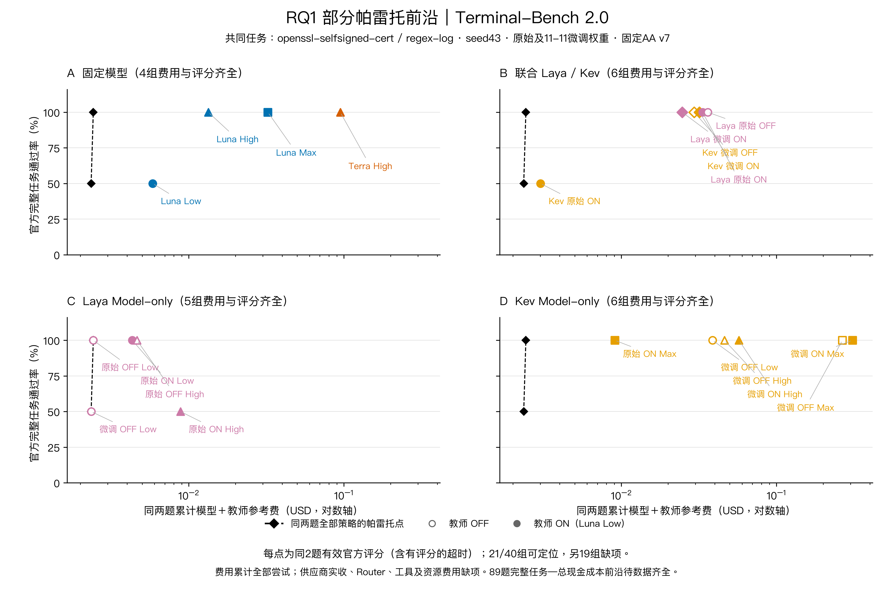

# RQ1 部分帕雷托前沿

**Single-Agent；Luna/GLM-5.3-Flash/Terra；Model×Native Effort；完整T/M/H；AA精确档位能力；缓存连续性；Luna教师；Laya/Kev原始与最终训练版；A6000原Harbor；完整任务质量—总成本净收益。**

共同任务：openssl-selfsigned-cert、regex-log；seed43；原始与11-11微调实体；AA v7。

通过率只在同两题均有有效官方Reward时计算，含有评分的超时；费用累计全部尝试及晚到响应的模型＋教师参考费。正常提交、超时与未评分分别沿原记录保留。完整现金费用缺项保持空值。

| 策略 | 有效评分 | 通过数 | 同两题Pass率 | 累计API参考费USD | 状态 |
|---|---:|---:|---:|---:|---|
| glm_low | 1/2 | 1 | 未知 | 未知 | 缺有效官方评分；缺API费用 |
| glm_high | 1/2 | 1 | 未知 | 未知 | 缺有效官方评分；缺API费用 |
| glm_max | 0/2 | 0 | 未知 | 未知 | 缺有效官方评分；缺API费用 |
| luna_low | 2/2 | 1 | 50% | 0.00584564 | 已绘制 |
| luna_high | 2/2 | 2 | 100% | 0.01336268 | 已绘制 |
| luna_max | 2/2 | 2 | 100% | 0.03233184 | 已绘制 |
| terra_high | 2/2 | 2 | 100% | 0.09478440 | 已绘制 |
| luna_xhigh | 1/2 | 1 | 未知 | 未知 | 缺有效官方评分；缺API费用 |
| laya_original_off | 2/2 | 2 | 100% | 0.03605180 | 已绘制 |
| laya_original_on | 2/2 | 2 | 100% | 0.03337800 | 已绘制 |
| laya_trained_off | 1/2 | 1 | 未知 | 未知 | 缺有效官方评分；缺API费用 |
| laya_trained_on | 2/2 | 2 | 100% | 0.02466572 | 已绘制 |
| kev_original_off | 1/2 | 1 | 未知 | 未知 | 缺有效官方评分；缺API费用 |
| kev_original_on | 2/2 | 1 | 50% | 0.00300610 | 已绘制 |
| kev_trained_off | 2/2 | 2 | 100% | 0.02944120 | 已绘制 |
| kev_trained_on | 2/2 | 2 | 100% | 0.03183710 | 已绘制 |
| laya_original_off_model_only_low | 2/2 | 2 | 100% | 0.00242127 | 帕雷托点 |
| laya_original_off_model_only_high | 2/2 | 2 | 100% | 0.00463366 | 已绘制 |
| laya_original_off_model_only_max | 1/2 | 1 | 未知 | 未知 | 缺有效官方评分；缺API费用 |
| laya_original_on_model_only_low | 2/2 | 2 | 100% | 0.00432028 | 已绘制 |
| laya_original_on_model_only_high | 2/2 | 1 | 50% | 0.00884055 | 已绘制 |
| laya_original_on_model_only_max | 1/2 | 1 | 未知 | 未知 | 缺有效官方评分；缺API费用 |
| laya_trained_off_model_only_low | 2/2 | 1 | 50% | 0.00234565 | 帕雷托点 |
| laya_trained_off_model_only_high | 1/2 | 1 | 未知 | 未知 | 缺有效官方评分；缺API费用 |
| laya_trained_off_model_only_max | 2/2 | 2 | 100% | 未知 | 缺API费用 |
| laya_trained_on_model_only_low | 1/2 | 1 | 未知 | 未知 | 缺有效官方评分；缺API费用 |
| laya_trained_on_model_only_high | 1/2 | 1 | 未知 | 未知 | 缺有效官方评分；缺API费用 |
| laya_trained_on_model_only_max | 2/2 | 2 | 100% | 未知 | 缺API费用 |
| kev_original_off_model_only_low | 1/2 | 0 | 未知 | 未知 | 缺有效官方评分；缺API费用 |
| kev_original_off_model_only_high | 1/2 | 1 | 未知 | 未知 | 缺有效官方评分；缺API费用 |
| kev_original_off_model_only_max | 1/2 | 1 | 未知 | 未知 | 缺有效官方评分；缺API费用 |
| kev_original_on_model_only_low | 2/2 | 2 | 100% | 未知 | 缺API费用 |
| kev_original_on_model_only_high | 2/2 | 2 | 100% | 未知 | 缺API费用 |
| kev_original_on_model_only_max | 2/2 | 2 | 100% | 0.00905588 | 已绘制 |
| kev_trained_off_model_only_low | 2/2 | 2 | 100% | 0.03871960 | 已绘制 |
| kev_trained_off_model_only_high | 2/2 | 2 | 100% | 0.04624140 | 已绘制 |
| kev_trained_off_model_only_max | 2/2 | 2 | 100% | 0.26640480 | 已绘制 |
| kev_trained_on_model_only_low | 2/2 | 2 | 100% | 未知 | 缺API费用 |
| kev_trained_on_model_only_high | 2/2 | 2 | 100% | 0.05734710 | 已绘制 |
| kev_trained_on_model_only_max | 2/2 | 2 | 100% | 0.30910010 | 已绘制 |
