# V9 Router 恒选 Sol、CPU 开销与接续材料：离线诊断

本轮从 main `6e4541c58443e278c72b03a3dd35d2e1441ff5b9` 接续，只分析已保存输入和源码。124 次决策全部正确映射到原生概率的最大项；没有发现强制 Sol 分支、平局或候选索引错位。能够确定的是：当前权重在这些状态下始终更偏向 Sol，而不是选择结果被客户端改成 Sol。稀疏 K=2 步骤监督、训练与运行输入变化、任务/阶段分布差异共同支持“尚未学会可泛化的动态选择”这一解释；各因素的因果占比没有实测。

同时发现两处程序问题：右截断会丢掉尾部状态字段；指定 Checkpoint 缺失时原 Adapter 会加载基座。已在原模块修正，并在原 Checkpoint 推理进程使用 `inference_mode`。没有加载 Laya/Kev 权重、请求付费 API、连接服务器、训练、运行 Episode、Benchmark 或修改 Serving。新输出概率与模型前向加速均未实测。

完整结构化数字在 [summary.json](summary.json) 的 `offline_router_analysis`；原 Episode、概率、费用与服务器快照均保留。

## 1. 实际调用路径与证据范围

```mermaid
flowchart LR
  A[mini-SWE-agent 下一次生成] --> B[AgentState 截止状态]
  B --> C[V9DecisionHook 任务与工具视图／已存能力卡／可选教师]
  C --> D[PreDecisionState.router_text 唯一 formatter]
  D --> E[CheckpointRouterClient 固定原合法候选顺序]
  E --> F[Episode 专属 SSH stdio 进程]
  F --> G[LayaAdapter.system_one]
  G --> H[原生 RLAgent 编码／collate／模型／概率]
  H --> I[choice 标签映射回同一合法动作]
  I --> J[原 Provider 实际 DeepSeek]
```

实验实际使用 `PolicyModel._query → CheckpointRouterClient.route → checkpoint.main → LayaAdapter.system_one → RLAgent.system_one`，不是常驻 Serving 的 `LayaAdapter.route`。`/route` 的 action_id 排序因此不是本批次候选顺序变化的来源。

- 每条保存记录的顺序都是 Sol、Luna、Flash；问题为 `step_model_preference`，说明来自 `MODEL_TARGETS["STEP_LEVEL_PREFERENCE"]`。CheckpointClient 按模型名保留输入顺序，以回答中的模型键取回同一动作；Harbor Agent 再确认该动作属于原候选集。
- 原生内部字段为 `t/ins/crit`，QID 自身不是模型特征。原生按 `crit.items()` 生成选项，再按同一键序把 logits 转为标签与概率。四位小数导致的概率总和误差最大约 0.0001，不足以改变最小 0.029 的领先差。
- 原生参考序列为“问题说明 → 每个候选 MASK → 状态”，候选标记位置是 `70/88/104`。三候选标记均保留，没有无效候选被固定补分。
- 124 条都报告 `V9_LAYA_STEP_001-e01` 和同一实体路径；此前保存快照确认该权重存在。当前 `checkpoint.main` 在加载前读取该目录的 training_run，原生加载采用 strict state_dict。未在本轮读取服务器实体，不以这些元数据代替字节或内存权重核验。
- 源码为本地仓库及已经引用过的 [Laya commit](https://github.com/NandhaKishorM/laya/tree/1adc59f7e371deb601fcfa18a14e25db238addcc)。实际导入名 `rl_agent_api/rl_common` 的公开原生参考来自 [HF revision](https://huggingface.co/convaiinnovations/laya/tree/7b928d828b7b0e022f929d9bd2e44165aa270148)，只下载了源码、配置与 Tokenizer，未下载模型。它不等于本轮实读服务器源码。

Tokenizer 对照使用正确的实际训练行：TinyDB k83qfoxy 的 STEP_001 行为 3707 Token、标记 70/88；新增 Schema 与 Mido 分别为 3874/3962、标记 70/88，与保存记录一致。这支持本轮离线重编码所用 Tokenizer，但不是旧服务器进程 Token IDs 已被捕获。另一 TinyDB dhlrwy9y 任务不能混作同一控制行。

## 2. 124 次恒选 Sol 的主因

所有 124 次均是严格 Top-1 Sol，无自然切换、无 fallback；Luna 为第二名 99 次，Flash 为第二名 25 次。123 种 canonical 状态中，唯一重复是 Git 教师开/关 Episode 的初始状态；任务、近期反馈、工具历史和步数均有变化。故“模型没有读取任何变化”不是现有证据的结论。

### 按任务

概率列为各任务均值；Git 合并教师开/关两条 Episode。Top-1/Top-2 差为该任务范围，所有选择仍为 Sol。

| Dev 任务 | 决策 | Sol | Luna | Flash | 差最小—最大 |
|---|---:|---:|---:|---:|---:|
| build-cython-ext | 7 | 0.389329 | 0.311443 | 0.299214 | 0.0324—0.0966 |
| build-pmars | 1 | 0.388500 | 0.322900 | 0.288600 | 0.0656—0.0656 |
| build-pov-ray | 30 | 0.397230 | 0.305293 | 0.297467 | 0.0517—0.1248 |
| filter-js-from-html | 1 | 0.391800 | 0.319100 | 0.289200 | 0.0727—0.0727 |
| financial-document-processor | 26 | 0.388658 | 0.325327 | 0.286019 | 0.0290—0.1017 |
| git-leak-recovery | 14 | 0.398321 | 0.304379 | 0.297307 | 0.0721—0.1163 |
| hf-model-inference | 8 | 0.388750 | 0.323412 | 0.287837 | 0.0308—0.1249 |
| mteb-leaderboard | 30 | 0.383483 | 0.319797 | 0.296720 | 0.0379—0.0892 |
| pytorch-model-cli | 7 | 0.438329 | 0.275943 | 0.285743 | 0.1178—0.1664 |

最接近切换的是 financial-document-processor 第15步 modify：Sol0.3821、Luna0.3531、Flash0.2648，仍非平局。全批差的最小/中位/最大为 0.0290/0.0739/0.1664。

### 按阶段、步数与反馈

阶段是原工具命令启发式记录，不是额外人工金标签。

| 阶段 | 决策 | Sol均值 | Luna均值 | Flash均值 | 差中位数 |
|---|---:|---:|---:|---:|---:|
| inspect | 18 | 0.401550 | 0.313272 | 0.285178 | 0.08885 |
| modify | 86 | 0.391727 | 0.312509 | 0.295766 | 0.07290 |
| verify | 1 | 0.391400 | 0.316000 | 0.292600 | 0.07540 |
| recover | 19 | 0.393637 | 0.314884 | 0.291468 | 0.07170 |

第0步、1–5步、6–15步、16–29步分别10/40/36/38次，Sol均值为0.401960/0.398175/0.389911/0.389566；后续概率略接近 Luna，但未越过它。最后工具退出码0/未知/1/127/2分别105/9/4/4/2次，也全部Sol。4次含教师状态的均值为Sol0.396050、Luna0.304100、Flash0.299900，不构成教师有效的因果对照。

`confidence` 为“1−归一化熵”，范围0.0029–0.0352，不是“任务成功概率只有百分之一”，也不决定客户端是否切换。程序按最大概率选择，即使归一化熵很低仍可持续选择同一模型。

### 为什么 STEP_001 后没有切换

确定事实：

1. STEP_001 从 F11 接续，encoder 冻结，只更新原共享 pointer/head 参数；72行中仅8行是步骤偏好，1轮、9次更新、head_lr2e-5。它不是用19条全部目标训练，更不是74行已训练。
2. 这8条步骤均为K=2、Sol/Luna4:4，来自公开代码修复状态。后来修正的6条比较视图、Schema/Mido两新目标及本轮布局修复都没有进入已保存权重。
3. 当前运行是 Terminal-Bench Dev、逻辑K=3，物理后端却只有DeepSeek一个。Flash没有真实选择监督；原两模型一步质量标签不能支持这一三候选分布的能力主张。
4. 现有10条步骤中verify9、recover1，inspect/modify各0；本批Dev则inspect18、modify86。步骤标签只奖励“一步后验证”，并不等同于早期检查/中间编辑阶段的长期价值。
5. 先前 [runtime_replay.json](../20261101-v9-runtime-quality-dev/runtime_replay.json) 已做过同输入换序：Sol放第二仍0.5393，放第一0.5652，均选Sol；说明顺序敏感存在，但“第一项恒选”不足以解释全部现象。本轮不再运行或调换顺序。

据此，主解释是有限 head 接续未形成对真实运行状态的动态区分能力，而不是客户端偷偷固定Sol。原权重候选先验、AA Max参考差、位置偏差及尾部截断分别贡献多少，仍需同实体离线前向或有真实标签的后续对照；不把这些猜测升级为已证明原因。本轮发现的状态丢失也只解释部分信息不足，不能解释未截断的83次为何仍全Sol。

## 3. 已修复的状态丢失

旧字符视图为6502–14018字符；原生窗口5120、head512，三候选问题占122 Token（含末SEP），状态预算4998。离线重编码得到总输入2395–5120、中位4943；41条被截断，最多丢1525状态Token。

旧 formatter 把任务ID、计数及agent_context放在详细能力卡后。字段级 offset 对照如下：

| 字段 | 修复前完整/124 | 修复后完整/124 |
|---|---:|---:|
| task_id | 88 | 124 |
| history_length | 94 | 124 |
| prior_tool_calls_count | 93 | 124 |
| prior_error_signals_count | 91 | 124 |
| agent_context | 86 | 124 |
| continuity | 123 | 124 |
| prompt、phase、step、最近反馈、三候选摘要 | 各124 | 各124 |

仅在 `format_router_payload` 中移动原字段，不增加第二种格式、删除输入值或降低窗口。124条解码JSON值全相同，候选顺序与标记全相同；字段位置改变使124条整序列Token IDs均改变，因此不能声称新概率不变。

这不是“完整历史已保留”的修复：41条总截断仍在，详细卡完整94→86，工具history完整123→121。POV-Ray第20/21/22步的history字段可见字符分别5478→4803、5543→5308、5554→5340。任务、最新512字符反馈、候选摘要、连续状态优先保留；原完整消息与工具原文没有修改。这个取舍为修复已观察到的决策状态丢失，不是通过减少输入宣称加速。

## 4. CPU 前向开销

原报告的“前向3081.16秒”计时点是 `LayaAdapter.system_one`，包含 formatted_questions、原生编码、collate、模型计算、张量转换和概率解码；没有逐层计时。

| 已保存指标 | 秒 |
|---|---:|
| Router总耗时 | 3399.845963 |
| Adapter/system_one总耗时 | 3081.157349 |
| 10次初始化合计 | 304.933696 |
| 114次复用的前向外开销 | 3.223207 |

system_one占Router90.63%，初始化8.97%。每Episode已只加载一次；把主要剩余开销再归因于重复初始化是不正确的。

| 离线重编码总输入 | 次数 | 原保存system_one中位秒 |
|---|---:|---:|
| <3000 Token | 12 | 8.614898 |
| 3000–3999 | 13 | 14.382488 |
| 4000–5119 | 58 | 27.068656 |
| 5120 | 41 | 30.062038 |

重编码Token数与原时延 Pearson r=0.986941。该关系和源码共同把主要调查方向收敛到长序列模型计算，但不是同机逐层因果测量。

原生源码 [RLAgent](https://huggingface.co/convaiinnovations/laya/blob/7b928d828b7b0e022f929d9bd2e44165aa270148/rl_agent_api.py) 已 `eval()`、`@torch.no_grad()`、CPU不启用CUDA AMP，并关闭ModernBERT reference_compile。每次一次模型调用，五个输入张量在CPU上 `.to(cpu)` 不意味着发生五次跨设备复制；logits与act输出很小。没有依据把张量转换或缺no_grad说成3081秒的主因。

[DecisionModel](https://huggingface.co/convaiinnovations/laya/blob/7b928d828b7b0e022f929d9bd2e44165aa270148/rl_common.py) 是ModernBERT编码器加两层Transformer head。head先处理整个Token序列，再gather三个MASK；它不是只处理三个候选的小MLP。全序列head注意力具有随长度二次增长的计算项，这是强候选瓶颈，encoder与head各占多少仍未知。不能删掉history/能力证据、改变attention或换模型来绕过测量。

原10个运行配置都设置OMP_NUM_THREADS=8、MKL_NUM_THREADS=8；旧进程的torch intra/inter-op实值未保存。没有线程对照，不改成1/4/80线程，也不将未测的过度线程化写成根因。

Mac同机对124个原输入，只测原生build_sequence和collate：合计402.418/56.270毫秒，版本torch2.4.1/transformers4.57.6。这不是A6000的模型测量，不能用它从3081秒中减去0.46秒，或对外报告服务器加速比。

原Checkpoint进程新增 `torch.inference_mode()`，用于这些只输出JSON、不交回训练的前向。它比no_grad进一步关闭view追踪与version计数；架构、权重、候选、概率计算和线程均未更改。由于本机无权重且Mac零权重约定保持，模型前向前/后耗时、概率相等与性能改善均为UNKNOWN。下一次获准同服务器CPU回放时，应分别测编码/collate、encoder、head与解码，再决定是否还有不改语义的重复计算或线程优化。

## 5. 19条目标与74行材料能支持什么

| 目标 | 条数 | Sol/Luna | 语义 |
|---|---:|---:|---|
| task_model_preference | 9 | 0/9 | 初始状态，双方原Verifier通过时选较低模型费 |
| step_model_preference，质量差异 | 8 | 4/4 | 同决策前缀，某候选一步后通过、另一未通过 |
| step_model_preference，等质量费用 | 2 | 0/2 | 双方该步后通过，Luna模型费更低 |

19条来自11个标签任务/10仓库，步骤来自10任务/9仓库；均为两个合法模型、requested low输入、applied Effort目标null、teacher=null。任务和步骤交集8题，其中4题的任务赢家Luna、步骤赢家Sol。这是不同验证时间范围的合理差别，不能复制任务成本标签来训练每一步，也不能据此视为同标签冲突。

74行是64条原ROUTE-004人类模型偏好加10条步骤目标；9条任务目标不参与。64条旧S1值与72行版本一致，旧候选是原历史模型、两选项，多数描述为空，不是64条新的Sol/Luna质量样本。它们用于保留原S1能力，不提供本轮状态动态知识。

当前原Trainer沿soft-ce按问题平均，无任务/步骤专用loss weight；顺序扰动已有 `shuffle_options=("choice",)`。72行的步骤占11.11%，74行占13.51%，旧S1仍占86.49%。这说明有效新目标在共享head中比例小，但不证明自动提高权重或多跑epochs就会解决问题。此次不改Trainer、loss、采样或数据。

现行Serializer离线消费全部19条，JSON值与保存视图一致；74行按修复后共享formatter重编码，总Token563–4302、中位610，全部两选项、无5120截断。只验证了原材料格式和输入保留，没有导出新74行、加工旧382行/13214候选或更新模型。

结论：74行在格式和输入长度上可用于下一次有限K=2 head接续；研究证据不足以期待可靠K=3动态收益或自动启动训练。只新增1条Luna质量、1条Luna成本，不解决inspect/modify覆盖、跨仓库泛化、真实第三模型、同模型Effort和长期任务收益。原S1 Val561项Accuracy0.6898保持，仅证明有限接续未使该旧目标准确率退步，不是动态选择的验证集。

## 6. 修改、最小检查与下一行动

| 原文件与函数 | 必要修改 |
|---|---|
| `v9/runtime/context.py:format_router_payload` | 将原动态计数、身份、agent_context/continuity移到冗长证据前 |
| `serving/laya_adapter.py:LayaAdapter._load` | 缺指定safetensors时明确报错，不再加载fallback_dir基座；该参数只定位原生代码 |
| `v9/runtime/checkpoint.py:main` | JSON-only CPU推理使用inference_mode |

缺权重回退有真实历史依据：[checkpoint_initial_failure.json](../20261101-v9-quality-step-supervision/checkpoint_initial_failure.json) 保存了基座加载约28.96秒后才因训练配置缺失退出的日志。当前124次无该回退证据，因此这一修复不能被说成恒选Sol的根因。没有新增加载器、候选校验系统或部署流程。

最小检查已实际完成：三文件语法；124条原输入前后JSON值、候选标记与字段offset对照；19条现行Serializer消费；74行输入长度；缺指定权重抛FileNotFoundError且不加载模型。未运行测试套件、新增测试文件、请求模型或改任何旧结果。离线用过的临时源码/Tokenizer将清理，不保留第二套工程。

下一行动优先级：

1. 在明确获准后，补独立Train任务的真实一步质量对照，尤其inspect/modify及失败恢复；同状态、同环境、同协议、原Verifier，两失败和未知结果只保留观察。需要能在不同状态合理偏向不同候选的真实证据，不需要人为均衡标签。
2. 同服务器CPU环境做有限旧输入分段回放和inference_mode前后输出/耗时对照；不碰GPU/F14/handoff/Serving。本轮没有该权限或同机实体，不擅自登录测量。
3. 有新质量差异后，再沿原Trainer讨论一次小规模K=2 head接续，保留S1并使用修正后的同一输入；之后用独立、非Alias、同协议完整Dev对照判断成功率与费用，而不是只看是否出现切换。
4. 真实第三模型与可确认Effort分别补真实监督。DeepSeek Alias Dev、旧TwinRouterBench四档、AA Max、未知Effort和双失败都不能补为新赢家；教师仍需独立净收益证据。

通俗地说：Router确实在算，但它每次仍把Sol排第一；学过的少量“修复后立即验证”题，无法教会它面对广泛任务什么时候换模型。本轮把被长输入遮住的状态移到前面，并去掉错误权重回退；这改善的是输入与运行真实性，不是已经获得动态收益。让切换有价值，需要先有同状态下“这里用哪个模型确实更好”的真实质量证据。

本轮发布只更新本地源码/结果/对应研究记录并定向推送main；服务器源码未同步、Serving未部署。最新服务器信息仍是2026-11-02 03:36:36台北保存快照，不作当前实时状态。
