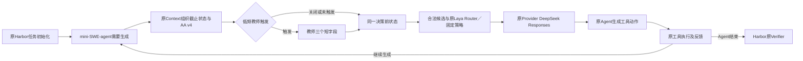

# DeepSeek Dev 批次：完整结果与训练接续

2026-11-02后续离线诊断见[Router恒选Sol、CPU与材料分析](offline_router_analysis.md)及`summary.json.offline_router_analysis`。仅复用本批输入、修正既有源码；没有重跑以下Episode、新训练或部署，原结果与快照按原时点保留。

9个公开Dev任务、19个Episode全部结束：原Harbor Verifier实际执行9次，7次reward 1、2次reward 0；另外10次终局未知。动态实验属于`ALIAS_SMOKE`，实际请求型号统一为`deepseek-v4.1-flash`。本批次取得完整运行和失败证据，未证明动态Router或教师的净收益，没有新增正式三模型训练标签。

源码接续`6d040e786d0bd95a1060f793a8e680caa7bf1a93`；原Provider接入提交`8f4ed71745b4f2c647dfb6a6794b8de0011e6189`，工具反馈及费用处理提交`d77e0673169cc122c299dfee3b4e3ca5b35d6b28`。公开结果、原规划和训练报告随本报告同步；最终提交见Git记录和本轮最终回复。

## 运行设置与结果范围

- Terminal-Bench 2.1.0，原任务源提交`7131e4375048a0e408a8fb404b5f499d726b695b`；均为Dev，不触碰Sealed Final、不进入Train。
- Harbor 0.24.0、mini-SWE-agent 2.4.6、原Docker环境及原Verifier；共同设置30步、输出4096、工具30秒，任务自身Agent和Verifier时限保持。
- 固定策略直接选择DeepSeek；动态策略使用服务器`V9_LAYA_STEP_001-e01`，候选顺序为Sol low、Luna low、Flash none。该权重只接受过K=2 Model-only步骤监督，尚无正式K=3训练目标。
- DeepSeek沿原AIHub Responses配置和原凭据引用调用。实际发送`reasoning.effort=high`，223份返回身份均匹配DeepSeek；供应商没有报告应用档位，high保持请求参数身份，不作为已确认的Native Effort。
- 三逻辑身份的请求和费用映射与实际DeepSeek身份分别保存。正式Sol/Luna应用档位未知、Flash访问缺口保持；本轮没有重复旧Flash失败渠道。

`退出`组13个Episode沿用原命令超时直接结束的处理；`反馈`组6个Episode使用本轮原位工具反馈。财务和MTEB的固定/动态策略分属两组，只保留观察结果。两组都使用30秒工具窗口和原Verifier。

## 逐任务结果

所有行的实际后端均为DeepSeek。`固定`为真实DeepSeek固定策略；`动态`和`动态+教师`均为`ALIAS_SMOKE`。工具列包含实际执行尝试与超时，去掉早期恢复记录中`episode_id="None"`的重复项；Token为输入加输出，教师行含独立教师用量。费用为模型费率估算，实收和完整资源费用另列为未知。

| 任务 | 策略 | 超时处理 | reward / CTRF通过数 | 生成 / 工具 | 已报告总Token | 逻辑映射费USD | DeepSeek参考费USD | Trial秒 |
|---|---|---|---|---:|---:|---:|---:|---:|
| git-leak-recovery | 固定 | 退出 | 1 / 5/5 | 7/7 | 23545 | — | 0.002285682 | 82.015 |
| git-leak-recovery | 动态 | 退出 | 1 / 5/5 | 7/7 | 22106 | 0.0341912 | 0.002141046 | 261.585 |
| git-leak-recovery | 动态+教师 | 退出 | 1 / 5/5 | 7/7 | 29060 | 0.0533408 | 0.003340314 | 278.958 |
| build-pmars | 固定 | 退出 | UNKNOWN | 0/0 | UNKNOWN | — | UNKNOWN | 25.626 |
| build-pmars | 动态 | 退出 | UNKNOWN | 0/0 | UNKNOWN | UNKNOWN | UNKNOWN | 52.322 |
| build-cython-ext | 固定 | 退出 | UNKNOWN | 5/5 | 25743 | — | 0.00247929 | 120.198 |
| build-cython-ext | 动态 | 退出 | UNKNOWN | 7/7 | 43750 | 0.041492 | 0.00271623 | 251.454 |
| filter-js-from-html | 固定 | 退出 | UNKNOWN | 0/0 | UNKNOWN | — | UNKNOWN | 9.213 |
| filter-js-from-html | 动态 | 退出 | UNKNOWN | 0/0 | UNKNOWN | UNKNOWN | UNKNOWN | 50.191 |
| pytorch-model-cli | 固定 | 退出 | UNKNOWN | 17/17 | 153900 | — | 0.009430446 | 169.326 |
| pytorch-model-cli | 动态 | 退出 | UNKNOWN | 7/7 | 18938 | 0.0235112 | 0.001472856 | 234.974 |
| financial-document-processor | 固定 | 退出 | UNKNOWN | 5/5 | 11044 | — | 0.000931854 | 57.512 |
| financial-document-processor | 动态 | 反馈 | 1 / 7/7 | 26/26 | 425592 | 0.3157664 | 0.018786072 | 1183.903 |
| mteb-leaderboard | 固定 | 退出 | UNKNOWN | 25/25 | 884953 | — | 0.018111612 | 306.168 |
| mteb-leaderboard | 动态 | 反馈 | 0 / 0/2 | 30/48 | 839876 | 0.350712 | 0.020329860 | 1255.525 |
| hf-model-inference | 固定 | 反馈 | 1 / 4/4 | 11/13 | 38210 | — | 0.003362478 | 196.267 |
| hf-model-inference | 动态 | 反馈 | 1 / 4/4 | 8/8 | 24440 | 0.0365312 | 0.002257476 | 286.273 |
| build-pov-ray | 固定 | 反馈 | 1 / 3/3 | 30/30 | 517303 | — | 0.012813072 | 460.218 |
| build-pov-ray | 动态 | 反馈 | 0 / 0/3 | 30/30 | 350233 | 0.1503444 | 0.009043362 | 1257.624 |

10次未知终局包括4次HTTP 502且无Usage，以及6次旧工具超时直接退出。两次有Verifier的失败均到30步上限；固定POV-Ray也到30步上限，但真实产物通过3/3，依旧按原Verifier计为成功。没有人工补产物或改分。

## 同协议对照和费用

Git、HF和POV-Ray三组具有双方原Verifier、相同任务源、Agent生成设置及超时处理。以下仅描述这三题，不外推稳定收益。

| 同一组三题 | 固定DeepSeek | 动态Alias |
|---|---:|---:|
| 官方成功 | 3/3 | 2/3 |
| 模型参考费总计USD，含失败用量 | 0.018461232 | 0.013441884 |
| 模型参考费 / 成功数USD，含失败用量 | 0.006153744 | 0.006720942 |
| 三个Trial时长合计秒 | 738.499661 | 1805.481871 |

动态模型参考费小计下降，同时少完成一题；按成功数分摊后略高，并增加大量Router时间。完整资源费用未知。财务与MTEB的处理版本不同，不能加入上述同协议比较。

| 全批策略，任务集合与可观察终局不同 | 成功 / 失败 / 未知 | 生成 / 工具 | DeepSeek参考费已知小计USD | 映射费已知小计USD | Trial秒合计 |
|---|---|---:|---:|---:|---:|
| 固定，9次 | 3 / 0 / 6 | 100/102 | 0.049414434 | — | 1426.542913 |
| 动态关闭教师，9次 | 3 / 2 / 4 | 115/133 | 0.056746902 | 0.9525484 | 4833.850880 |
| 动态开启教师，1次 | 1 / 0 / 0 | 7/7 | 0.003340314 | 0.0533408 | 278.958213 |

完整9题成功率保持未知；不能把仅已验证的3/3与3/5作为两策略总体优劣。固定和动态全组的完整模型费、完整每成功任务费用也因4次缺Usage保持未知。上表为已知小计，教师单题例外具有完整模型参考费用，但仍缺实收与资源费用。

227次模型请求中223次有Usage：222次生成和1次教师，4次失败请求缺用量。已报告输入3316883、输出91810，共3408693 Token；完整总量未知。223份均缺reasoning细项，输出按Responses原口径计一次；缓存读215份有回报、8份缺测，缓存写全部缺测。缺缓存数量保留null，相应用量在参考估算中按普通输入价计算。

DeepSeek参考费已知小计0.10950165USD；动态逻辑映射费已知小计1.0058892USD，二者是不同口径，不相加。映射按实际DeepSeek Usage乘所选Sol/Luna/Flash费率。DeepSeek采用[官方价格页](https://api-docs.deepseek.com/quick_start/pricing)同系列非高峰参考价：输入0.15、输出含reasoning0.60、缓存命中0.003 USD/M Token。本批请求时段为周日UTC，处于公开非高峰范围。官方表名称`deepseek-flash`、版本`DeepSeek-V4.1-Flash-1017`，没有核明精确AIHub型号记录及费率，因此标注`OFFICIAL_FAMILY_OFF_PEAK_REFERENCE_NOT_PROVIDER_TARIFF`。供应商实收、CPU、工具、容器资源USD与Complete Episode Cost仍为UNKNOWN。

## Router与教师的真实行为

124次服务器CPU神经决策，Sol124、Luna0、Flash0；包括两次之后遇到HTTP 502的已完成路由。阶段为inspect 18、modify 86、verify 1、recover 19，各阶段均选Sol。自然模型切换0、fallback0。每次完整概率、状态截止点和时延见[summary.json](summary.json)的`episodes[].routing_decisions`及原各Episode `events.jsonl`。

| 候选 | 概率最小值 | 最大值 | 均值 |
|---|---:|---:|---:|
| Sol low | 0.3706 | 0.4611 | 0.393443 |
| Luna low | 0.2367 | 0.3531 | 0.313012 |
| Flash none | 0.2648 | 0.3176 | 0.293545 |

沿原Adapter与SSH标准输入输出通信，每个Episode初始化一次：10次初始化、114次复用。Router总3399.845963秒，前向3081.157349秒，初始化304.933696秒；114次复用的前向外开销合计3.223207秒。旧7次路由前向外222.417776秒，新Git7次为30.822240秒，其中初始化29.923633秒。重复加载开销已实际降低，任务、候选数和并发负载不同，不作同负载前向加速主张。前向本身仍是主要耗时。

教师只在Git的第3次生成后触发一次，逻辑Sol、实际DeepSeek，三字段JSON成功。输入1509、输出614、reasoning细项缺测；映射费0.009158USD，DeepSeek参考费0.00059475USD，调用4.656680秒。短评进入后4次Router，截止范围保留，未进入Agent计划或工具命令。开关均reward 1，开启后映射总费增加0.0191496USD、Trial增加17.372801秒；包含不同后续轨迹和缓存，单题不证明稳定收益或正式Sol教师可靠性。

原三字段、两条固定成功参考、低频触发与失效机制均沿用。本轮没有新教师、重试服务或在线检索。

## 原位系统调整与实际运行

| 原对象 | 本轮必要改动 |
|---|---|
| [Provider](../../../code/src/modelrouter/providers/provider.py)与[Registry](../../../code/src/modelrouter/providers/registry.py) | 复用已注册端点和Responses，登记DeepSeek及明确参考价；映射、后端参考价和实收分开 |
| [Alias](../../../code/src/modelrouter/v9/runtime/alias.py) | 使用配置指定的原Responses/Chat入口及原凭据引用，不复制Key |
| [Harbor Agent](../../../code/src/modelrouter/benchmark/harbor_agent.py) | 固定DeepSeek接点、保留实际Provider错误；真实命令超时作为工具观察返回原Agent循环 |
| [Iterations](../../../code/src/modelrouter/benchmark/iterations.py) | 缺Usage保留未知，记录后端参考价，停止重复复制全工作区差异；原看板上传临时文件按进程区分，并保留上传错误信息 |
| [V9 Context](../../../code/src/modelrouter/v9/runtime/context.py)与[State](../../../code/src/modelrouter/agent/state.py) | 超时记录实际输出/OS退出码未知，并保存适配器错误指示，不伪造执行结果 |

原Docker.exec超过30秒抛RuntimeError，旧适配器直接结束Episode。现在只处理这条已经发生的命令超时：适配器返回`returncode=-1`及原异常，实际OS退出码和输出为null。其他终止和Harbor总时限保持。反馈组6次均执行原Verifier，其中4次成功、2次失败；固定HF两次和动态HF一次工具超时后继续，双方4/4通过；固定POV-Ray两次超时后3/3通过。全批19次工具超时均保留真实记录。

完整Agent消息、工具轨迹和/app产物沿原目录保存。SWE-bench Verified目前没有原生可运行的官方入口；本轮没有另造Harness。RQ1可记录官方成功和模型费用、资源费用仍缺；RQ2真实K=3与应用Effort、RQ3 G0–G3任务拆分、RQ4可信教师/能力卡消融、RQ5覆盖与泛化仍需后续真实研究。五RQ、八图十二表保持。

## 训练与Serving

[服务器取样](server_snapshot.json)：2026-11-02 03:36:36台北。F14独立维护PID808492仍running/COLD_START，首轮284/420块（67.62%），36352/107404步（33.85%），材料曝光2326528/6873816；最新Loss0.5028087299。首轮和固定Val未完成，不作父权重。旧NON_FINITE_LOSS归档与既有handoff817520保持，本轮没有干预。

Laya F01–F13、Kev R01–R16及既有固定Val完成，F11-e01/R11代表不变；V9_LAYA_STEP_001-e01仍为此前72行、1轮、9次pointer head更新，S1 Val561项Accuracy0.6898、Loss0.5938、Brier0.4083、ECE0.0362沿用。74行下一轮材料已准备但未训练，215/186仅为可组合视图。本轮新增训练0、Kev参数更新0，Serving仍PID327621、F05-e01/原Kev Adapter，health/models均200。

有效真实K=2 Model-only目标仍19条、11个标签任务：任务级9、步骤级10；总Sol4/Luna15，步骤Sol4/Luna6。本轮Dev/Alias不产生Train标签，确认的Native Effort和正式K=3目标均0。AA固定`20261031T072548885180Z-v4`，Sol/Luna Max各10项，Intelligence v5.0为54.5087338138148/27.7552004938153；low、none及托管Flash缺测保持，未运行刷新或把Max当low分数。独立TwinRouterBench旧八版本不重评、不用于训练或调参。

## 文件整理与下一步

公开结果只处理本轮适合公开的文本和小型任务产物。个人路径与服务器连接信息替换为原有占位符，原数字、模型身份、/app工具命令和Verifier内容保持；原Key文件、运行配置引用及用户账本不提交。大型HF模型、第三方检出和二进制任务产物保留本机，不无差别加入Git。

删除10份本轮重复工作区状态快照、5份筛选后为空的补丁副本；另5份补丁只保留本轮相关源码。副本本身未入Git，原用户文件、源码历史和真实结果均保留。Harbor已结束任务容器，当前Docker无剩余容器；本轮DeepSeek临时资料标签页已关闭，原阿里帮助页保留。原看板终局快照已同步，远端实际读到动态POV-Ray reward 0对应状态。

下一步优先取得更多独立训练任务的质量步骤差异，并降低CPU前向耗时、让真实动态Dev与固定策略形成可比较收益；随后处理供应商应用Effort证据、Flash访问和教师净收益。新训练需要真实动作目标和旧S1保留，不能用这批Alias结果或独立静态标签补答案。现有负结果、F14历史和优秀研究权重继续保留，实验权重不自动上线。
