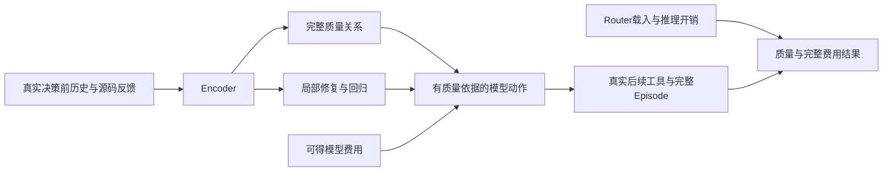

# V9：完整任务机会、选择错误与Router经济空间

## 目标及口径

继续K=2 Sol/Luna：以真实动作前状态、质量优先和费用次之进行模型选择，最终在独立完整Episode上证明包含Router开销的净收益。本批先研究完整任务，再决定新比较的用途。起点远端main为`7707186a6bba208a1330a9afec9c99a3e9d59364`；本地五个已有提交保留，没有重做旧训练、旧Val、旧Dev或既有成对生成。

源码、数据和测量明细见[summary.json](summary.json)。Provider身份是请求/返回身份，物理后端尚未独立确认；参考费不是供应商账单。单步原测试通过、完整Episode成功、模型关系正确与实际净收益分别报告。

## 一、已观察到的完整任务机会

以下是五轮真实K=2比较中的8个不同任务、24个策略Episode。23个具备原官方终局；COBOL的Luna原Verifier下载失败，没有终局奖励。其原动作重放可通过，但不将重放改称原完整Episode成功。

| 任务 | 固定Sol Reward / USD | 固定Luna Reward / USD | 动态 Reward / USD | 动态Router秒 |
|---|---:|---:|---:|---:|
| extract-elf | 1 / .03741220 | 1 / .00329197 | 1 / .03882760 | 89.814 |
| build-cython-ext | 1 / .12369510 | 0 / .00882111 | 1 / .13139580 | 343.482 |
| git-leak-recovery | 1 / .03221720 | 1 / .00367393 | 1 / .03276250 | 59.826 |
| bn-fit-modify | 1 / .03445390 | 1 / .00702773 | 1 / .04441890 | 19.046 |
| distribution-search | 1 / .01807060 | 1 / .00574064 | 1 / .01522330 | 41.289 |
| git-multibranch | 1 / .04719750 | 0 / .00519490 | 0 / .00177993 | 16.135 |
| filter-js-from-html | 0 / .02777950 | 0 / .00655687 | 0 / .02179210 | 46.833 |
| cobol-modernization | 1 / .03804840 | 未知 / .00544096 | 1 / .03480860 | 64.535 |

4个任务双方成功且Luna模型参考费较低，2个只有记录中的Sol成功，1个双方失败，1个关系未知。四项同成功的固定费用差合计`.10241964 USD`。在六个已有可信成功选择的任务目录中，固定Sol模型费`.29304650 USD`；如果预先知道每题真实结果，四题用记录中的Luna、两题用Sol的费用参照为`.19062686 USD`。这个35%左右的目录差额不包含Router开销，不是可部署选择器，也没有拼接步骤或制造新Episode。

这八题动态合计50次路由、680.960秒、切换0。所有同成功题动态都比固定Luna更贵；其中动态比固定Sol偶尔便宜，仍是同一个生成模型的轨迹、Token和缓存差异，不能归因模型选择。失败Episode的低费用不作为收益。

另外读取11-01两轮的13个既有真实记录，保留不同协议、版本、教师、失败与缺失终局。configure-git-webserver固定Sol无原终局、固定Luna缺席，两个动态Reward均0，不能形成双模型任务关系。更早的HTML动态曾3次Sol/12次Luna、切换1、Reward0，因此不能声称全部历史从未切换。更早distribution-search固定Luna为0，后来为1；COBOL也存在Luna成功而动态失败的旧记录。不同配置及轨迹的单次结果不能变成长期模型通过率。教师对照仅有少量随机Episode，未证明教师净收益。DeepSeek/托管单后端映射实验保留为通路和系统观察，不加入真实K=2互补性统计。

**判断**：存在值得验证的质量—费用机会，尤其是恢复/配置、提取与轻量数值任务的同成功低费机会，以及编译/部署任务的质量差异。不过样本有目的性，机会出现频率、同一轨迹可安全切换的具体位置、重复成功稳定性都未知。现在不能证明高频步骤路由优于更简单的任务级选择。

## 二、经济边界

必要条件是：质量满足要求时，模型调用节省必须大于Router资源费及其余增量成本。若资源单价为`r USD/小时`、Router占用`t秒`，资源部分为`t*r/3600`；总时间还要包含载入、CPU/GPU转移、锁等待、重发上下文及生成变化。

既有真实CPU新状态测量是46次前向977.766秒，平均21.256秒；较短旧输入曾测得12–13秒。载入历史测量从约28秒到约5秒，暖磁盘重载与同一进程复用不同。既有GPU暖调用完整段约1.085–1.935秒，纯前向约0.071–0.115秒，首次载入和设备转移另列。不能只用纯GPU前向抵扣完整CPU开销，也不能将GPU视为免费。用户Docker是4核/8GiB、TCG软件虚拟化，业务工具时间不代表原生GPU性能。

按现有Registry的短上下文标准参考率，Sol输入/输出为2/10 USD每百万Token，Luna为.1/.5。假设相同Token、无缓存、轨迹和质量都不变：

| 单次输入 / 输出Token | 假设模型费节省USD | 用21.256秒CPU时资源单价上限USD/小时 |
|---|---:|---:|
| 1,000 / 100 | .00285 | .483 |
| 10,000 / 1,000 | .02850 | 4.827 |
| 50,000 / 1,000 | .10450 | 17.699 |

这些是条件计算，不是账单或动态Episode测量。缓存会缩小输入差额，供应商费率也可能不同。按4个同成功任务的完整固定费用差和各自已测动态Router时间推算，允许用于Router的资源单价上限仅约1.075–5.184 USD/小时，且已假设能拿到全部固定差额、没有其他增量费。实际动态尚未拿到这些节省。

每步调用与每2/4步、仅任务开始调用的时间表达分别为`L+N*t`、`L+ceil(N/k)*t`、`L+t`。降低频率只会在“质量和后续轨迹不变”的未观察假设下减少调用开销，不能直接报告新成功率。小额短调用不适合无证据的高频CPU路由；长历史、高费用输出或自然诊断/执行阶段转折更值得研究。任务级或低频研究属于建议，未替换现行V9方法。

全部供应商实收、未报告缓存、CPU/GPU/VM美元单价及端到端完整成本仍有未知项。

## 三、整体选择错误

正式40条不是40个独立任务：步骤31状态/28任务/27仓库，另9条任务费用偏好使合并身份为29任务/28仓库。步骤质量23条是Sol18/Luna5，步骤等质量费用8条和任务费用9条全为Luna。TRA-002贡献步骤质量Sol5/Luna5；TRA-001质量13条全Sol。仓库、阶段、来源和费用类别相关，不能据此估计真实工作负载比例或唯一归因捷径。

实际步骤参考A只用23状态/20任务，完整关系B4用30状态/27任务，F2P候选进展只用11任务。9条任务费用没有混入步骤参考。旧STEP010梯度材料也不是这40条的简单合并，不能根据总标签比例认定只学习了成本多数。

已保存真实错误包括：Datumaro真实Sol独过，009/010 B4却预测双方通过并选Luna；010 F2P辅助虽识别Sol有进展/Luna无进展，仍被错误完整关系压过。pipdeptree双方通过时，010失去低费机会；009也曾以错误关系碰巧选择正确模型。Docformatter双方未完成，010预测双方完成；Setuptools双方未完成，两Encoder B4均预测Sol独过。

复用实际协议版本的旧任务留出，A009/010质量16/16，费用6/7及7/7；B4分别质量14/16及15/16、费用5/7及6/7，完整关系10/30及14/30，7个NEITHER状态都没认出。A没有完整关系输出；动作正确不能替代关系正确。这些只是Head任务留出，Encoder祖先见过旧材料，已反复研究的观察不称最终独立测试。

局部目标保留了Stingray的F2P严格修复集合和Narwhals的初始P2P恢复，确实超出原正式赢家的信息。但F2P Train只有Sol进展、双方进展、双方无进展，没有仅Luna进展；P2P仅一个Train优势，只能支持恒定先验。局部正确既不保证完整成功，也不保证动作映射正确。读取和诊断可能有后续价值，却无法由立即Verifier成功目标直接确认；多步价值仍未观察。

监督压缩局部信息、完整关系到动作的冲突、旧高频路由开销均有直接证据；Encoder不可分、6000字符摘要是主要原因、某个局部目标必然可迁移等解释仍未证明。

## 四、本批新状态与执行证据

用途、方法和输入在候选结果前确定。沿原TRA-001分片和ENV-002选择Laravel/scikit-build为Train，Telegraph/NestJS为新任务评价，覆盖PHP/Python/TypeScript；原任务均为合法L4 Train，仓库其他资格与实际祖先成员分开，未知不称绝对未见。没有按模型赢家改变用途。

scikit-build成功源码diff中的`except OSError:`被原异常正则误读为真实错误。只将异常类型冒号匹配移到真实输出行首，保留真实退出码和原测试优先规则；已用真实记录重建，未添加测试。原输入和8次预测保留；在任何候选请求前，以相同模型、相同Train、固定ridge=1补算相同四个新状态。没有重跑旧46次、旧摘要或旧阶段任务。

四任务最终恢复110条历史动作，退出码全部与原记录对应；Telegraph首次因缺Python而有5处不同，记录保留，安装原历史所需Python后41条完整对应。在线当前阶段均为Inspect，虽然前缀含成功源码写入，仍没有强设Modify。原镜像工作树恢复后索引时间信息未刷新，Laravel/NestJS初次补丁应用没有进入测试；仅在临时独立验证容器刷新原Git索引，沿相同补丁、原测试命令和Parser继续执行。

| 任务及事前用途 | 恢复动作 | 固定原范围与完整Verifier | 收费及证据用途 |
|---|---:|---|---|
| Laravel / Train | 31 | 19/19，原Verifier通过；命令走原Encryption备用范围 | 题面AWS endpoint与实际范围对应不足，不发请求 |
| scikit-build / Train | 12 | 初始3/3 | Sol两次HTTP502无动作；请求Luna返回gpt-5.6-luna，真实动作后3/3仅归于返回身份，不是目标Luna真值 |
| Telegraph / 新任务评价 | 41 | 固定唯一项1/1；完整命令exit255，另3项通过超出固定集合，存在Response::dump依赖签名冲突 | 不将固定项通过当完整完成，不发请求 |
| NestJS / 新任务评价 | 26 | 初始32/32；Luna动作后原Verifier32/32，exit0 | SolHTTP502无动作；目标Luna身份匹配，质量保留而不是新增修复 |

Sol三个失败都来自原配置唯一绑定的aihope端点；注册资料没有其他可用Sol账户，不能把Luna账户自动当Sol候选，也不改Code Generation工程。scikit仅作一次有原因的Sol补采；NestJS不同真实输入也发生同端点502，表明故障不只发生在scikit请求，具体上游原因仍未知，没有继续相同路径收费。scikit的Luna虽然可执行，但返回身份不符且参考费未知，不能计目标模型成功或合法偏好。

本批临时成对入口原以agent_error为空推断身份匹配，这与实际返回字段不一致。已从真实GENERATOR_END的请求和返回身份生成比较标志，保留原动作和Verifier事实；原prepare_comparison也沿已有结果条件拒绝显式identities_matched=false，与逐候选入口语义一致。实际scikit材料经原入口返回COMPARISON_NOT_VALID，两目标候选均UNKNOWN，没有把503/502、身份不符或局部通过制造为赢家。

相同009/010模型及固定Train参考的两套新状态前向共16次、62510编码Token、354.090秒前向、367.818秒含加载分析；GPU allocated0。真实异常文字处理前后四项原生动作及A/B4类别均不变，没有独立表示收益。新正式Train信息尚未成立，A23/B4 30/F2P 11保持，不重复相同Train拟合，不训练STEP011。新任务完整关系、正式动作及相对固定策略结果仅在真正双候选可信时计算；单方观察不计算这些正确率。

全部Docker、候选工具和原业务测试只在A6000用户空间执行。私有请求、原响应、补丁、首次错误和用量保留；结果字段、身份和费用分别处理。最终用量、独立单方评价及清理状态在summary中列出。

NestJS的实际Luna动作是运行已有Jest及ESLint，原工具exit0，报告81物理测试通过；原Parser将测试名归为固定32个ID，独立容器沿原命令和精确集合再次32/32、exit0，231.826秒。没有源码增量修复，没有初始F2P失败可供修复，不把通过数量变成新赢家。009候选完成预测Luna通过，与单方观察相符；010预测Luna未通过，与真实32/32相反，因此其B4的SOL_ONLY也与已知Luna通过矛盾。009的BOTH仍未由单方结果证实。局部F2P预测恰好相反：009误预测Luna有修复进展，010预测无进展正确。此例直接显示完成目标、局部目标和动作不能互代；正式动作及双模型关系正确率仍null，不据这一例选择父Encoder。

新5个物理请求共2次有效生成，其中只有NestJS的目标身份匹配；3个Sol502用量未知，scikit返回身份不符。已知输入68287/输出688，总68975 Token，reasoning已包含在输出、只计一次。已知目标模型参考费$0.0044017；全部总费用、异常/身份不符参考费、供应商实收、CPU/GPU/VM美元费未知。原共享用量记录已有19613311已知Token，另有未知请求记录，现有记录未达到约1亿Token提醒量，也没有设置收费上限。

所有本批容器已删除，Laravel/Telegraph原镜像及动作前快照共4标签删除，需要时可从原仓库重拉；scikit/NestJS原镜像和动作前快照共4标签保留，用于已有不完整目标身份比较，避免重恢复历史。原VM、磁盘、专用socket、权重、私人证据和用户文件保留。临时控制脚本与本批SSH控制/下载转发撤除后，原F15、队列和Serving仍运行；只提交公开结果、必要源码与有实质变化的规划。

## 五、科研决策与关联后续

本批没有形成新可信质量—费用双方向选择，新增正式偏好0，原40保持；没有可用于增量学习的新Train真值。当前不支持通过加epoch、固定009父Encoder或增加同类Head继续训练，也不运行新完整Dev。实际可执行的历史机会、经济空间、错误分析、新状态恢复、有效单方动作及评价已完成；成对质量关系受Sol上游故障和部分固定范围限制而UNKNOWN，并非技术不可行结论。原权重、健康F15/38组队列和Serving不替换。

近期优先研究长历史/高输出费用和自然执行转折，任务开始或低频选择可作为待负责人确认的粒度建议；未改变现行每步V9方法。对四个同成功任务观察到的模型差额，与现有CPU路由时间相比已足够小，资源成本可能消耗节省。这是继续K2经济研究的依据，也是不扩张昂贵盲采集的依据。模型选择不足、费用测量不足与采样不足同时存在，现有结果无法唯一归因到监督、表示或学习方法。

K=2尚需两项核心证据：事前新任务中的可靠质量—费用双方向选择，以及独立完整Episode的含Router开销净收益。RQ1仍需总体任务效果和完整费用，RQ2缺实际K3/Effort与池变化，RQ3缺粒度比较，RQ4缺系统/教师/能力卡的可信净收益消融，RQ5缺具备明确抽样口径的工作负载边界。Inspect、Native Effort、K3正式监督仍为0。

### 下一批完整Execution工作包

1. 继续当前目录和四核心规划，沿原syy身份、必要时已授权101、用户Docker及GPU锁。先根据实际端点状态恢复Sol路径；三个502为同一aihope绑定、没有登记替代Sol，具体供应商上游原因未知，不改Code Generation账户或擅自换身份。若原端点恢复，复用保存前缀、快照、工具和测试，只补缺失候选：NestJS只补Sol，不重发已通过的目标Luna；scikit需Sol和请求/返回均gpt-6-luna的有效结果，已有gpt-5.6-luna观察保留而不替代。初始范围保持，不重恢复110动作，不重算16前向。当前四任务在本报告分析后视为开发观察，不再称最终盲测试。
2. 沿本批完整任务价值分析，优先长历史/较高输出费、编译部署质量差异以及提取配置同质量机会；用原合法Train轨迹/ENV-002选择少量机制不同的新质量状态与新费用状态，结果前定Train和全新评价用途。只有动作前确有业务机会或可信费用问题且原测试可执行才请求，正常各模型一次，失败只作有具体原因的恢复。完整关系、局部修复/回归、返回身份、Token、参考费与UNKNOWN分别保留；不能按赢家挑任务或改变原固定范围。
3. 保持原009/010及A/B4/候选完成/F2P的Train、输入、ridge1在新结果前确定。新增合法Train后再作增量研究；区分独立双候选关系、单方已知约束、局部关系和最终动作，相比固定Sol/Luna分别报告质量与费用方向。只提升局部或单候选输出而未改善动作，不称条件选择进步。已有观察不选超参数或父Encoder，数据不足时结束同类训练分支，不叠加epoch或Head。
4. 仅在具体假设得到Train及独立方向依据时沿原Trainer研究一个主要因素；Serving不自动替换。仅当同一事前方法在新质量及等质量低费任务有可靠双方向信号，才使用新任务、原Harbor镜像与官方Evaluator三策略全Episode，记录Reward、实际切换、所有Token、Router载入/推理/锁等待、CPU/GPU、墙钟和完整费用未知项。没有该证据不扩正式Dev；任务级/低频改变须先经负责人确认，保留每步V9对照，不能用条件时间表达代替真实收益。
5. 将K2的可靠独立选择和完整净收益接到RQ1总体、RQ2模型池及原生Effort、RQ3任务拆分、RQ4动作/信息/合法监督系统消融、RQ5事前工作负载边界。已有Inspect、Native Effort和K3正式监督为0的事实保留。只更新有新增证据的原结果和规划，定向main提交推送；保护原38组队列、Serving、权重、用户改动及私人账本，收尾只清理本批无用途临时对象。付费普通授权沿用，预计约1亿Token时提醒，不建立周期任务或额外工程流程。
