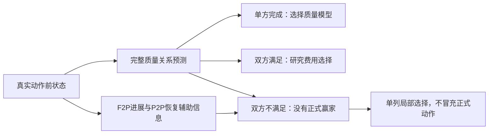

# V9：质量关系与最终动作的真实边界

## 目标和范围

继续 K=2 Sol/Luna：根据真实动作前状态，质量优先、费用次之，并在独立完整 Episode 中证明包含 Router 开销的净收益。本批起点 main 为 `e7eda8609aa7d3226386000b430f824fedd9006d`，原正式偏好40条。既有五个 Modify、110条原动作、四组比较、STEP009/010训练和旧 Dev 没有重复。

复用 TRA-001 已存分片、资格索引、ENV-002、原 Provider、Prepare、Torch 参照与上游 Evaluator。全部容器和业务测试在原 A6000 用户 Docker 中执行；Mac 仅控制、源码和分析。原 F15、38组队列及 Serving 不动。

## 新状态与独立性

10项候选用途在模型结果之前确定，6项 Train、4项仓库留出，不按赢家改变用途。当前阶段是9 Modify、1 Recover，来自截止前已观察的工具反馈；Recover为WTForms。原失败文本与原测试ID相符，不意味着最后一次写入后故障仍然存在。固定已全过且无增量问题的状态不收费。

完整身份、版本、许可、截止、原 F2P/P2P 和用途见 [source_selection.json](source_selection.json)，原环境结果见 [state_analysis.json](state_analysis.json)。10个当前任务均为合法L4 Train。GraphQL/Behat仓库的已存资格只有L4 Train，Nock的Train也仅L4但另有Val/Test；其余仓库存在L1–L3 Train资格。仓库资格、祖先Encoder实际成员、当前STEP显式成员和未知基座预训练分开记录。资料不完整不等于绝对未见。

Docformatter虽未进入旧STEP显式材料，同仓库另有L1/L2/L3 Train记录，实际祖先成员未知。因此该事前留出可用于任务级观察，不能称为已证明全模型未见仓库。已查看结果后，后续视为开发观察。

## 原验证与成对结果

GraphQL原日志有明确断言失败，但原`parse_log_js_4()`的失败符号表没有日志使用的`✕`，其固定ID为MISSING；不替换原Parser或制造质量标签。Nock原Parser未把多行Mocha失败标题映射为固定ID，且真实故障包含2秒超时。Superjson日志是700ms性能断言在TCG中测得2942ms，原Parser同样缺`✕`。两种问题同时存在，不能把这些结果当可学习的模型能力。

Behat原镜像缺原历史使用的python3，七次写入退出127；仅在自己的任务容器补原依赖，恢复后88/88，未生成。FastMCP固定4/4且实际额外收集7项全过；保留上游完整passed集合不匹配，不借额外ID制造剩余故障。

Docformatter初始54/55：目标F2P已经通过，剩余的是旧P2P `test_format_docstring_should_ignore_multi_paragraph[args0]`。Sol/Luna同前缀、同文件系统、同Shell工具、独立候选容器，原55项固定测试不变，教师关闭。最终双方均54/55、无源码修复、无P2P恢复、无F2P/P2P新增回归，完整关系NEITHER、局部NO_LOCAL_IMPROVEMENT，原Prepare返回NO_VERIFIED_ACTION。没有正式赢家，正式动作正确率为null。

Sol第一次HTTP524无结果，保留UNKNOWN；已有注册端点的定向补采HTTP200，复用原状态快照和已完成Luna结果，没有重发Luna。一次端点ID写错在HTTP前失败，和先前三次构造失败均单独保留。两次有效请求身份均匹配，终止原因为tool_calls。Sol动作是执行诊断/测试，Luna动作是读取/编译；有效生成与当步修复是不同事实。

实际每候选和局部集合见 [local_evidence.json](local_evidence.json)，全部收费调用与未知费用见 [summary.json](summary.json)。完整请求、模型响应、工具输出和原测试日志只留私有目录，不上传。通过原上游固定范围的一步比较不是新的官方完整Episode或Reward。

Setuptools的动作前原47项首次受下载网络影响为43/47、3项MISSING；同版本、同固定ID、同命令经临时代理恢复后46/47，唯一失败为F2P `test_debugging_tips`。Sol首次524无动作，随后仅补一次有效请求；已保存Luna动作不重复生成。最终双方均46/47、同一F2P未修复、P2P46项保持、无新增回归，原Prepare返回NO_VERIFIED_ACTION。两候选都有有效工具动作，但均未改变源码。原传输失败、局部UNKNOWN和初始网络结果另存，不能用它们制造质量失败。

| 新状态及事前用途 | 动作前原固定范围 | Sol | Luna | 完整关系 | 局部结果 |
|---|---:|---:|---:|---|---|
| Docformatter，留出 | 54/55，旧P2P失败1 | 54/55 | 54/55 | NEITHER | 无恢复、无回归 |
| Setuptools，Train | 46/47，F2P失败1 | 46/47 | 46/47 | NEITHER | 无修复、无回归 |

DBT-BigQuery补选状态53/53，XKNX15/15，WTForms3/3，Behat88/88，FastMCP固定4/4；均无增量质量问题，不收费。10项中7项初始Verifier可信、3项UNKNOWN。6个物理请求为4次200、2次Sol请求524；另外4次HTTP前配置错误单列。4次有效生成共176838输入、557输出（已含84 reasoning）、177395 Token，参考费0.2183648 USD。两次524用量、Sol缓存、供应商全部实收及资源USD仍未知。返回身份相符只证明API身份，物理后端仍未独立验证。

## 三种目标与最终选择

继续保持完整质量关系、局部F2P/P2P集合和正式动作三种语义。A只预测正式赢家；B4预测完整关系；每候选完成与F2P进展分别拟合。UNKNOWN不编码为失败。NEITHER没有正式动作真值，局部优势只单列一致性。

本批最小参照把预测的完整关系先用于动作：Sol独过选Sol，Luna独过选Luna，预测双方满足要求时采用已有较低模型费率的Luna。预测双方不满足时，才单列每候选F2P进展可支持的局部动作；没有进展差异则无局部动作。这是研究输出，未替换在线Router，不是长期通过率或完整成功承诺，也没有用实际候选动作后的机会集合作输入。

旧Datumaro的010辅助目标正确预测F2P进展为Sol有/Luna无，但B4错误预测BOTH而选Luna；旧辅助输出本来没有参与最终动作。本批把质量信息用于一个明确分支，仍不能用不可靠的完整关系消除这种冲突：错判候选完成会使局部信息不进入该分支。任意阈值或经验总分没有依据，不能据辅助预测正确宣布整体路由正确。

使用同一固定ridge=1、相同合法Train，无Dev/Test调参、无神经梯度更新。原A23状态/20任务，B4 29状态/26任务，F2P候选进展10状态/10任务。每次排除一个任务的全部截止点，不随机拆同题。

原A的16条质量是Sol11/Luna5，7条等质量费用全为Luna；9条任务费用没有进入本批步骤参照。B4为Sol独过11、Luna独过5、双方通过7、双方未完成6。F2P辅助的双候选真值只有双方有进展2、双方无进展4、仅Sol有进展4，仍没有仅Luna有进展的Train信息；不把完整质量中的Luna赢家直接当成已记录的局部修复赢家。分布见 [learning_analysis.json](learning_analysis.json)。

训练内固定参照拟合也单列：A为009 22/23、010 23/23，B4两者均18/29，候选F2P联合判断5/10、6/10。B4与辅助目标在训练内都没有达到完整拟合，因而不能把全部负结果直接归为独立泛化问题；目标可分性与固定拟合方法仍需区分。没有据这些数字改变参数或启动神经训练。

| 旧Train按任务整体留出，状态数口径 | 009 | 010 |
|---|---:|---:|
| A正式动作 | 22/23 | 23/23 |
| B4完整关系 | 10/29 | 15/29 |
| B4有正式赢家的动作 | 19/23 | 22/23 |
| F2P双候选进展联合判断 | 1/10 | 4/10 |

这些Encoder含旧训练暴露，Head任务留出不等于全模型跨任务泛化。A高动作成绩同时伴随关系错误，不能代替完整质量判断。固定Sol/Luna、新Train拟合与事前留出分别汇总在 [model_evaluation.json](model_evaluation.json)；实际协议文本重放在 [model_evaluation_runtime.json](model_evaluation_runtime.json)。原生Head和A的完整关系正确率不适用。

最终加入Setuptools这一合法Train的NEITHER及F2P双无进展观察后，A仍23状态/20任务，B4为30状态/27任务，F2P为11状态/11任务。没有将Docformatter留出加入拟合。名义low卡的B4训练内009/010均18/30；F2P联合均6/11。按任务整体留出：B4关系10/30、15/30，正式动作19/23、22/23；F2P联合2/11、3/11。实际协议输入的对应B4关系10/30、14/30，正式动作19/23、21/23，F2P联合0/11、3/11；两种输入不能混算。

两Encoder的B4及每候选完成方法仍未认出Setuptools真实NEITHER。名义卡下，新增Train使两者的Setuptools F2P辅助输出变为正确的[0,0]，但这是参与拟合的状态，完整关系和最终动作没有相应正确真值。Docformatter留出的关系与局部动作不因该新增Train改善；它没有初始F2P机会，不能给F2P辅助正确率填分。P2P轴仅有Narwhals一个旧Train优势观察，只能输出恒定类别，Docformatter的真实EQUAL不支持该预测。没有新的独立质量赢家、费用机会或局部严格优势，正式动作正确率仍null。

## 实际输入差异

初始8状态及补充2状态卡没有requested low，合计20次CPU前向只保留为初步输入研究；后续按实际合法low卡完成10状态20次CPU前向，结果前快照见 [pre_outcome_requested_low_predictions.json](pre_outcome_requested_low_predictions.json)。

随后读取真实ROUTER_END发现：离线Prepare保留原首个user题面，Native开发入口改用原problem_statement加真实CWD；Hook还写入已完成生成计数、空continuity和feature状态。额外只做Docformatter/Setuptools/DBT三个状态6次CPU前向，并复用其余缓存，不重做20次。Docformatter与记录的实际router_text完全相同；其重放在Luna结果之后，不能称事前盲预测。两个新Train构造在候选结果前保存。

Docformatter原生009/010都从Luna变Sol，009 B4从错误Sol独过变为正确NEITHER，010仍错误BOTH。双方真实均未完成，没有正式动作真值，没有修复或费用收益；这一观察不能证明表示泛化改善，也不足以归因到某个字段。没有改Context/Prepare生产表达，没有重复256/1024摘要研究。

全部本批前向为20初步+20low卡+6实际协议，共46次、177138个本地编码输入Token、977.766秒纯前向；载入另列 [cpu_resources.json](cpu_resources.json)，GPU allocated为0。初步构造错误及其CPU耗时没有隐藏，也不混入付费生成Token。

## 源码、训练与完整任务判断

原`prepare_local_quality_relation()`面对Provider无结果的空测试映射会读取不存在的字段。本批在原入口三处读取改用get，缺失项进入UNKNOWN；已由本批真实无结果与有效双候选数据执行，不新增测试文件。正式Prepare本来拒绝不可信比较，保持该定义。

原固定拟合在P2P轴只含一个Train观察时，中心化尺度为0，产生NaN却被argmax当作Sol输出。本批把标签与先验计算移到前面；所有Train标签相同时直接返回岭回归的恒定先验解，不改变有类别差异的原拟合、ridge或目标。最终真实数据重算已无非有限分数。40个事前轴输出的原NaN记录私下保留，公开快照改为不可评价；恒定标签输出不是已学到状态区分。

未取得足以支持新神经训练的独立信息前，不启动STEP011、不更换Serving、不重复旧Val或Trainer。没有同一事前方法在真正新任务中同时证明质量方向与等质量费用方向，更没有优于两个固定策略的完整净收益；不运行新完整Dev。负结果不等于技术不可行。

两组可信结果和固定参照研究已完成，适用工作没有留待下一次继续。已删除本批任务容器、12个无后续用途镜像、客体临时补丁、临时控制脚本、CLI代理及Mac转发；原用户Docker容器0/镜像0，VM和专用socket保留。原F15、38组controller及Serving现场仍运行，Laya/Kev loaded、healthy，没有替换权重或中断健康计算。私人账本只更新本批对应行，原生成阶段事件保留；不提交账本、请求或用户其他改动。

K=2仍缺可靠独立双方向条件选择与含Router开销的完整净收益两项证据；V9五RQ还缺整体效果、模型池、任务拆分、系统消融和工作负载适用边界的相应完整任务数据。Inspect、Native Effort、K3正式监督仍为0。后续关联范围见 [next_execution.md](next_execution.md)。
