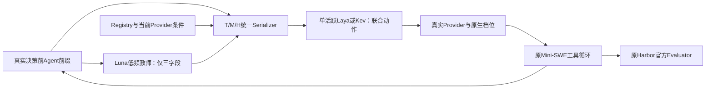

# V9完整输入、联合监督与Terminal-Bench 2.1执行

## 研究目标和结果性质

真实Luna/HY4/Terra池，联合选择模型与原生档位；以任务质量优先、同质量参考费用次之，最终要求独立完整Episode包含Router和教师开销的收益。本批原位补齐方法，进行真实Train比较、原Trainer更新和官方完整任务对照。任务执行成功、输入可编码、训练更新和动态收益分别报告。

事前选定regex-log、sqlite-db-truncate、openssl-selfsigned-cert三个正式评价任务；没有参与梯度、校准或参数选择。它们是小规模正式子集，不能估计整个Benchmark稳定成功率，也不能证明祖先预训练从未接触其知识。固定high跟进和Kev CPU部署接续是明确标注的后续对照，不重新称为未查看评价。

## Fig.2输入与实际执行

| 信息 | 当前实现 | 实际语义及限制 |
|---|---|---|
| 任务和目标 | `agent/state.py`、`runtime/context.py` | 原任务文本与真实阶段；任务摘要有字符范围，不等于完整原始题面/历史 |
| Agent和协作 | 原Harbor入口的`agent_state` | 单Agent职责、框架及当前任务；真实子任务/交接不存在时不适用，历史未报告项保持未报告 |
| 执行进度和预算 | 原State、Schema | 已执行生成、剩余步数、墙钟/剩余时间；0费用上限表示无限额，None表示未知，不当成余额0 |
| 模型身份和能力 | 原Registry、Features、Provider | 三模型树形卡；身份、协议、版本、工具/模态、容量、证据来源；缺测档位没有复制模型级成绩 |
| 档位和经济条件 | 原LegalAction、Checkpoint | Luna/Terra各6登记动作，HY4一个默认动作，共13；实际条件按Provider、工具与容量筛选，未测不冒称已确认 |
| 工具和恢复 | 原Context及Mini-SWE反馈 | 最近真实命令、退出码、测试错误、成功写入、已发生修改和生成摘要；没有注入隐藏Verifier、未来补丁或候选结果 |
| Context与缓存 | 原DecisionHook、Provider Usage | 当前前缀连续性在本次选择前计算；上次请求/返回、档位、端点、真实缓存/Token/费用进入历史；当前命中只在请求后更新 |
| 轨迹教师 | 原Trigger、Assessor | Luna low、原两条合法Train参考、低频自然触发；只输出进度/主要障碍/下一里程碑，不执行工具、不选择模型 |

Luna/Terra实际采用Responses，HY4采用Chat Completions且不传OpenAI式档位参数。HY4和hy4-preview按负责人确认的同模型渠道别名处理，原返回名称仍保留，物理权重未经独立验证。当前HY4多次502及一次短请求诊断均失败，没有新增有效质量结果，不归为质量失败。

原Provider曾把保存轨迹的`reasoning_content`直接传入Responses，错误体明确指向`input[3].reasoning_content`。现在普通消息只发送合法role/content，工具调用保持原协议。通用Provider的`generate()`也按实际返回协议读取内容，解决Train教师收到Responses后读取Chat字段的KeyError。原400、教师失败和未知用量均保留，没有重复有效候选生成。

原Laya/Kev Adapter记录实际Tokenizer的T/M/H/教师字段位置。保存状态共8项编码；本次18训练记录共36项原生编码，最长5515状态Token，8192窗口内无截断。真实新Luna教师输入另由F05/R11原生前向验证三字段保留；教师为空的编码不算教师成功消费。字符摘要之前省略的原始细节不由字段FULL证明完整保留，也不据此认定泛化改善。

窗口按实际实现区分：Laya正式序列限8192；Kev原`admit()`严格使用65536状态Token，基座位置上限262144，不能把Laya的`router_max_len`当Kev的已执行窗口。原始Kev完整请求最大记录8925 Token，三组及教师均FULL；这是实际原生容量，不是截断后的8192。Kev现额外返回原Encoder的`state_tokens`、`state_limit_tokens`与`state_truncated`，不改变输入或已运行协议。两Trainer仍使用事前8192训练状态范围。

原Serializer已提供`disabled_information_groups`（T/M/H）输入遮蔽，主方法为空集合、输入文本不变；教师关闭继续沿原`teacher_enabled`。未来同权重消融复用同一路径，M遮蔽不删除输出所必需的联合动作ID。本批未运行这些遮蔽臂，不计作RQ4消融成绩。

## 合法Train监督

沿TRA-001既有Train身份与保存轨迹，使用Dynaconf和Hikari原镜像、源码版本、固定F2P/P2P及原Tester。轨迹CC-BY-4.0、仓库MIT；此前仓库和训练暴露记录保持原身份，不称两个全模型未见仓库。

原Dynaconf71条及Hikari11条工具动作恢复后，可信原集合分别29/30、410/411。Hikari先前测试补丁未应用与安装环境scope错误的过程保留；使用原base测试与原install_config环境语句后才计入可信结果，没有改断言。

本批正常原截止每模型/档位各一次。四个有效GPT候选在两题均没有一步修复。然后每题只追加已保存的首个Luna-low动作和真实工具反馈，未追加隐藏Verifier信息；新截止仍属于相同Train任务，不当成独立任务。原阶段Modify，追加后Dynaconf为Verify、Hikari为Recover，未强设阶段。

Dynaconf追加截止Luna low及明确xhigh均30/30，Terra low/max均29/30；Luna请求max也30/30，但返回xhigh，作为档位不符观察，不用于max标签。Hikari四候选均410/411，没有F2P修复、P2P恢复或新回归。

明确xhigh的参考费$0.00134336、缓存读取62976；low为$0.00653470、缓存0。标签按原固定集合均过后的实测参考费用选择xhigh，不声称更高档位的名义价格更低，不能排除缓存和实际生成长度影响。Max返回xhigh的两条观察从正式档位目标排除，原结果保留。

使用原`prepare_record()/prepare_comparison()`得到2条S1：一次已观察候选的联合选择、一次Luna low/xhigh档位比较；两条来自同一个任务和同一个截止，不是两个独立赢家。16条旧合法S2/S3辅助记录只重编码、不改变标签。旧40条Model-only偏好不转成新K=3标签，未执行动作UNKNOWN；HY4及其余档位无联合最优监督。

Train教师从准确47次生成截止恢复，三字段源于该前缀及原参考，未向教师提供候选结果；进入这两条S1的同义Router输入。历史辅助教师有其他模型身份，不冒称全为新Luna教师。

## 原Trainer与正式完整结果

两架构事前固定原始父实体：`models/laya-421m`和`models/kev-4b-adapter`，没有根据正式Reward改选F05/R11。原Trainer只做一次epoch、18条记录；Laya更新Head、Encoder保持；Kev沿原LoRA和pointer Head。训练原始权重、Serving和F15恢复实体均保留。

Laya已实际完成18次更新、平均训练loss1.157084、CPU墙钟546.828秒，保存`runs/V9-K3-LAYA-20261107`。没有校准或评价切片，训练loss不解释成泛化。原Trainer导出预置辅助问题时提示不同定义；正式运行仍显式提供本次联合问题和候选。

Kev也已完成18次更新，03:51保存`runs/V9-K3-KEV-20261107`的LoRA及pointer Head；CPU训练8495.464秒，43213前向Token，18条无截断、拒绝0，峰值RSS158022168576字节（147.17GiB）。该研究实体已真实加载执行三题，没有用正式结果选权重或替换Serving。两架构的原始与更新版本均实际执行，不再以训练进行中描述Kev。

Kev原8线程协议出现300秒路由超时；不是任务质量失败。一次相同保存输入测得8线程前向252.066秒、40线程120.084秒，选择都为Luna high。因此原始与训练Kev接续完整对照采用相同40线程、原300秒窗口；8线程失败另列，不与40线程拼成统一成功率。训练仍保留事前8线程配置，不中断正在计算的Worker。

完整数值以[Episode结果](episode_results.json)、[Train观察](train_observations.json)、[联合监督](joint_supervision.json)、[编码](training_encoding.json)及最终摘要为准。每项是原Harbor完整真实轨迹，不拼接固定模型步骤。

固定Luna low在三题为0/1/1，Terra low为1/1/1；HY4三题UNKNOWN。原始Laya三题1/1/1、14次全部Luna high、模型/档位切换0。跟进固定Luna high也三题1/1/1，三题模型加教师参考费合计$0.00678068，原始Laya为$0.01057712并有314.025秒Router调用；没有由此取得动态分工或总成本收益。

训练版Laya的证书题出现Luna high→Terra high真实切换，原Reward 1，模型加教师参考费$0.00997820。相同保存决策前输入交给原始Laya也选择Terra high；两个输入均6398状态Token、三组及教师FULL。因此不能把这次切换说成本次训练新增能力。固定Luna low/high也通过该题，切换的必要质量收益未证明。SQLite首次训练版Episode因TLS EOF缺Reward，原有效动作和未知用量保留；仅一次完整网络恢复对照，不拼接轨迹、不将第一次计成0。

原始Kev CPU40的regex原Reward为0，但APT仓库502、curl及uvx缺失，原业务测试未执行，可信业务结果为UNKNOWN；原值不改。SQLite原pytest真实执行1项失败，原因是`/app/recover.json`不存在，保留业务失败。两者不能合成两个模型质量失败，费用分析仅使用原CTRF确实执行且通过的终局。

regex已在原镜像重放已保存的四个工具动作，并由原Harbor Verifier取得1/1通过。恢复保留原HTTP软件源、原断言，没有新的模型请求；此前恢复编排缺日志目录、CA缺失与依赖超时记录仍在。这是保存终态的恢复验证，不是新的完整Episode，也不将原环境UNKNOWN改成成功。原始Kev CPU40证书原CTRF为6/6通过、5次全Luna high，仍无跨模型切换。

训练Kev三题于04:51结束，原Reward依次1/0/1。regex及证书原CTRF分别1/1、6/6通过；SQLite下载curl遇APT502，uvx未安装、业务测试未执行，因此可信业务Reward仍null。12:41将SQLite保存终态的原动作在同镜像重放后，原Harbor Verifier为1/1通过；没有新模型请求，原0及环境UNKNOWN保留。[此恢复](verifier_recovery_sqlite.json)与原始Kev regex恢复各自单列。

| 策略 | regex原可信结果 | SQLite原可信结果 | 证书原可信结果 | 三题模型＋教师参考费 |
|---|---|---|---|---|
| 固定Luna low | 0 | 1 | 1 | $0.01305303 |
| 固定Terra low | 1 | 1 | 1 | $0.07365440 |
| 固定HY4默认 | UNKNOWN | UNKNOWN | UNKNOWN | UNKNOWN |
| 原始Laya | 1 | 1 | 1 | $0.01057712 |
| 更新Laya原尝试 | 1 | UNKNOWN：TLS EOF | 1 | UNKNOWN，已知小计$0.01329922 |
| 原始Kev CPU40 | UNKNOWN：APT502 | 0：业务测试失败 | 1 | $0.00698546，含未成功任务，不作节省 |
| 更新Kev CPU40 | 1，Agent超时 | UNKNOWN：APT502及Agent超时 | 1，Agent超时 | $0.06500900，含未知任务，不作节省 |
| 固定Luna high跟进 | 1 | 1 | 1 | $0.00678068 |

Laya SQLite完整网络恢复单独Reward1、$0.01444324；不是原尝试的一部分。Kev两个终态恢复也不进入上表的完整Episode成绩。所有数值是单次真实轨迹，不合并成统一Checkpoint/协议的总体成功率。

更新Kev有效生成15次：Terra high11、Luna medium3、Luna xhigh1，实际跨模型切换4（regex2、SQLite2、证书0）；原始CPU40有效13次全Luna high。另有3次Router在Agent取消后才返回，没有发送生成请求或执行工具。这3次不是实际动作选择，但其耗时仍计入真实资源开销。18次返回路由累计2726.638秒，三题均触及原900秒Agent上限；原始CPU40仅SQLite触及该上限。官方超时终态Reward1不表示Agent正常提交完成，也不据训练Kev的regex1与原始环境未知推导质量提升。

本批已清理Laya Trainer额外生成的`checkpoint_latest`重复目录；最终研究实体已真实加载并完成正式任务，原始版与Serving实体仍保留。移除的重复文件可从最终研究目录重新生成，不涉及F15恢复文件或其他训练。

## 费用、限制与科研判断

费用分执行模型、教师、Router和VM；reasoning已包含于completion时只计一次。真实缓存读取、缺失写入、当前前缀重合和物理KV共享分别记录。已知参考费保留数值，失败请求Token、供应商实收、CPU/GPU/VM美元费仍未知；未成功调用写出的Token0不是实收0。

本批固定策略也沿共同配置调用教师，但固定策略不消费教师进行模型选择。它们的实际教师费用单列，不能把固定策略无需承担的教师开销当作动态收益；经济表另给已观察固定生成组件的差额，不称为真实教师关闭Episode。后续完整净收益主比较应采用固定策略必要成本，并用真实教师关闭臂研究教师贡献，不能只从当前账目相减推断新的轨迹、质量或缓存效果。

三个Train教师KeyError的成功上游请求，已用原账本的唯一请求时间与延迟对应恢复23828 Token、$0.00252720参考费；不再把这些已知部分说成未知。教师解析结果仍为失败，账本恢复不是新的教师生成或质量标签，其余失败用量保持未知。[恢复数值](teacher_usage_recovered.json)只公开汇总，不公开原账本。

本批28次完整Episode尝试（包括跟进与恢复臂），19个原CTRF业务终局、4个Provider未知、3个单次CPU路由超时、2个环境未知；其中4条轨迹同时有Agent总时限事件，不能只按Reward忽略超时。135条已保存请求计量含757370输入、53243输出（含reasoning）、344491已报告缓存读取，模型和教师已知参考费小计$0.20621875；Train17个有效生成另708249输入输出Token、$0.29017668。上述分项不包含所有诊断和Train教师，不能冒称本批全部实收。原累计账本至04:45记录21847284已知Token及102条用量未知；未知预留是估算，不当实测用量。

更新Kev的证书题同可信质量下$0.02488970，固定Luna high为$0.00114452；regex为$0.02052580对$0.00301780。即使暂不计资源美元费，这两项也没有参考模型费用优势。Laya更新版regex单次参考费较低，但其余题不形成同一策略的稳定双方向优势，不能由单条低费推出独立迁移或净收益。

本批实现并实际消费了完整三组语义，取得有限的真实模型/档位质量—费用监督并进行了原训练。它尚不能代替独立可迁移双方向选择。单一Train机制、小样本、HY4不可用、完整任务单次轨迹及CPU运行成本共同限制结论；没有足够依据唯一归因到监督、Encoder、教师或状态信息。

RQ1仍需完整有效K=3、更多事前任务和总资源费用；RQ2缺模型/多档位可比质量曲线；RQ3没有新任务拆分或低频臂真实结果；RQ4本批只提供原始/更新对照，T/M/H、教师和S1/S2/S3的正式消融矩阵未完成；RQ5缺足够独立分层任务。原每步协议保留，不以减少离线调用次数声称低频净收益。

原38组仍25完成。F15之前沿原Controller/GPU锁接续后，10:44游标80124、10:47 run报告80252，并记录`BrokenPipeError(32, 'Broken pipe')`、Worker返回120；该次退出有直接错误依据，关闭输出管道的外部来源及更早退出原因仍未知。可恢复`checkpoints/epoch_01`仍61180，80252不当落盘进度。

本次接续将原Controller标准输出直接追加到原`continuous_queue.log`普通文件，并保持原GPU锁和原38组范围、无新托管或周期任务。启动时误将虚拟环境Python符号链接解析成系统解释器，发生`ModuleNotFoundError: torch`、没有训练更新；错误保留，仅停止这个错误Controller后改用原虚拟环境路径。当前已确认`EXACT_RESUME`从61180接续并产生61820新计算游标；原始/研究权重、F15优化器、ComfyUI及Serving未替换。最新状态另见[原训练记录](original_training_status.json)。

收尾时用户Docker容器0、镜像20；正式三题、两Train原环境及四个截止快照供关联研究保留。无用途cancel-async-tasks镜像、完成的一次性恢复/启动脚本及本批Mac Docker/代理隧道已删除或停止；脚本可按原实现和私有记录重建，未删除生成、验证、账本、权重、VM磁盘或其他用户资料。
