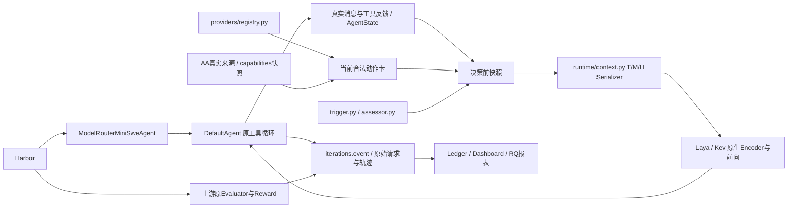

# V9 单 Agent 重构与 GLM 迁移结果

## 一、整体科研目标

负责人正式要求保持：真实 K=3 `gpt-6-luna / glm-5.3-flash / gpt-6.1-terra`，研究 Model×Native Effort 联合选择、T/M/H、AA 精确档位能力、实际缓存读取、前缀连续性、模型切换成本、Luna 低频教师，以及 Laya/Kev 原始与选定训练版的完整 Agent 质量—总成本净收益。

当前只研究 Single-Agent。RQ3 已改为单 Agent 的任务阶段、真实子任务边界和路由决策粒度；多 Agent、角色协作、委派和 handoff 正式取消。`inspect/modify/verify/recover` 只是观察到的阶段，不表示已经实现任务拆分算法。

本批已完成主要源码收敛、GLM授权接入、AA与原生输入工作，并新增10个真实Harbor尝试。11-08接口定位进一步确认GLM正常接收和生成；本地180秒等待过短、长度耗尽误归为空响应两处已处理。完整科研仍未完成：GLM任务生成的推理预算、实际返回档位、Luna Max身份、新池合法训练、最终四实体比较及完整任务净收益尚缺证据。

## 二、真实进度与唯一职责

| 原重复位置或混合职责 | 当前唯一实现与处理 |
| --- | --- |
| 旧 `agent/agent.py`、Agent Pilot runner、开发执行命令 | 正式只走 `benchmark/harbor_agent.py → DefaultAgent`；旧 SingleAgent 移至 `agent/legacy.py`，无正式调用，Ledger 仅用于类型引用 |
| 原生 mini 中继与重复模型费用注入 | 正式 CLI 不再提供另一条 mini/自定义 Agent 路径；删除 `native_generator_relay`，保留官方 Oracle 工具用途 |
| Agent 状态、训练前缀、Serving 各自编码 | `AgentState` 持有生成顺序与时间；`compact_router_state` 建立观察摘要，`PreDecisionState.router_text()` 调用唯一 Serializer；训练前缀复用同义重放 |
| 另一个模型注册 JSON、旧 Alias、新池硬编码 | `providers/registry.py` 登记身份、协议、档位、容量、模态与费率；AA 查询目标及合法动作由它派生；旧 Alias 源码和配置删除 |
| Provider 传输、解析、模拟、费用混在大文件 | `provider.py` 为供 Agent 使用的单一接口；`protocols.py` 处理两种原生协议；`base.py` 放响应类型；`simulation.py` 仅历史模拟；`usage.py` 处理真实用量账本和部分已知费用 |
| 多处教师触发与教师信息再生成 | `teacher/trigger.py` 只基于已经完成的生成和反馈；`assessor.py` 只请求精确 Luna、读取两条固定合法参考并返回三个字符串字段；其他模块只保存或消费 |
| 两个 Serving 路由包装及另查模型身份 | `/route` 和 `/system-one` 共享各 Adapter 的 `system_one()`；一次前向响应同时返回实际权重身份和输入 Usage，移除旧 Adapter `.route()` 包装与另一次 `/models` 身份推断 |
| Batch Prep 混合矩阵、来源与视图导出 | `matrix/sweep/full_coverage` 管矩阵和选择；`batch_materialization` 管来源物化；`batch_examples/batch_constants` 管公共样本语义；`views/view_reporting/view_validation` 管视图与来源报告 |
| `all_data` 混合所有来源阶段 | `all_data_shared/all_data_adapters/all_data_stage1/coverage_audit` 分别负责公共字段、来源处理、阶段一材料和覆盖说明 |
| 根 `router_data` 与正式包重复完整实现 | 根入口变为短转发，来源、视图、训练与恢复逻辑仅在正式包实现；原远端独有 Kev 导出并入正式 `build_v8_data_extension.py` |
| 训练准备混合监督、前缀、教师材料和编码 | `prepare` 编排；`supervision` 保留合法目标与原因；`prefix_replay` 重放真实截止；`teacher_material/material_io/constants` 各管材料职责，统一调用状态 Serializer |
| 大型恢复与训练队列文件 | 恢复职责拆入 `checkpoint_metrics/identity/policy/inventory/disk/writer`；队列沿 `matrix_queue/full_coverage_queue/queue_support`，不另起队列；Laya 执行拆入 `batch_runs/streaming_run/runner_support` |
| Telemetry 两份 logger、状态解释和预填 RQ 结果 | 删除 `multi_model_logger` 及 RQ2/RQ4/RQ5 模拟结果生成入口；状态读取、历史、资源和报告分到 `telemetry/common/history/resources/reports`；RQ1 从原官方事件取数 |
| 两份大型 Demo 与内嵌 HTML | 根 Demo 保留一个实现，scripts 只转发；HTML 放原 Dashboard assets，不作科研执行路径 |
| 冒称RouteLLM校准权重与SR-KNN官方样本的例子 | 删除两套任意权重/手写参考向量、standalone runner、配置及重复包转发；真实文献依据仍保留，现行策略工厂不再提供这些虚假竞品实现 |

模型费用只由 Registry 的 `ModelSpec.calculate_cost()` 解释；协议 Usage 由 `protocols.py` 解析，reasoning 属于 completion 时只计一次。`usage.known_request_cost()` 统一解释完整费用与部分已知账户费用；缺失总额、实收和资源 USD 保持未知，旧记录不按当前价格重算。

事件由 `iterations.event()` 统一记录 UTC 与单调时钟。AgentState 使用单调时间计算已用时间；Router、教师、模型和工具记录来自同一次实际执行。模型请求身份、返回身份与物理后端分别保存；返回名相同不等于独立确认物理权重。

已取消多 Agent Schema 字段与正式描述；源码中没有新增多 Agent 系统。根 AGENTS、README、四规划、现行方法与 Fig.2/RQ3 图表同步调整。历史响应、旧提交及日期结果保留原貌。

11-07自有实现已低于1000行，最大 `data_pipeline/views.py` 为982行；当时保留的1491行 `router_data/test_retention_ordering.py` 是剩余例外。11-08已按负责人要求把它按保留算法、包入口、队列、汇总和Kev保留职责拆成五个文件，52个原函数内容一致，没有新增断言。当前全部自有Python文件均低于1000行，最大仍982行。

A6000 原 `/home/syy/路由/` 已定向部署源码；删除28个实际存在的过时源文件/配置，唯一上版源码包为 `.runtime/modelrouter-previous-source.tar.gz`（99文件、887058字节）。原权重、轨迹、F15恢复材料、GPU锁及健康Serving未替换。专用 `.runtime/benchmark-venv` 已安装 Harbor 0.24.0、mini-swe-agent 2.4.6、LiteLLM 1.106.0，并复用原Code Generation的37个CWEaver依赖源码，未另写Luna账户实现。上游 Terminal-Bench 2.1 的89题目录可实际加载。新增circuit-fibsqrt镜像供后续开发对照复用；本批任务容器全部结束并移除，原20镜像保留。Mac与A6000临时wheel目录已删除。

## 三、五个 RQ 的实际缺口

| RQ | 本批事实 | 仍缺结果 |
| --- | --- | --- |
| RQ1 完整质量—总成本 | 新开发题10次尝试，4个有效官方零分，6个无有效Reward | GLM完整任务、独立评价及模型/教师/Router/缓存/资源净收益 |
| RQ2 联合档位效果 | 登记15动作；Terra Low/Max完整运行；GLM三档接收请求但不报告返回档位 | GLM档位身份与完整响应、Luna Max返回xhigh、可比质量—费用证据 |
| RQ3 单Agent粒度 | 文档、图表及分析定义已统一 | 当前实现仍主要为阶段观察和逐生成路由；任务起点、阶段转折及真实子任务边界的可比粒度结果未完成 |
| RQ4 教师/T/M/H/训练 | 唯一教师与共享Serializer；真实保存教师可进入原生输入 | 可比消融与新池合法训练；编码成功不能作为学习贡献证据 |
| RQ5 适用边界 | 旧预填结果生成器取消，保留真实任务属性分析 | 未见任务上的分层、缓存及切换收益边界 |

## 四、前三任务

1. 沿统一Harbor剩余时间取得GLM合法档位与4096额度内的有效工具生成；保留真实限流、预算耗尽及旧空流的区别，取得渠道档位/计价说明并确认Luna Max身份。现有Key不用重新提供。
2. 原A6000环境继续开发题RQ1/RQ2；固定同批AA版本，取得可比完整Episode及所有已知/未知成本。当前10尝试不升级为论文效果结论。
3. 根据真实新池任务结果形成合法监督，沿原Trainer比较每架构原始与选定训练实体；再推进RQ4、RQ3其他粒度及RQ5独立评价。

## 五、实验与能力数据结果

### GLM 接入状态

Registry 登记GLM的 `low/high/max`，官方Chat参数使用顶层 `reasoning_effort` 和独立 `thinking: {type: enabled}`，不使用OpenAI Responses的reasoning对象或HY4的none动作。官方来源：<https://docs.z.ai/api-reference/llm/chat-completion>、<https://docs.z.ai/guides/vlm/glm-5.3-flash>。

负责人提供的Colink绑定已写入唯一私有配置 `~/.agent-global/外部文本模型.local.json`，权限600；不进入Git，不在实验目录另存Key。A6000通过SSH标准输入取得同一配置，在父进程memfd中读取，运行结束已关闭内存文件。精确请求ID为小写 `glm-5.3-flash`，不使用大写Alias或HY4映射。

`/v1/models`返回200；A6000初始low/high/max三个请求均返回精确GLM及bash function calls，但返回Effort、物理权重未报告。因此15登记动作不等于15档位已获渠道独立确认。Luna Max在本批返回xhigh，原记录保留为 `NATIVE_EFFORT_MISMATCH`，不改名或自动转档。

GLM Low1024第二次生成只有reasoning、finish=length，无工具/文本；High/Max出现reasoning大于completion。Provider现保留原Usage，完整用量及费用标未知，不让计费异常掩盖有效生成；旧失败不重写。更新后的Laya真实GLM High仍返回矛盾Usage（prompt4561、completion1024、reasoning1025、cached1024）。单独4096输出组的第二请求182.345秒仅有role及keepalive，无DONE、内容或Usage，原229字节SSE保留。GLM完整多轮任务尚未跑通。

Colink自身Key接口 `https://www.colink.site/v1/usage`真实返回USD用量及多个费用字段；完整私人查询保留在private/glm_channel，不公开账户账目。这是累计模型汇总，未取得逐请求关联及费率说明，不能分摊给Episode或冒称本批实收。公开模型广场接口返回401，不使用admin接口。Registry仍明确使用官方标准参考价，不冒称Colink费率。

11-08负责人要求直接核对请求侧：在原A6000环境用同一Key、精确小写GLM和当前Provider完成真实调用；没有启动Benchmark容器或改变共享服务。

| 实际调用 | 结果 | 证据 |
| --- | --- | --- |
| 短请求，现有Provider SSE | HTTP200、OK、DONE | 13.216秒，prompt20/completion15/reasoning13 |
| 同短请求，有效curl POST SSE | HTTP200、OK、DONE | 5.035秒，prompt20/completion14/reasoning12 |
| 原失败工具历史，High4096，Provider非流式 | 本地TimeoutError | 180.955秒，尚未取得HTTP响应 |
| 同历史与参数，curl非流式、不设180秒等待 | 先429、按Retry-After只重试一次后HTTP200 | 333.097秒，prompt4706/completion4096/reasoning4096、cached4608；finish=length，无文本或工具，原JSON有14888字符推理 |
| 同历史，Low4096，更新后Provider SSE | 两次HTTP429 | 没有形成Low质量或耗时对照，不继续补发 |

GLM接入与请求协议可以工作。333秒响应说明180秒本地等待不适配这一生成；4096额度全部耗于推理，不能将它称为成功工具生成，也不能把“输出上限较大”与“答案额度充足”混为一件事。旧229字节SSE确实没有可见输出，其精确原因尚未由这组非流式结果证明；不能据旧失败推断渠道整体不可用。

正式Agent请求现在在教师前、Router后分别读取同一AgentState的实际剩余时间，不再使用独立provider_timeout_sec；Harbor总任务时间仍有效。Chat finish=length统一为INCOMPLETE_RESPONSE，真实无内容/工具且无完成原因的空流仍按EMPTY_RESPONSE保存。复用333秒原JSON已确认新解释为INCOMPLETE_RESPONSE，部署环境的Harbor Adapter实际导入成功。没有扩大1024/4096额度、换模型、添加产品自动重试或重跑全仓测试。

三个直接curl控制在请求体装载不正确时得到404/400，只属于诊断命令问题，不能计作GLM质量或可用性失败；有效POST对照已经补齐。全部新请求、响应、限流和超时材料保留于private/glm_channel/request_diagnosis，不作为完整Episode、AA成绩、训练标签或新盲测。

### AA 精确记录

当前快照 `20261107T134704898459Z-v7`，取得时间 `2026-11-07T13:47:04.783836Z`，Intelligence Index版本 `5.0.1`，状态 `PARTIAL`。AA专用API密钥不可用；真实成绩来自三个AA公开release页面，不冒称授权API已返回完整数据。

| Effort | Luna Intelligence Index | GLM-5.3-Flash | Terra Intelligence Index |
| --- | ---: | --- | ---: |
| none | 9.44244373619813 | 不属于登记动作 | 30.515898867357 |
| low | 9.66610812336462 | NOT_MEASURED | 29.4169280792131 |
| medium | 18.4542156192416 | 不属于登记动作 | 38.1652076677975 |
| high | 21.4290170864582 | NOT_MEASURED | 42.4344508712563 |
| xhigh | 23.4508728089378 | 不属于登记动作 | 45.250051789066 |
| max | 27.8552004938153 | 27.803889160883 | 51.3265188577015 |

Luna/Terra各6档、GLM Max各有10项独立metric，共130条，完整原分数、单位和已报告版本保存于同名snapshot JSON。GLM Low/High只能看到Max作为其他档位参考，不能复制为自己的成绩；没有独立Coding/Agentic Index。官方模型revision和发布时间仍为 `NOT_REPORTED`，不以本次获取时间替代发布时间。

来源：<https://artificialanalysis.ai/models/releases/gpt-6-luna>、<https://artificialanalysis.ai/models/releases/glm-5-3-flash>、<https://artificialanalysis.ai/models/releases/gpt-6-1-terra>。各Benchmark保留自己的原单位与版本，不混成统一正确率，也不作为Terminal-Bench训练最优动作标签。

每档10项为Intelligence Index及 `aa-briefcase / automationbench-aa / terminalbench-4-0 / frontiercode-2-0 / omniscience / gdp-pdf / hle-diamond / critpt-v2-hard / terminal-bench-science`；AA所用Terminal-Bench 4.0不是本项目Terminal-Bench 2.1任务成绩。Luna Max旧10项仍单独标为STALE，取得时间保留 `2026-10-31T07:25:48Z`，不混为当前130条。

`ensure_current()` 已实现默认86400秒有效期、过期刷新、明确 `--force`、最近成功数据保留及STALE状态。正式启动刷新一次并保存到本批配置；同一Episode和比较批次使用固定版本，不逐生成联网。网络成功但内容相同只表示再次取得，不表示AA新发布成绩。授权API逐Benchmark/档位权限仍缺，不能通过猜测补数。

### T/M/H、教师与原生输入

T保留真实任务、目标、阶段、已发生进度、剩余步骤/预算/时间与单Agent职责。M用模型共享字段、逐档分数、原始metric定义、精确AA slug及版本/来源；合法动作与实际可用性分开。H保留已观察生成、工具/错误/修改摘要、此前Usage/缓存、上次模型/端点、前缀连续性与耗时，当前请求命中不提前写入。

历史摘要由同一Serializer控制；工具历史最多1000字符、生成历史最多800字符，保留头尾并记录源字符数与保留字符数。共享模型metric格式与缺测原因，不重复解释六遍；H去除已在T/H表达的重复计数，保留真实生成、最近成功修改、截止、缓存和连续性。完整原消息、命令输出和轨迹另存。编码FULL指该紧凑摘要，不代表完整原始历史。

此前4条保存状态的8项当前v7原生编码均FULL，见 `glm_channel_encoding.json`。新真实Laya第二次决策曾出现H PARTIAL；仅缩至1200字符仍不能解决。去除共享字段重复并采用上述摘要后，复用新实验8条真实决策前状态完成16项原生编码：Laya总输入6524–8092 Token，Kev6727–8194 Token；T/M/H/教师状态、15动作、130当前分数及10条独立历史分数全部FULL，无状态截断，见新开发目录 `native_encoding_final.json`。逐档行保留13条实测的AA稳定ID及Slug，GLM Low/High身份缺测保持null。两套编码各有1条真实Luna三字段教师、其余教师缺失状态。原H截断结果和中间编码均保留，最终重编码不改写原实验，也没有另跑模型前向或新Agent任务。

Laya原始保存配置为512，F05原Serving为1024，V9-K3训练版为8192。本批原始Laya前向明确使用8192/512运行配置；Kev使用原生65536状态容量，两者Tokenizer和容量未统一成一个限制。Laya原始checkpoint的choice温度被上游运行时调整到允许范围，置信度仍未校准，原权重未改。

此前CPU8前向Laya40.877秒、Kev575.349秒保留于 `refactor_forward.json`。本批新Harbor使用40线程：Laya两次路由19.918/16.689秒；Kev六次路由p50=189.923秒、p95=205.311秒，初次模型推理141.192秒。两组测量不混称。Kev真实触发1次Luna Low教师，墙钟11.105秒、参考费0.0002309美元；三字段实际进入该次Kev，`TEACHER_ROUTER_INPUT.assessment_consumed_by_router=true`且原生跨度FULL。健康Serving PID327621和权重未重启或替换；新源码部署不等于现有API进程切换。

### 版本与新Harbor结果

原始实体为服务器 `models/laya-421m` 与 `models/kev-4b-adapter`。`runs/V9-K3-LAYA-20261107`、`runs/V9-K3-KEV-20261107`各18次更新及正式三题结果保留，它们是旧Luna/HY4/Terra池的有限研究实体，不是新GLM池训练版，也不是最优实体证明。F05/R11及其他研究权重保持；新GLM监督不由HY4标签改名生成。

新增两组真实Harbor运行均结束：`20261107-v9-glm-development`九策略/1024输出与 `20261107-v9-glm-high-4096`单GLM High/4096输出，同用v7。九策略批次在运行中有源码处理，不作为代码不变的纯因果主表；4096组保持独立，不改写1024组。

| 策略 | 官方Reward | Episode秒 | 输入/输出Token | 结果 |
| --- | ---: | ---: | --- | --- |
| GLM Low1024 | 无 | 145.207 | 5561/1058 | EMPTY_RESPONSE |
| GLM High1024 | 无 | 114.139 | 未知 | 原计费解析异常 |
| GLM Max1024 | 无 | 112.965 | 未知 | 原计费解析异常 |
| Luna Low | 0 | 134.306 | 92902/3015 | 上游Evaluator完成 |
| Luna Max | 无 | 36.286 | 19984/288 | max返回xhigh |
| Terra Low | 0 | 344.302 | 138988/4074 | 上游Evaluator完成 |
| Terra Max | 0 | 1135.990 | 522682/28759 | 上游Evaluator完成 |
| 原始Laya | 无 | 233.422 | 总用量未知 | 两次选择GLM High，最终空返回 |
| 原始Kev | 0 | 1314.663 | 107210/2224 | 六次选择Luna Low，Evaluator完成 |
| GLM High4096 | 无 | 225.125 | 总用量未知 | 第二次返回空流 |

四个有效官方零分、六个无有效Reward；没有成功任务或合法S1赢家，未取得质量—总成本收益。九策略已知生成参考费0.26879623美元、教师0.0002309美元，4096组已知生成0.00008247美元；合计部分已知参考费0.2691096美元。总Token、完整生成费、逐请求渠道实收及CPU/VM资源费仍未知，不把部分已知金额当完整总成本。

GLM High4096第一请求原Usage为prompt1119/completion75/reasoning1/cached1024，参考费0.00008247美元。缓存是该请求返回后的事实，不提前进入当前H；不等于已证明完整Agent缓存净收益。本机原Token账本已合并远端增量，未知用量与历史保留，不上传私人账本。

新池训练更新0。之前regex-log、sqlite-db-truncate、openssl-selfsigned-cert三题均已观察，不改名为新独立评价。旧质量、训练与费用仍以原 `review.md/summary.json` 为准，不用这些题挑Checkpoint。

## 六、独立判断

源码、数据链和原生消费已收敛，GLM接入与333秒非流式生成已确认正常；当前障碍包括推理预算耗尽、真实429以及尚无完整任务和档位回报证据，不再概括为渠道不可用。当前支持“当前能力与真实教师能进入Router”，不支持“Router学会新池”或“完整任务净收益成立”。AA分数是外部能力参考，不能用作Terminal-Bench赢家标签。新开发题Terra Low/Max与Luna Low均失败，没有Max总体质量收益证据。

原始Laya在CPU上的路由时间不能忽略；Kev更大的原生状态容量也不能直接解释成任务收益。论文主表需要完整Episode和所有成本项，部分已知参考模型费用须与未知实收/资源费用分开。

## 七、通俗解释

这次把“谁执行任务、谁建立状态、谁解释模型能力、谁调用教师、谁计费”各收为一个来源，避免同一事实被不同模块讲成不同意思。两个小Router现在可以读到当前AA分数和真实历史摘要，但读到不等于学会；仍需三个真实模型在完整任务中的结果证明选择值得付出路由与教师成本。

## 八、下一批完整工作

事前选定开发用途 `circuit-fibsqrt`已真实运行并成为已观察开发题；独立评价用途 `constraints-scheduling`仍未运行、未阅读终局，不用于挑权重。可见旧运行目录未包含这两题，不等于证明模型预训练无暴露。

源码、原生编码、证据同步及临时容器清理已处理。11-08接口定位后的临时17898代理及memfd按运行结束清理；原Docker VM/用户socket保留，镜像联网仍需任务内代理，不建立持久调度。接下来沿统一Harbor剩余时间和合法Model×Effort取得RQ1/RQ2完整开发结果，区分额度耗尽/限流/旧空流；不反复补发相同失败，不根据API成功宣称方法有效。之后形成真实新池监督、沿原Trainer选择训练实体，最后做独立题完整质量与全部成本，并推进RQ4/RQ3/RQ5。实际Effort与费用资料仍需补齐，不换Key、第二工作区或共享服务。
