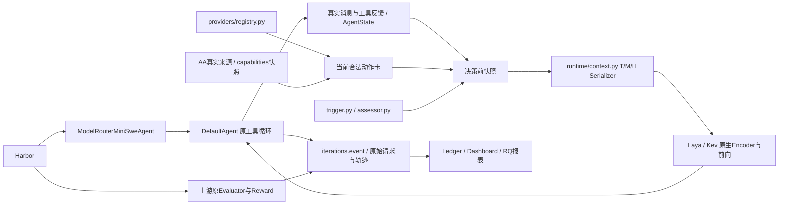

# V9 单 Agent 重构与 GLM 迁移结果

## 一、整体科研目标

负责人正式要求保持：真实 K=3 `gpt-6-luna / glm-5.3-flash / gpt-6.1-terra`，研究 Model×Native Effort 联合选择、T/M/H、AA 精确档位能力、实际缓存读取、前缀连续性、模型切换成本、Luna 低频教师，以及 Laya/Kev 原始与选定训练版的完整 Agent 质量—总成本净收益。

当前只研究 Single-Agent。RQ3 已改为单 Agent 的任务阶段、真实子任务边界和路由决策粒度；多 Agent、角色协作、委派和 handoff 正式取消。`inspect/modify/verify/recover` 只是观察到的阶段，不表示已经实现任务拆分算法。

本批已完成主要源码收敛和 AA/原生输入工作，尚未完成整个科研工作包：GLM 未绑定授权渠道，新 K=3 Harbor 比较、新池训练及净收益证明均未取得。

## 二、真实进度与唯一职责

| 原重复位置或混合职责 | 当前唯一实现与处理 |
| --- | --- |
| 旧 `agent/agent.py`、Agent Pilot runner、开发执行命令 | 正式只走 `benchmark/harbor_agent.py → DefaultAgent`；旧 SingleAgent 移至 `agent/legacy.py`，无正式调用，Ledger 仅用于类型引用 |
| 原生 mini 中继与重复模型费用注入 | 正式 CLI 不再提供另一条 mini/自定义 Agent 路径；删除 `native_generator_relay`，保留官方 Oracle 工具用途 |
| Agent 状态、训练前缀、Serving 各自编码 | `AgentState` 持有生成顺序与时间；`compact_router_state` 建立观察摘要，`PreDecisionState.router_text()` 调用唯一 Serializer；训练前缀复用同义重放 |
| 另一个模型注册 JSON、旧 Alias、新池硬编码 | `providers/registry.py` 登记身份、协议、档位、容量、模态与费率；AA 查询目标及合法动作由它派生；旧 Alias 源码和配置删除 |
| Provider 传输、解析、模拟、费用混在大文件 | `provider.py` 为供 Agent 使用的单一接口；`protocols.py` 处理两种原生协议；`base.py` 放响应类型；`simulation.py` 仅历史模拟；`usage.py` 处理真实用量账本和部分已知费用 |
| 多处教师触发与教师信息再生成 | `teacher/trigger.py` 只基于已经完成的生成和反馈；`assessor.py` 只请求精确 Luna、读取两条固定合法参考并返回三个字符串字段；其他模块只保存或消费 |
| 两个 Serving 路由包装及另查模型身份 | `/route` 和 `/system-one` 共享各 Adapter 的 `system_one()`；一次前向响应同时返回实际权重身份和输入 Usage，移除旧 Adapter `.route()` 包装与另一次 `/models` 身份推断 |
| Batch Prep 混合矩阵、来源与视图导出 | `matrix/sweep/full_coverage` 管矩阵和选择；`batch_materialization` 管来源物化；`batch_examples/batch_constants` 管公共样本语义；`views/view_reporting/view_validation` 管视图与来源报告 |
| `all_data` 混合所有来源阶段 | `all_data_shared/all_data_adapters/all_data_stage1/coverage_audit` 分别负责公共字段、来源处理、阶段一材料和覆盖说明 |
| 根 `router_data` 与正式包重复完整实现 | 根入口变为短转发，来源、视图、训练与恢复逻辑仅在正式包实现；原远端独有 Kev 导出并入正式 `build_v8_data_extension.py` |
| 训练准备混合监督、前缀、教师材料和编码 | `prepare` 编排；`supervision` 保留合法目标与原因；`prefix_replay` 重放真实截止；`teacher_material/material_io/constants` 各管材料职责，统一调用状态 Serializer |
| 大型恢复与训练队列文件 | 恢复职责拆入 `checkpoint_metrics/identity/policy/inventory/disk/writer`；队列沿 `matrix_queue/full_coverage_queue/queue_support`，不另起队列；Laya 执行拆入 `batch_runs/streaming_run/runner_support` |
| Telemetry 两份 logger、状态解释和预填 RQ 结果 | 删除 `multi_model_logger` 及 RQ2/RQ4/RQ5 模拟结果生成入口；状态读取、历史、资源和报告分到 `telemetry/common/history/resources/reports`；RQ1 从原官方事件取数 |
| 两份大型 Demo 与内嵌 HTML | 根 Demo 保留一个实现，scripts 只转发；HTML 放原 Dashboard assets，不作科研执行路径 |
| 冒称RouteLLM校准权重与SR-KNN官方样本的例子 | 删除两套任意权重/手写参考向量、standalone runner、配置及重复包转发；真实文献依据仍保留，现行策略工厂不再提供这些虚假竞品实现 |

模型费用只由 Registry 的 `ModelSpec.calculate_cost()` 解释；协议 Usage 由 `protocols.py` 解析，reasoning 属于 completion 时只计一次。`usage.known_request_cost()` 统一解释完整费用与部分已知账户费用；缺失总额、实收和资源 USD 保持未知，旧记录不按当前价格重算。

事件由 `iterations.event()` 统一记录 UTC 与单调时钟。AgentState 使用单调时间计算已用时间；Router、教师、模型和工具记录来自同一次实际执行。模型请求身份、返回身份与物理后端分别保存；返回名相同不等于独立确认物理权重。

已取消多 Agent Schema 字段与正式描述；源码中没有新增多 Agent 系统。根 AGENTS、README、四规划、现行方法与 Fig.2/RQ3 图表同步调整。历史响应、旧提交及日期结果保留原貌。

自有实现均已低于 1000 行，最大实现 `data_pipeline/views.py` 为 982 行。**所有 Python 文件无例外达标尚未成立**：既有 `router_data/test_retention_ordering.py` 1491 行，遵守本轮不改现有测试/夹具的要求保留；旧测试对已移除历史模块的引用也没有改写或运行。

A6000 原 `/home/syy/路由/` 已定向部署源码；删除28个实际存在的过时源文件/配置，唯一上版源码包为 `.runtime/modelrouter-previous-source.tar.gz`（99文件、887058字节）。原权重、账本、轨迹、F15恢复材料、GPU锁及健康Serving未替换。专用 `.runtime/benchmark-venv` 已安装 Harbor 0.24.0、mini-swe-agent 2.4.6、LiteLLM 1.106.0；上游 Terminal-Bench 2.1 的89题目录可实际加载，用户Docker元数据读取成功，容器0、镜像20。Mac与A6000本批临时wheel目录已删除，必要安装环境保留。

## 三、五个 RQ 的实际缺口

| RQ | 本批事实 | 仍缺结果 |
| --- | --- | --- |
| RQ1 完整质量—总成本 | 单一路径、事件与未知费用语义收敛 | 新GLM池完整官方Episode、独立评价及模型/教师/Router/缓存/资源净收益 |
| RQ2 联合档位效果 | 登记15个 Model×Effort，AA精确档位区别可输入 | GLM渠道级档位实测、同批完整任务质量与费用对照 |
| RQ3 单Agent粒度 | 文档、图表及分析定义已统一 | 当前实现仍主要为阶段观察和逐生成路由；任务起点、阶段转折及真实子任务边界的可比粒度结果未完成 |
| RQ4 教师/T/M/H/训练 | 唯一教师与共享Serializer；真实保存教师可进入原生输入 | 可比消融与新池合法训练；编码成功不能作为学习贡献证据 |
| RQ5 适用边界 | 旧预填结果生成器取消，保留真实任务属性分析 | 未见任务上的分层、缓存及切换收益边界 |

## 四、前三任务

1. 在唯一私有配置提供获授权的精确 GLM Chat Completions 绑定，随后核实 low/high/max 和工具调用。不能将HY4或相似型号作为请求目标。
2. 复用A6000正式环境，固定同一比较批次AA快照，先取得新开发题RQ1/RQ2完整Episode的质量、实际Usage、缓存和总费用证据。
3. 用新池真实任务结果更新合法监督，沿原Trainer分别比较每架构原始与选定训练版；其后推进RQ4消融、RQ3粒度和RQ5独立边界。

## 五、实验与能力数据结果

### GLM 接入状态

Registry 登记GLM的 `low/high/max`，官方Chat参数使用顶层 `reasoning_effort` 和独立 `thinking: {type: enabled}`，不使用OpenAI Responses的reasoning对象或HY4的none动作。官方来源：<https://docs.z.ai/api-reference/llm/chat-completion>、<https://docs.z.ai/guides/vlm/glm-5.3-flash>。

统一私有配置尚无GLM绑定。已有Terra端点 `/models` 返回200，但没有精确GLM；Luna/HY4/DeepSeek端点列表返回403，不能由此推断支持。GLM当前为 `UNAVAILABLE / MODEL_ENDPOINT_UNBOUND`，没有发送真实GLM请求，也没有渠道级合法档位或实收价格证据。

A6000尚无该唯一私有配置，公网请求也不可直达。新的付费实验需先让原正式进程能够读取授权配置并使用临时任务内网络路径；不得把Key放实验目录，或修改共享Serving/GPU服务来代替必要接入。

### AA 精确记录

当前快照 `20261107T123907543910Z-v6`，取得时间 `2026-11-07T12:15:19.946883Z`，Intelligence Index版本 `5.0.1`，状态 `PARTIAL`。免费API密钥不可用；真实成绩来自三个AA公开release页面，不冒称授权API已返回完整数据。

| Effort | Luna Intelligence Index | GLM-5.3-Flash | Terra Intelligence Index |
| --- | ---: | --- | ---: |
| none | 9.44244373619813 | 不属于登记动作 | 30.515898867357 |
| low | 9.66610812336462 | NOT_MEASURED | 29.4169280792131 |
| medium | 18.4542156192416 | 不属于登记动作 | 38.1652076677975 |
| high | 21.4290170864582 | NOT_MEASURED | 42.4344508712563 |
| xhigh | 23.4508728089378 | 不属于登记动作 | 45.250051789066 |
| max | 27.8552004938153 | 27.803889160883 | 51.3265188577015 |

Luna/Terra各6档、GLM Max各有10项独立metric，共130条，完整原分数、单位和已报告版本保存于同名snapshot JSON。GLM Low/High只能看到Max作为其他档位参考，不能复制为自己的成绩；没有独立Coding/Agentic Index。官方模型revision和发布时间仍为 `NOT_REPORTED`，不以本次获取时间替代发布时间。

来源：<https://artificialanalysis.ai/models/releases/gpt-6-luna>、<https://artificialanalysis.ai/models/releases/glm-5-3-flash>、<https://artificialanalysis.ai/models/releases/gpt-6-1-terra>。各Benchmark保留自己的原单位与版本，不混成统一正确率，也不作为Terminal-Bench训练最优动作标签。

每档10项为Intelligence Index及 `aa-briefcase / automationbench-aa / terminalbench-4-0 / frontiercode-2-0 / omniscience / gdp-pdf / hle-diamond / critpt-v2-hard / terminal-bench-science`；AA所用Terminal-Bench 4.0不是本项目Terminal-Bench 2.1任务成绩。Luna Max旧10项仍单独标为STALE，取得时间保留 `2026-10-31T07:25:48Z`，不混为当前130条。

`ensure_current()` 已实现默认86400秒有效期、过期刷新、明确 `--force`、最近成功数据保留及STALE状态。正式启动刷新一次并保存到本批配置；同一Episode和比较批次使用固定版本，不逐生成联网。网络成功但内容相同只表示再次取得，不表示AA新发布成绩。授权API逐Benchmark/档位权限仍缺，不能通过猜测补数。

### T/M/H、教师与原生输入

T保留真实任务、目标、阶段、已发生进度、剩余步骤/预算/时间与单Agent职责。M用模型共享字段、逐档分数、原始metric定义、精确AA slug及版本/来源；合法动作与实际可用性分开。H保留已观察生成、工具/错误/修改摘要、此前Usage/缓存、上次模型/端点、前缀连续性与耗时，当前请求命中不提前写入。

历史摘要由同一Serializer控制；较长工具摘要保留头尾2500字符，明确保存源字符数和保留字符数。完整原消息、命令输出和轨迹另存。编码FULL指该紧凑摘要，不代表完整原始历史。

已复用4条保存状态，用当前Registry/AA更新M后通过两套真实原生Encoder，15动作与130分数均保留。前三条教师缺失状态如实保留；第四条包含真实保存的Luna三个字段及观察截止。详细Token跨度、保留量和候选状态见 `refactor_encoding.json`。这不是四次新Agent决策，也没有新教师API请求。

Laya原始保存配置为512，F05原Serving为1024，V9-K3训练版为8192。本批原始Laya前向明确使用8192/512运行配置；Kev使用原生65536状态容量，两者Tokenizer和容量未统一成一个限制。Laya原始checkpoint的choice温度被上游运行时调整到允许范围，置信度仍未校准，原权重未改。

本批两个原始实体真实CPU前向均返回15候选概率，T/M/H与教师均FULL；8线程下Laya为40.877秒，Kev为575.349秒。实际结果在 `refactor_forward.json`，不据此宣布方法有效。正式配置复用已有Checkpoint原生入口与历史已使用的40线程参数，去除原60秒Router窗口，由上游Harbor管理任务时间；没有补造40线程新输入性能结果。健康Serving PID327621保持原代码进程和权重，没有重启；新源码部署不等于现有API进程已切换到新版本。

### 版本与新Harbor结果

原始实体为服务器 `models/laya-421m` 与 `models/kev-4b-adapter`。`runs/V9-K3-LAYA-20261107`、`runs/V9-K3-KEV-20261107`各18次更新及正式三题结果保留，它们是旧Luna/HY4/Terra池的有限研究实体，不是新GLM池训练版，也不是最优实体证明。F05/R11及其他研究权重保持；新GLM监督不由HY4标签改名生成。

本批新增付费生成0、教师请求0、训练更新0、官方Harbor Episode0。之前regex-log、sqlite-db-truncate、openssl-selfsigned-cert三题均已观察，不改名为新独立评价。旧任务质量与费用仍以原 `review.md/summary.json` 为准，不重跑旧题挑checkpoint。

## 六、独立判断

源码、数据链和原生消费已显著收敛，但真实K=3尚未可执行。当前证据支持“新精确档位能力能进入两个Router”，不支持“Router已学会新池选择”或“完整任务净收益成立”。AA分数是外部能力先验；GLM缺测不删除API支持的候选，API未授权也不能靠登记表冒称可用。

原始Laya在CPU上的路由时间不能忽略；Kev更大的原生状态容量也不能直接解释成任务收益。论文主表需要完整Episode和所有成本项，部分已知参考模型费用须与未知实收/资源费用分开。

## 七、通俗解释

这次把“谁执行任务、谁建立状态、谁解释模型能力、谁调用教师、谁计费”各收为一个来源，避免同一事实被不同模块讲成不同意思。两个小Router现在可以读到当前AA分数和真实历史摘要，但读到不等于学会；仍需三个真实模型在完整任务中的结果证明选择值得付出路由与教师成本。

## 八、下一批完整工作

事前选择新开发用途 `circuit-fibsqrt`、独立评价用途 `constraints-scheduling`。它们未出现在本次只读汇总的既有run_config任务身份中；这只证明当前可见运行记录未暴露，不证明模型预训练无暴露。尚未阅读其终局结果或运行任务，独立题不用于挑选checkpoint。

GLM渠道到位后，先用最小真实请求确认精确ID、支持Effort、工具及Usage；沿当前唯一Harbor路径，在固定AA快照的开发比较中优先RQ1/RQ2。随后以真实监督更新原Trainer并按可比开发证据选择每架构一个训练实体，保留原始版对照。最后在事前独立题报告完整质量—模型/教师/Router/缓存/资源总成本，继续RQ4、RQ3和RQ5。当前不创建后台调度、不另建工作区、不改共享服务。
