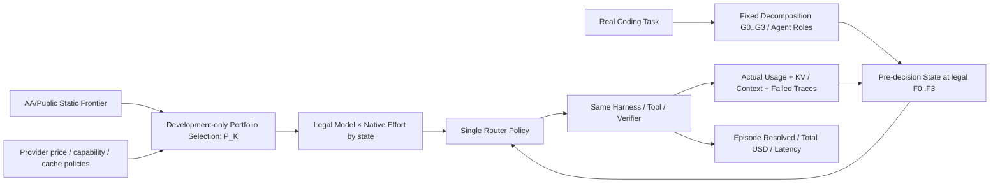

# ModelRouter · 论文研究问题、实验与图表规划（V6）

> **更新日期**：2026-10-13；**研究设计**：5 个 RQ、8 张图、12 张空白表
>
> 本次整合候选模型池、任务拆分粒度、Model×Effort、缓存连续性与完整任务经济收益；保留 V5 的前沿迁移思想，恢复任务粒度作为独立 RQ。所有实验结果图与表仍为空白；实际模型/预算/执行授权沿用现有正式决策。
>
> **展示入口**：[交互式原型](交互式原型/index.html)

## 0. 研究定位与版本

### 0.1 新的统一思路

**先选择值得路由的模型集合，再决定在什么任务粒度、对哪个子 Agent、以什么推理档位调用，以及当前节省是否会在未来缓存重读、失败或重试中被抵消，最后用真实 Agent Benchmark 检验动态策略是否创造新的非支配策略点。**

- **配置层**：`provider / model / revision / native_effort`；同一模型的不同原生 Effort 是不同可执行动作，同模型不同 Provider 属部署/价格/可用性差异。
- **模型池层**：公开能力—成本 Pareto 仅用于初选；与 Agent 开发集实际能力、互补模型、前沿外模型对照。**等 K 选池**与**同池对比 Router**必须分开。
- **工作流层**：同一原任务可按 G0–G3 固定分解（单 Agent、阶段、功能、可验证细粒度），路由 F0–F3（任务、阶段、子任务、合法调用）；两维不能混淆，不新增 Agent 架构搜索。
- **决策层**：单一 Router 在真实执行前观测状态与合法动作，选择 `Model×Native Effort`。执行后的真实费用、缓存和成败反馈成为下一决策输入。
- **经济层**：主指标是同任务完整 Episode 成功率与平均实际成本。目标是**在观测到的固定/随机混合前沿之外获得新有效点**，不是宣称超越理论所有策略的最优边界。
- **学术层**：模型池、任务粒度、Model×Effort、缓存历史各自建立可否证对照；最终端到端结果作为总评，不以 Laya/Kev 的训练 Accuracy 替代。

**主线总结**：Pool Selection → Task Granularity → Joint Model/Effort → Cache/History-Aware Sequential Decision → Real Episode Success–Cost Frontier.

### 0.2 与项目现有资产的关系

| 文件 / 资产 | 本文如何使用 | 不在本文维护的事项 |
|---|---|---|
| [RESEARCH_OVERVIEW](../../our-project/planning/RESEARCH_OVERVIEW.md) | 方法总纲、H1–H7、受控状态、作用域 | 实时实验进度、最新 GPU 状态 |
| [EXPERIMENT_QA](../../our-project/planning/EXPERIMENT_QA.md) | Q-001=A 真实 Coding Benchmark；Q-002=B 商业+本地；Q-004=B 成功率约束；Q-005=B 分层基线；Q-006=A 同状态分支 | 未经负责人确认擅自改变决策或预算 |
| [PROJECT_STATUS](../../our-project/planning/PROJECT_STATUS.md) | 唯一实际执行状态和下一授权动作 | 历史对话中的计划当作已完成 |
| [PLANNING_MEMORY](../../our-project/planning/PLANNING_MEMORY.md) | 历史研究决定与跨 Agent 交接 | 将本文每个草案设成正式决定 |
| [GROUP_MEETING_RESEARCH_BRIEF](../../our-project/planning/GROUP_MEETING_RESEARCH_BRIEF.md) | 早期 RQ 命名与组会对照 | 将旧版 RQ 与本文版本混为同一正式版本 |
| [PAPER_NOTES_AND_FIGURES](../../our-project/汇报/ModelRouter组会/PAPER_NOTES_AND_FIGURES.md) | 已有论文**原图**资料与相关工作边界 | 把别人的论文截图当成本项目实验结果 |
| [训练看板](../../docs/training-dashboard/index.html) | 已完成 Laya 离线训练指标/Checkpoint 历史 | 冒充任务级经济评测 |

### 0.3 版本演进

| 版本 | 五个 RQ 的主要划分 | 关系 |
|---|---|---|
| V3 | 整体收益、任务结构、联合分配、长期成本、泛化 | 保留原任务粒度问题 |
| V4 讨论建议 | 任务级目标、决策粒度、联合分配、缓存、状态/复杂度 | 未单独落库 |
| V5 | 模型池前沿、全局收益、联合分配、缓存、重新路由 | 增加模型池，但任务拆分降为附属 |
| **V6 当前草案** | **模型池、任务拆分/频率、联合分配、缓存/历史、端到端前沿收益** | 同时保留模型池新意与多子代理核心，5 个 RQ 不扩张 |

**运行时反馈、学习型 Router 开销、跨仓库泛化**分别是 RQ2/4/5 的受控对照与全 RQ 补充实验，不再人为挤占一个主题性 RQ。正式 Q-ID/H1–H7 不随论文 RQ 编号自动修改。

## 1. 前沿定义与方法边界

### 1.1 三种前沿，三个不同对象

| 前沿 | 横轴 | 纵轴 | 数据与作用 | 可比较对象 |
|---|---|---|---|---|
| 公开能力—费用前沿 | 来源实际使用的 Cost per Task 或 Token Price | 来源 Intelligence / Benchmark Score | 同日、同版本来源快照；选池先验 | 同一公开指标内的配置 |
| 真实 Agent 固定配置前沿 | 所有任务的平均完整 Episode 费用 | 相同任务集 Resolved% | 固定 Harness、每个配置真实执行 | 同坐标的固定配置与混合 |
| 真实 Agent 动态策略前沿 | 含路由开销的平均完整 Episode 费用 | 相同任务集 Resolved% | 动态策略真实执行 | 同池、同任务的固定/动态策略 |

Artificial Analysis 是第三方，厂商自己的评测声明单独登记来源；两者均只在各自任务、版本和计价条件下定义前沿，本文不将它们混称为厂商造假。
Artificial Analysis 当前方法区分 Token Price、混合单价和它自身工作负载的 Cost per Task，后者包含真实消耗 Token；因此不能笼统说公开前沿都只是 Token 单价图，也不能把公开 Cost per Task 当作我们的 Agent Episode 费用。
两个面板的模型标签可以对齐，坐标数值与纵轴不能直接合并；实验证明的是外部指标迁移性和本任务域的策略增益。

### 1.2 何谓向左上改善

- Pareto 支配：费用不更高且成功率不更低，至少一项严格改善
- 同费用收益：ΔSuccess@Cost
- 同成功率收益：Savings@Success
- 固定配置之外的强对照：任务无关随机混合包络
- 数据范围：只比较实测支持重叠区间；成功率容忍度事前确定
- 不能成立的推断：低于最贵配置费用 → 整条前沿已经被支配

动态策略能够创造新的非支配点，但仍属于扩展策略集合自身的前沿，不能声称突破了所有可能策略的理论最优界。

### 1.3 最小方法闭环

Pool 在开发阶段冻结。RQ2 只改变已有 Harness 的可复现任务拆分粒度与路由频率；RQ3 比较固定/动态 Model×Effort；RQ4 在相同环境下改变缓存/历史信息；RQ5 在完整 Benchmark 上统一对照。单一路由入口，不引入第二个在线 Router、学习型拆分器或跨模型 KV 迁移功能。

### 1.4 证据要求

- `E0` 公共能力/价格表：只支持公开静态指标，不能直接推断 Agent Episode 结局。
- `E1` CCH/Blog 观察调用：支持已记录的单次成本/缓存/Token；缺少真实 task_id 的不能推断整任务成功。
- `E2` 历史 Agent 轨迹：只支持已执行动作的观察结果，不能给未执行动作伪造未来标签。
- `E3` 真实同任务 Episode：支持路由策略成本—成功率比较。
- `E4` 同一决策前状态的可恢复分支：支持受控动作间后续费用/成功差异。
- `E5` 冻结策略的独立 held-out：支持预设质量约束下的泛化与置信区间。

### 1.5 成本边界

完整任务 API USD 必须包含全部真实模型调用的输入/输出、缓存读写与失败/重试费用；重试成本不可在已计价的调用费用上重复累加。本地 GPU-hours、估计本地美元费用、路由延迟、工具费用等分列报告。单位必须相同才能绘制 Pareto。QuotaUnits ≠ USD；prefix overlap ≠ Provider 报告的物理 KV 命中；不能假设 KV 可跨模型移植。

## 2. 五个研究问题

| RQ | 科学问题 | 核心自变量 | 主对照 | 图 | 表 |
|---|---|---|---|---|---|
| **RQ1 · 模型池** | 公开静态 Pareto 前沿能否迁移到真实 Agent；哪些模型组合最有路由价值？ | 池成员、选择规则、K | 公开前沿/Agent-dev/互补/价位分层/随机等 K | Fig. 1、4 | T1、T4 |
| **RQ2 · 任务粒度** | 任务拆分和路由频率的最佳协作尺度在哪里？ | G 拆分粒度 × F 路由边界 | G0–G3 × F0–F3 中真实合法的交叉配置 | Fig. 7 | T8 |
| **RQ3 · 异构算力** | Model × Native Effort 的联合动作是否提供超出单因素选择的增量价值？ | Model 与 Effort 政策 | Fixed / Model-only / Effort-only / Joint | Fig. 5 | T5 |
| **RQ4 · 路径依赖** | 缓存、上下文连续性与恢复历史何时改变最经济的下一动作？ | measured cache/history / stay-switch | Unaware / Sticky / Cache-aware / History-aware | Fig. 6 | T6、T7 |
| **RQ5 · 最终价值** | 完整动态路由能否扩展实际 Agent 成功率—成本前沿？ | 整体路由策略 | 固定配置/随机混合/Task-only/Greedy/规则/轻量/Full | Fig. 3 | T3 |

### RQ1 · 公开静态前沿是否能指导真实 Agent 的候选模型池？

**Question**：哪些 `(provider, model, revision)` 应进入模型池？在相同池大小与策略预算下，静态 Pareto 成员是否比任务互补的模型池更有效？被公开指标支配的配置是否有局部路由价值？

- **选择规则**：Public-Pareto、Agent-development Pareto、Task-complementary、Price-stratified、Random，均固定 `K`；所有组合在开发集选择，独立任务评估。
- **初始候选身份**：例如 Claude Haiku 5.5、GPT-6.1 Sol、Claude Opus 5.5，以及一个或更多真实可用的国产/本地开源模型。它们是调研候选，**不是事前认定的真实 Pareto 成员**；每模型多个原生 Effort 另列真实动作，不能当多个独立模型凑 `K`。
- **规模数学**：`N` 个模型可能有 `2^N−1` 个非空池；固定 `K` 有 `C(N,K)` 种。同池合法动作数量为 `Σ_{m∈P}|E_m|`（只数实际支持的 Effort）。不穷举全部执行轨迹。
- **初步设计**：先选 `K=3` 的低费、中档/互补、强能力三角色池；对照等 K 替换，再用 `K=2/4/5` 的少量嵌套池、单模型加入/移除分析边际贡献。**模型数量和模型选择是不同因素**。
- **任务表现**：按规划、实现、验证、失败恢复及任务难度报告不同模型优势、分组胜率和完整 Episode 费用。固定路由策略以测池收益；池固定再测策略收益；选池开发预算/额外模型调用成本单列。
- **前沿迁移**：公开 AA Intelligence 与公开 Cost per Task 一张图；我们独立任务的 Resolved 与平均 Episode USD 另一张图。只在共同模型/档位和可比较价格快照范围分析成员重合/排序变化，不能叠加两个纵轴宣称“击败 AA”。
- **否证**：公开前沿池与互补池无稳定差异、前沿外模型边际收益为零、增加 K 不抵探索费，则如实报告。
- **产物**：Fig. 1（静态/Agent 前沿并列），Fig. 4（等 K 池与边际贡献），T1/T4。

### RQ2 · 任务应拆多细，路由应多频繁？

**Question**：在同一原任务和工具/预算下，改变任务拆分深度与模型路由时机，是否存在非单调的最佳经济粒度？对子代理分工是否有实际增益？

- **因子 G**：G0 完整任务/单 Agent；G1 阶段级（规划/实现/验证）；G2 文件/功能子任务；G3 更细但语义可验证的任务片段。不可拆的任务格子为 N/A。
- **因子 F**：F0 仅任务开始；F1 阶段交接；F2 子任务边界；F3 每个合法模型调用边界。F1/F2 在某 G 下不成立则 N/A，不能虚构。
- **固定 G 改 F / 固定 F 改 G**：第一轮用可比的小矩阵分别分析，再对有交互迹象的组合补最少的交叉配置；不需要穷举所有 G×F。
- **对照**：每组固定模型/固定 Effort vs 同一动态 Router，所有拆分、Handoff、上下文重复和 Router 调用的成本均进入完整任务账本。
- **主要指标**：Success、Episode USD、Cost/Resolved、Trace、handoff、子 Agent 数、重复编辑与纠错、上下文重复 token、P95；单 Agent 和多 Agent 任务可分层。
- **学术边界**：不训练新拆分器、不搜索 Agent 拓扑。拆分造成的提升归入粒度主效应，不能冒充路由器本身收益。
- **否证**：G0/F0 简单策略已经达到同等效果，或更细分解令通信/重复工作成本超过收益。
- **产物**：Fig. 7 任务树与 G×F 结果矩阵，T8。

### RQ3 · Model × 原生 Reasoning Effort 联合分配是否真正有效？

**Question**：在固定任务拆分和路由频率条件下，联合选择模型和真实原生 Effort 是否优于分别控制其中一个？强模型低 Effort 和弱模型高 Effort 是否会因为后续 Trace/恢复成本发生经济排序反转？

- **对照**：Fixed M/E、Dynamic Model + Fixed Effort、Fixed Model + Dynamic Effort、Joint M×E、必要的 Agent-role-aware Joint。
- **动作合法性**：Effort 是 Provider 的原生档位；不同 Provider 名称不一定可比。不支持某档位标 N/A，不能填 0 或伪造。
- **控制**：同一候选池、G/F、状态输入、任务集、价格快照和预算。任务分层比较规划/实现/验证/恢复，难度不能使用未来成功标签输入路由器。
- **指标**：Task Resolved、真实 reasoning/output tokens、单次费用、Trace、重试、Episode USD、成功率约束内净收益。
- **否证**：Joint 不超过最优 Model-only 或 Effort-only，或收益被决策开销抵消。
- **产物**：Fig. 5，T5。

### RQ4 · 缓存与历史如何改变跨步骤最经济的动作？

**Question**：考虑真实 Provider 缓存、上下文连续性和已发生的失败/恢复历史后，Stay 与 Switch 哪个更经济？局部便宜是否导致更高后续任务成本？

- **固定池、G/F、合法动作**，依次对照 Cache-unaware、Sticky、Cache-aware、Cache+Observed Runtime History；有真实可信反事实/监督后再比较未来费用估计模型，不凭空构建。
- **证据等级**：真实 Provider cached-read/write 为 measured；前缀复用机会为 estimated；TTL 模拟为 simulated。分面展示，不混为物理命中。
- **实验**：先同任务 Episode 配对比较，再在可恢复的决策前状态进行 Stay/Switch 受控分支；固定后续 continuation policy，记录实际失败、恢复、重试和最终费用。
- **费用完整性**：缓存冷启动/上下文重新预填充已进入 API 费用时，只作费用组成解释，不再重复增加一次。
- **否证**：复杂历史信号没有超越 Sticky、延迟开销超过节省，或无法在真实 Provider 观测下确定收益边界。
- **产物**：Fig. 6，T6/T7。

### RQ5 · 完整 ModelRouter 能否把真实 Agent 前沿推向左上？

**Question**：在冻结的可行候选池与任务/价格口径下，动态策略能否在同成功率降低完整 Episode 费用，或同费用提高任务成功率，从而产生固定配置与无条件随机混合包络之外的非支配点？

- **策略**：池内每个 Fixed Model×Effort、任务无关随机整任务混合（构成固定点的凸组合包络）、Task-only、Per-call Greedy、Rule/Sticky、Lightweight Router、Full ModelRouter。
- **关键统计**：横轴 `Mean Episode USD`（所有任务含失败与恢复），纵轴 `Resolved%`；附 `Total USD`、`Cost/Resolved`、P95 和本地 GPU/Router overhead。仅在共同任务、预算与费用区间比较，报告 task-level paired CI。
- **进步判据**：相对于已测固定配置与无条件混合前沿，在重叠成本区间有统计可辨的 `ΔSuccess@Cost`，或在预先冻结的成功率下有正的 `Savings@Success`。**不能保证**比每个固定模型都同时更便宜且更准确，更不能声称超过所有可行策略的理论最优边界。
- **机制与净收益**：分别将 RQ2 G/F、RQ3 单/联合动作、RQ4 缓存/历史固定为可比版本，在共同池下汇总；Router 推理开销、Cache cold-start、Tool/Retry 全部计入。学习型 Kev/Laya 与规则/轻量分类器比较只能基于相同状态与真实训练监督，不把离线 Accuracy 当终局收益。
- **稳健性**：策略冻结后在未见仓库/任务、Agent 数量、模型池与 Provider 状态变化下复验；这些属于各 RQ 共用验证而不是第六个 RQ。
- **否证**：Full 未胜过最佳简单策略、成功率显著回退、或者成本节约仅来自换池而非路由时，应限定或否认整体贡献。
- **产物**：Fig. 3 核心任务级 Pareto，T3；真实轨迹 Fig. 8、机制 T9、系统开销 T12。

## 3. 实验安排与已有资产

### 3.1 Benchmark 来源：先真实任务，后逐层扩大

遵循已确认 Q-001=A：从**真实可复现 Coding Benchmark** 直接抽取小型技术试运行，不必另造独立合成任务。候选（需再次核许可/版本/evaluator）：SWE-bench Verified、TwinRouterBench 动态任务/静态决策基准；历史 SWE-Gym 等为训练环境/轨迹源，不可混同于自动终局 Bench。初期可提出 10 个真实任务烟测、约 50 个开发/选择任务、100+ 个独立评测任务作为**预算讨论锚点，不是已授权数额或已执行**；对同一任务的多策略比较要乘策略、模型、seed 的真实费用预算。

- Split 单位：task/repo/近重复 issue；同一任务的轨迹前缀不能跨 Train/Val/Test。
- Terminal outcome：可执行 evaluator、补丁/测试规则、timeout、环境版本、成功/失败/中断原因。
- 模型池：商业 + 本地混合（Q-002=B），官方实际可用 Native Effort、上下文、工具、缓存计价和故障 fallback。
- 预算：Q-003 只确认按模型分阶段限制的原则；**API 金额、成功率非劣容忍度与具体模型名单尚未冻结**。
- 最后一次独立 Test 只在策略及阈值冻结后运行，不能用 Test 反复选最佳 Checkpoint。

### 3.2 执行顺序（依赖而非额外执行链）

| 顺序 | 做什么 | 对应 RQ | 数据与产物 |
|---|---|---|---|
| A | 同日 AA 指标与 Provider 能力/定价/缓存快照；固定模型真实任务成本 | Motivation / RQ1 | Fig. 1、T1/T2 |
| B | 固定 Harness，在开发集比较 K=3 等规模模型池和少量 K 扩展 | RQ1 | Fig. 4、T4 |
| C | 在同池内固定模型/固定路由，比较 G0–G3 与 F0–F3 可能的组合 | RQ2 | Fig. 7、T8 |
| D | 固定 G/F，在同池比较 Model-only、Effort-only 与 Joint | RQ3 | Fig. 5、T5 |
| E | 固定池/G/F/动作，对照缓存历史和受控 Stay/Switch | RQ4 | Fig. 6、T6/T7 |
| F | 在冻结协议下，和固定配置、无条件随机混合及简单策略比较端到端前沿 | RQ5 | **Fig. 3 主结果**、T3 |
| G | 用独立任务/真实案例和负面结果界定贡献适用范围 | 全 RQ | Fig. 8、T9/T12 |

模型池搜索与 Router 策略效果必须分开归因；实时 Benchmark GPU/API 消耗仍按原 `EXPERIMENT_QA` 的正式授权和预算执行。

### 3.3 微调是研究支撑，不是贡献的主体

- Laya 的 Batch 1、Sweep-02、Full-Graded 属**离线监督能力与数据方案探索**，训练指标可放附录 T10/T11 及补充曲线，不宣称 Cost-per-Resolved 改善。
- Kev-4B 是原研究总纲中的单一学习型 Router 主候选，实际适配必须使用真实合法 label；S1 人类偏好、S2 已观测 Agent 成败、S3 请求/缓存辅助目标不能混为“同一动态最优模型标签”。
- 已分级的 660 万异构行和约 486 万合法候选，是数据资产而不是 486 万独立路由标签；训练覆盖率和路由成功率完全不同。
- 只有同状态多动作真实结果（或明确标示为估计并承认偏差）才支持相对动作选择监督；测试集和许可证待核内容不能训练。
- 是否需要更复杂学习目标取决于真实 Benchmark 与简单规则的比较，不以 Checkpoint 个数决定论文质量。

## 4. 八张图的正式设计（结果全部待真实数据填充）

| 图 | 论文位置 | 可视化结构 | 主要证据 |
|---|---|---|---|
| **Fig. 1** | Motivation / RQ1 | **双面板**：左公共 AA Intelligence–Cost/Task 静态 Pareto；右同标签配置在真实 Agent 上 Resolved–Mean Episode USD；两套纵轴独立 | 同日期/同版本/同价目与共同模型 |
| **Fig. 2** | Main Method | **左**：G0–G3 任务/子 Agent 树；**中**：选池+动态合法 Model×Effort 与单一 Router；**右**：执行/工具；**底部**：KV/历史/费用与下一状态反馈 | 方法结构，不包含假成功率 |
| **Fig. 3** | **RQ5 主结果** | 真实 Agent 成功率—平均完整任务成本散点/前沿；固定配置、随机混合包络、Task-only、Greedy、Rule、Full，CI 与质量门槛 | 同任务完整 Episode |
| **Fig. 4** | RQ1 | 左不同等 K 模型池组成；右 K 固定下各池成功率与费用，前沿外模型加入/移除另列 | 开发池、冻结独立评测 |
| **Fig. 5** | RQ3 | Model×Native Effort 矩阵 + 任务阶段/难度分面 + Trace/Cost 面板 | 实际支持的 Provider Effort |
| **Fig. 6** | RQ4 | 同状态 Stay/Switch 路径，缓存读写/重复上下文/重试费用分解、净收益与反转区域 | measured 与 simulated 分开 |
| **Fig. 7** | **RQ2** | **左侧分解树 G0–G3**；**右侧 G×F 决策粒度响应矩阵**；固定和动态路由成功率/费用成对比较 | 任务拆分/Handoff 与路由边界 |
| **Fig. 8** | Real Case | 同一真实任务中固定策略与动态策略的阶段、子代理角色、Effort、Cache、失败恢复及累计费用时间轴 | 可追溯真实 Episode，成功/失败案例 |

注意：图 1 比较的是**两种不同评测坐标系的前沿迁移**，不是直接把动态 Agent 点画在 AA Intelligence 坐标上；图 3 才是检验“向左上”的论文主结果。没有真实任务数据的点、曲线和表值一律保留空白。

## 5. 十二张空白表格

表格只填写表头及第一列类别，其余格全部为空；K、模型名单、费用、成功率和边际收益均待真实评测填写，空白不代表零。

### Table 1 · 模型与供应商能力 / Model Registry

**归属**：Setup

| Model / Provider | Intelligence | Native Effort | Context | Input $/M | Output $/M | Cached $/M | Price Snapshot |
| --- | --- | --- | --- | --- | --- | --- | --- |
| 候选低费用配置 |   |   |   |   |   |   |   |
| 候选中等费用配置 |   |   |   |   |   |   |   |
| 候选高能力配置 |   |   |   |   |   |   |   |
| 候选互补配置 |   |   |   |   |   |   |   |
| 候选本地开源配置 |   |   |   |   |   |   |   |

### Table 2 · Benchmark 与任务协议

**归属**：Setup

| Benchmark / Split | Tasks | Agent Type | Decomposition | Evaluator | Task Split | Provider Pool | Budget |
| --- | --- | --- | --- | --- | --- | --- | --- |
| SWE-bench Verified |   |   |   |   |   |   |   |
| TwinRouterBench |   |   |   |   |   |   |   |
| Multi-Agent Subset |   |   |   |   |   |   |   |
| Development Tasks |   |   |   |   |   |   |   |
| Held-out Tasks |   |   |   |   |   |   |   |

### Table 3 · 完整路由与真实 Agent 成功率—成本前沿

| Policy | Resolved ↑ | Mean Episode USD ↓ | Cost/Resolved ↓ | ΔSuccess@Cost | Savings@Success | Router Overhead | 95% CI |
| --- | --- | --- | --- | --- | --- | --- | --- |
| Fixed Model×Effort (each) |   |   |   |   |   |   |   |
| Task-independent random mixture |   |   |   |   |   |   |   |
| Task-only / Admission-only |   |   |   |   |   |   |   |
| Per-call Greedy |   |   |   |   |   |   |   |
| Sticky / Rule |   |   |   |   |   |   |   |
| Lightweight Router |   |   |   |   |   |   |   |
| Full ModelRouter |   |   |   |   |   |   |   |

### Table 4 · 候选池：公开前沿迁移与等规模组合

| Pool Selection Rule | Selected Models | K | Public→Agent Transfer | Resolved ↑ | Mean Episode USD ↓ | Added-model Gain | Pool Selection Cost |
| --- | --- | --- | --- | --- | --- | --- | --- |
| Public Pareto / K fixed |   |   |   |   |   |   |   |
| Agent-dev Pareto / K fixed |   |   |   |   |   |   |   |
| Task-Complementary / K fixed |   |   |   |   |   |   |   |
| Price-stratified / K fixed |   |   |   |   |   |   |   |
| Random / K fixed |   |   |   |   |   |   |   |
| Base Pool + Off-frontier Model |   |   |   |   |   |   |   |
| Base Pool - One Model |   |   |   |   |   |   |   |
| Nested K=2/3/4/5 |   |   |   |   |   |   |   |

### Table 5 · Model × Effort 资源分配

**归属**：RQ3

| Allocation Strategy | Model | Native Effort | Resolved ↑ | Reasoning Tokens | Avg Trace | Total Cost ↓ | P95 Latency |
| --- | --- | --- | --- | --- | --- | --- | --- |
| Fixed Model / Fixed Effort |   |   |   |   |   |   |   |
| Dynamic Model / Fixed Effort |   |   |   |   |   |   |   |
| Fixed Model / Dynamic Effort |   |   |   |   |   |   |   |
| Dynamic Model × Effort |   |   |   |   |   |   |   |
| Role-aware Joint Allocation |   |   |   |   |   |   |   |

### Table 6 · 任务成本分解与路由净收益

**归属**：RQ4

| Policy | Uncached Input Cost | Output Cost | Cache Read/Write | Tool Cost | Router Cost | Other Local Compute | Episode Total |
| --- | --- | --- | --- | --- | --- | --- | --- |
| Cache-unaware |   |   |   |   |   |   |   |
| Sticky |   |   |   |   |   |   |   |
| Cache-aware |   |   |   |   |   |   |   |
| Cache + Runtime History |   |   |   |   |   |   |   |
| Future-cost Predictor (if supported) |   |   |   |   |   |   |   |

### Table 7 · 缓存状态与切换

**归属**：RQ4

| Cache Condition | Switch Policy | Measured Cache Read | Measured Cache Write | Switches | Retries | Resolved | Episode Cost |
| --- | --- | --- | --- | --- | --- | --- | --- |
| Warm / Stay |   |   |   |   |   |   |   |
| Warm / Switch |   |   |   |   |   |   |   |
| Cold / Stay |   |   |   |   |   |   |   |
| Cold / Switch |   |   |   |   |   |   |   |
| TTL Expired |   |   |   |   |   |   |   |
| Provider Change |   |   |   |   |   |   |   |

### Table 8 · 任务拆分 G × 决策频率 F

| Granularity / Frequency | Subtasks | Agents | Handoffs | Resolved ↑ | Mean Episode USD ↓ | Context Copy | Router Calls |
| --- | --- | --- | --- | --- | --- | --- | --- |
| G0 / F0 (task) |   |   |   |   |   |   |   |
| G1 / F0 |   |   |   |   |   |   |   |
| G1 / F1 (stage) |   |   |   |   |   |   |   |
| G2 / F1 |   |   |   |   |   |   |   |
| G2 / F2 (subtask) |   |   |   |   |   |   |   |
| G2 / F3 (legal call) |   |   |   |   |   |   |   |
| G3 / F2 (where legal) |   |   |   |   |   |   |   |
| G3 / F3 (where legal) |   |   |   |   |   |   |   |

### Table 9 · 机制消融与主要增量收益

| Variant | Resolved ↑ | Mean Episode USD ↓ | Cost/Resolved ↓ | Trace | Cache/Context | Router Calls | P95 Latency |
| --- | --- | --- | --- | --- | --- | --- | --- |
| Full ModelRouter |   |   |   |   |   |   |   |
| Fixed/Task-only Routing |   |   |   |   |   |   |   |
| w/o Joint Effort |   |   |   |   |   |   |   |
| w/o Cache Signals |   |   |   |   |   |   |   |
| w/o Runtime Feedback |   |   |   |   |   |   |   |
| Fixed G/F, Router Only |   |   |   |   |   |   |   |
| Same Pool / Simple Policy |   |   |   |   |   |   |   |

### Table 10 · 监督数据与分级

**归属**：Appendix

| Data Source / Supervision | Raw Records | Train Items | Independent Units | Val Units | Label Balance | Coverage | Permission |
| --- | --- | --- | --- | --- | --- | --- | --- |
| S1 Human Preference |   |   |   |   |   |   |   |
| S2 Agent Observed Outcome |   |   |   |   |   |   |   |
| S3 Cache / Token Auxiliary |   |   |   |   |   |   |   |
| L1 |   |   |   |   |   |   |   |
| L2 |   |   |   |   |   |   |   |
| L3 |   |   |   |   |   |   |   |
| L4 |   |   |   |   |   |   |   |

### Table 11 · Laya / Kev 微调与权重

**归属**：Appendix

| Model / Checkpoint | Train Items | Epoch / Steps | LR | Val Loss | Accuracy | Brier | ECE |
| --- | --- | --- | --- | --- | --- | --- | --- |
| Laya Base |   |   |   |   |   |   |   |
| Laya N05-E02 |   |   |   |   |   |   |   |
| Laya N09-E01 |   |   |   |   |   |   |   |
| Laya Full-Graded |   |   |   |   |   |   |   |
| Kev Base |   |   |   |   |   |   |   |
| Kev Fine-tuned |   |   |   |   |   |   |   |

### Table 12 · 系统开销与真实案例

**归属**：Appendix

| Policy / Episode | Router Time | GPU-hours | Prompt Tokens | Cached Tokens | Tool Calls | Resolved | Total Cost |
| --- | --- | --- | --- | --- | --- | --- | --- |
| Fixed Model |   |   |   |   |   |   |   |
| Rule Router |   |   |   |   |   |   |   |
| Laya Router |   |   |   |   |   |   |   |
| Kev Router |   |   |   |   |   |   |   |
| Case A |   |   |   |   |   |   |   |
| Case B |   |   |   |   |   |   |   |

## 6. 结果数据关联信息

| 粒度 | 最少记录 | 支持哪项研究 |
|---|---|---|
| 模型身份 | `provider/model/revision/native_effort/capability/price_snapshot` | RQ1/RQ3；跨厂商 Effort 不自动等价 |
| 模型池 | `pool_id/members/K/selection_rule/dev_split` | RQ1 选池与 Router 增益分离 |
| 拆分与路由边界 | `task_id/G_decomposition_version/F_routing_frequency/role_id/handoff_count` | **RQ2** 双因素 |
| 决策 | `episode/step/observed_state/legal_action/chosen_model/effort` | RQ3/RQ4 |
| 缓存与费用 | `usage/cache_read/write/cache_source/price_version/retry/tool/router_gpu` | RQ4/RQ5 |
| Episode | `task/policy/pool_id/seed/resolved/total_cost/wall_time` | **RQ5** 主前沿 |
| 独立验证 | `task_split/repository_id/evaluator_version/CI_method` | 全 RQ 泛化 |

指标未观察到时标注 N/A，不得用 0；任务级聚合分母包含未成功的任务。

## 7. 论文章节与贡献映射

| 章节 | 内容 | 主图 | 主表 |
|---|---|---|---|
| Introduction / Motivation | AA 公开静态前沿、Agent 任务经济性缺口 | Fig. 1 | T1 |
| Method | 模型池 → 任务拆分 → 单一 Router → KV/费用反馈 | Fig. 2 | T2 |
| RQ1 | 公开前沿迁移和等 K 模型池互补性 | Fig. 1、4 | T4 |
| RQ2 | 任务分解 G 与路由频率 F 的最佳粒度 | **Fig. 7** | **T8** |
| RQ3 | Model × Native Effort 联合动作 | Fig. 5 | T5 |
| RQ4 | KV、连续性、失败重试与未来执行成本 | Fig. 6 | T6、T7 |
| **RQ5 / Main Results** | **真实 Agent Success–Episode Cost 前沿是否被扩展** | **Fig. 3** | **T3** |
| Analysis / Case | 机制对照、失败/退化与真实轨迹 | Fig. 8 | T9、T12 |
| Appendix | 数据清洗与 Laya/Kev SFT，独立场景泛化 | 附图 | T10、T11 |

**候选论文贡献（须由实测证实）**：
1. 公开静态前沿的适用边界与具有互补能力的候选模型池选取方式；
2. 多子代理任务结构/决策粒度与 Model×Effort 联合分配之间的经济交互；
3. 历史缓存、上下文及恢复成本感知的长程路由，最终检验完整任务成功率—费用非支配前沿相对于固定/简单策略是否真正改善。

## 8. 适用边界与结果填写

- 开发集选择模型、池成员与阈值，独立任务只用于评估，不根据最终测试结果重新选池。
- 沿用既有实验授权与费用记录，本轮只更新研究材料，不运行付费 API、GPU 或训练任务。
- 泛化补充覆盖未见仓库/任务、模型池变化、供应商故障、缓存 TTL，选择必要场景，失败和费用一并报告。
- 即使公开前沿可以迁移、前沿外模型无增量或动态路由收益不成立，也记录结果并收紧贡献，不把预期写成事实。
- 后续填表直接使用同口径实测，不要求新增 PR、CI、审批或反复复核流程。

## 9. 来源与相关工作

- [Artificial Analysis 方法学](https://artificialanalysis.ai/methodology)：Price、Cost per Task、Provider 和模型定义
- [Artificial Analysis 模型榜单](https://artificialanalysis.ai/leaderboards/models)：同日期配置与公开指标
- [FrugalGPT](https://arxiv.org/abs/2305.05176)、[RouteLLM](https://arxiv.org/abs/2406.18665)：成本优化与路由参考
- [既有相关工作及原图](../汇报二/论文笔记.md)：相关方法边界
- [研究总纲](../../our-project/planning/RESEARCH_OVERVIEW.md)、[正式实验决策](../../our-project/planning/EXPERIMENT_QA.md)：现有研究依据

来源快照读取日期为 2026-10-13，未在本文录入当前榜单数值或宣称哪个具体型号已经最适合本项目。

- [Artificial Analysis 当前模型指数方法与 Cost per Task 定义](https://artificialanalysis.ai/zh/methodology/intelligence-benchmarking)：公开指标并非相同 Coding Harness 的完整任务费用。
- [Claude Haiku 5.5 / GPT-6.1 Sol 档位与费用](https://artificialanalysis.ai/models/comparisons/claude-haiku-5-5-high-vs-gpt-6-1-sol-low)、[Claude Opus 5.5 不同推理档位](https://artificialanalysis.ai/models/comparisons/claude-opus-5-5-vs-claude-opus-5)：仅作候选池调研入口，正式采样时以同日可用性及价格为准。
