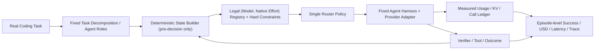
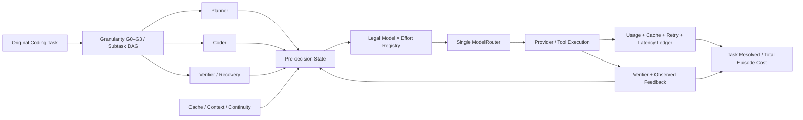

# ModelRouter · 论文研究问题、实验协议与图表交互式原型（V3 草案）

> **定位**：研究论文专用的 *RQ → Hypothesis → Experimental Contrast → Metric → Figure → Table* 设计与空白占位模板；不替代 `RESEARCH_OVERVIEW.md`（研究方法）、`EXPERIMENT_QA.md`（负责人正式决策）、`PROJECT_STATUS.md`（最新进度）或 `PLANNING_MEMORY.md`（交接历史）。
>
> **状态：DRAFT / PAPER DESIGN / NOT APPROVED FOR EXECUTION。** 本文 5 RQ、8 张正文图、12 张表格与实验规模均为**论文规划**。除明确指向既有报告的历史结果外，本文所有结果表**只有首行和首列**，数值单元格均留空；没有新的 Agent Benchmark、付费 API、Kev 训练授权或成果暗示。
>
> **时间**：2026-10-13；**研究主线**：长程单 Agent 与多子代理任务的动态 `(model, native reasoning_effort)` 选择，利用任务拆分、执行状态、KV/上下文连续性、未来 Trace/失败恢复，在成功率约束下优化全任务成本。
>
> **交互式展示**：[网页版论文原型](交互式原型/index.html)（静态 HTML，无结果数据；若 GitHub 未启用 Pages，可下载 `index.html` 本地打开）。**阅读说明**：Markdown 是详细科研协议的主文档，HTML 是相同 5 RQ / 8 图 / 12 表的视觉浏览器，不另建研究决策源。

## 0. 研究定位与文件职责

### 0.1 一句话论文主张（待真实实验验证）

在长程 Agent 系统中，**最低单次调用费用不等于最低完整任务成本**。任务拆分粒度、模型能力与原生推理档位、真实 KV 缓存/上下文连续性、验证失败与恢复、协作与动态资源条件，会共同改变任务级经济最优的模型分配。论文检验动态路由是否真的优于固定模型、Task-only、Rule/Sticky 与简单学习型策略；**没有结果前不能写“已证明节省”**。

**不主张**首次 Agent 动态路由、首次 Model × Effort、首次 cache-aware routing、首次任务拆分、首次多子代理编排；这些已有邻近研究，必须通过控制实验说明新增价值。也不把 660 万异构行、486 万候选记录等同于 486 万真实反事实最优路由标签。

### 0.2 与项目现有资产的关系

| 文件 / 资产 | 本文如何使用 | 不在本文维护的事项 |
|---|---|---|
| [RESEARCH_OVERVIEW](../../our-project/planning/RESEARCH_OVERVIEW.md) | 方法总纲、H1–H7、受控状态、作用域 | 实时实验进度、最新 GPU 状态 |
| [EXPERIMENT_QA](../../our-project/planning/EXPERIMENT_QA.md) | Q-001=A 真实 Coding Benchmark；Q-002=B 商业+本地；Q-004=B 成功率约束；Q-005=B 分层基线；Q-006=A 同状态分支 | 未经负责人确认擅自改变决策或预算 |
| [PROJECT_STATUS](../../our-project/planning/PROJECT_STATUS.md) | 唯一实际执行状态和下一授权动作 | 历史对话中的计划当作已完成 |
| [PLANNING_MEMORY](../../our-project/planning/PLANNING_MEMORY.md) | 历史研究决定与跨 Agent 交接 | 将本文每个草案设成正式决定 |
| [GROUP_MEETING_RESEARCH_BRIEF](../../our-project/planning/GROUP_MEETING_RESEARCH_BRIEF.md) | 早期 RQ 命名与组会对照 | 将旧版 RQ 与本文版本混为同一正式版本 |
| [PAPER_NOTES_AND_FIGURES](../../our-project/汇报/ModelRouter组会/PAPER_NOTES_AND_FIGURES.md) | 已有论文**原图**资料与相关工作边界 | 把别人的论文截图当成本项目实验结果 |
| [训练看板](../../docs/training-dashboard/index.html) | 已完成 Laya 离线训练指标/Checkpoint 历史 | 冒充任务级经济评测 |

### 0.3 RQ 版本演进（务必显式保留）

- **组会简纲旧版**：RQ1 状态增量；RQ2 联合动作；RQ3 任务级目标；RQ4 缓存/History；RQ5 决策器开销。旧版仍可作为研究假设/消融索引。
- **本 V3 草案**：RQ1 端到端经济有效性；RQ2 任务拆分粒度与分工；RQ3 异构 Model × Effort 资源分配；RQ4 局部贪心与长期成本；RQ5 泛化/适用边界。
- **新旧对应**：旧 RQ1 → 新 RQ1/RQ5 状态消融；旧 RQ2 → 新 RQ3；旧 RQ3/4 → 新 RQ4；旧 RQ5 → 新 RQ1 的路由开销与附录 Kev/Laya。新增 RQ2 为结构—路由相互作用。
- RQ 是论文研究问题，不是已获批准的 Q-ID；如批准更改正式研究协议，应另在 `EXPERIMENT_QA.md` 留痕。

## 1. 论文叙事、核心方法与证据边界

### 1.1 论文叙事的六个环节

1. **Motivation：问题发现**。用 Artificial Analysis 同一日期的模型能力—Cost per Task 数据绘制静态 Pareto，再用真实模型/供应商价格、缓存条款、实际调用记录说明为什么静态前沿不能代表长程 Agent 任务经济性。该图**不设为 RQ1**。
2. **System & Method**。固定一个真实 Coding Agent Harness；任务拆分为可重放的方案；单一 Router 接收决策前八组状态与合法动态 `Model × Effort` 选项；Provider Adapter 执行；Episode Ledger 统一记账并反馈。
3. **RQ1 主结果**。在相同任务、候选、预算与 evaluator 下，比较完整路由策略与固定/简单策略的成功率—整任务成本前沿。
4. **RQ2/RQ3 因素**。先固定资源分配比较任务拆分粒度，再固定拆分比较 Model × Effort 分配；最后报告交互效应，不能把两个因素混淆。
5. **RQ4 长程机制**。同状态分支或有明确可比性的任务运行，检验即时低价与完整任务成本排序的反转；分解缓存、重读、失败、重试、路由本身开销。
6. **RQ5 边界与案例**。未见任务/仓库、Agent 规模、供应商故障、模型池变化、价格和缓存冷热条件，报告成功率、成本、CI 和何时退化；用真实同任务案例解释路径。

### 1.2 最小执行闭环



任务拆分实验可以改变分解/角色结构，但**不暗中更换 Harness、tool 权限或 evaluator**；第一版不用额外学习型任务拆分器。安全连续性和 provider 能力属于硬约束，不因“去 Cache 状态”消融而解除安全限制。主方法可用 Kev-4B 风格单一学习型决策器；Laya 为小模型对照，简易规则/GBDT 等用于验证复杂模型是否必要。

### 1.3 证据等级（每份数据与图必须标注）

| 等级 | 证据 | 可以声称 | 不可以声称 |
|---|---|---|---|
| E0 | Artificial Analysis / 厂商价格/能力说明 | 静态能力、版本化公开报价、静态费用前沿 | 完整 Coding Agent 成功率或缓存净收益 |
| E1 | CCH 聚合与 Blog 真实调用 | 已观察 Token/费用/缓存/档位分布（按来源可见粒度） | 缺 task_id/终局时的任务成功率或任务级 Trace |
| E2 | 开放 Agent 历史轨迹 | 已执行动作的轨迹、结果、部分长度/时序 | 未执行 model×effort 的最优反事实结果 |
| E3 | 相同任务可比较的真实 Episode | 端到端成功率、累计费用/延迟与观察到的缓存读写 | 严格同一中途状态的局部因果比较（若不能恢复） |
| E4 | 同状态可恢复分支 | 相同决策前状态下两动作及相同 continuation 的受控对比 | 外推所有其他未运行候选 |
| E5 | 冻结策略的独立 held-out Benchmark | 预注册指标下的外部有效性与置信区间 | 无限制推广到所有模型、任务或供应商 |

### 1.4 六类不可混淆的“成本”

- `per_call_api_usd`：单次计费的输入、缓存读/写、输出及其他实际 API 费用；不同 Provider 按同版价目表与单位。
- `episode_api_usd`：任务开始至终止**所有 API 调用**的费用之和，包含失败/重试，避免重复把“失败费用”再加一次。
- `local_gpu_hours` 和 `local_gpu_cost_estimate`：本地推理/路由所耗 GPU 时间与按明确小时价模型估计的费用；与实际 API 支付分列。
- `router_overhead`：决策调用费用、路由推理时延、额外 GPU 资源；若已被 GPU 费用或 API 调用记账，不要二次加总。
- `episode_wall_time`：真实墙钟延迟，报告 P50/P95；不能不加权直接换算成 USD。
- `task_cost_to_go_observed`：已执行行为后剩余真实开销；只是观察标签，**并非未执行其他动作的 cost-to-go**。

**论文主成功率** = resolved 任务数 / 所有评测任务数（成功、失败、预算中止均进入分母）；**总任务花费** = 同一策略所有评测任务成本总和；**Cost per Resolved** = 总任务花费 / 成功任务数（成功数为 0 时 N/A）；**Savings** = 1 − Router Total Cost / Baseline Total Cost（同任务集合、同成本口径）；统计以任务而非调用行配对，报告 CI。质量约束阈值尚需负责人确定，不能在看到 Test 结果后补选阈值。

### 1.5 八类状态与作用域

| 组 | 决策前合法信息 | 主要假设 | 主要观测缺口 |
|---|---|---|---|
| Task/Subtask | 任务类型、阶段、依赖、拆分/角色与已知难度先验 | RQ2/3 | 不得读取任务最终难度或未来成功 |
| Agent/Coordination | 当前角色、handoff、活跃 Agent、协作轮次 | RQ2/5 | 未测角色不能虚构 |
| Context/Memory | 已消费上下文、压缩、当前窗口、摘要状态 | RQ4/5 | 未来输出长度不可先见 |
| Tool/Environment | 已发生工具结果、错误、环境状态 | RQ5 | 未来工具执行不可先见 |
| Verification/Recovery | 先前失败/测试结果/修复阶段 | RQ4/5 | 最终 evaluator 不能泄漏 |
| KV Cache/Continuity | 真实 cached-token、估计 prefix、TTL、affinity、switch penalty | RQ4 | measured/estimated/simulated 严格分离 |
| Temporal/Execution | 已耗时、步数、剩余预算 | RQ3/4/5 | 不得用未来总 Trace |
| Provider/Availability | 原生 Effort 支持、报价、限流/故障、模型版本 | RQ1/3/5 | 未知 ≠ 无此能力 |

## 2. 五个研究问题（最终论文草案）

| RQ | 核心科学问题 | 主要改变的变量 | 必须控制的变量 | 主图 | 主表 |
|---|---|---|---|---|---|
| **RQ1 · 整体经济收益** | 动态路由能否在成功率约束下改善长程任务的成功率—成本前沿？ | 路由策略 | 任务、模型池、预算、工具、evaluator、价格 | Fig. 3 | T3 |
| **RQ2 · 任务结构** | 拆分粒度与子 Agent 分工如何改变异构模型路由的任务级经济性？ | 任务分解粒度、Agent 角色/数量 | 候选模型、预算、验证器；拆分与决策频率分别控制 | Fig. 4 | T4 |
| **RQ3 · 资源分配** | 能否按子任务阶段/需求联合分配 Model × Effort，减少 Trace/计算而不损成功率？ | Model 与真实 Effort 分配政策 | 固定分解与路由频率、合法动作 | Fig. 5 | T5 |
| **RQ4 · 长期经济性** | 何时逐次低价决策比考虑缓存、失败和后续任务的策略更贵？ | greedy/sticky/cache/task-aware 长期价值机制 | 同状态、后续策略、工具环境、可比价格 | Fig. 6 | T6/T7 |
| **RQ5 · 泛化与边界** | 新任务、更多子代理、Provider 变化与故障时收益还能成立吗？ | 环境/模型池/任务分布 | 冻结策略、统计协议和任务分层 | Fig. 7 | T8 |

**注意**：RQ3/RQ4 不叫“消融”——消融只是可选实验技术；主张必须能被数据反驳。RQ1 是整篇论文的主结果；RQ2 解释任务结构；RQ3 解释算力分配；RQ4 解释跨步路径依赖；RQ5 解释适用范围。

### RQ1 · 端到端任务级经济收益

**Question**：在真实可重复的 Coding Agent 任务上，动态 `(model,effort)` 路由能否在维持预先规定的任务成功率下，降低完整任务成本？

- **H1a**：相比 Always-strong，Full 的总任务成本更低而成功率不劣于预定边界。
- **H1b**：Full 应至少与可行的 Task-only、Sticky/Rule 及简单学习策略比较，而不是只与最贵固定模型比较。
- **组别**：Always-Strong、Always-Cheap、Task-only、Rule/Sticky、MLP/LightGBM（合法候选）、Full ModelRouter；选定少数直接相近工作再单独公平比较。
- **控制**：相同 task IDs / repo versions / evaluator / timeout / tool/harness / provider capability / 预算。动态策略可因动作不同产生不同轨迹，这是要测量的真实效应，不强迫相同步数。
- **主指标**：Resolved、组总 API USD、Cost/Resolved、Task Pareto；次指标 P50/P95 任务时延、失败率、平均 Trace、router overhead、本地 GPU-hours。
- **统计**：task-level paired bootstrap/配对 CI；报告任务完整成本分布、成功和失败所耗；不可只筛成功任务。
- **可否证**：Full 若只比 Always-Strong 便宜却劣于简单 Sticky 或损失不可接受的成功率，论文须明确承认完整方法的增量未成立。
- **数据协议**：开发/选择任务与最终 Test 按任务/仓库隔离，禁用 Test 反复定阈值。
- **图表**：Fig. 3 成功率—任务成本 Pareto，T3 总表；附补充成本 CDF 和时间分布。

### RQ2 · 任务拆分粒度与多子代理分工

**Question**：以同一原任务为起点，不同分解粒度/角色/交接机制是否改变应选模型和成功率—成本表现？是否存在过细分解成本反而升高的非单调区间？

- **因子 A：分解粒度**：G0 无拆分（单 Agent）；G1 阶段级（规划/实现/验证）；G2 文件或功能级；G3 细粒度任务（仅在语义可拆、可验证时执行，不强行每任务都四级）。
- **因子 B：策略**：相同粒度下固定 Model×Effort vs 同一 Router。先报告 A 与 B 主效应，再报告交互，避免“动态策略自身同时改变拆分深度”。
- **控制**：同一原始 task、代码仓库、工具、安全边界、共享预算和 evaluator；不同粒度下自然出现的消息交接/上下文复制费用必须计入 Ledger。
- **评价**：Resolved、总费、每成功任务成本、子任务数、Handoff、重复工作、并行总墙钟、上下文复制 Token、缓存复用/失效、角色分配、Trace。
- **潜在混杂**：粒度引入的测试机会不同、子代理并行导致 GPU/API 排队变化、拆分器模型的费用被遗漏、不可拆任务筛选偏差。
- **有效比较**：至少进行 G×(fixed/dynamic) 交叉表；将分解器成本计入比较；无法等效拆分的任务作为单独分层，不伪造 G3。
- **图表**：Fig. 4 左侧任务分解树/角色与模型分配，右侧粒度 × 策略的成本/成功率图；T4。
- **可否证**：动态分配收益若只来自更少 Handoff 或不同分解提示词，应将贡献归于任务分解而不是 Router。

### RQ3 · 异构推理能力与 Effort 预算分配

**Question**：不同子任务/执行阶段需要的模型能力和推理强度是否不同？联合路由 Model × *原生 Effort* 能否减少完成任务所需的总 Trace/推理费用，相比只选择 Model 或只选择 Effort 更合理？

- **策略**：Fixed Model+Fixed Effort；Dynamic Model+Fixed Effort；Fixed Model+Dynamic Effort；Joint Model×Effort；Role-aware Joint。
- **合法动作**：逐 Provider/Model/Revision 明确 Effort 能力；某模型不支持 Max 则对应格子是 **N/A**，不是虚构一个 Max 测量；low/medium/high 跨 Provider 不预设等距或同语义。
- **固定条件**：相同分解粒度、子 Agent 配置、决策频率、工具条件、预算、价格快照、context 限制。
- **主指标**：Resolved、Total Cost/Cost-per-Resolved、任务 Trace、原生 reasoning/output tokens、调用数量、P95 延迟；分子任务类型与阶段报告。
- **发现**：是否发生“强模型单次贵但少失败/少 Trace、全任务更便宜”或“强模型低 Effort vs 弱模型高 Effort”的交叉；预设多个有代表性的难度层而不是事后只看胜出任务。
- **注意**：难度只能使用决策前可得信息或事后用于分组分析，不可把最终成功标签输入 Router。
- **图表**：Fig. 5 Model × Effort × task-stage 热图（缺失保留空白），并列任务 Trace/成本分布，T5。
- **可否证**：Joint 没有明显改善或 overhead 抹平收益，应如实报告。

### RQ4 · 短视决策与长期成本反转

**Question**：在什么条件下，“现在最便宜”会因为缓存冷启动/重读、持续失败与未来 Trace 变成“整个任务更贵”？面向整任务路径的策略能否利用这些条件？

- **策略**：Greedy Per-call、Sticky、Cache-aware、Task-aware Cost-to-go、Full；比较在相同合法动作空间内执行。
- **路径依赖变量**：真实 cache read/write、前缀 TTL、会话 affinity、跨模型重 prefilling、context 重读/摘要、失败/重试/恢复、剩余预算；`estimated_prefix_overlap` 不能伪称物理 KV 命中。
- **实验一：完整 Episode 配对**。同任务从开始运行多个策略，对照真实成功率和总成本（非严格同状态局部因果）。
- **实验二：受控同状态动作分支**。仅在安全可恢复的决策前状态下，从同一快照执行两个真实合法动作，并固定后续 continuation policy，比较延迟费用和最终任务 Outcome。分支需要明确 Tool/Env 恢复边界；不能从离线单轨迹推断全部替代动作结果。
- **成本分解**：Current Call；Future Calls；Failed/Retry；Cache Read/Write；Extra Re-prefill；Router Time/GPU；工具费；如各项已计入总费用，不重复加总。
- **研究输出**：任务级 cost reversal 的真实案例分布、何时保持模型连续性、何时切换收益超过失去的缓存折扣；不能预设 Sticky 总是更好。
- **统计**：同状态动作的可比对、任务类型/前缀长度/缓存冷热/Provider 分层；未提供原始物理数据则降级为估计/模拟分析。
- **图表**：Fig. 6 同状态分叉轨迹 + 路径成本 waterfall / reversal region；T6/T7。
- **可否证**：若长期策略复杂但并未优于简单缓存感知规则，应如实报告任务级优化未带来额外价值。

### RQ5 · 泛化、环境适应与实际适用边界

**Question**：模型池、任务、Agent 数量、Provider 可用性和缓存状态变化后，一个冻结的动态路由策略是否仍能可靠运行且保持可接受的经济收益？

- **场景**：In-distribution；Unseen repository；Unseen task type；More sub-agents；Dynamic model pool；Provider unavailable / rate limit；cache cold/warm or TTL change；predefined price regime。
- **控制**：冻结策略、合法候选规则和主指标，测试前固定所有场景分层；不基于最终 Test 调整路由、切换阈值或模型名单。
- **指标**：Resolved、Total Cost、Cost-per-Resolved、P95、恢复成功率、服务故障 fallback、动作非法/硬约束违规次数、CI。
- **效率条件**：路由 overhead（GPU 时间、API 调用、系统开销）必须计入总体比较；小任务上收益可能低于决策开销。
- **图表**：Fig. 7 scenario × (Success, Cost, Recovery) 结果矩阵/区间图；T8。
- **可否证**：明显退化则界定适用边界和失败原因，不能事后删去失败环境。

## 3. Benchmark、数据与研究执行顺序

### 3.1 Benchmark 来源：先真实任务，后逐层扩大

遵循已确认 Q-001=A：从**真实可复现 Coding Benchmark** 直接抽取小型技术试运行，不必另造独立合成任务。候选（需再次核许可/版本/evaluator）：SWE-bench Verified、TwinRouterBench 动态任务/静态决策基准；历史 SWE-Gym 等为训练环境/轨迹源，不可混同于自动终局 Bench。初期可提出 10 个真实任务烟测、约 50 个开发/选择任务、100+ 个独立评测任务作为**预算讨论锚点，不是已授权数额或已执行**；对同一任务的多策略比较要乘策略、模型、seed 的真实费用预算。

- Split 单位：task/repo/近重复 issue；同一任务的轨迹前缀不能跨 Train/Val/Test。
- Terminal outcome：可执行 evaluator、补丁/测试规则、timeout、环境版本、成功/失败/中断原因。
- 模型池：商业 + 本地混合（Q-002=B），官方实际可用 Native Effort、上下文、工具、缓存计价和故障 fallback。
- 预算：Q-003 只确认按模型分阶段限制的原则；**API 金额、成功率非劣容忍度与具体模型名单尚未冻结**。
- 最后一次独立 Test 只在策略及阈值冻结后运行，不能用 Test 反复选最佳 Checkpoint。

### 3.2 整体实验阶段

| 阶段 | RQ | 任务 | 输出 | 进入下一阶段前最低证据 |
|---|---|---|---|---|
| M0 问题发现 | Motivation | AA 同版 Pareto + Provider/Token/Cache 价格研究 + CCH/Blog 汇总 | Fig. 1、T1、实证问题示例 | 计价来源/时效/单位标明 |
| M1 账本与固定基线 | RQ1/3 | 真实 Coding Benchmark、同 Harness 固定模型×原生 effort、成本 ledger | T2、固定策略费用与完成率 | 真实终局与 usage 可回溯 |
| M2 动态路由主对照 | RQ1 | Task-only、Rule/Sticky、简单学习型、Full | Fig. 3、T3 | 任务级公平对照与 cost/success |
| M3 任务结构 | RQ2 | G0–G3 × fixed/dynamic | Fig. 4、T4 | 粒度与路由两个因素不混淆 |
| M4 资源分配 | RQ3 | 固定/动态 Model × Effort 组合 | Fig. 5、T5 | 所有动作真实可执行 |
| M5 长期经济性 | RQ4 | Greedy/Sticky/Cache/Task-aware；可恢复状态分支 | Fig. 6、T6/T7 | measured cache 与 estimate 不混合 |
| M6 泛化 | RQ5 | 冻结策略跨任务/Provider/Agent 规模 | Fig. 7、T8/T9 | 独立 heldout 与 CI |
| M7 案例与论文 | Case Study | 相同真实任务的完整轨迹对照与失败案例 | Fig. 8、T12、附录 | Episode 及每个调用可查 |

### 3.3 微调是研究支撑，不是贡献的主体

- Laya 的 Batch 1、Sweep-02、Full-Graded 属**离线监督能力与数据方案探索**，训练指标可放附录 T10/T11 及补充曲线，不宣称 Cost-per-Resolved 改善。
- Kev-4B 是原研究总纲中的单一学习型 Router 主候选，实际适配必须使用真实合法 label；S1 人类偏好、S2 已观测 Agent 成败、S3 请求/缓存辅助目标不能混为“同一动态最优模型标签”。
- 已分级的 660 万异构行和约 486 万合法候选，是数据资产而不是 486 万独立路由标签；训练覆盖率和路由成功率完全不同。
- 只有同状态多动作真实结果（或明确标示为估计并承认偏差）才支持相对动作选择监督；测试集和许可证待核内容不能训练。
- 是否需要更复杂学习目标取决于真实 Benchmark 与简单规则的比较，不以 Checkpoint 个数决定论文质量。

## 4. 八张论文正文图：完整绘制规范

| ID | 章节 / 目的 | 推荐布局 | 证据要求 | RQ |
|---|---|---|---|---|
| **Fig. 1** | Introduction / Motivation | 静态 Intelligence × Cost/Task 对数散点、Pareto 非支配前沿；旁注单次 vs Episode 口径 | 同版 AA 数据/日期、价目条件、Model/Effort/Context；不能凭模型名预定前沿 | — |
| **Fig. 2** | Method / 论文中心图 | 左侧任务树与 Agent 角色，中间 State+合法候选+单一 Router，右侧执行/Provider，底部缓存+成本账本与反馈 | 架构/决策前字段可复现；无“训练完成”假象 | — |
| **Fig. 3** | Main Results | x = 同一任务集 Episode Cost（对数视成本跨度）；y = Resolved%；点 = 策略；误差棒/成功率约束/Pareto | 实际任务运行、同价格与预算；不能只统计成功任务成本 | RQ1 |
| **Fig. 4** | Task Granularity | (a) G0–G3 任务拆分和子代理树；(b) x = 粒度，y = Cost/Resolved，策略分组，成功率伴随显示 | 同 task ID、子任务分解版本、handoff/复制开销 | RQ2 |
| **Fig. 5** | Allocation | 行 Model/能力档，列原生 Effort，按子任务阶段/难度分面；单元格 Cost/Resolved 和 Trace，缺失为 N/A | 合法 Effort 支持、同任务条件、模型版本 | RQ3 |
| **Fig. 6** | Long-horizon Reversal | (a) 同状态两条真实 rollout 路径；(b) 成本分解 waterfall；(c) 缓存状态/任务长度上的反转区 | 真实 cache read/write、未来失败与 Trace、成本无重复加总 | RQ4 |
| **Fig. 7** | Robustness | 行 = 场景，列 = Success / Episode Cost / Recovery / Overhead，热图和 CI；或指标变化 dumbbell | 冻结策略/独立任务；无法比较标明 NA | RQ5 |
| **Fig. 8** | Case Study | 时间轴对齐同一任务固定策略 vs 动态策略：任务阶段、选模型/effort、cache、失败、子代理 handoff、累计成本与终局 | 实际 Episode ID/trace/price revision，可复现但图中脱敏 | 贯穿 |

### Fig. 1 细节：严禁假 Pareto

- 颜色区分 Provider/模型类别，形状区分 Effort、点大小可表示延迟或 context 条件，但图例清楚。横轴 Cost per Task（与 API 单价不混淆），纵轴 AA Intelligence Index，均从同时间快照读取。
- 可以用 Opus 5.5、GPT-6.1 Sol、Haiku 5.5 作为**待核查的模型例子**，但不能未经逐点同比、同上下文计价就断言它们全都处于真实非支配前沿，更不能先画虚构坐标然后写“实测”。
- 附小窗/文字对比：单次费用与完成任务总账本为何不同；不把 Fig. 1 误当“我们的路由收益图”。

### Fig. 2 图形蓝图（布局语义；Mermaid 是可编辑底稿）



论文视觉注意：不要暗示 Planner/Coder/Verifier 永远分别用强/中/小模型；这些恰恰是待比较的动态选择。不能把 KV 缓存绘成跨模型无条件共享。主图显示一条唯一执行主线，训练器放独立小块/附录。

### Fig. 3–7 小图规范

- **Fig. 3 / RQ1**：左侧策略主结果表，右侧成功率—总成本 Pareto；主图不要画假优势点。采用同一组 Benchmark 和 task-weighted 统计；不让许多调参点冒充独立试验。
- **Fig. 4 / RQ2**：左任务树、右 G×Policy Cost 及 Success；展示分解本身成本、交接和多 Agent 并行时间，必要时分任务可拆性。
- **Fig. 5 / RQ3**：一张 Model×Effort 热力矩阵可切换指标（正文固定一项），旁边显示 Trace 分布；不支持的格子用斜线/N/A，不可填 0。
- **Fig. 6 / RQ4**：本论文机制重点，展示选贵/选便宜两路径 **当前费→后续费→重试→缓存影响→终局**。反转只有在实际受控结果中发生才标出；模拟结果须单独标注。
- **Fig. 7 / RQ5**：场景一行，指标四列；每格带样本数和 CI；跨场景费用单位统一，否则分面分别画。
- **Fig. 8**：选一个成功案例和一个失败案例更可信；任务不同须分图且不能伪称严格同状态对照。

### 图表制作约定

- 所有图的初始稿只画**结构、轴、类别与空白绘图区**，不填任何假数字/模型点。
- 正式绘制从同一个结果 manifest 读取 `task_id, run_id, policy_id, split, model_revision, effort, price_version, episode_cost, resolved` 等审计字段；不同图不可暗中用不同过滤条件。
- 每张图需保留来源/版本、样本量 N、误差定义、成功率门槛、限制与结果快照 Commit。
- 优先 SVG/PDF 矢量图；各图有单独图注和可重画的数据 CSV（仅脱敏、许可允许时提交）。

## 5. 十二张论文结果表：只有首行、首列

> **重要**：空格单元格是故意的论文占位符。**不得把空白替换为 `0`、`—` 或凭经验填写任何结果。** 每张表的字段可以通过已有 HTML 原型交互浏览并复制 TSV。所有未来实测填表时需附对应的 `run_id` 与统计口径。

### Table 1 · 模型/供应商能力与价格

**归属**：Experimental Setup。**结果口径**：必须从实际同版任务/策略快照填充；所有右侧结果格目前留空。

| Model / Provider | Intelligence Index | Native Effort | Context Limit | Input $/M | Output $/M | Cached $/M | Price Snapshot |
|---|---|---|---|---|---|---|---|
| Claude Opus 5.5 |   |   |   |   |   |   |   |
| GPT-6.1 Sol |   |   |   |   |   |   |   |
| Claude Haiku 5.5 |   |   |   |   |   |   |   |
| Open-source model A |   |   |   |   |   |   |   |
| Open-source model B |   |   |   |   |   |   |   |

### Table 2 · Benchmark/任务集与评价器

**归属**：Experimental Setup。**结果口径**：必须从实际同版任务/策略快照填充；所有右侧结果格目前留空。

| Benchmark / Split | Tasks | Agent Type | Decomposition | Evaluator | Task Split | Provider Pool | Budget |
|---|---|---|---|---|---|---|---|
| SWE-bench Verified |   |   |   |   |   |   |   |
| TwinRouterBench |   |   |   |   |   |   |   |
| Multi-agent Subset |   |   |   |   |   |   |   |
| Development Tasks |   |   |   |   |   |   |   |
| Held-out Tasks |   |   |   |   |   |   |   |

### Table 3 · 任务级主结果

**归属**：RQ1。**结果口径**：必须从实际同版任务/策略快照填充；所有右侧结果格目前留空。

| Policy | Resolved ↑ | Total Cost ↓ | Cost/Resolved ↓ | P50 Latency | P95 Latency | Trace/Task | 95% CI |
|---|---|---|---|---|---|---|---|
| Always-Strong |   |   |   |   |   |   |   |
| Always-Cheap |   |   |   |   |   |   |   |
| Task-only / Admission-only |   |   |   |   |   |   |   |
| Rule / Sticky |   |   |   |   |   |   |   |
| MLP / LightGBM |   |   |   |   |   |   |   |
| Full ModelRouter |   |   |   |   |   |   |   |

### Table 4 · 任务粒度×分配策略

**归属**：RQ2。**结果口径**：必须从实际同版任务/策略快照填充；所有右侧结果格目前留空。

| Granularity / Policy | Subtasks | Agents | Handoffs | Resolved ↑ | Total Cost ↓ | Rework | Context/Cache Overhead |
|---|---|---|---|---|---|---|---|
| G0 / Fixed |   |   |   |   |   |   |   |
| G0 / Dynamic |   |   |   |   |   |   |   |
| G1 / Fixed |   |   |   |   |   |   |   |
| G1 / Dynamic |   |   |   |   |   |   |   |
| G2 / Fixed |   |   |   |   |   |   |   |
| G2 / Dynamic |   |   |   |   |   |   |   |
| G3 / Fixed |   |   |   |   |   |   |   |
| G3 / Dynamic |   |   |   |   |   |   |   |

### Table 5 · Model×Effort 资源分配

**归属**：RQ3。**结果口径**：必须从实际同版任务/策略快照填充；所有右侧结果格目前留空。

| Allocation Strategy | Model | Native Effort | Resolved ↑ | Reasoning Tokens | Avg Trace | Total Cost ↓ | P95 Latency |
|---|---|---|---|---|---|---|---|
| Fixed Model / Fixed Effort |   |   |   |   |   |   |   |
| Dynamic Model / Fixed Effort |   |   |   |   |   |   |   |
| Fixed Model / Dynamic Effort |   |   |   |   |   |   |   |
| Dynamic Model × Effort |   |   |   |   |   |   |   |
| Role-aware Joint Allocation |   |   |   |   |   |   |   |

### Table 6 · 全任务成本拆解

**归属**：RQ4。**结果口径**：必须从实际同版任务/策略快照填充；所有右侧结果格目前留空。

| Policy | Input Cost | Output Cost | Cache Read/Write | Re-prefill Cost | Tool Cost | Router Cost | Episode Total Cost |
|---|---|---|---|---|---|---|---|
| Greedy Per-call |   |   |   |   |   |   |   |
| Sticky |   |   |   |   |   |   |   |
| Cache-aware |   |   |   |   |   |   |   |
| Task-aware Cost-to-go |   |   |   |   |   |   |   |
| Full ModelRouter |   |   |   |   |   |   |   |

### Table 7 · 缓存状态与切换结果

**归属**：RQ4。**结果口径**：必须从实际同版任务/策略快照填充；所有右侧结果格目前留空。

| Cache Condition | Switch Policy | Measured Cache Read | Measured Cache Write | Switches | Retries | Resolved | Episode Cost |
|---|---|---|---|---|---|---|---|
| Warm / Stay |   |   |   |   |   |   |   |
| Warm / Switch |   |   |   |   |   |   |   |
| Cold / Stay |   |   |   |   |   |   |   |
| Cold / Switch |   |   |   |   |   |   |   |
| TTL Expired |   |   |   |   |   |   |   |
| Provider Change |   |   |   |   |   |   |   |

### Table 8 · 跨任务与环境稳健性

**归属**：RQ5。**结果口径**：必须从实际同版任务/策略快照填充；所有右侧结果格目前留空。

| Scenario | Policy | Resolved ↑ | Total Cost ↓ | P95 Latency | Recovery | Constraint Violations | 95% CI |
|---|---|---|---|---|---|---|---|
| In-distribution |   |   |   |   |   |   |   |
| Unseen Repository |   |   |   |   |   |   |   |
| Unseen Task Type |   |   |   |   |   |   |   |
| More Sub-agents |   |   |   |   |   |   |   |
| Changed Model Pool |   |   |   |   |   |   |   |
| Provider Unavailable |   |   |   |   |   |   |   |
| Cache/TTL Changed |   |   |   |   |   |   |   |

### Table 9 · 机制贡献与反事实对照

**归属**：Cross-RQ Analysis。**结果口径**：必须从实际同版任务/策略快照填充；所有右侧结果格目前留空。

| Variant | Resolved ↑ | Total Cost ↓ | Cost/Resolved ↓ | Cache Reuse | Trace | Switches | P95 Latency |
|---|---|---|---|---|---|---|---|
| Full |   |   |   |   |   |   |   |
| w/o Runtime State |   |   |   |   |   |   |   |
| w/o Dynamic Effort |   |   |   |   |   |   |   |
| w/o Cache Features |   |   |   |   |   |   |   |
| w/o Agent Coordination |   |   |   |   |   |   |   |
| w/o Cost-to-go |   |   |   |   |   |   |   |

### Table 10 · 监督数据、分级与有效性

**归属**：Appendix。**结果口径**：必须从实际同版任务/策略快照填充；所有右侧结果格目前留空。

| Data Source / Supervision | Raw Records | Train Items | Independent Units | Val Units | Label Balance | Coverage | Permission |
|---|---|---|---|---|---|---|---|
| S1 Human Preference |   |   |   |   |   |   |   |
| S2 Agent Observed Outcome |   |   |   |   |   |   |   |
| S3 Cache / Token Auxiliary |   |   |   |   |   |   |   |
| L1 |   |   |   |   |   |   |   |
| L2 |   |   |   |   |   |   |   |
| L3 |   |   |   |   |   |   |   |
| L4 |   |   |   |   |   |   |   |

### Table 11 · Laya/Kev 微调与 Checkpoint

**归属**：Appendix。**结果口径**：必须从实际同版任务/策略快照填充；所有右侧结果格目前留空。

| Model / Checkpoint | Train Items | Epoch / Steps | LR | Val Loss | Accuracy | Brier | ECE |
|---|---|---|---|---|---|---|---|
| Laya Base |   |   |   |   |   |   |   |
| Laya N05-E02 |   |   |   |   |   |   |   |
| Laya N09-E01 |   |   |   |   |   |   |   |
| Laya Full-Graded |   |   |   |   |   |   |   |
| Kev Base |   |   |   |   |   |   |   |
| Kev Fine-tuned |   |   |   |   |   |   |   |

### Table 12 · 系统开销与案例

**归属**：Case Study / Appendix。**结果口径**：必须从实际同版任务/策略快照填充；所有右侧结果格目前留空。

| Policy / Episode | Router Time | GPU-hours | Prompt Tokens | Cached Tokens | Tool Calls | Resolved | Total Cost |
|---|---|---|---|---|---|---|---|
| Fixed Model |   |   |   |   |   |   |   |
| Rule Router |   |   |   |   |   |   |   |
| Laya Router |   |   |   |   |   |   |   |
| Kev Router |   |   |   |   |   |   |   |
| Case A |   |   |   |   |   |   |   |
| Case B |   |   |   |   |   |   |   |

## 6. 图表—实验—数据契约索引

| RQ / Motivation | 图 | 表 | 最小数据行粒度 | 来源或生成位置 | 验收问题 |
|---|---|---|---|---|---|
| Motivation | Fig. 1 | T1 | model/version/effort/pricing snapshot | Artificial Analysis + Provider 官方定价 | static score 与 agent success 是否区分 |
| Method | Fig. 2 | T2 | decision-state/action/provider | Harness/Registry schema | pre-decision 与硬约束是否正确 |
| RQ1 | Fig. 3 | T3 | task × policy × seed Episode | Episode Ledger + Verifier | same tasks, full-cost denominators |
| RQ2 | Fig. 4 | T4 | task × granularity × allocation | decomposition manifest + Ledger | decomposition 和 routing 是否分因子 |
| RQ3 | Fig. 5 | T5 | task/subtask × model × effort | Registry/Provider usage + Ledger | Effort 是否原生支持 |
| RQ4 | Fig. 6 | T6/T7 | state × action branch + full Episode | restore points + measured cache ledger | 是否真正可比、没有伪缓存 |
| RQ5 | Fig. 7 | T8 | frozen policy × heldout scenario | task/repo split + Ledger | 测试前参数冻结 |
| Mechanism | — | T9 | task × ablation / rule | same experimental configuration | 有没有实际控制其他变量 |
| Case Study | Fig. 8 | T12 | step/trace + cumulative ledger | same real task Episode | 轨迹完整且匿名 |
| SFT Appendix | curves | T10/T11 | source/unit and epoch checkpoint | Laya/Kev training manifest | train loss ≠ task cost gain |

### 6.1 建议统一的最小结果列（仅设计）

```text
campaign_id, source_revision, benchmark, split, task_id, repository_id,
episode_id, seed, agent_harness_version, evaluator_version,
decomposition_id, granularity, role_id, decision_step, observed_at,
policy_id, checkpoint_id, router_version, model_id, provider, model_revision,
native_effort_requested, native_effort_effective, candidate_pool_version,
price_catalog_version, cache_evidence(measured/estimated/simulated/unknown),
input_tokens, output_tokens, reported_cached_read_tokens, cache_write_tokens,
tool_calls, switches, retries, episode_api_usd, local_gpu_hours,
episode_latency_ms, resolved, termination_reason
```

没有观测到的字段保留 missing/unknown，不填 0；若字段按调用级存储，Episode 聚合时必须明确关联规则，不能把一行调用当一项独立任务。

### 6.2 每 RQ 的“论文结果”定义

- RQ1 至少要有可比较的策略主表、误差/置信区间，以及成功率约束内的费用比较。
- RQ2 至少要有 G0–G3 的任务集适用比例、固定与动态两个因素的交叉结果，且账本包含分解器与 handoff 开销。
- RQ3 至少要有合法 Model×Effort 支持矩阵、分阶段 Trace/Cost 与固定/联合分配对比。
- RQ4 至少要有真实缓存量或明确的降级标签、策略 Episode 比较和至少一组可审阅的受控状态分支；没有受控分支时限制因果主张。
- RQ5 至少要有一个事前定义的独立变化场景、冻结策略和失败/退化案例分析。
- 每张图不允许仅有示意图却写“结果”；没有数据的图统一标 **TEMPLATE / PENDING**。

## 7. 论文写作顺序与文稿章节映射

| 章节 | 论点 | 图 | 表 | 可用证据与待补充 |
|---|---|---|---|---|
| 1 Introduction / Motivation | 静态能力/单次费用不代表长程任务经济性 | Fig. 1 | T1 | AA + 价格 + CCH/Blog；任务级结论待 Benchmark |
| 2 Background / Problem | task-level policy、合法动作、缓存与成本口径 | — | T2 | 研究总纲中已定义 Schema；真实任务待运行 |
| 3 Method | 任务结构、状态感知、合法 Model×Effort、单一 Router、反馈 | Fig. 2 | — | 架构设计；不虚报训练和路线结果 |
| 4 Experimental Setup | 数据/任务/模型、Baselines、Evaluator、预算与统计 | — | T1/T2 | 明确 Q-ID 仍待冻结的细节 |
| 5 Main Results / RQ1 | 全局是否节省完整任务费用 | Fig. 3 | T3 | 待真实对照 |
| 6 RQ2 / RQ3 | 任务粒度、协作和能力预算分配 | Fig. 4/5 | T4/T5 | 待控制实验 |
| 7 RQ4 | 路径依赖、缓存与长期成本反转 | Fig. 6 | T6/T7 | 待受控分支/真实缓存 |
| 8 RQ5 / Failure Analysis | 泛化、恢复、Provider 变化 | Fig. 7/8 | T8/T9/T12 | 待独立测试/案例 |
| Appendix | SFT、数据监督定义、更多曲线和 CI | 补充图 | T10/T11 | 可复用 Laya 已记录数据但不能当任务级收益 |

## 8. 实验执行/结果填充纪律

1. **本文只记录论文结构**，不创建第二个数据清洗/训练/调度入口，不要求 PR/CI 或重复工程门禁。
2. 每个已批准实验 Run 结束后，Execution Agent 先把实际数据写入权威实验 manifest / 现有 Dashboard；**本规划文档中的空白表不在未经评审/确认前填入混口径旧结果**。
3. 论文结果可由统一 manifest 派生填表/绘图；图注必须带模型版本、任务集与分割、价格版、N、CI、日期和 Git Commit。
4. 静态 AA 图或文献原图应保留来源链接、出处、日期；不得把“Opus/Haiku/Sol 在图上看起来最前沿”当作我们的实验结论。
5. 真实 Benchmark 所需的额外模型下载、商业 API 额度、服务器占用和独立 Test 必须单独获得明确授权。
6. 已训练但没有真实任务级结果的 Laya Checkpoint 仅支持离线预测/校准报告；正式 Route 对比仍需 Harness 和 Ledger。
7. 若任何 RQ 无法被当前数据支持，标记 `PENDING_DATA` / `NOT_EVALUABLE` 并说明缺口，不回填推测数字。
8. 图中空白不等于 0；文档表格仅第一行和第一列，配套 HTML 保持同一批类别名。

## 9. 资料与近邻工作索引（作用边界）

- Artificial Analysis / 模型发布与静态 intelligence-cost 图：https://artificialanalysis.ai/models/releases 。必须使用同日模型快照和计价说明。
- FrugalGPT：https://arxiv.org/abs/2305.05176 （请求级成本基线）。
- RouteLLM：https://arxiv.org/abs/2406.18665 （静态模型路由）。
- Route-to-Reason：https://arxiv.org/abs/2505.19435 （模型与推理策略关联工作；不预设 Effort 同一语义）。
- TwinRouterBench：https://arxiv.org/abs/2605.18859 （真实逐步路由近邻；需要审阅其评测协议）。
- ProgRouter：https://arxiv.org/abs/2608.25992 （进度/状态路由近邻）。
- Unified AI Gateway：https://arxiv.org/abs/2609.06940 （缓存/模型切换成本近邻，不等于本研究整任务 Agent 证明）。
- 组会详细文献/原图与截图索引：[PAPER_NOTES_AND_FIGURES](../../our-project/汇报/ModelRouter组会/PAPER_NOTES_AND_FIGURES.md)。
- 主研究设计权威：[RESEARCH_OVERVIEW](../../our-project/planning/RESEARCH_OVERVIEW.md)；正式实验许可/决策：[EXPERIMENT_QA](../../our-project/planning/EXPERIMENT_QA.md)。

**本 V3 草案的下一步**：负责人确认 RQ 文义、图表数量、Benchmark 选择与实际资源预算后，Execution Agent 将本文规划映射到现有唯一 Agent Harness / 看板中。**此版本没有触发任何 GPU/API 任务。**
