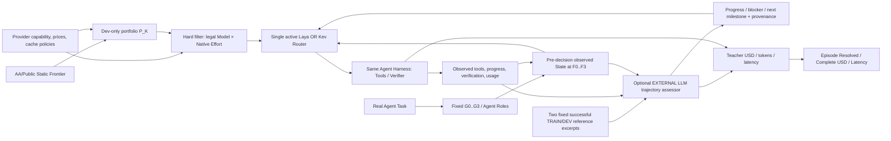

# ModelRouter · 论文研究问题、实验与图表规划（V9｜2026-10-22 输入与架构补充）

> **更新日期：2026-10-18；现行已确定：五个 RQ、八张图、十二张空白表。** 本次明确把**系统消融定为 RQ4**，删除原 V8 的独立「多 Agent 角色互补性 RQ4」；**RQ5 仍为动态路由适用边界**。历史 Q-ID / H1–H7 和已有真实训练、评测记录不被重写。
>
> **最终五个 RQ**：**RQ1 整体效果**（与同类 Router 横向比较）；**RQ2 模型池选择**（池成员与 K）；**RQ3 任务拆分粒度**（固定池/Router 比 G）；**RQ4 系统消融**（动作 Model×Native Effort、信息组 T/M/H、训练数据/监督与必要运行机制）；**RQ5 工作负载适用边界**（何种任务条件下动态路由有/无净收益）。**原角色互补性不再是独立 RQ**，角色字段仅在实际 Agent 状态和 RQ4 状态消融中按需研究。
>
> **导师汇报 / PPT 大纲（V8｜14 页，约 12–15 分钟）**：[汇报提纲.md](汇报提纲.md)——逐页标题、讲述重点、主方法 Fig.2 的每个模块/变量/箭头、各 RQ 图的坐标和对照、12 张空白表的用途、后续生图素材数量。**当前只规划，不制作 PPT 或图片**。
>
> **旧交互式视觉原型**：[交互式原型（V7，未同步 V8）](交互式原型/index.html)；不能作为本轮最新 RQ 的权威依据。

> **V9 设计补充（2026-10-22）**：不改变已经确认的 **RQ1 总体、RQ2 模型池、RQ3 拆分、RQ4 系统消融、RQ5 工作负载边界**，也不增加第六个 RQ。按负责人最新要求，在原 Fig.2 Agent Runtime **外部**补充“相似顶级成功轨迹检索 → 独立大模型工具/进展合理性短评 → 单一 Router”的支路，并将每个具体模型 × 原生 Effort 的能力 Benchmark 证据纳入动态候选。详细字段见 §1.3a 与 [研究总纲](../../our-project/planning/RESEARCH_OVERVIEW.md)；这些是**待训练/待验证的输入方案**，不是已运行的评测结果或新增付费 API 授权。

> **2026-10-28 V9 最近讨论简化补充（拟议，未实现）**：正式权威仍是 **5 个 RQ + 8 图/12 表**；聊天里“改三核心 RQ、消融合入 RQ1”的组织建议尚未正式批准，不自动修改原 RQ/Fig/Table 编号。Fig.2 外置教师简化为**单个顶级推理模型 + 固定两条来自合法 TRAIN/DEV 的公开成功轨迹摘要**（高效完成/失败恢复），不建实时相似度检索；约积累三次模型生成或关键阶段/停滞事件时，在下一次 Router 决策前生成 `progress_summary, main_blocker, next_milestone`，另记录截止步骤、参考 ID、教师完整 Token/美元费用/时延。模型能力卡优先软件工程/代码/工具 Benchmark 的原始分和原始单位、AA 综合 Intelligence Index（不是正确率百分比）、对应真实 Effort 证据；只派生综合低中高，缺失档位 `NOT_MEASURED`。健康训练继续；Laya/Kev 各按同协议 Val 选可加载候选，再用独立 Dev Agent 完整 Episode 比较后决定继续微调主线，初始研究池暂以 K=3 个可用模型为目标。mini-SWE-agent 是 Agent 框架，SWE-bench Lite/Verified 和 Terminal-Bench 2.1/Harbor 评测任务不同，结果不得混用。本轮文档同步不是新训练、付费调用、测试或图表实测授权。

> **2026-10-29｜初始 K=3 模型池与能力证据刷新（最新负责人纠正）**：论文正式 V9 五 RQ、Fig.1–8、T1–T12 不变。首轮模型身份 `gpt-6.1-sol`（高）、`gpt-6-luna`（中）、`qwen3.8-flash`（第三档**托管 Qwen3.8-Flash**）；此前同日草稿误写 `Qwen3.8 27B`，已按最新用户指定纠正。三档只是研究角色、不是严格能力或价格排序；公开标准价输入/输出美元/百万 Token 为 2/10、0.10/0.50、0.15/0.47，Qwen 输入费反高于 Luna。AA Sol Max 52、Luna Max 38（v4.3.2），Qwen Flash 托管版同版分数缺失；不能以开源 `Qwen3.8-Flash-Next` 的 40 分替代。三者合法 Effort、部署/工具权限仍需验证。未来本地 Agent 在**原代码路径**抓取合法 AA API、官方 Benchmark/价格信息，并**立即建立可追溯的初始本地快照/可消费能力卡**；专用脚本**每次运行尝试重新抓取**，失败只沿用明确标注过期的上次成功快照，不在每次 Router 决策在线抓取；每轮训练/正式评测冻结 snapshot。当前健康训练继续，各自固定 Val 选实体、Dev 比较后基于胜出可加载权重叠加继续微调新字段及合法监督。六份文档只保守去重；没有新增训练、实际抓取、付费调用或 Agent 成绩。官方型号与报价见 https://developers.openai.com/api/docs/models 、https://docs.qwencloud.com/developer-guides/getting-started/model-prices；能力版本与来源见 https://artificialanalysis.ai/models/releases/gpt-6-1-sol 、https://artificialanalysis.ai/models/releases/gpt-6-luna 。

## 0. 研究定位与版本

### 0.1 新的统一思路

**先选择值得路由的模型集合，再决定在什么任务粒度、对哪个子 Agent、以什么推理档位调用，以及当前节省是否会在未来缓存重读、失败或重试中被抵消，最后用真实 Agent Benchmark 检验动态策略是否创造新的非支配策略点。**

- **配置层**：`provider / model / revision / native_effort`；同一模型的不同原生 Effort 是不同可执行动作，同模型不同 Provider 属部署/价格/可用性差异。
- **模型池层**：公开能力—成本 Pareto 仅用于初选；与 Agent 开发集实际能力、互补模型、前沿外模型对照。**等 K 选池**与**同池对比 Router**必须分开。
- **工作流层**：同一原任务可按 G0–G3 固定分解（单 Agent、阶段、功能、可验证细粒度），路由 F0–F3（任务、阶段、子任务、合法调用）；两维不能混淆，不新增 Agent 架构搜索。
- **决策层**：单一 Router 在真实执行前观测状态与合法动作，选择 `Model×Native Effort`。执行后的真实费用、缓存和成败反馈成为下一决策输入。
- **经济层**：主指标是同任务完整 Episode 成功率与平均实际成本。目标是**在观测到的固定/随机混合前沿之外获得新有效点**，不是宣称超越理论所有策略的最优边界。
- **学术层**：模型池、任务粒度、Model×Effort、缓存历史各自建立可否证对照；最终端到端结果作为总评，不以 Laya/Kev 的训练 Accuracy 替代。

**当前正式主线（V9）**：**Overall Performance → Model Pool Selection → Task Decomposition → Systematic Ablation → Workload Applicability**。不以多 Agent 角色互补性作为独立研究贡献；但 Agent 状态中合法可见的角色/子任务仍可作为消融信息。

### 0.2 与项目现有资产的关系

| 文件 / 资产 | 本文如何使用 | 不在本文维护的事项 |
|---|---|---|
| [RESEARCH_OVERVIEW](../../our-project/planning/RESEARCH_OVERVIEW.md) | 方法总纲、H1–H7、受控状态、作用域 | 实时实验进度、最新 GPU 状态 |
| [EXPERIMENT_QA](../../our-project/planning/EXPERIMENT_QA.md) | Q-001=A 真实 Coding Benchmark；Q-002=B 商业+本地；Q-004=B 成功率约束；Q-005=B 分层基线；Q-006=A 同状态分支 | 未经负责人确认擅自改变决策或预算 |
| [PROJECT_STATUS](../../our-project/planning/PROJECT_STATUS.md) | 唯一实际执行状态和下一授权动作 | 历史对话中的计划当作已完成 |
| [PLANNING_MEMORY](../../our-project/planning/PLANNING_MEMORY.md) | 历史研究决定与跨 Agent 交接 | 将本文每个草案设成正式决定 |
| [GROUP_MEETING_RESEARCH_BRIEF](../../our-project/planning/GROUP_MEETING_RESEARCH_BRIEF.md) | 早期 RQ 命名与组会对照 | 将旧版 RQ 与本文版本混为同一正式版本 |
| [PAPER_NOTES_AND_FIGURES](../../our-project/汇报/ModelRouter组会/PAPER_NOTES_AND_FIGURES.md) | 已有论文**原图**资料与相关工作边界 | 把别人的论文截图当成本项目实验结果 |
| [训练看板](../../docs/training-dashboard/index.html) | 已完成 Laya 离线训练指标/Checkpoint 历史 | 冒充任务级经济评测 |

### 0.3 版本演进

| 版本 | 五个 RQ 的主要划分 | 关系 |
|---|---|---|
| V3 | 整体收益、任务结构、联合分配、长期成本、泛化 | 保留原任务粒度问题 |
| V4 讨论建议 | 任务级目标、决策粒度、联合分配、缓存、状态/复杂度 | 未单独落库 |
| V5 | 模型池前沿、全局收益、联合分配、缓存、重新路由 | 增加模型池，但任务拆分降为附属 |
| **V6 当前草案** | **模型池、任务拆分/频率、联合分配、缓存/历史、端到端前沿收益** | 同时保留模型池新意与多子代理核心，5 个 RQ 不扩张 |

**V9 修订**：RQ1 只回答完整方法与强基线的总体表现；联合 Model×Native Effort、KV/Trace/反馈、输入信息组和监督/数据配方的**受控消融移入 RQ4**。完整 Episode 费用既是全部 RQ 的计量口径，也是 RQ1 主表和 RQ4 消融的共同评价指标。正式 Q-ID/H1–H7 不因论文重编号而改变。

| V7 历史 | 模型池、任务结构、候选泛化、稀疏反馈、整任务经济收益 | 2026-10-13 方案，已被 V8 的 RQ 编号替代 |
| V8 历史 | 总体效果/机制、模型池、任务拆分、角色模型互补性、任务适用边界 | 2026-10-16 版本，**原 RQ4 已废止**，参见历史提交 |
| **V9 当前** | **总体效果、模型池、任务拆分、系统消融、任务适用边界** | 2026-10-18 负责人明确决定：旧 RQ4 删除，系统消融正式取代为 RQ4，RQ5 保留 |

## 1. 前沿定义与方法边界

### 1.1 三种前沿，三个不同对象

| 前沿 | 横轴 | 纵轴 | 数据与作用 | 可比较对象 |
|---|---|---|---|---|
| 公开能力—费用前沿 | 来源实际使用的 Cost per Task 或 Token Price | 来源 Intelligence / Benchmark Score | 同日、同版本来源快照；选池先验 | 同一公开指标内的配置 |
| 真实 Agent 固定配置前沿 | 所有任务的平均完整 Episode 费用 | 相同任务集 Resolved% | 固定 Harness、每个配置真实执行 | 同坐标的固定配置与混合 |
| 真实 Agent 动态策略前沿 | 含路由开销的平均完整 Episode 费用 | 相同任务集 Resolved% | 动态策略真实执行 | 同池、同任务的固定/动态策略 |

Artificial Analysis 是第三方，厂商自己的评测声明单独登记来源；两者均只在各自任务、版本和计价条件下定义前沿，本文不将它们混称为厂商造假。
Artificial Analysis 当前方法区分 Token Price、混合单价和它自身工作负载的 Cost per Task，后者包含真实消耗 Token；因此不能笼统说公开前沿都只是 Token 单价图，也不能把公开 Cost per Task 当作我们的 Agent Episode 费用。
两个面板的模型标签可以对齐，坐标数值与纵轴不能直接合并；实验证明的是外部指标迁移性和本任务域的策略增益。

### 1.2 何谓向左上改善

- Pareto 支配：费用不更高且成功率不更低，至少一项严格改善
- 同费用收益：ΔSuccess@Cost
- 同成功率收益：Savings@Success
- 固定配置之外的强对照：任务无关随机混合包络
- 数据范围：只比较实测支持重叠区间；成功率容忍度事前确定
- 不能成立的推断：低于最贵配置费用 → 整条前沿已经被支配

动态策略能够创造新的非支配点，但仍属于扩展策略集合自身的前沿，不能声称突破了所有可能策略的理论最优界。

### 1.3 最小方法闭环

Pool 在开发阶段冻结；RQ2 **改变 K 与具体池成员**，RQ3 **固定池/Router 改变同一任务的拆分 G**，RQ4 **固定池/任务/评测口径改变动作、可选状态信息或训练监督配置**，RQ5 **固定 Router/池/G 比较预定工作负载条件下的相对收益**。同一个 Laya **或** Kev Router 负责 Model×Native Effort 联合选择；**外置轨迹评审器不是第二个选路 Router**，只处理状态摘要。仍不引入学习型拆分器或跨模型 KV 迁移功能。

### 1.3a · 输入字段和模块接口：外部轨迹评审 + Model×Effort 能力卡（2026-10-22）

**结构定位**：外部评审器放在 Agent Harness 之外、Router 之前。它可以独立调用一次顶级/强大模型，参考若干**其他合法 Train/Dev 相似任务**的已验证成功轨迹与当前 Agent 截至 `decision_id` 的工具历史，压缩成短信息：工具使用意图是否合理、阶段/进展、是否无效重复、验证缺口、下一关键里程碑与不确定度。它不执行工具、不直接告诉 Agent 隐藏答案、也不负责选生成模型；只有单一活跃 Laya 或 Kev 执行最终路由。在线触发频率（阶段/失败恢复/停滞，非每步必调）、教师模型/档位、参考库规模与 token 上限需 Dev 小试。

| 输入对象 | 字段（拟议） | 解释和来源 |
| --- | --- | --- |
| `task_state` | `task_id, task_summary, task_domain, subtask_id, agent_role, stage, step_index, remaining_steps, context_tokens, remaining_time_seconds, remaining_budget_usd` | 当前任务与已知预算，估计/实际 token 分开 |
| `tool_trace` | `recent_tool_events[{tool_name, tool_intent, args_digest, observed_result, observed_at}], progress_milestones, verification_status, recovery_attempts` | 只记录已经发生的行为，退出码不是合理性结论 |
| `external_trajectory_assessment` | `short_summary, tool_intent_alignment, progress_alignment, redundancy_risk, verification_gap, next_milestone_short, risk_flags, confidence, assessed_through_decision_id` | 外置 teacher/critic 的推断短评，不是最终成功标签 |
| `assessment_provenance` | `teacher_model_id, teacher_native_effort, reference_trajectory_ids, reference_split, retrieval_protocol, trigger_reason, generated_at, teacher_input/output_tokens, teacher_cost_usd, teacher_latency_ms, status` | 教师来源、时间截止、Token/时延/真实费用入账 |
| `continuity` | `previous_model_id, previous_native_effort, reported_cached_tokens, estimated_prefix_overlap, session_affinity, estimated_switch_penalty` | 实测 cached read 与预测复用不混为一谈 |
| `legal_actions[]` | `provider, model_id, revision, deployment_id, native_effort, action_id, available_now, supports_tools, context_limit, price_snapshot_id, capability_evidence[]` | 先硬过滤；动作是具体型号+该 Provider 真正支持的档位 |
| `capability_evidence[]` | `benchmark_id, version, metric, score_raw, score_normalized, harness, evaluator_revision, eval_split, evaluated_effort, sample_count, eval_date, source_url, evidence_status` | 每档 Effort 的实测分数仅在确有同协议结果时填；未测=NOT_MEASURED |

**Benchmark 能力维度（待核具体版本/来源）**：拟先看软件工程修复、代码推理、工具调用，例如 SWE-Bench Pro、LiveCodeBench、BFCL；综合能力分数可作可选辅助。保留模型原始 ID 与明确的 Provider、Endpoint、Revision；不要以我们人为定的“低/中/高能力”替代分数，更不要把**模型能力等级**误作**原生 reasoning effort**。同一模型 low/high 若无各自实测，则 score_scope 标模型级/档位未知，不得复制为每档的独立真实成绩。

**实验和安全边界**：外置教师禁止看到正式 Terminal-Bench 2.1 封存题目的未来轨迹、参考答案、测试 rubric 或最终 verifier；教师费用和端到端时延属于完整 Episode。没有 teacher 时标 `NOT_USED`、调用失败标 `FAILED`，不得静默回退而计算为评审有效。现有 F05/F06/C03 训练没有被证明学会读取该能力卡/外置短评；需要同语义训练输入与推理编码验证。消融：无评审/确定性摘要/独立 LLM 评审、只有名称+Effort/追加能力分数、只看工具返回码/检查行为和进展。结果只填真实 Task Success 和完整 USD，不把离线分数当任务效果。

### 1.4 证据要求

- `E0` 公共能力/价格表：只支持公开静态指标，不能直接推断 Agent Episode 结局。
- `E1` CCH/Blog 观察调用：支持已记录的单次成本/缓存/Token；缺少真实 task_id 的不能推断整任务成功。
- `E2` 历史 Agent 轨迹：只支持已执行动作的观察结果，不能给未执行动作伪造未来标签。
- `E3` 真实同任务 Episode：支持路由策略成本—成功率比较。
- `E4` 同一决策前状态的可恢复分支：支持受控动作间后续费用/成功差异。
- `E5` 冻结策略的独立 held-out：支持预设质量约束下的泛化与置信区间。

### 1.5 成本边界

完整任务 API USD 必须包含全部真实模型调用的输入/输出、缓存读写与失败/重试费用；重试成本不可在已计价的调用费用上重复累加。本地 GPU-hours、估计本地美元费用、路由延迟、工具费用等分列报告。单位必须相同才能绘制 Pareto。QuotaUnits ≠ USD；prefix overlap ≠ Provider 报告的物理 KV 命中；不能假设 KV 可跨模型移植。

## 2. 五个研究问题（V9，最新确认）

> 本节为当前**正式确定**的 RQ1–RQ5。旧 V8 的角色互补性独立 RQ 已取消。真实 Agent 任务仍可带有多个角色，但不把多 Agent 架构或角色专业化本身当成本文独立研究问题。

| RQ | 白话问法 | 主要变化轴 | 图 | 表 |
|---|---|---|---|---|
| **RQ1 Overall Performance** | **我们的动态 ModelRouter 与相同任务环境中的其他路由方法相比，整体成功率—成本表现如何？** | 相同工作负载/模型池/Harness/预算下改变路由策略 | Fig.3 | T3、T10（成本账本） |
| **RQ2 Pool Selection** | **池里放哪些模型、放几个最有价值？** | 模型身份成员与数量 K | Fig.5 | T6 |
| **RQ3 Task Decomposition** | **同样的模型池与 Router，任务拆多细比较划算？** | 同原任务的可复现拆分粒度 G | Fig.6 | T7 |
| **RQ4 Systematic Ablation** | **Router 究竟靠哪些设计发挥作用？联合模型与档位、状态信息、训练数据/监督，哪些必要，哪些组合有效？** | 固定任务/池/评测，仅改变受控组件、输入信息组或训练配置 | Fig.7 | T4–T5、T8、T11 |
| **RQ5 Workload Boundary** | **哪些多 Agent 任务真正适合动态路由，哪些不值得？** | 预先定义的任务类别、难度/长度、协作结构等工作负载分层 | Fig.8 | T9 |

### 2.1 动作树、状态与训练的边界

- **Model pool**：K 统计不同模型身份，池成员为 `provider/model/revision` 的实际候选；每个模型有不同且真实存在的原生 Effort 集合 `E_m`，不能由用户提前规定每个 Agent 固定用哪个模型。
- **Single Router**：每个合法调用边界，由一个路由策略在可变长 `{(m,e):m∈P,e∈E_m,legal(m,e,s_t)}` 中**同时选择模型与这个模型自己的 Effort**。树是“模型→原生档位”，而不是把几十个固定组合当成永远不变的类别。缓存、角色和历史信息属于状态/候选条件特征。
- **Multi-Agent state**：当前 `agent_role`、`agent_id`、`subtask_goal`、`task_phase`、已发生 handoff、当前上下文、KV、Trace、验证反馈、剩余预算；观测缺失标 UNKNOWN。消息 `role=assistant` 不能冒充子 Agent 的 `agent_role`。这些设计已纳入 Research Overview，但当前 P22 数据和训练权重**尚不能证明角色特征已经成功进入训练编码**。
- **证据**：S1 偏好、S2 观察性轨迹、S3 缓存辅助不是同状态、全候选 `(m,e)` 的最优反事实标签；不能从一个成功轨迹推断未执行模型会失败。

### 2.2 RQ1：完整 Router 的总体性能（已确认局部调整）

**科学问题**：在可复现的真实 Agent 任务中，相同模型身份池、真实原生 Effort 菜单、Harness、预算与最终验证规则下，ModelRouter 是否优于具有竞争力的固定、混合、简单动态以及可兼容的公开路由方法？**本 RQ 仅研究最终方法的横向性能比较；机制、输入变量、训练配方等大规模消融拟独立成一个更大的 RQ，尚未定最终编号。**

- **主对照**：固定强/低价配置、开发集最优固定策略、整任务固定策略随机混合（含双模型混合包络）、Task-only、Greedy、Rule/Sticky、轻量 Router；在多 Agent Harness 上存在真实角色时加入 Role-static；优先比较**同一执行接口真正可运行的学术路由算法**（如已合法接入的 RouteLLM/SR-KNN/Agent 方向算法），不把 TwinRouterBench 评测框架名直接当成算法名。
- **共同条件**：相同任务 ID、原始任务集合、工具/容器/终局 Evaluator、候选模型身份和每个模型自己的合法原生 Effort、可比 API 预算/成本计价与路由频率规则；对不支持动态 Effort 的外部方法明确注释动作能力差异。
- **主指标**：Task Success Rate、Mean Complete Episode USD、Cost per Resolved；补充真实 Router 费用/延迟、P95 Episode Time、按独立任务计算的置信区间。失败任务和已发生的失败重试费用全部计入总费用，不能重复计价。
- **核心结果图表**：Fig.3 成功率—Episode USD Pareto，Table 3 同环境横向对照；费用 ledger 用 T10 作为任务级总成本口径说明，并不在此宣称任何模块有贡献。
- **可证伪性**：Full 可能无法超越认真选择的双模型整任务随机混合、开发集最佳固定或 Role-static，也可能被自身路由开销抵消；均须如实报告。

### 2.2A 消融实验索引（正式归属为 RQ4，详细定义见 §2.5）

> 2026-10-18 负责人已明确确认：**本项就是新的 RQ4**。保留此节为从原 RQ1 迁移来的实验索引，详细控制与图表安排见 §2.5，不再是候选。以前独立的「角色互补性 RQ4」已删除；角色信息是可选评分特征之一，不预先断言它有效。

- **A｜动作结构消融**：Fixed Model+Effort、Model-only（模型动态、每模型合法 Effort 预先固定）、Effort-only（模型固定）、Hierarchical Model→Effort、Joint Model×Native Effort；考察联合动作在实际任务上是否产生净收益，并分别说明候选动作空间是否相同。
- **B｜决策输入消融**：T（任务/当前 Agent 与子任务）、M（模型能力和候选经济性）、H（上下文/KV/已发生 Trace 和验证反馈）的单组、双组、三组组合；根据开发集再细分关键字段。**所有模型合法性、Effort 支持、工具/权限硬约束保持启用**；去掉某组评分特征不是允许非法调用。
- **C｜训练证据消融（新增讨论方向）**：在确实能合法训练与配对的前提下，对比 S1 静态偏好、S2 观察性 Agent 轨迹、S3 缓存/调用辅助及其合规组合的作用，或 Laya/Kev Checkpoint/数据配比的真实影响。固定任务、池、评测条件，对照离线指标和真实 Episode 表现；绝不将异构观察数据当作同状态所有未选动作的反事实真值。
- **D｜运行开销与费用解释**：实际 token、reasoning、缓存读写、失败重试、路由器本身成本与延迟单独计账；这部分也可作为全论文共有的成本测量，不一定占一个消融子题。
- **实验组织**：先分组，不穷举全部原始变量；对测过的负结果做汇总，依据开发集定最终模型、独立测试不参与事后筛选；端到端成功率与 Episode USD 才能确认最终经济价值。

### 2.3 RQ2：模型池该放哪些模型、多少个？

**科学问题**：公开静态能力—价格 Pareto 与真实多 Agent 路由需求是否一致？池成员互补性以及规模 K 的边际收益如何变化？

- 在**固定 K** 下比较不同成员集合：公开前沿/Agent 开发集/价位分层/按任务互补/随机；再比较不同 K（如 3/5/8 仅作候选，不是已锁定配置）和在前沿之外加入模型的价值。
- 固定 Router、任务、拆分、Evaluator 与预算；**K 是模型身份数**，另外报告每个池实际合法 Model×Effort 动作数 `Σ|E_m|`。
- RQ2 测**池怎么搭**，不预设不同 Agent 角色必须选择不同模型；角色信息是否帮助评分可在 RQ4 的输入消融中测试。主要指标为整体任务成功率、费用、K 的边际价值及选池成本。
- 允许“两个模型足够”“扩大池子无收益”等负结果。公开 AA 图与真实 Episode 图须分开坐标。

### 2.4 RQ3：同池条件下的任务拆分效果

**科学问题**：固定模型数量、具体成员、每模型原生 Effort 支持和 Router，改变同一多 Agent 任务的可复现拆分粒度，是否改善动态分配的净收益？

- 在相同原始任务上比较整体/阶段级/细粒度子任务等可执行 G，配合至少一种固定模型或 Role-static 对照；保持 Router 核心策略及合法动作条件一致。
- 记录实际 agent 数、可用路由边界 F、handoff、上下文复制、Trace、费用和成功率。任务粒度改变可能自然增加 Agent 数：主结果可作为**整体拆分方案效果**；如需纯粒度因果结论，另加控制对照，不能声称这些因素完全独立。
- 在可用的 Coding / Research / Data 等**真实多 Agent 工作负载**上分别展示，不把不同 benchmark 难度直接作同一任务的配对比较。
- RQ3 研究**拆分方法本身带来的变化**；是否需要给 Router 提供角色、交接等额外输入，作为 RQ4 的信息消融，而不是另设角色互补性 RQ。

### 2.5 RQ4：哪些设计与训练信息真正决定 ModelRouter 的任务级效果？（系统消融）

**2026-10-22 新增 RQ4 对照**：外置轨迹评审（无/确定性摘要/独立教师短评）与教师费用/时延；工具合理性（仅看错误码 vs 参考成功轨迹引导的阶段/工具意图/重复/进展/验证）；候选输入（仅真实型号+原生 Effort vs 额外有来源的每档 Benchmark 能力卡）。固定同一合法候选池、任务、Harness、预算和验证协议，比较真实完整 Episode 费用与成功率；未证明有效前不把教师短评和能力分数写成最终方法必要项。

**科学问题**：在固定的实际 Agent 任务、模型身份池、各模型原生 Effort 菜单、Harness 和真实终局评测下，完整 Router 的性能来源于哪些组成部分？联合动作选择、决策前状态信息和训练数据/监督是否有独立贡献或组合交互，是否值得其额外运行成本？

**RQ4-A｜路由动作维度**（表 T5）：
- 固定 Model+Effort；Model-only（模型动态，Effort 用每模型合法默认档位）；Effort-only（固定同一模型，动态选择该模型合法 Effort）；分层 Model→Effort；完整**单一共享评分器联合 Model×Native Effort**。
- 每模型 Effort 档位必须来自 Provider 实际支持，不用人为设定统一 Low/Medium/High；明确行动空间变化可能带来上限变化，不把动作空间扩张误当路由器训练优势。

**RQ4-B｜决策信息与组合贡献**（表 T4）：
- 分组 T=任务需求/Agent 子任务（可含已知角色）；M=候选模型能力与经济性；H=决策前已有 Trace/上下文/KV/验证反馈/预算。
- 最小矩阵：T、M、H、T+M、T+H、M+H、T+M+H（在合法过滤、官方价格/权限/工具/context 硬规则始终存在的条件下）；再对真实共现、允许训练的 KV/Trace/Agent role 等子字段开展有重点的单项剔除。
- 信息组本身不是动作类别；当前大规模异构训练数据不具备完整八类状态同一条真实联合监督，无法把缺测字段硬填成“所有变量均可用”。允许无效变量从最终实现中删除，但已测负结果须保留记录。

**RQ4-C｜训练数据与监督方式**（表 T8、附录 T11）：
- 比较真实合法 S1 人类偏好、S2 已执行 Agent 轨迹、S3 缓存/调用辅助，以及**经许可、时间截断并实际进入输入编码的**组合；报告独立训练单元、样本覆盖、数据来源/许可证、固定训练预算、验证指标与最终任务级收益。
- Laya / Kev 的不同训练阶段、代表性 Checkpoint/数据配比可在同条件下对照，但不能把异质数据行当独立决策标签，更不能由已执行轨迹生成未选动作的最优答案。
- 训练配方本身与学习器架构差异应分开对照；若资源不足先做最能判别因果的重点对照，不为 92 种组合穷举而耗费大量 API。

**RQ4-D｜净费用与必要性**（Fig.7）：
- 汇总每个消融配置的 Task Success、完整 Episode USD、Cost/Resolved、Router 延迟与额外费用；真实 token、reasoning、cache、失败重试费用可从 T10 复用。
- 只依据开发集进行变量筛选，独立 Test 用于冻结策略的最终评价；已测不显著或变差的实验不能隐匿。**某变量未产生观察到的净收益，不等于证明它本质无效**。

**RQ1 与 RQ4 的严格分工**：RQ1 只证明最终完整方法与外部/简单基线的横向差异；RQ4 固定外部条件，改变 Router 自身动作、输入或训练数据来解释这种差异。即使总体无收益，RQ4 仍可报告各模块的真实影响。

**主图**：Fig.7 为三面板（A 联合动作、B 信息组、C 训练数据/监督）；必要时另以小面板列 Router/Cache 开销。不画虚假提升曲线。**主表**：T4、T5、T8；补充 T10/T11。

### 2.6 RQ5：哪些多 Agent 工作负载值得动态路由？（用户确认原方案 C）

**科学问题**：动态路由相对于有竞争力的简单策略，其**任务级净收益**是否随任务类别、预先可观测的任务规模/难度、协作结构发生系统变化？能否识别没有路由收益空间的场景？

- **实验**：在**已固定的 Router、池、拆分协议**下跨若干多 Agent 工作负载类别做横向实验；优先预定义 Coding/Research/Data 等可真正执行且有统一终局评价的任务类型，或按同一 benchmark 内已知任务规模、预定角色/依赖结构、预算档位分层。
- **主对照**：每个工作负载分层都重用 RQ1 中同一组强基线（尤其 Best-Fixed-on-Dev、Role-static、随机 Episode Mix、Rule/Sticky）和同一 Full Router；计算每层在**相同成功率要求**下的任务级费用差和不确定性，不只给一个 Full 的整体平均值。
- **不是简单切分 RQ1 表**：事前规定可观察的工作负载特征，检验 `policy × workload` 的收益交互；以跨类型复测和足够独立任务支撑“适用边界”，不能靠观察到好结果再筛选任务类型。任务完成后的实际 Trace/失败次数只能用于机制解释，不能冒充任务开始前的条件。
- **RQ1 区别**：RQ1 回答整体上有没有收益；RQ5 回答**在什么任务条件下有收益/无收益且是否稳定**。
- **RQ3 区别**：RQ3 控制并改变同一任务的拆分；RQ5 固定当前选定 G，比较**工作负载原有差异**，不得再次把拆分处理效果当 RQ5 新结论。
- **证伪情况**：收益与所选任务特征没有稳定关系，或样本过少以致无法可靠划定边界；必须如实报告。
- **主图**：不同预定义工作负载（任务类型×复杂度/协作结构）的`Full vs 强基线`净经济收益矩阵和分层置信区间。不要为了作图捏造任务类型覆盖。

### 2.7 论文逻辑与必要数据

- **数据优先**：RQ1–RQ5 均需要真实完整 Agent Episode、终局成功标签、当时合法池及完整费用；**RQ4** 额外要求每种训练监督/信息组的真实覆盖、可比 Checkpoint 和合法输入编码证据；**RQ5** 要有预定义的、独立任务数量足够的工作负载分层。Agent role/handoff 仅作为具体输入字段候选，而非独立的跨角色模型互补性 RQ。
- **现有训练缺口**：已加工轨迹含 `agent_framework`、消息 role、step/context 及部分 thinking mode，但这些不等于真正的子 Agent 角色监督；AgentState 已在研究总纲和数据台账设计，尚未验证进入 Laya/Kev 实际训练输入。公开数据集可帮助角色表征，不能凭此制造最佳 Model×Effort 动作标签。
- **微调定位**：Laya / Kev 的 S1/S2/S3 联合训练和 Checkpoint 比选是 Router 的训练证据，继续作为方法、训练记录和附录；离线 Accuracy 不是 RQ1–RQ5 的任务级成绩。

## 3. 实验安排与已有资产

### 3.1 Benchmark 来源：先真实任务，后逐层扩大

遵循已确认 Q-001=A：从**真实可复现 Coding Benchmark** 直接抽取小型技术试运行，不必另造独立合成任务。候选（需再次核许可/版本/evaluator）：SWE-bench Verified、TwinRouterBench 动态任务/静态决策基准；历史 SWE-Gym 等为训练环境/轨迹源，不可混同于自动终局 Bench。初期可提出 10 个真实任务烟测、约 50 个开发/选择任务、100+ 个独立评测任务作为**预算讨论锚点，不是已授权数额或已执行**；对同一任务的多策略比较要乘策略、模型、seed 的真实费用预算。

- Split 单位：task/repo/近重复 issue；同一任务的轨迹前缀不能跨 Train/Val/Test。
- Terminal outcome：可执行 evaluator、补丁/测试规则、timeout、环境版本、成功/失败/中断原因。
- 模型池：商业 + 本地混合（Q-002=B），官方实际可用 Native Effort、上下文、工具、缓存计价和故障 fallback。
- 预算：Q-003 只确认按模型分阶段限制的原则；**API 金额、成功率非劣容忍度与具体模型名单尚未冻结**。
- 最后一次独立 Test 只在策略及阈值冻结后运行，不能用 Test 反复选最佳 Checkpoint。

### 3.2 V8 实验安排（以科研必要性排序）

| 顺序 | 目的 | 对应 | 结果图表 |
|---|---|---|---|
| A | 锁定真实多 Agent task/evaluator、候选模型树、原生 Effort、完整费用口径；不改变现有训练授权 | Setup | Fig.1–2, T1–2 |
| B | 同池同任务运行固定/随机混合/简单/可比 Agent Router/Full，完成主要任务级横向对照 | RQ1 | Fig.3, T3 |
| C | 固定池与任务做联合动作、T/M/H 信息单双三组合、训练数据/监督与费用开销的系统消融 | **RQ4** | **Fig.7, T4–5、T8、T10–11** |
| D | 固定 Router/G，比不同 K 和同 K 不同模型组合，区分 K 与 `Σ|E_m|` | RQ2 | Fig.5, T6 |
| E | 固定模型池身份/K/原生 Effort/Router 改可复现任务拆分，按任务类型分层 | RQ3 | Fig.6, T7 |
| F | 对照合法训练数据/监督的真实效果，核验动态输入编码并报告独立样本、训练开销和最终任务级效果 | **RQ4（训练消融）** | **Fig.7, T8/T11** |
| G | 固定池/Router/G，预先定义工作负载分层，比较 Full 相对强基线的任务级收益边界 | RQ5 | Fig.8, T9 |
| H | 报告费用分解、真实训练证据和代表性任务轨迹；独立 Test 不用于事后挑池/变量 | 全部 | T10–12 |

**讲述顺序**是先 RQ1 让导师看到目标，再解释模型池/任务拆分/角色互补/适用边界；**实际采集顺序**可复用相同 Episode 避免重复计费，但不得从不同任务混合数据构造假配对。

### 3.3 微调是研究支撑，不是贡献的主体

- Laya 的 Batch 1、Sweep-02、Full-Graded 属**离线监督能力与数据方案探索**，训练指标可放附录 T10/T11 及补充曲线，不宣称 Cost-per-Resolved 改善。
- Kev-4B 是原研究总纲中的单一学习型 Router 主候选，实际适配必须使用真实合法 label；S1 人类偏好、S2 已观测 Agent 成败、S3 请求/缓存辅助目标不能混为“同一动态最优模型标签”。
- 已分级的 660 万异构行和约 486 万合法候选，是数据资产而不是 486 万独立路由标签；训练覆盖率和路由成功率完全不同。
- 只有同状态多动作真实结果（或明确标示为估计并承认偏差）才支持相对动作选择监督；测试集和许可证待核内容不能训练。
- 是否需要更复杂学习目标取决于真实 Benchmark 与简单规则的比较，不以 Checkpoint 个数决定论文质量。

## 4. 八张图的 V9 设计（结果点全部留空）

> **逐页制作说明**：参见 [导师汇报 V8 详细提纲](汇报提纲.md)。建议只有封面与 Agent 工作流两张 AI 场景插画（另可选一张训练/证据概念插画）；**Fig.2 论文主方法必须精确画成可编辑矢量流程图，不是 AI 随机生成的文本图**；Fig.1、Fig.3–8 的统计图当前保留精确轴、对照组和空白结果区域。

| 图 | 对应 | 坐标/结构与最终要回答的问题 |
|---|---|---|
| Fig.1 | Motivation | 静态 AA Intelligence–Price 与真实 Agent Success–Episode USD **两个独立面板**，不能把 AA 结果当 Agent 任务结果 |
| **Fig.2** | Method | **树形模型池 Model→Native Effort**、AgentState（真实角色/子任务）→**Agent 外部参考轨迹检索与可选独立 LLM 短评**；另一支为每档能力证据/价格/合法动作过滤→**单一 Laya 或 Kev Router**→任务执行→真实费用/验证/缓存反馈 |
| **Fig.3** | **RQ1 主结果** | X=Mean Complete Episode USD，Y=Task Success Rate；固定、Role-static、随机整任务混合、简单、同 Harness 学术 Router、Full；真实实测后绘 Pareto |
| Fig.4 | RQ1 结果解释 | 主结果策略的完整 Episode 成本分解（input/output/cache/router/retry）与成功率—费用基线包络说明；不与 Fig.7 的机制消融重复 |
| Fig.5 | RQ2 | 不同 Pool Rule、不同 K 的 Success–Episode Cost/边际收益，分开标注 K 与实际合法 M×E 动作数 |
| Fig.6 | RQ3 | X=可复现拆分粒度 G，Y=Success/Mean Episode USD（双面板），图例 Fixed/Role-static/Full、任务类型分层；标注 Agents/Handoffs/F |
| **Fig.7** | **RQ4 系统消融** | 三面板：A 固定/Model-only/Effort-only/分层/Joint；B T/M/H 单双三组与**外置 LLM 轨迹短评/候选分数**的有无及规则摘要对照；C S1/S2/S3 合法数据与监督配置；真实 Success/完整 USD（含教师费用）衡量，结果待测 |
| **Fig.8** | **RQ5** | X=预定义多 Agent 工作负载分层（类型/复杂度/结构），Y=在可比成功率下的 Full 相对强基线的**任务级费用改善**及不确定性；无收益区域同样保留 |

**不得填假坐标点或预设正收益**。Case trajectory、Provider cached-read 细节和失败案例可作补充图；图 8 不得简单重复图 3 的总体平均数。

## 5. 十二张空白结果表（V9）

> PPT 表格展示策略：P06 缩略展示 T1/T2 的 Benchmark/池/协议；P07 展示 T3；P08 展示 T4/T5/T10；P09–P12 分别展示 T6–T9；T11/T12 留在备用/附录页。各表行、列的口径与讲述逻辑见 [详细汇报提纲](汇报提纲.md)。

**全部结果单元格空白，不意味着零。** 第一列只是计划对照条件，实际有没有该 benchmark/模型、能否运行需以之后的执行证据为准。数据采集只需一套共享 Episode/Agent/Decision 账本，结果表从同一事实派生；没有真实结果不填数字。

### Table 1 · 模型池树与供应商能力（Setup）

| Model Identity | Provider / Revision | Allowed Native Efforts | Context | Tools | Input $/M | Output $/M | Cache Policy |
| --- | --- | --- | --- | --- | --- | --- | --- |
| Model candidate A |   |   |   |   |   |   |   |
| Model candidate B |   |   |   |   |   |   |   |
| Model candidate C |   |   |   |   |   |   |   |
| Model candidate D |   |   |   |   |   |   |   |

> **T1 补充**：每个可执行 `model×native_effort` 需关联外部能力 Benchmark 证据清单（实测评分、测试协议、实际 Effort、来源、缺测状态），单列 `capability_evidence_refs` 附表/机器可读 manifest；T1 的单价不可替代每档能力成绩。正式结果格保持空白。

### Table 2 · 真实多 Agent Benchmark / 协议（Setup）

| Benchmark / Task Type | Independent Tasks | Real Agent Roles | Decomposition G | Harness / Evaluator | Development / Test Split | Budget |
| --- | --- | --- | --- | --- | --- | --- |
| Coding tasks |   |   |   |   |   |   |
| Research tasks (if available) |   |   |   |   |   |   |
| Data tasks (if available) |   |   |   |   |   |   |
| Held-out tasks |   |   |   |   |   |   |

### Table 3 · RQ1 同类 Router 主结果

| Policy | Task Success ↑ | Mean Episode USD ↓ | Cost / Resolved ↓ | P95 Time ↓ | Router Overhead ↓ | 95% CI |
| --- | --- | --- | --- | --- | --- | --- |
| Fixed-Strong |   |   |   |   |   |   |
| Fixed-Cheap |   |   |   |   |   |   |
| Best-Fixed-on-Dev |   |   |   |   |   |   |
| Role-Static (dev-chosen) |   |   |   |   |   |   |
| Random Whole-Episode Mix |   |   |   |   |   |   |
| Task-only Router |   |   |   |   |   |   |
| Greedy / Rule / Sticky |   |   |   |   |   |   |
| Adapted Agent Router (named algorithm) |   |   |   |   |   |   |
| Full ModelRouter |   |   |   |   |   |   |

### Table 4 · RQ4 信息组单/双/三组合消融

| Information Used | Valid Action Space | Task Success ↑ | Mean Episode USD ↓ | Δ vs Full | Router Cost |
| --- | --- | --- | --- | --- | --- |
| T: Task/Agent |   |   |   |   |   |
| M: Candidate Economics |   |   |   |   |   |
| H: Execution History |   |   |   |   |   |
| T+M |   |   |   |   |   |
| T+H |   |   |   |   |   |
| M+H |   |   |   |   |   |
| T+M+H |   |   |   |   |   |
| Full minus Agent role |   |   |   |   |   |
| Full minus KV |   |   |   |   |   |
| Full minus Verifier feedback |   |   |   |   |   |
| Full minus external LLM trajectory assessment |   |   |   |   |   |
| Deterministic tool-history summary (no teacher LLM) |   |   |   |   |   |
| Full minus per-effort Benchmark ability evidence |   |   |   |   |   |

### Table 5 · RQ4 Model×Native Effort 联合动作消融

| Action Policy | Model Dynamic? | Effort Dynamic? | Task Success ↑ | Mean Episode USD ↓ | Reasoning Tokens | P95 Time |
| --- | --- | --- | --- | --- | --- | --- |
| Fixed Model+Effort |   |   |   |   |   |   |
| Model-only |   |   |   |   |   |   |
| Effort-only |   |   |   |   |   |   |
| Hierarchical M→E |   |   |   |   |   |   |
| Joint M×E |   |   |   |   |   |   |

### Table 6 · RQ2 池规模与组成

| Pool Selection | K Models | Model Identities | Legal M×E Actions | Task Success ↑ | Mean Episode USD ↓ | Marginal Value |
| --- | --- | --- | --- | --- | --- | --- |
| Equal K: AA Pareto |   |   |   |   |   |   |
| Equal K: Agent-dev |   |   |   |   |   |   |
| Equal K: Price-tiered |   |   |   |   |   |   |
| Equal K: Complementary |   |   |   |   |   |   |
| Equal K: Random |   |   |   |   |   |   |
| Expanded K |   |   |   |   |   |   |
| Off-frontier addition |   |   |   |   |   |   |

### Table 7 · RQ3 固定模型池的任务拆分

| Task Type / Same Task Set | Decomposition G | Policy | Agents | Handoffs | Route Calls F | Task Success ↑ | Episode USD ↓ |
| --- | --- | --- | --- | --- | --- | --- | --- |
| Coding: Whole / Role-static |   |   |   |   |   |   |   |
| Coding: Whole / Full |   |   |   |   |   |   |   |
| Coding: Phase / Role-static |   |   |   |   |   |   |   |
| Coding: Phase / Full |   |   |   |   |   |   |   |
| Coding: Fine / Role-static |   |   |   |   |   |   |   |
| Coding: Fine / Full |   |   |   |   |   |   |   |
| Other multi-Agent task: paired granularity (if runnable) |   |   |   |   |   |   |   |

### Table 8 · RQ4 合法训练数据/监督与微调策略消融

| Training Variant | Source / S1-S2-S3 | Independent Train Units | Input Feature Coverage | Frozen Training Budget | Offline Validation | Task Success ↑ | Episode USD ↓ |
|---|---|---|---|---|---|---|---|
| S1-only（合规子集） |  |  |  |  |  |  |  |
| S1 + S2（合规且真实已观察） |  |  |  |  |  |  |  |
| S1 + S3（仅经准入辅助） |  |  |  |  |  |  |  |
| S1 + S2 + S3（可真实共现/分层） |  |  |  |  |  |  |  |
| Representative Laya checkpoint |  |  |  |  |  |  |  |
| Representative Kev checkpoint |  |  |  |  |  |  |  |

> 行只代表拟比较的合法配置，不证明它们当前可训练、已完成或具有匹配反事实标签。结果字段保持空白；各样本准入与角色/缓存字段是否进入编码均需按真实资产说明。

### Table 9 · RQ5 工作负载收益边界

| Predefined Workload Stratum | Independent Tasks | Best Comparable Baseline | Baseline Success | Full Success | Baseline Episode USD | Full Episode USD | Net Difference / CI |
| --- | --- | --- | --- | --- | --- | --- | --- |
| Task type: Coding |   |   |   |   |   |   |   |
| Task type: Research (if runnable) |   |   |   |   |   |   |   |
| Task type: Data (if runnable) |   |   |   |   |   |   |   |
| Predefined task size: Small |   |   |   |   |   |   |   |
| Predefined task size: Large |   |   |   |   |   |   |   |
| Predefined coordination pattern |   |   |   |   |   |   |   |

### Table 10 · 全局费用与连续性账本（支持 RQ1 与消融候选）

| Policy | Input/Output USD | Cache Read/Write USD | Retry/Failed Cost | Router Cost | Trace / Task | Switches / Task | Total Episode USD |
| --- | --- | --- | --- | --- | --- | --- | --- |
| Fixed / Role-static |   |   |   |   |   |   |   |
| Random Mix |   |   |   |   |   |   |   |
| Greedy / Sticky |   |   |   |   |   |   |   |
| Full ModelRouter |   |   |   |   |   |   |   |

### Table 11 · 微调监督与 Checkpoint（Appendix）

| Checkpoint / Learner | Supervision Source | Independent Train Units | Validation Split | Val Loss | Accuracy | Brier/ECE | Eligible for Online Evaluation? |
| --- | --- | --- | --- | --- | --- | --- | --- |
| Laya / Stage1 |   |   |   |   |   |   |   |
| Laya / Full Graded |   |   |   |   |   |   |   |
| Kev / Baseline |   |   |   |   |   |   |   |
| Kev / Finetuned |   |   |   |   |   |   |   |

### Table 12 · 真实 Episode 与系统开销（Appendix）

| Task / Policy | Agent Role Sequence | Selected M×Native E | Trace | Handoffs | Measured Cache | Resolved? | Episode USD |
| --- | --- | --- | --- | --- | --- | --- | --- |
| Representative Case A |   |   |   |   |   |   |   |
| Representative Case B |   |   |   |   |   |   |   |
| Failure Case |   |   |   |   |   |   |   |
| Full Router |   |   |   |   |   |   |   |
| Role-static Baseline |   |   |   |   |   |   |   |

## 6. 结果关联字段（按真实观测，不制造反事实）

| 层级 | 必需字段与因果边界 |
|---|---|
| Model Registry | `provider/model_id/revision/native_effort_set/capabilities/price/cache_policy`；原生档位以 Provider 实际支持为准 |
| Pool | `pool_id/K/model_ids/legal_action_count/selection_split`；K≠effort 动作数 |
| Task / Multi-Agent | `task_id/task_type/repo/subtask_id/subtask_goal/agent_id/agent_role/parent_agent/handoff_so_far`，并标 `observed_at` 与 UNKNOWN |
| G/F | `decomposition_id/G/agent_count/decision_boundary_F/handoffs/context_copy` |
| Decision | `pre_decision_state/model/effort/legal_candidates/policy/router_time`；不得读取未来验证或未来 Trace |
| Evidence | `supervision_regime/task_group/observed_action/true_matched_branch`；历史单轨迹不是最优反事实标签 |
| Usage | `actual_input/output/reasoning/cache_read/cache_write/retries/router_overhead/price_snapshot`；估计和实测分离 |
| Episode | `task_id/task_type/G/pool/policy/seed/terminal_resolved/total_USD/wall_time/evaluator_version` |
| RQ4 | `ablation_group/action_policy/feature_mask/supervision_sources/train_units/checkpoint/actual_encoded_fields/terminal_resolved/episode_USD`；训练信息及动作/状态消融与全程 Episode 同口径，缺少真实反事实不补造 |
| RQ5 | `predefined_workload_stratum/independent_task_count/baseline/full/cost_delta/uncertainty`；事后 Trace 仅用于解释 |

不基于缺失的真实分支制造角色×模型“最优 oracle”；不因一次负结果就从训练/论文历史删除测试过的因素。

## 7. 论文章节与图表定位（V9）

| 章节 | Figure | Table |
|---|---|---|
| Motivation / Method / Setup | Fig.1–2 | T1–2 |
| **RQ1 Overall Performance** | **Fig.3** | **T3（主表）** |
| **RQ1 Results & Accounting** | **Fig.3–4** | **T3、T10** |
| RQ2 Pool | Fig.5 | T6 |
| RQ3 Task Decomposition | Fig.6 | T7 |
| **RQ4 Systematic Ablation** | **Fig.7** | **T4–5、T8、T11** |
| **RQ5 Workload Boundary** | **Fig.8** | **T9** |
| Appendix: Laya/Kev, Case Traces | Supplementary | T11–12 |

## 8. 适用边界与结果填写

- 开发集选择模型、池成员与阈值，独立任务只用于评估，不根据最终测试结果重新选池。
- 沿用既有实验授权与费用记录，本轮只更新研究材料，不运行付费 API、GPU 或训练任务。
- 泛化补充覆盖未见仓库/任务、模型池变化、供应商故障、缓存 TTL，选择必要场景，失败和费用一并报告。
- 即使公开前沿可以迁移、前沿外模型无增量或动态路由收益不成立，也记录结果并收紧贡献，不把预期写成事实。
- 后续填表直接使用同口径实测，不要求新增 PR、CI、审批或反复复核流程。

## 9. 来源与相关工作

- [Artificial Analysis 方法学](https://artificialanalysis.ai/methodology)：Price、Cost per Task、Provider 和模型定义
- [Artificial Analysis 模型榜单](https://artificialanalysis.ai/leaderboards/models)：同日期配置与公开指标
- [FrugalGPT](https://arxiv.org/abs/2305.05176)、[RouteLLM](https://arxiv.org/abs/2406.18665)：成本优化与路由参考
- [既有相关工作及原图](../汇报二/论文笔记.md)：相关方法边界
- [研究总纲](../../our-project/planning/RESEARCH_OVERVIEW.md)、[正式实验决策](../../our-project/planning/EXPERIMENT_QA.md)：现有研究依据

来源快照读取日期为 2026-10-13，未在本文录入当前榜单数值或宣称哪个具体型号已经最适合本项目。

- [Artificial Analysis 当前模型指数方法与 Cost per Task 定义](https://artificialanalysis.ai/zh/methodology/intelligence-benchmarking)：公开指标并非相同 Coding Harness 的完整任务费用。
- [Claude Haiku 5.5 / GPT-6.1 Sol 档位与费用](https://artificialanalysis.ai/models/comparisons/claude-haiku-5-5-high-vs-gpt-6-1-sol-low)、[Claude Opus 5.5 不同推理档位](https://artificialanalysis.ai/models/comparisons/claude-opus-5-5-vs-claude-opus-5)：仅作候选池调研入口，正式采样时以同日可用性及价格为准。

## 2026-10-16 V8 决策落款

**2026-10-18 最新明确决定（V9）**：负责人要求**消融直接成为新的 RQ4，原 V8 的 RQ4 角色互补性删除**；**RQ5 动态路由适用边界保持不变**。现行顺序为 RQ1 总体、RQ2 模型池、RQ3 任务粒度、RQ4 系统消融、RQ5 适用边界。V8/V7 的旧角色互补性编号仅在 Git 历史与 Q-ID 审批历史中可查，不属于当前论文方案。

**更新范围**：仅论文实验研究设计及空白图表口径，没有新增 API/GPU 训练、下载、跑 Benchmark 或产生任何结果。八张图和十二张表的实际数据留空；独立外部最终评测集继续遵守现有隔离规则。
