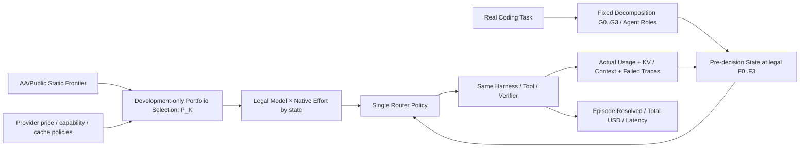

# ModelRouter · 论文研究问题、实验与图表规划（V8｜2026-10-16 导师讨论确认版）

> **更新日期：2026-10-16；现行汇报口径：五个 RQ、八张图、十二张空白表。** 这次明确调整 RQ1–RQ5 的科研定位，不改历史 Q-ID/H1–H7，不启动或声称完成真实 Benchmark。
>
> **五个 RQ**：RQ1 实际任务总体效果与联合 Model×Native Effort/变量消融；RQ2 模型池成员与 K；RQ3 同池条件下的任务拆分；RQ4 不同子 Agent 角色间是否存在可利用的模型互补性；RQ5 不同工作负载下动态路由的适用条件和无收益边界。
>
> **导师汇报 / PPT 大纲（V8｜14 页，约 12–15 分钟）**：[汇报提纲.md](汇报提纲.md)——逐页标题、讲述重点、主方法 Fig.2 的每个模块/变量/箭头、各 RQ 图的坐标和对照、12 张空白表的用途、后续生图素材数量。**当前只规划，不制作 PPT 或图片**。
>
> **旧交互式视觉原型**：[交互式原型（V7，未同步 V8）](交互式原型/index.html)；不能作为本轮最新 RQ 的权威依据。

## 0. 研究定位与版本

### 0.1 新的统一思路

**先选择值得路由的模型集合，再决定在什么任务粒度、对哪个子 Agent、以什么推理档位调用，以及当前节省是否会在未来缓存重读、失败或重试中被抵消，最后用真实 Agent Benchmark 检验动态策略是否创造新的非支配策略点。**

- **配置层**：`provider / model / revision / native_effort`；同一模型的不同原生 Effort 是不同可执行动作，同模型不同 Provider 属部署/价格/可用性差异。
- **模型池层**：公开能力—成本 Pareto 仅用于初选；与 Agent 开发集实际能力、互补模型、前沿外模型对照。**等 K 选池**与**同池对比 Router**必须分开。
- **工作流层**：同一原任务可按 G0–G3 固定分解（单 Agent、阶段、功能、可验证细粒度），路由 F0–F3（任务、阶段、子任务、合法调用）；两维不能混淆，不新增 Agent 架构搜索。
- **决策层**：单一 Router 在真实执行前观测状态与合法动作，选择 `Model×Native Effort`。执行后的真实费用、缓存和成败反馈成为下一决策输入。
- **经济层**：主指标是同任务完整 Episode 成功率与平均实际成本。目标是**在观测到的固定/随机混合前沿之外获得新有效点**，不是宣称超越理论所有策略的最优边界。
- **学术层**：模型池、任务粒度、Model×Effort、缓存历史各自建立可否证对照；最终端到端结果作为总评，不以 Laya/Kev 的训练 Accuracy 替代。

**当前汇报主线（V8）**：Overall Effect & Mechanisms → Pool Design → Task Decomposition → Cross-role Model Complementarity → Workload-dependent Routing Boundary。历史 V3–V7 命名仅供版本追溯。

### 0.2 与项目现有资产的关系

| 文件 / 资产 | 本文如何使用 | 不在本文维护的事项 |
|---|---|---|
| [RESEARCH_OVERVIEW](../../our-project/planning/RESEARCH_OVERVIEW.md) | 方法总纲、H1–H7、受控状态、作用域 | 实时实验进度、最新 GPU 状态 |
| [EXPERIMENT_QA](../../our-project/planning/EXPERIMENT_QA.md) | Q-001=A 真实 Coding Benchmark；Q-002=B 商业+本地；Q-004=B 成功率约束；Q-005=B 分层基线；Q-006=A 同状态分支 | 未经负责人确认擅自改变决策或预算 |
| [PROJECT_STATUS](../../our-project/planning/PROJECT_STATUS.md) | 唯一实际执行状态和下一授权动作 | 历史对话中的计划当作已完成 |
| [PLANNING_MEMORY](../../our-project/planning/PLANNING_MEMORY.md) | 历史研究决定与跨 Agent 交接 | 将本文每个草案设成正式决定 |
| [GROUP_MEETING_RESEARCH_BRIEF](../../our-project/planning/GROUP_MEETING_RESEARCH_BRIEF.md) | 早期 RQ 命名与组会对照 | 将旧版 RQ 与本文版本混为同一正式版本 |
| [PAPER_NOTES_AND_FIGURES](../../our-project/汇报/ModelRouter组会/PAPER_NOTES_AND_FIGURES.md) | 已有论文**原图**资料与相关工作边界 | 把别人的论文截图当成本项目实验结果 |
| [训练看板](../../docs/training-dashboard/index.html) | 已完成 Laya 离线训练指标/Checkpoint 历史 | 冒充任务级经济评测 |

### 0.3 版本演进

| 版本 | 五个 RQ 的主要划分 | 关系 |
|---|---|---|
| V3 | 整体收益、任务结构、联合分配、长期成本、泛化 | 保留原任务粒度问题 |
| V4 讨论建议 | 任务级目标、决策粒度、联合分配、缓存、状态/复杂度 | 未单独落库 |
| V5 | 模型池前沿、全局收益、联合分配、缓存、重新路由 | 增加模型池，但任务拆分降为附属 |
| **V6 当前草案** | **模型池、任务拆分/频率、联合分配、缓存/历史、端到端前沿收益** | 同时保留模型池新意与多子代理核心，5 个 RQ 不扩张 |

**现行 V8**：模型×原生 Effort、KV/Trace/反馈、Router 开销、短视策略与整任务费用均属于 **RQ1**；不再作为独立 RQ4/RQ5。正式 Q-ID/H1–H7 不因论文重编号而改变。

| V7 历史 | 模型池、任务结构、候选泛化、稀疏反馈、整任务经济收益 | 2026-10-13 方案，已被 V8 的 RQ 编号替代 |
| **V8 当前** | **总体效果/机制、模型池、任务拆分、角色模型互补性、任务适用边界** | 2026-10-16 用户确认 RQ4（原方案 B）和 RQ5（原方案 C），Joint Model×Effort 内收 RQ1 |

## 1. 前沿定义与方法边界

### 1.1 三种前沿，三个不同对象

| 前沿 | 横轴 | 纵轴 | 数据与作用 | 可比较对象 |
|---|---|---|---|---|
| 公开能力—费用前沿 | 来源实际使用的 Cost per Task 或 Token Price | 来源 Intelligence / Benchmark Score | 同日、同版本来源快照；选池先验 | 同一公开指标内的配置 |
| 真实 Agent 固定配置前沿 | 所有任务的平均完整 Episode 费用 | 相同任务集 Resolved% | 固定 Harness、每个配置真实执行 | 同坐标的固定配置与混合 |
| 真实 Agent 动态策略前沿 | 含路由开销的平均完整 Episode 费用 | 相同任务集 Resolved% | 动态策略真实执行 | 同池、同任务的固定/动态策略 |

Artificial Analysis 是第三方，厂商自己的评测声明单独登记来源；两者均只在各自任务、版本和计价条件下定义前沿，本文不将它们混称为厂商造假。
Artificial Analysis 当前方法区分 Token Price、混合单价和它自身工作负载的 Cost per Task，后者包含真实消耗 Token；因此不能笼统说公开前沿都只是 Token 单价图，也不能把公开 Cost per Task 当作我们的 Agent Episode 费用。
两个面板的模型标签可以对齐，坐标数值与纵轴不能直接合并；实验证明的是外部指标迁移性和本任务域的策略增益。

### 1.2 何谓向左上改善

- Pareto 支配：费用不更高且成功率不更低，至少一项严格改善
- 同费用收益：ΔSuccess@Cost
- 同成功率收益：Savings@Success
- 固定配置之外的强对照：任务无关随机混合包络
- 数据范围：只比较实测支持重叠区间；成功率容忍度事前确定
- 不能成立的推断：低于最贵配置费用 → 整条前沿已经被支配

动态策略能够创造新的非支配点，但仍属于扩展策略集合自身的前沿，不能声称突破了所有可能策略的理论最优界。

### 1.3 最小方法闭环

Pool 在开发阶段冻结。RQ2 只改变已有 Harness 的可复现任务拆分粒度与路由频率；RQ3 比较固定/动态 Model×Effort；RQ4 在相同环境下改变缓存/历史信息；RQ5 在完整 Benchmark 上统一对照。单一路由入口，不引入第二个在线 Router、学习型拆分器或跨模型 KV 迁移功能。

### 1.4 证据要求

- `E0` 公共能力/价格表：只支持公开静态指标，不能直接推断 Agent Episode 结局。
- `E1` CCH/Blog 观察调用：支持已记录的单次成本/缓存/Token；缺少真实 task_id 的不能推断整任务成功。
- `E2` 历史 Agent 轨迹：只支持已执行动作的观察结果，不能给未执行动作伪造未来标签。
- `E3` 真实同任务 Episode：支持路由策略成本—成功率比较。
- `E4` 同一决策前状态的可恢复分支：支持受控动作间后续费用/成功差异。
- `E5` 冻结策略的独立 held-out：支持预设质量约束下的泛化与置信区间。

### 1.5 成本边界

完整任务 API USD 必须包含全部真实模型调用的输入/输出、缓存读写与失败/重试费用；重试成本不可在已计价的调用费用上重复累加。本地 GPU-hours、估计本地美元费用、路由延迟、工具费用等分列报告。单位必须相同才能绘制 Pareto。QuotaUnits ≠ USD；prefix overlap ≠ Provider 报告的物理 KV 命中；不能假设 KV 可跨模型移植。

## 2. 五个研究问题（V8，导师汇报版）

> 本节为当前有效研究定位，替代 V7 的 RQ 顺序。五个 RQ 都要与真实多 Agent 任务和 ModelRouter 目标相连，而不能把单个字段、训练技巧或 KV 缓存单独包装成主问题。

| RQ | 白话问法 | 主要变化轴 | 图 | 表 |
|---|---|---|---|---|
| **RQ1 Overall & Mechanisms** | **我们的动态 ModelRouter 比其他同类 Agent 路由方法好吗？为什么？** | 相同工作负载/池/Harness/预算下改变 Router 策略；内部做动作与信息消融 | Fig.3–4 | T3–T5、T10 |
| **RQ2 Pool Selection** | **池里放哪些模型、放几个最有价值？** | 模型身份成员与数量 K | Fig.5 | T6 |
| **RQ3 Task Decomposition** | **同样的模型池与 Router，任务拆多细比较划算？** | 同原任务的可复现拆分粒度 G | Fig.6 | T7 |
| **RQ4 Role Complementarity** | **规划、编码、验证等不同子 Agent，真的需要不同的模型配置吗？** | 固定池/拆分条件下比较角色×模型能力交互 | Fig.7 | T8 |
| **RQ5 Workload Boundary** | **哪些多 Agent 任务真正适合动态路由，哪些不值得？** | 预先定义的任务类别、难度/长度、协作结构等工作负载分层 | Fig.8 | T9 |

### 2.1 动作树、状态与训练的边界

- **Model pool**：K 统计不同模型身份，池成员为 `provider/model/revision` 的实际候选；每个模型有不同且真实存在的原生 Effort 集合 `E_m`，不能由用户提前规定每个 Agent 固定用哪个模型。
- **Single Router**：每个合法调用边界，由一个路由策略在可变长 `{(m,e):m∈P,e∈E_m,legal(m,e,s_t)}` 中**同时选择模型与这个模型自己的 Effort**。树是“模型→原生档位”，而不是把几十个固定组合当成永远不变的类别。缓存、角色和历史信息属于状态/候选条件特征。
- **Multi-Agent state**：当前 `agent_role`、`agent_id`、`subtask_goal`、`task_phase`、已发生 handoff、当前上下文、KV、Trace、验证反馈、剩余预算；观测缺失标 UNKNOWN。消息 `role=assistant` 不能冒充子 Agent 的 `agent_role`。这些设计已纳入 Research Overview，但当前 P22 数据和训练权重**尚不能证明角色特征已经成功进入训练编码**。
- **证据**：S1 偏好、S2 观察性轨迹、S3 缓存辅助不是同状态、全候选 `(m,e)` 的最优反事实标签；不能从一个成功轨迹推断未执行模型会失败。

### 2.2 RQ1：完整 Router 的实际收益与机制（主 RQ）

**科学问题**：在相同多 Agent 任务与模型池上，联合动态选择 Model×Native Effort 的 Router 能否比有竞争力的固定、随机、静态角色分配、简单动态及已有 Agent 路由策略获得更好的任务级成功率—实际费用前沿？如果有收益，哪些决策机制有贡献？

- **RQ1-A 整体横向比较**：固定强/固定低价、开发集最优固定、按角色静态模型分配、整任务固定策略随机混合（检查固定模型混合包络）、Task-only、per-call Greedy、Rule/Sticky、轻量 Router；选择可实际接入**同一 Harness**的公开 Agent Router（例如 TwinRouterBench 的明确 Router 算法，而非把 TwinRouterBench 框架名当算法；MasRouter/ProgRouter 的可比部分）作真实对照。外部原论文成绩只进入 Related Work，不与我们不同任务的结果并表。
- **RQ1-B Model×Native Effort 机制**：固定模型+固定合法档位、Model-only（每模型使用事先确定的合法默认档位）、Effort-only（模型固定，仅选该模型合法 Effort）、分层 Model→Effort、单评分器联合选择；**各策略动作约束及机会差异明确说明**，不能把“允许更多动作”的优势误判为算法性能。
- **RQ1-C 变量/状态消融**：基础硬约束与合法动作不删除；只对可选评分信息分组：T=任务/子 Agent 状态、M=候选模型能力/经济特征、H=历史/上下文/缓存/已发生反馈。先检验单组、双组、三组（T/M/H，T+M/T+H/M+H，T+M+H），再视开发集结果细分 Role/KV/Trace/Verifier 等。对已测负结果保留记录，不以测试集挑选最终特征；没观察到收益不等于数据天然无效。
- **RQ1-D 任务费用机制**：输入/输出、原生 reasoning tokens、缓存真实读写、失败重试与工具、Router 自身费用/时延分别记账；比较当前调用贪心与任务级成本，但**不再单设“长期经济性 RQ5”**。
- **控制**：相同原任务、执行工具/Harness、固定候选池和真实合法 Effort、终局测试、费用口径、预算范围；所有策略按同一完整 Episode 计费，失败也入账。
- **主结果**：`Success Rate`、`Mean Complete Episode USD`、`Cost/Resolved`，并报 `P95 latency`、Router overhead、按任务采样的不确定性。主前沿不得预绘 Full 优于基线的点。
- **可能结果**：Full 可能没有超越随机两模型混合或按角色静态分配；也可能增益被路由开销抵消。论文必须如实保留。

### 2.3 RQ2：模型池该放哪些模型、多少个？

**科学问题**：公开静态能力—价格 Pareto 与真实多 Agent 路由需求是否一致？池成员互补性以及规模 K 的边际收益如何变化？

- 在**固定 K** 下比较不同成员集合：公开前沿/Agent 开发集/价位分层/按任务互补/随机；再比较不同 K（如 3/5/8 仅作候选，不是已锁定配置）和在前沿之外加入模型的价值。
- 固定 Router、任务、拆分、Evaluator 与预算；**K 是模型身份数**，另外报告每个池实际合法 Model×Effort 动作数 `Σ|E_m|`。
- RQ2 测**池怎么搭**，不是断言所有 Agent 角色必须有不同最优模型；后者交给 RQ4。主要指标为整体任务成功率、费用、K 的边际价值及选池成本。
- 允许“两个模型足够”“扩大池子无收益”等负结果。公开 AA 图与真实 Episode 图须分开坐标。

### 2.4 RQ3：同池条件下的任务拆分效果

**科学问题**：固定模型数量、具体成员、每模型原生 Effort 支持和 Router，改变同一多 Agent 任务的可复现拆分粒度，是否改善动态分配的净收益？

- 在相同原始任务上比较整体/阶段级/细粒度子任务等可执行 G，配合至少一种固定模型或 Role-static 对照；保持 Router 核心策略及合法动作条件一致。
- 记录实际 agent 数、可用路由边界 F、handoff、上下文复制、Trace、费用和成功率。任务粒度改变可能自然增加 Agent 数：主结果可作为**整体拆分方案效果**；如需纯粒度因果结论，另加控制对照，不能声称这些因素完全独立。
- 在可用的 Coding / Research / Data 等**真实多 Agent 工作负载**上分别展示，不把不同 benchmark 难度直接作同一任务的配对比较。
- RQ3 研究**拆分方法本身带来的变化**；固定 G 之后的“不同角色是否偏好不同模型”由 RQ4 研究。

### 2.5 RQ4：多 Agent 角色之间存在可利用的模型互补性吗？（用户确认原方案 B）

**科学问题**：在固定模型池和拆分结构下，不同子 Agent 角色/任务阶段是否真的存在不同的优势 Model×Effort 配置？这种差异能否转化成真实端到端路由收益？

- **对照**：同池统一固定模型；开发集按角色选静态配置（强基线）；不看角色的同一 Router；使用角色/子任务信息的同一 Router。不能把角色数据是否存在当成证明角色有效。
- **角色×模型/档位对照**：选择同一批具有明确职责、可验证结果的规划/编码/测试/恢复子任务，在对应角色中对少量合法 Model×Effort 做受控重复执行，记录质量、成本及不确定性。观测日志只能提供观察性证据；不同任务的历史聚合结果**不是同状态反事实**；在昂贵且可恢复的少量状态做匹配分支，不推断全空间 oracle。
- **有效价值与潜在价值分开**：角色×候选质量/费用热力图可以显示经验互补性；整体 Fixed / Role-static / Role-aware Router Episode 对比才能证明**可实现的净收益**。不能从局部子任务分数直接加总推出整任务成功率。
- **RQ2 区别**：RQ2 决定池中有哪些模型；RQ4 固定 K/成员，问这些模型是否存在**跨角色的差异化适用性**。
- **RQ3 区别**：RQ3 改任务拆分 G；RQ4 **固定 G**，分析角色与模型表现关系。
- **证伪情况**：同一模型在所有角色都占优、角色差异无统计/实际意义，或 Role-static 已达到相当收益。
- **主图**：角色×模型（或合法 M×E）格子质量/费用差的空白热力图；另报角色感知相较最优 Role-static 的端到端收益。

### 2.6 RQ5：哪些多 Agent 工作负载值得动态路由？（用户确认原方案 C）

**科学问题**：动态路由相对于有竞争力的简单策略，其**任务级净收益**是否随任务类别、预先可观测的任务规模/难度、协作结构发生系统变化？能否识别没有路由收益空间的场景？

- **实验**：在**已固定的 Router、池、拆分协议**下跨若干多 Agent 工作负载类别做横向实验；优先预定义 Coding/Research/Data 等可真正执行且有统一终局评价的任务类型，或按同一 benchmark 内已知任务规模、预定角色/依赖结构、预算档位分层。
- **主对照**：每个工作负载分层都重用 RQ1 中同一组强基线（尤其 Best-Fixed-on-Dev、Role-static、随机 Episode Mix、Rule/Sticky）和同一 Full Router；计算每层在**相同成功率要求**下的任务级费用差和不确定性，不只给一个 Full 的整体平均值。
- **不是简单切分 RQ1 表**：事前规定可观察的工作负载特征，检验 `policy × workload` 的收益交互；以跨类型复测和足够独立任务支撑“适用边界”，不能靠观察到好结果再筛选任务类型。任务完成后的实际 Trace/失败次数只能用于机制解释，不能冒充任务开始前的条件。
- **RQ1 区别**：RQ1 回答整体上有没有收益；RQ5 回答**在什么任务条件下有收益/无收益且是否稳定**。
- **RQ3 区别**：RQ3 控制并改变同一任务的拆分；RQ5 固定当前选定 G，比较**工作负载原有差异**，不得再次把拆分处理效果当 RQ5 新结论。
- **证伪情况**：收益与所选任务特征没有稳定关系，或样本过少以致无法可靠划定边界；必须如实报告。
- **主图**：不同预定义工作负载（任务类型×复杂度/协作结构）的`Full vs 强基线`净经济收益矩阵和分层置信区间。不要为了作图捏造任务类型覆盖。

### 2.7 论文逻辑与必要数据

- **数据优先**：主 RQ 都需要真实完整多 Agent Episode、终局成功标签、当时的合法池及实际费用；RQ4 更需要真正的 `agent_role / subtask_goal / handoff` 和一小部分公平的角色×模型对照；RQ5 需要每个工作负载层足够的独立任务和预先可知的分层字段。
- **现有训练缺口**：已加工轨迹含 `agent_framework`、消息 role、step/context 及部分 thinking mode，但这些不等于真正的子 Agent 角色监督；AgentState 已在研究总纲和数据台账设计，尚未验证进入 Laya/Kev 实际训练输入。公开数据集可帮助角色表征，不能凭此制造最佳 Model×Effort 动作标签。
- **微调定位**：Laya / Kev 的 S1/S2/S3 联合训练和 Checkpoint 比选是 Router 的训练证据，继续作为方法、训练记录和附录；离线 Accuracy 不是 RQ1–RQ5 的任务级成绩。

## 3. 实验安排与已有资产

### 3.1 Benchmark 来源：先真实任务，后逐层扩大

遵循已确认 Q-001=A：从**真实可复现 Coding Benchmark** 直接抽取小型技术试运行，不必另造独立合成任务。候选（需再次核许可/版本/evaluator）：SWE-bench Verified、TwinRouterBench 动态任务/静态决策基准；历史 SWE-Gym 等为训练环境/轨迹源，不可混同于自动终局 Bench。初期可提出 10 个真实任务烟测、约 50 个开发/选择任务、100+ 个独立评测任务作为**预算讨论锚点，不是已授权数额或已执行**；对同一任务的多策略比较要乘策略、模型、seed 的真实费用预算。

- Split 单位：task/repo/近重复 issue；同一任务的轨迹前缀不能跨 Train/Val/Test。
- Terminal outcome：可执行 evaluator、补丁/测试规则、timeout、环境版本、成功/失败/中断原因。
- 模型池：商业 + 本地混合（Q-002=B），官方实际可用 Native Effort、上下文、工具、缓存计价和故障 fallback。
- 预算：Q-003 只确认按模型分阶段限制的原则；**API 金额、成功率非劣容忍度与具体模型名单尚未冻结**。
- 最后一次独立 Test 只在策略及阈值冻结后运行，不能用 Test 反复选最佳 Checkpoint。

### 3.2 V8 实验安排（以科研必要性排序）

| 顺序 | 目的 | 对应 | 结果图表 |
|---|---|---|---|
| A | 锁定真实多 Agent task/evaluator、候选模型树、原生 Effort、完整费用口径；不改变现有训练授权 | Setup | Fig.1–2, T1–2 |
| B | 同池同任务运行固定/随机混合/简单/可比 Agent Router/Full，完成主要任务级横向对照 | RQ1-A | Fig.3, T3 |
| C | 固定任务池和 Harness 测 Model-only、Effort-only、联合选择，以及信息组与费用机制消融 | RQ1-B/C/D | Fig.4, T4–5、T10 |
| D | 固定 Router/G，比不同 K 和同 K 不同模型组合，区分 K 与 `Σ|E_m|` | RQ2 | Fig.5, T6 |
| E | 固定模型池身份/K/原生 Effort/Router 改可复现任务拆分，按任务类型分层 | RQ3 | Fig.6, T7 |
| F | 固定池与 G，分析角色×模型经济互补；真实 Role-static 与 Role-aware 任务对照 | RQ4 | Fig.7, T8 |
| G | 固定池/Router/G，预先定义工作负载分层，比较 Full 相对强基线的任务级收益边界 | RQ5 | Fig.8, T9 |
| H | 报告费用分解、真实训练证据和代表性任务轨迹；独立 Test 不用于事后挑池/变量 | 全部 | T10–12 |

**讲述顺序**是先 RQ1 让导师看到目标，再解释模型池/任务拆分/角色互补/适用边界；**实际采集顺序**可复用相同 Episode 避免重复计费，但不得从不同任务混合数据构造假配对。

### 3.3 微调是研究支撑，不是贡献的主体

- Laya 的 Batch 1、Sweep-02、Full-Graded 属**离线监督能力与数据方案探索**，训练指标可放附录 T10/T11 及补充曲线，不宣称 Cost-per-Resolved 改善。
- Kev-4B 是原研究总纲中的单一学习型 Router 主候选，实际适配必须使用真实合法 label；S1 人类偏好、S2 已观测 Agent 成败、S3 请求/缓存辅助目标不能混为“同一动态最优模型标签”。
- 已分级的 660 万异构行和约 486 万合法候选，是数据资产而不是 486 万独立路由标签；训练覆盖率和路由成功率完全不同。
- 只有同状态多动作真实结果（或明确标示为估计并承认偏差）才支持相对动作选择监督；测试集和许可证待核内容不能训练。
- 是否需要更复杂学习目标取决于真实 Benchmark 与简单规则的比较，不以 Checkpoint 个数决定论文质量。

## 4. 八张图的 V8 设计（结果点全部留空）

> **逐页制作说明**：参见 [导师汇报 V8 详细提纲](汇报提纲.md)。建议只有封面与 Agent 工作流两张 AI 场景插画（另可选一张训练/证据概念插画）；**Fig.2 论文主方法必须精确画成可编辑矢量流程图，不是 AI 随机生成的文本图**；Fig.1、Fig.3–8 的统计图当前保留精确轴、对照组和空白结果区域。

| 图 | 对应 | 坐标/结构与最终要回答的问题 |
|---|---|---|
| Fig.1 | Motivation | 静态 AA Intelligence–Price 与真实 Agent Success–Episode USD **两个独立面板**，不能把 AA 结果当 Agent 任务结果 |
| **Fig.2** | Method | **树形模型池 Model→Native Effort**、AgentState（真实子 Agent 身份/角色/子任务）、合法动作过滤→单一 Router→任务执行→真实费用/验证/缓存反馈 |
| **Fig.3** | **RQ1 主结果** | X=Mean Complete Episode USD，Y=Task Success Rate；固定、Role-static、随机整任务混合、简单、同 Harness 学术 Router、Full；真实实测后绘 Pareto |
| Fig.4 | RQ1 机制 | A: T/M/H 信息组单/双/三组合的 Success/Cost；B: Fixed / Model-only / Effort-only / Hierarchical / Joint 的 Success–Cost；C: KV/Trace/Router 实际成本分解 |
| Fig.5 | RQ2 | 不同 Pool Rule、不同 K 的 Success–Episode Cost/边际收益，分开标注 K 与实际合法 M×E 动作数 |
| Fig.6 | RQ3 | X=可复现拆分粒度 G，Y=Success/Mean Episode USD（双面板），图例 Fixed/Role-static/Full、任务类型分层；标注 Agents/Handoffs/F |
| **Fig.7** | **RQ4** | Role×Model（或合法 Model×Effort）性能/费用热力图（空格待测）+ Role-static vs Role-aware 的任务级净收益 |
| **Fig.8** | **RQ5** | X=预定义多 Agent 工作负载分层（类型/复杂度/结构），Y=在可比成功率下的 Full 相对强基线的**任务级费用改善**及不确定性；无收益区域同样保留 |

**不得填假坐标点或预设正收益**。Case trajectory、Provider cached-read 细节和失败案例可作补充图；图 8 不得简单重复图 3 的总体平均数。

## 5. 十二张空白结果表（V8）

> PPT 表格展示策略：P06 缩略展示 T1/T2 的 Benchmark/池/协议；P07 展示 T3；P08 展示 T4/T5/T10；P09–P12 分别展示 T6–T9；T11/T12 留在备用/附录页。各表行、列的口径与讲述逻辑见 [详细汇报提纲](汇报提纲.md)。

**全部结果单元格空白，不意味着零。** 第一列只是计划对照条件，实际有没有该 benchmark/模型、能否运行需以之后的执行证据为准。数据采集只需一套共享 Episode/Agent/Decision 账本，结果表从同一事实派生；没有真实结果不填数字。

### Table 1 · 模型池树与供应商能力（Setup）

| Model Identity | Provider / Revision | Allowed Native Efforts | Context | Tools | Input $/M | Output $/M | Cache Policy |
| --- | --- | --- | --- | --- | --- | --- | --- |
| Model candidate A |   |   |   |   |   |   |   |
| Model candidate B |   |   |   |   |   |   |   |
| Model candidate C |   |   |   |   |   |   |   |
| Model candidate D |   |   |   |   |   |   |   |

### Table 2 · 真实多 Agent Benchmark / 协议（Setup）

| Benchmark / Task Type | Independent Tasks | Real Agent Roles | Decomposition G | Harness / Evaluator | Development / Test Split | Budget |
| --- | --- | --- | --- | --- | --- | --- |
| Coding tasks |   |   |   |   |   |   |
| Research tasks (if available) |   |   |   |   |   |   |
| Data tasks (if available) |   |   |   |   |   |   |
| Held-out tasks |   |   |   |   |   |   |

### Table 3 · RQ1 同类 Router 主结果

| Policy | Task Success ↑ | Mean Episode USD ↓ | Cost / Resolved ↓ | P95 Time ↓ | Router Overhead ↓ | 95% CI |
| --- | --- | --- | --- | --- | --- | --- |
| Fixed-Strong |   |   |   |   |   |   |
| Fixed-Cheap |   |   |   |   |   |   |
| Best-Fixed-on-Dev |   |   |   |   |   |   |
| Role-Static (dev-chosen) |   |   |   |   |   |   |
| Random Whole-Episode Mix |   |   |   |   |   |   |
| Task-only Router |   |   |   |   |   |   |
| Greedy / Rule / Sticky |   |   |   |   |   |   |
| Adapted Agent Router (named algorithm) |   |   |   |   |   |   |
| Full ModelRouter |   |   |   |   |   |   |

### Table 4 · RQ1 信息组单/双/三消融

| Information Used | Valid Action Space | Task Success ↑ | Mean Episode USD ↓ | Δ vs Full | Router Cost |
| --- | --- | --- | --- | --- | --- |
| T: Task/Agent |   |   |   |   |   |
| M: Candidate Economics |   |   |   |   |   |
| H: Execution History |   |   |   |   |   |
| T+M |   |   |   |   |   |
| T+H |   |   |   |   |   |
| M+H |   |   |   |   |   |
| T+M+H |   |   |   |   |   |
| Full minus Agent role |   |   |   |   |   |
| Full minus KV |   |   |   |   |   |
| Full minus Verifier feedback |   |   |   |   |   |

### Table 5 · RQ1 Model×Native Effort 联合选择

| Action Policy | Model Dynamic? | Effort Dynamic? | Task Success ↑ | Mean Episode USD ↓ | Reasoning Tokens | P95 Time |
| --- | --- | --- | --- | --- | --- | --- |
| Fixed Model+Effort |   |   |   |   |   |   |
| Model-only |   |   |   |   |   |   |
| Effort-only |   |   |   |   |   |   |
| Hierarchical M→E |   |   |   |   |   |   |
| Joint M×E |   |   |   |   |   |   |

### Table 6 · RQ2 池规模与组成

| Pool Selection | K Models | Model Identities | Legal M×E Actions | Task Success ↑ | Mean Episode USD ↓ | Marginal Value |
| --- | --- | --- | --- | --- | --- | --- |
| Equal K: AA Pareto |   |   |   |   |   |   |
| Equal K: Agent-dev |   |   |   |   |   |   |
| Equal K: Price-tiered |   |   |   |   |   |   |
| Equal K: Complementary |   |   |   |   |   |   |
| Equal K: Random |   |   |   |   |   |   |
| Expanded K |   |   |   |   |   |   |
| Off-frontier addition |   |   |   |   |   |   |

### Table 7 · RQ3 固定模型池的任务拆分

| Task Type / Same Task Set | Decomposition G | Policy | Agents | Handoffs | Route Calls F | Task Success ↑ | Episode USD ↓ |
| --- | --- | --- | --- | --- | --- | --- | --- |
| Coding: Whole / Role-static |   |   |   |   |   |   |   |
| Coding: Whole / Full |   |   |   |   |   |   |   |
| Coding: Phase / Role-static |   |   |   |   |   |   |   |
| Coding: Phase / Full |   |   |   |   |   |   |   |
| Coding: Fine / Role-static |   |   |   |   |   |   |   |
| Coding: Fine / Full |   |   |   |   |   |   |   |
| Other multi-Agent task: paired granularity (if runnable) |   |   |   |   |   |   |   |

### Table 8 · RQ4 角色与模型互补

| Agent Role / Subtask | Candidate Model×Effort | Matched Independent Units | Local Quality | Local Cost | Role-static Episode Success | Role-aware Episode Success | Episode USD Δ |
| --- | --- | --- | --- | --- | --- | --- | --- |
| Planner: Candidate A |   |   |   |   |   |   |   |
| Planner: Candidate B |   |   |   |   |   |   |   |
| Coder: Candidate A |   |   |   |   |   |   |   |
| Coder: Candidate B |   |   |   |   |   |   |   |
| Verifier: Candidate A |   |   |   |   |   |   |   |
| Verifier: Candidate B |   |   |   |   |   |   |   |
| Role-static vs Role-aware |   |   |   |   |   |   |   |

### Table 9 · RQ5 工作负载收益边界

| Predefined Workload Stratum | Independent Tasks | Best Comparable Baseline | Baseline Success | Full Success | Baseline Episode USD | Full Episode USD | Net Difference / CI |
| --- | --- | --- | --- | --- | --- | --- | --- |
| Task type: Coding |   |   |   |   |   |   |   |
| Task type: Research (if runnable) |   |   |   |   |   |   |   |
| Task type: Data (if runnable) |   |   |   |   |   |   |   |
| Predefined task size: Small |   |   |   |   |   |   |   |
| Predefined task size: Large |   |   |   |   |   |   |   |
| Predefined coordination pattern |   |   |   |   |   |   |   |

### Table 10 · RQ1 费用与连续性账本

| Policy | Input/Output USD | Cache Read/Write USD | Retry/Failed Cost | Router Cost | Trace / Task | Switches / Task | Total Episode USD |
| --- | --- | --- | --- | --- | --- | --- | --- |
| Fixed / Role-static |   |   |   |   |   |   |   |
| Random Mix |   |   |   |   |   |   |   |
| Greedy / Sticky |   |   |   |   |   |   |   |
| Full ModelRouter |   |   |   |   |   |   |   |

### Table 11 · 微调监督与 Checkpoint（Appendix）

| Checkpoint / Learner | Supervision Source | Independent Train Units | Validation Split | Val Loss | Accuracy | Brier/ECE | Eligible for Online Evaluation? |
| --- | --- | --- | --- | --- | --- | --- | --- |
| Laya / Stage1 |   |   |   |   |   |   |   |
| Laya / Full Graded |   |   |   |   |   |   |   |
| Kev / Baseline |   |   |   |   |   |   |   |
| Kev / Finetuned |   |   |   |   |   |   |   |

### Table 12 · 真实 Episode 与系统开销（Appendix）

| Task / Policy | Agent Role Sequence | Selected M×Native E | Trace | Handoffs | Measured Cache | Resolved? | Episode USD |
| --- | --- | --- | --- | --- | --- | --- | --- |
| Representative Case A |   |   |   |   |   |   |   |
| Representative Case B |   |   |   |   |   |   |   |
| Failure Case |   |   |   |   |   |   |   |
| Full Router |   |   |   |   |   |   |   |
| Role-static Baseline |   |   |   |   |   |   |   |

## 6. 结果关联字段（按真实观测，不制造反事实）

| 层级 | 必需字段与因果边界 |
|---|---|
| Model Registry | `provider/model_id/revision/native_effort_set/capabilities/price/cache_policy`；原生档位以 Provider 实际支持为准 |
| Pool | `pool_id/K/model_ids/legal_action_count/selection_split`；K≠effort 动作数 |
| Task / Multi-Agent | `task_id/task_type/repo/subtask_id/subtask_goal/agent_id/agent_role/parent_agent/handoff_so_far`，并标 `observed_at` 与 UNKNOWN |
| G/F | `decomposition_id/G/agent_count/decision_boundary_F/handoffs/context_copy` |
| Decision | `pre_decision_state/model/effort/legal_candidates/policy/router_time`；不得读取未来验证或未来 Trace |
| Evidence | `supervision_regime/task_group/observed_action/true_matched_branch`；历史单轨迹不是最优反事实标签 |
| Usage | `actual_input/output/reasoning/cache_read/cache_write/retries/router_overhead/price_snapshot`；估计和实测分离 |
| Episode | `task_id/task_type/G/pool/policy/seed/terminal_resolved/total_USD/wall_time/evaluator_version` |
| RQ4 | `role/subtask/candidate/outcome/matched_unit_count`；角色×候选结果的局部证据与整任务收益分开 |
| RQ5 | `predefined_workload_stratum/independent_task_count/baseline/full/cost_delta/uncertainty`；事后 Trace 仅用于解释 |

不基于缺失的真实分支制造角色×模型“最优 oracle”；不因一次负结果就从训练/论文历史删除测试过的因素。

## 7. 论文章节与图表定位（V8）

| 章节 | Figure | Table |
|---|---|---|
| Motivation / Method / Setup | Fig.1–2 | T1–2 |
| **RQ1 Overall + Joint/Features/Cost mechanisms** | **Fig.3–4** | **T3–5、T10** |
| RQ2 Pool | Fig.5 | T6 |
| RQ3 Task Decomposition | Fig.6 | T7 |
| **RQ4 Role Complementarity** | **Fig.7** | **T8** |
| **RQ5 Workload Boundary** | **Fig.8** | **T9** |
| Appendix: Laya/Kev, Case Traces | Supplementary | T11–12 |

## 8. 适用边界与结果填写

- 开发集选择模型、池成员与阈值，独立任务只用于评估，不根据最终测试结果重新选池。
- 沿用既有实验授权与费用记录，本轮只更新研究材料，不运行付费 API、GPU 或训练任务。
- 泛化补充覆盖未见仓库/任务、模型池变化、供应商故障、缓存 TTL，选择必要场景，失败和费用一并报告。
- 即使公开前沿可以迁移、前沿外模型无增量或动态路由收益不成立，也记录结果并收紧贡献，不把预期写成事实。
- 后续填表直接使用同口径实测，不要求新增 PR、CI、审批或反复复核流程。

## 9. 来源与相关工作

- [Artificial Analysis 方法学](https://artificialanalysis.ai/methodology)：Price、Cost per Task、Provider 和模型定义
- [Artificial Analysis 模型榜单](https://artificialanalysis.ai/leaderboards/models)：同日期配置与公开指标
- [FrugalGPT](https://arxiv.org/abs/2305.05176)、[RouteLLM](https://arxiv.org/abs/2406.18665)：成本优化与路由参考
- [既有相关工作及原图](../汇报二/论文笔记.md)：相关方法边界
- [研究总纲](../../our-project/planning/RESEARCH_OVERVIEW.md)、[正式实验决策](../../our-project/planning/EXPERIMENT_QA.md)：现有研究依据

来源快照读取日期为 2026-10-13，未在本文录入当前榜单数值或宣称哪个具体型号已经最适合本项目。

- [Artificial Analysis 当前模型指数方法与 Cost per Task 定义](https://artificialanalysis.ai/zh/methodology/intelligence-benchmarking)：公开指标并非相同 Coding Harness 的完整任务费用。
- [Claude Haiku 5.5 / GPT-6.1 Sol 档位与费用](https://artificialanalysis.ai/models/comparisons/claude-haiku-5-5-high-vs-gpt-6-1-sol-low)、[Claude Opus 5.5 不同推理档位](https://artificialanalysis.ai/models/comparisons/claude-opus-5-5-vs-claude-opus-5)：仅作候选池调研入口，正式采样时以同日可用性及价格为准。

## 2026-10-16 V8 决策落款

**负责人最新确认**：原方案 B“多 Agent 任务是否存在可利用模型互补性”作为 RQ4；原方案 C“哪些多 Agent 任务不适合动态路由/路由适用边界”作为 RQ5；原独立 Model×Native Effort RQ4 并入 RQ1 的实验机制。此前 V7 的“候选泛化 RQ3、监督可靠性 RQ4、完整经济性 RQ5”只作为 Git 历史方案，不再代表当前 RQ 编号。

**更新范围**：仅论文实验研究设计及空白图表口径，没有新增 API/GPU 训练、下载、跑 Benchmark 或产生任何结果。八张图和十二张表的实际数据留空；独立外部最终评测集继续遵守现有隔离规则。
