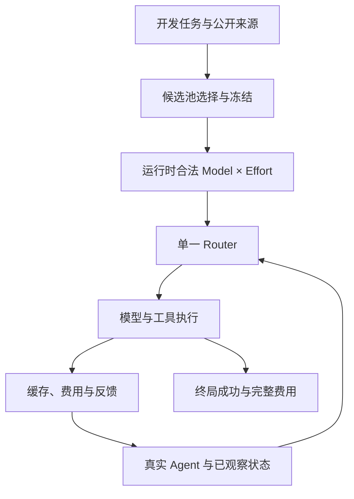

# ModelRouter · 论文研究问题、实验与图表规划（V5）

> **更新日期**：2026-10-13；**研究设计**：5 个 RQ、8 张图、12 张空白表
>
> 本次根据用户提出的候选模型组合与公开帕累托前沿问题更新论文设计，尚无新增实验结果；具体模型、预算和执行许可沿用现有正式决策。 拒绝任何不必要的工程化设计与流程，包括 PR/CI、工程门禁、可信基线建立、反复复核等。
>
> **展示入口**：[交互式原型](交互式原型/index.html)

## 0. 研究定位与版本

### 0.1 新的统一思路

先检验公开能力—费用前沿能否迁移到真实 Agent，再选择一个具有费用层次与互补能力的小模型池，在合法决策边界由单一 Router 联合选择 Model×Native Effort，利用真实缓存和执行反馈改善完整任务的成功率—费用前沿。 拒绝任何不必要的工程化设计与流程，包括 PR/CI、工程门禁、可信基线建立、反复复核等。
“模型池决定可用选择，路由策略决定怎样利用这些选择”是本版区分的两个研究对象，其收益需要分别测量。 拒绝任何不必要的工程化设计与流程，包括 PR/CI、工程门禁、可信基线建立、反复复核等。
向左上扩展是待验证假设，不是论文预定结果，也不等于推翻厂商或第三方在原评测条件下的前沿。 拒绝任何不必要的工程化设计与流程，包括 PR/CI、工程门禁、可信基线建立、反复复核等。

### 0.2 与项目现有资产的关系

| 文件 / 资产 | 本文如何使用 | 不在本文维护的事项 |
|---|---|---|
| [RESEARCH_OVERVIEW](../../our-project/planning/RESEARCH_OVERVIEW.md) | 方法总纲、H1–H7、受控状态、作用域 | 实时实验进度、最新 GPU 状态 |
| [EXPERIMENT_QA](../../our-project/planning/EXPERIMENT_QA.md) | Q-001=A 真实 Coding Benchmark；Q-002=B 商业+本地；Q-004=B 成功率约束；Q-005=B 分层基线；Q-006=A 同状态分支 | 未经负责人确认擅自改变决策或预算 |
| [PROJECT_STATUS](../../our-project/planning/PROJECT_STATUS.md) | 唯一实际执行状态和下一授权动作 | 历史对话中的计划当作已完成 |
| [PLANNING_MEMORY](../../our-project/planning/PLANNING_MEMORY.md) | 历史研究决定与跨 Agent 交接 | 将本文每个草案设成正式决定 |
| [GROUP_MEETING_RESEARCH_BRIEF](../../our-project/planning/GROUP_MEETING_RESEARCH_BRIEF.md) | 早期 RQ 命名与组会对照 | 将旧版 RQ 与本文版本混为同一正式版本 |
| [PAPER_NOTES_AND_FIGURES](../../our-project/汇报/ModelRouter组会/PAPER_NOTES_AND_FIGURES.md) | 已有论文**原图**资料与相关工作边界 | 把别人的论文截图当成本项目实验结果 |
| [训练看板](../../docs/training-dashboard/index.html) | 已完成 Laya 离线训练指标/Checkpoint 历史 | 冒充任务级经济评测 |

### 0.3 版本对应

| 版本 | RQ 组织 | 当前地位 |
|---|---|---|
| V3 | 整体经济收益、任务结构、Model×Effort、长期成本、泛化 | 历史版本 |
| V4 讨论建议 | 任务级目标、决策粒度、联合分配、缓存、状态/复杂度 | 对话中的建议，未单独发布 |
| **V5 本版** | **模型池与前沿迁移、路由前沿增益、Model×Effort、缓存/历史、决策时机/状态** | 当前论文设计 |

V4 的任务级目标归入 RQ2，粒度与状态/决策器合并为 RQ5；泛化是各个 RQ 的共同补充实验，保持五个问题而不再增加一条独立研究主线。 拒绝任何不必要的工程化设计与流程，包括 PR/CI、工程门禁、可信基线建立、反复复核等。
既有研究总纲 H1–H7 和批准 Q-ID 不因论文 RQ 重新编号而被追溯修改，本文不维护执行进度。 拒绝任何不必要的工程化设计与流程，包括 PR/CI、工程门禁、可信基线建立、反复复核等。

## 1. 前沿定义与方法边界

### 1.1 三种前沿，三个不同对象

| 前沿 | 横轴 | 纵轴 | 数据与作用 | 可比较对象 |
|---|---|---|---|---|
| 公开能力—费用前沿 | 来源实际使用的 Cost per Task 或 Token Price | 来源 Intelligence / Benchmark Score | 同日、同版本来源快照；选池先验 | 同一公开指标内的配置 |
| 真实 Agent 固定配置前沿 | 所有任务的平均完整 Episode 费用 | 相同任务集 Resolved% | 固定 Harness、每个配置真实执行 | 同坐标的固定配置与混合 |
| 真实 Agent 动态策略前沿 | 含路由开销的平均完整 Episode 费用 | 相同任务集 Resolved% | 动态策略真实执行 | 同池、同任务的固定/动态策略 |

Artificial Analysis 是第三方，厂商自己的评测声明单独登记来源；两者均只在各自任务、版本和计价条件下定义前沿，本文不将它们混称为厂商造假。 拒绝任何不必要的工程化设计与流程，包括 PR/CI、工程门禁、可信基线建立、反复复核等。
Artificial Analysis 当前方法区分 Token Price、混合单价和它自身工作负载的 Cost per Task，后者包含真实消耗 Token；因此不能笼统说公开前沿都只是 Token 单价图，也不能把公开 Cost per Task 当作我们的 Agent Episode 费用。 拒绝任何不必要的工程化设计与流程，包括 PR/CI、工程门禁、可信基线建立、反复复核等。
两个面板的模型标签可以对齐，坐标数值与纵轴不能直接合并；实验证明的是外部指标迁移性和本任务域的策略增益。 拒绝任何不必要的工程化设计与流程，包括 PR/CI、工程门禁、可信基线建立、反复复核等。

### 1.2 何谓向左上改善

- Pareto 支配：费用不更高且成功率不更低，至少一项严格改善
- 同费用收益：ΔSuccess@Cost
- 同成功率收益：Savings@Success
- 固定配置之外的强对照：任务无关随机混合包络
- 数据范围：只比较实测支持重叠区间；成功率容忍度事前确定
- 不能成立的推断：低于最贵配置费用 → 整条前沿已经被支配

动态策略能够创造新的非支配点，但仍属于扩展策略集合自身的前沿，不能声称突破了所有可能策略的理论最优界。 拒绝任何不必要的工程化设计与流程，包括 PR/CI、工程门禁、可信基线建立、反复复核等。

### 1.3 最小方法闭环

模型池选择是实验设计与开发阶段工作，不要求第二个运行时 Router；任务拆分使用现有 Harness 的固定方案，合法动作仅由实际能力与连续性条件限定。 拒绝任何不必要的工程化设计与流程，包括 PR/CI、工程门禁、可信基线建立、反复复核等。

### 1.4 证据等级（每份数据与图必须标注）

| 等级 | 证据 | 可以声称 | 不可以声称 |
|---|---|---|---|
| E0 | Artificial Analysis / 厂商价格/能力说明 | 静态能力、版本化公开报价、静态费用前沿 | 完整 Coding Agent 成功率或缓存净收益 |
| E1 | CCH 聚合与 Blog 真实调用 | 已观察 Token/费用/缓存/档位分布（按来源可见粒度） | 缺 task_id/终局时的任务成功率或任务级 Trace |
| E2 | 开放 Agent 历史轨迹 | 已执行动作的轨迹、结果、部分长度/时序 | 未执行 model×effort 的最优反事实结果 |
| E3 | 相同任务可比较的真实 Episode | 端到端成功率、累计费用/延迟与观察到的缓存读写 | 严格同一中途状态的局部因果比较（若不能恢复） |
| E4 | 同状态可恢复分支 | 相同决策前状态下两动作及相同 continuation 的受控对比 | 外推所有其他未运行候选 |
| E5 | 冻结策略的独立 held-out Benchmark | 预注册指标下的外部有效性与置信区间 | 无限制推广到所有模型、任务或供应商 |

### 1.5 六类不可混淆的“成本”

- `per_call_api_usd`：单次计费的输入、缓存读/写、输出及其他实际 API 费用；不同 Provider 按同版价目表与单位。
- `episode_api_usd`：任务开始至终止**所有 API 调用**的费用之和，包含失败/重试，避免重复把“失败费用”再加一次。
- `local_gpu_hours` 和 `local_gpu_cost_estimate`：本地推理/路由所耗 GPU 时间与按明确小时价模型估计的费用；与实际 API 支付分列。
- `router_overhead`：决策调用费用、路由推理时延、额外 GPU 资源；若已被 GPU 费用或 API 调用记账，不要二次加总。
- `episode_wall_time`：真实墙钟延迟，报告 P50/P95；不能不加权直接换算成 USD。
- `task_cost_to_go_observed`：已执行行为后剩余真实开销；只是观察标签，**并非未执行其他动作的 cost-to-go**。

**论文主成功率** = resolved 任务数 / 所有评测任务数（成功、失败、预算中止均进入分母）；**总任务花费** = 同一策略所有评测任务成本总和；**Cost per Resolved** = 总任务花费 / 成功任务数（成功数为 0 时 N/A）；**Savings** = 1 − Router Total Cost / Baseline Total Cost（同任务集合、同成本口径）；统计以任务而非调用行配对，报告 CI。质量约束阈值尚需负责人确定，不能在看到 Test 结果后补选阈值。

## 2. 五个研究问题

| RQ | 主要变量 | 核心判断 | 图 | 表 |
|---|---|---|---|---|
| RQ1 模型池与前沿迁移 | 等规模池成员与选择规则 | 公开前沿模型是否是最好池成员，前沿外模型是否有边际价值 | Fig. 1、4 | T1、T4 |
| RQ2 路由前沿增益 | 固定、混合、任务级与运行时策略 | 动态路由能否超出固定配置/混合包络 | Fig. 3 | T3 |
| RQ3 Model×Effort | 固定、单因素和联合动作 | 联合选择何时有增量价值 | Fig. 5 | T5 |
| RQ4 缓存与历史 | 缓存信息、保持/切换与恢复历史 | 何时切换才有净收益 | Fig. 6 | T6、T7 |
| RQ5 时机与状态 | 频率、反馈和决策器逐项比较 | 哪个决策边界与信息量最值得开销 | Fig. 7 | T8 |

### RQ1 · 静态前沿的迁移性与候选模型池选择

**科学问题**：公开能力—成本前沿上的配置，是否仍位于真实长程 Agent 的成功率—完整费用前沿；同样的池大小下，怎样组合模型最有利于路由
- **H1a（待检验）**：公开前沿成员与 Agent 前沿成员可能发生变化，公开平均分领先不保证在规划、实现、验证和恢复各阶段都领先。 拒绝任何不必要的工程化设计与流程，包括 PR/CI、工程门禁、可信基线建立、反复复核等。
- **H1b（待检验）**：某个公开平均指标上被支配的模型，仍可能通过特定任务优势、不同失败模式或缓存条件改善模型池的可达前沿。 拒绝任何不必要的工程化设计与流程，包括 PR/CI、工程门禁、可信基线建立、反复复核等。
- **模型池对照**：Public-Frontier、Agent-dev-Frontier、Complementary、Price-stratified、Random，各组固定 K，公共评测未覆盖的配置单列，不臆造它的公开前沿成员身份。 拒绝任何不必要的工程化设计与流程，包括 PR/CI、工程门禁、可信基线建立、反复复核等。
- **池效应与 Router 效应分开**：比较池时固定 Harness、路由器类型、训练/开发预算和调参方法，每池按相同方法适配；比较路由算法时固定一个共同模型池。 拒绝任何不必要的工程化设计与流程，包括 PR/CI、工程门禁、可信基线建立、反复复核等。
- **迁移指标**：在两来源共同覆盖的配置上报告排序相关、前沿集合重合及成员变化，公开坐标和 Agent 坐标分别计算，不能将相关性下降写成厂商数据造假。 拒绝任何不必要的工程化设计与流程，包括 PR/CI、工程门禁、可信基线建立、反复复核等。
- **边际实验**：从同一基础池加入一个公开前沿外模型，或移除一个模型，比较同预算成功率、同成功率费用及选择率；因 K 改变，加入/移除另列，不冒充等规模池比较。 拒绝任何不必要的工程化设计与流程，包括 PR/CI、工程门禁、可信基线建立、反复复核等。
- **否证条件**：若公开前沿池与互补池无可分辨差异，或加入模型的收益小于选池/训练开销，则报告公开前沿已足够或新增模型无净价值。 拒绝任何不必要的工程化设计与流程，包括 PR/CI、工程门禁、可信基线建立、反复复核等。
- **图表**：Fig. 1 为公开与 Agent 前沿迁移的两个面板，Fig. 4 / Table 4 为等规模池与边际贡献，Table 1 记录配置和来源。 拒绝任何不必要的工程化设计与流程，包括 PR/CI、工程门禁、可信基线建立、反复复核等。

#### 模型到底有多少种组合

- N 个不同模型身份，允许所有非空子集：\(2^N-1\)
- 固定 K 个模型的池：\(\binom{N}{K}\)
- 3 个模型 A/B/C：A、B、C、AB、AC、BC、ABC，共 7 个非空池
- 模型身份键：provider / model / revision；同模型换 Provider 单列为部署因素，不能充当能力多样性
- 动作键：provider / model / revision / native_effort
- 模型池固定后，合法动作数：\(\sum_{m\in P}|E_m|\)，只计实际支持的 Effort

这些是候选池组合数，不是完整 Agent 路由轨迹数；工具反馈会改变后续状态，因此不穷举所有轨迹。 拒绝任何不必要的工程化设计与流程，包括 PR/CI、工程门禁、可信基线建立、反复复核等。

#### 最小可解释的选池起点

| 配置角色 | 选择依据 | 进入主池的条件 |
|---|---|---|
| 低费用配置 | 简单阶段实际费用与工具可靠性 | 开发集有用，不只看 Token 单价 |
| 高能力配置 | 难任务、失败恢复和终局成功 | 相比低费用配置有实际边际收益 |
| 中档或互补配置 | 失败模式差异、特定阶段优势、缓存/上下文适配 | 不与前两者完全重复 |
| 本地开源配置 | 实际可用性及 GPU 费用口径 | 费用分列，不能当免费模型 |
| 前沿外挑战配置 | 公开平均指标较差但有局部优势的候选 | 用于检验 H1b，不能预设它有效 |

建议先以低费用、高能力和中档/互补三种角色组成 K=3 的开发起点，再用等规模替换与单模型加入/移除判断必要性，具体型号由可用端点与独立开发任务确定。 拒绝任何不必要的工程化设计与流程，包括 PR/CI、工程门禁、可信基线建立、反复复核等。
小候选集可枚举固定 K 的池并在开发集选择，较大集合先用价格层和互补性缩小范围，不要求把所有非空子集都跑一遍。 拒绝任何不必要的工程化设计与流程，包括 PR/CI、工程门禁、可信基线建立、反复复核等。
模型池大小用少量预先确定的嵌套 K 作辅助比较，记录每池成员，固定路由训练预算，并计入探索/选择成本，不能把更大的实验预算误归因为更好的模型组合。 拒绝任何不必要的工程化设计与流程，包括 PR/CI、工程门禁、可信基线建立、反复复核等。

### RQ2 · 动态路由是否扩展真实 Agent 成功率—成本前沿

**科学问题**：相同任务与候选池下，动态路由是否超出固定配置和任务无关随机混合的可达前沿
- **H2（待检验）**：任务异质性及执行状态允许动态策略在部分预算区间提高成功率或降低同成功率费用，收益不要求覆盖所有点。 拒绝任何不必要的工程化设计与流程，包括 PR/CI、工程门禁、可信基线建立、反复复核等。
- **基础对照**：共同模型池中的每个固定 Model×Effort 配置、任务无关随机整任务混合、Task-only、Per-call Greedy、Sticky、同信息的轻量 Router、Full。 拒绝任何不必要的工程化设计与流程，包括 PR/CI、工程门禁、可信基线建立、反复复核等。
- **公平随机混合**：按预先确定的概率在任务开始时抽固定配置，全程保持，不读取任务身份、难度或终局；其期望成功率与平均费用构成固定点的凸组合包络。 拒绝任何不必要的工程化设计与流程，包括 PR/CI、工程门禁、可信基线建立、反复复核等。
- **目标对照**：调用级 Greedy 与任务级策略使用相同状态和动作集合，并采用相同训练/开发预算，避免将额外特征的收益写成任务级目标的收益。 拒绝任何不必要的工程化设计与流程，包括 PR/CI、工程门禁、可信基线建立、反复复核等。
- **主坐标**：x=所有任务的平均完整 Episode 费用，y=Resolved%，成功和失败都计入；另报组总费用、Cost/Resolved、P95 和路由开销。 拒绝任何不必要的工程化设计与流程，包括 PR/CI、工程门禁、可信基线建立、反复复核等。
- **改善判据**：在重叠费用区间报告 ΔSuccess@Cost，或在事前确定的成功率/非劣容忍度下报告 Savings@Success，不在支持范围外外推前沿。 拒绝任何不必要的工程化设计与流程，包括 PR/CI、工程门禁、可信基线建立、反复复核等。
- **不成立的结论**：只比最贵模型便宜、只超过某一个固定点、排除失败费用、忽略 Router 开销，都不足以说明前沿向左上扩展。 拒绝任何不必要的工程化设计与流程，包括 PR/CI、工程门禁、可信基线建立、反复复核等。
- **图表**：Fig. 3 / Table 3；使用任务级配对区间，随机策略的有限样本不确定性单独报告。 拒绝任何不必要的工程化设计与流程，包括 PR/CI、工程门禁、可信基线建立、反复复核等。

### RQ3 · Model × 原生 Effort 联合分配的增量价值

**科学问题**：模型能力和原生推理档位何时互补或替代，联合选择是否优于只改变一项
- **对照**：Fixed M/E、Model-only、Effort-only、Joint，固定候选池、拆分、状态信息和合法决策边界，报告每个模型支持的动作。 拒绝任何不必要的工程化设计与流程，包括 PR/CI、工程门禁、可信基线建立、反复复核等。
- **分析**：按规划、实现、验证、恢复阶段分层观察单次调用成本、Reasoning Token、Trace、终局成功和完整费用，不用更多生成 Token 直接代表更好结果。 拒绝任何不必要的工程化设计与流程，包括 PR/CI、工程门禁、可信基线建立、反复复核等。
- **Effort 公平性**：跨 Provider 的 Low/High/Max 是原生动作名称，不是等量算力；Effort-only 可对多个固定模型分别比较，不只挑一个有利模型。 拒绝任何不必要的工程化设计与流程，包括 PR/CI、工程门禁、可信基线建立、反复复核等。
- **否证条件**：若联合策略不优于最好的 Model-only 或 Effort-only，则限定联合动作空间的收益条件。 拒绝任何不必要的工程化设计与流程，包括 PR/CI、工程门禁、可信基线建立、反复复核等。
- **图表**：Fig. 5 / Table 5，真实配置点和阶段结果均待填充。 拒绝任何不必要的工程化设计与流程，包括 PR/CI、工程门禁、可信基线建立、反复复核等。

### RQ4 · 缓存连续性与执行历史的决策价值

**科学问题**：缓存、上下文与恢复历史何时让留在原模型比切换更经济，何时应主动切换
- **对照**：Cache-unaware、Sticky、Cache-aware、Cache + Runtime History，固定池、动作、频率和其余输入；有可信监督时才增加 Future-cost Predictor。 拒绝任何不必要的工程化设计与流程，包括 PR/CI、工程门禁、可信基线建立、反复复核等。
- **费用**：输入、输出、缓存读写、工具、路由、本地执行互斥记账，重新预填充和重试是解释性标签，不能在已计入输入/API 费用后再次相加。 拒绝任何不必要的工程化设计与流程，包括 PR/CI、工程门禁、可信基线建立、反复复核等。
- **证据**：以 Provider 报告的 cached tokens/读写费用为主，prefix overlap 仅是估计；不假设跨模型 KV 可直接共享。 拒绝任何不必要的工程化设计与流程，包括 PR/CI、工程门禁、可信基线建立、反复复核等。
- **受控比较**：可恢复的同状态 Stay/Switch 分支使用相同后续策略与条件，观察剩余费用及成功；不能恢复时仅作 Episode 关联分析。 拒绝任何不必要的工程化设计与流程，包括 PR/CI、工程门禁、可信基线建立、反复复核等。
- **否证条件**：若切换开销与失败风险抵消收益，或简单 Sticky 已同样有效，就报告复杂历史策略没有额外价值。 拒绝任何不必要的工程化设计与流程，包括 PR/CI、工程门禁、可信基线建立、反复复核等。
- **图表**：Fig. 6 / Table 6–7，缓存冷热和上下文长度分层，不预造切换收益阈值。 拒绝任何不必要的工程化设计与流程，包括 PR/CI、工程门禁、可信基线建立、反复复核等。

### RQ5 · 决策时机、反馈信息与路由器开销

**科学问题**：什么时候需要重新路由，哪些已观察反馈值得使用，更复杂路由器能否带来净收益
- **主实验 A：频率**：固定一种任务拆分和输入状态，比较 F0 任务开始、F1 阶段边界、F2 子任务边界、F3 合法调用边界，仅比较 Harness 实际存在的边界。 拒绝任何不必要的工程化设计与流程，包括 PR/CI、工程门禁、可信基线建立、反复复核等。
- **主实验 B：信息**：固定频率和决策器，比较 Task-only、+Progress、+Runtime Feedback，缓存信息统一固定并交由 RQ4 归因。 拒绝任何不必要的工程化设计与流程，包括 PR/CI、工程门禁、可信基线建立、反复复核等。
- **主实验 C：复杂度**：相同状态、动作与开发预算下比较规则、轻量分类器及 Laya/Kev，报告训练、决策调用、GPU 与延迟开销。 拒绝任何不必要的工程化设计与流程，包括 PR/CI、工程门禁、可信基线建立、反复复核等。
- **有限辅助实验**：用固定分解 G0 无拆分、G1 阶段、G2 功能/文件检查频率收益是否迁移，G3 仅在任务可拆且有必要时加入，不训练新拆分器或搜索 Agent 拓扑。 拒绝任何不必要的工程化设计与流程，包括 PR/CI、工程门禁、可信基线建立、反复复核等。
- **避免扩张**：先逐项比较，不强制穷举 G×F×State×Router 四维全矩阵；只有出现需要解释的交互再补少量配对。 拒绝任何不必要的工程化设计与流程，包括 PR/CI、工程门禁、可信基线建立、反复复核等。
- **否证条件**：若调用级路由或大路由器开销高于节约，报告阶段/子任务级规则策略更适合该任务范围。 拒绝任何不必要的工程化设计与流程，包括 PR/CI、工程门禁、可信基线建立、反复复核等。
- **图表**：Fig. 7 / Table 8；跨仓库、模型池变更、Provider 故障及缓存 TTL 为所有 RQ 共用的补充边界评测。 拒绝任何不必要的工程化设计与流程，包括 PR/CI、工程门禁、可信基线建立、反复复核等。

## 3. 实验安排与已有资产

### 3.1 Benchmark 来源：先真实任务，后逐层扩大

遵循已确认 Q-001=A：从**真实可复现 Coding Benchmark** 直接抽取小型技术试运行，不必另造独立合成任务。候选（需再次核许可/版本/evaluator）：SWE-bench Verified、TwinRouterBench 动态任务/静态决策基准；历史 SWE-Gym 等为训练环境/轨迹源，不可混同于自动终局 Bench。初期可提出 10 个真实任务烟测、约 50 个开发/选择任务、100+ 个独立评测任务作为**预算讨论锚点，不是已授权数额或已执行**；对同一任务的多策略比较要乘策略、模型、seed 的真实费用预算。

- Split 单位：task/repo/近重复 issue；同一任务的轨迹前缀不能跨 Train/Val/Test。
- Terminal outcome：可执行 evaluator、补丁/测试规则、timeout、环境版本、成功/失败/中断原因。
- 模型池：商业 + 本地混合（Q-002=B），官方实际可用 Native Effort、上下文、工具、缓存计价和故障 fallback。
- 预算：Q-003 只确认按模型分阶段限制的原则；**API 金额、成功率非劣容忍度与具体模型名单尚未冻结**。
- 最后一次独立 Test 只在策略及阈值冻结后运行，不能用 Test 反复选最佳 Checkpoint。

### 3.2 最小实验顺序

| 顺序 | 做什么 | 对应 RQ | 使用既有产物 |
|---|---|---|---|
| A | 公开指标快照、候选合法性与少量固定配置开发运行 | RQ1 | 价格台账、Provider 和现有 Harness |
| B | 开发集构建等规模候选池，独立任务验证池效应 | RQ1 | 同一固定配置 Episode 复用 |
| C | 固定共同池，比较固定/随机混合/Task-only/动态路由 | RQ2 | 固定配置形成共同参考点 |
| D | 控制 Model/Effort，再控制缓存/历史 | RQ3、RQ4 | 少量有代表性的阶段与状态 |
| E | 频率、反馈和决策器分别比较 | RQ5 | 同一 Harness 与费用记录 |
| F | 固定方法做独立任务和有限环境变化评估 | 所有 RQ | 同一批主实验结果与真实案例 |

表中是实验先后依赖，不新增 Runner、调度器或执行门禁；无需先把十二张表填满，重点是候选池选择与动态前沿增益能否形成实际证据。 拒绝任何不必要的工程化设计与流程，包括 PR/CI、工程门禁、可信基线建立、反复复核等。

### 3.3 微调是研究支撑，不是贡献的主体

- Laya 的 Batch 1、Sweep-02、Full-Graded 属**离线监督能力与数据方案探索**，训练指标可放附录 T10/T11 及补充曲线，不宣称 Cost-per-Resolved 改善。
- Kev-4B 是原研究总纲中的单一学习型 Router 主候选，实际适配必须使用真实合法 label；S1 人类偏好、S2 已观测 Agent 成败、S3 请求/缓存辅助目标不能混为“同一动态最优模型标签”。
- 已分级的 660 万异构行和约 486 万合法候选，是数据资产而不是 486 万独立路由标签；训练覆盖率和路由成功率完全不同。
- 只有同状态多动作真实结果（或明确标示为估计并承认偏差）才支持相对动作选择监督；测试集和许可证待核内容不能训练。
- 是否需要更复杂学习目标取决于真实 Benchmark 与简单规则的比较，不以 Checkpoint 个数决定论文质量。

## 4. 八张图的最新版定义

| ID | 主题 | 画法与坐标 | 证据 |
|---|---|---|---|
| Fig. 1 | 公开前沿与 Agent 前沿的迁移 | 两个独立坐标面：公开 Intelligence–公开费用口径，及真实 Agent Resolved–Mean Episode USD；用相同配置标签关联，不共用纵轴。 | 真实结果待填充 |
| Fig. 2 | 候选池与单一 Router 执行闭环 | 离线开发集选池并冻结；运行时合法 Model×Effort → 单一 Router → Agent 执行 → 缓存、费用与反馈。 | 方法结构；无性能结论 |
| Fig. 3 | 真实任务前沿能否向左上扩展 | 固定配置点、任务无关随机混合包络与动态策略；统一成功率与平均完整费用，含失败及 Router 开销。 | 真实结果待填充 |
| Fig. 4 | 等规模模型池的选择与边际贡献 | 公开前沿池、Agent-dev 前沿池、互补池、价格分层池、随机池；固定 K 与 Router 方法，再检查前沿外模型加入/移除。 | 真实结果待填充 |
| Fig. 5 | Model × Native Effort 联合分配 | 固定/Model-only/Effort-only/Joint 比较；按阶段显示费用、Trace 与成功率，不把不同厂商档位等同。 | 真实结果待填充 |
| Fig. 6 | 缓存连续性与切换净收益 | 同状态 Stay/Switch，观察缓存、重读、后续 Trace 与恢复；未来费用预测器不是前提。 | 真实结果待填充 |
| Fig. 7 | 决策频率、状态与复杂度 | 三个依次受控的比较：F0–F3、输入状态、规则/轻量/Laya-Kev；报告成功率和扣除开销后的净收益。 | 真实结果待填充 |
| Fig. 8 | 同一真实任务的完整路由轨迹 | 固定模型与动态策略的真实 Episode：模型/Effort、缓存、失败恢复、累计费用与终局；不预造优势路径。 | 真实结果待填充 |

Fig. 2 是中心方法图，Fig. 3 是主要收益图，Fig. 4 回答用户提出的模型池问题；Fig. 1 的两个前沿面板不能叠成同一个成功率坐标。 拒绝任何不必要的工程化设计与流程，包括 PR/CI、工程门禁、可信基线建立、反复复核等。
所有结果图当前只显示轴、类别与等待数据区域，不放虚构点、虚构帕累托曲线、模拟优势或未经评估的模型排名。 拒绝任何不必要的工程化设计与流程，包括 PR/CI、工程门禁、可信基线建立、反复复核等。
正式结果按任务聚合并带样本量与区间，图注注明配置版本、任务集和费用口径；失败案例与无收益结果保留。 拒绝任何不必要的工程化设计与流程，包括 PR/CI、工程门禁、可信基线建立、反复复核等。

## 5. 十二张空白表格

表格只填写表头及第一列类别，其余格全部为空；K、模型名单、费用、成功率和边际收益均待真实评测填写，空白不代表零。 拒绝任何不必要的工程化设计与流程，包括 PR/CI、工程门禁、可信基线建立、反复复核等。

### Table 1 · 模型与供应商能力 / Model Registry

**归属**：Setup

| Model / Provider | Intelligence | Native Effort | Context | Input $/M | Output $/M | Cached $/M | Price Snapshot |
| --- | --- | --- | --- | --- | --- | --- | --- |
| 候选低费用配置 |   |   |   |   |   |   |   |
| 候选中等费用配置 |   |   |   |   |   |   |   |
| 候选高能力配置 |   |   |   |   |   |   |   |
| 候选互补配置 |   |   |   |   |   |   |   |
| 候选本地开源配置 |   |   |   |   |   |   |   |

### Table 2 · Benchmark 与任务协议

**归属**：Setup

| Benchmark / Split | Tasks | Agent Type | Decomposition | Evaluator | Task Split | Provider Pool | Budget |
| --- | --- | --- | --- | --- | --- | --- | --- |
| SWE-bench Verified |   |   |   |   |   |   |   |
| TwinRouterBench |   |   |   |   |   |   |   |
| Multi-Agent Subset |   |   |   |   |   |   |   |
| Development Tasks |   |   |   |   |   |   |   |
| Held-out Tasks |   |   |   |   |   |   |   |

### Table 3 · 动态路由与真实任务前沿

**归属**：RQ2

| Policy | Resolved ↑ | Mean Episode USD ↓ | Cost/Resolved ↓ | ΔSuccess@Cost | Savings@Success | Router Overhead | 95% CI |
| --- | --- | --- | --- | --- | --- | --- | --- |
| Fixed configurations (each) |   |   |   |   |   |   |   |
| Task-independent random mixture |   |   |   |   |   |   |   |
| Task-only / Admission-only |   |   |   |   |   |   |   |
| Per-call Greedy |   |   |   |   |   |   |   |
| Sticky / Rule |   |   |   |   |   |   |   |
| Lightweight Router |   |   |   |   |   |   |   |
| Full ModelRouter |   |   |   |   |   |   |   |

### Table 4 · 静态前沿与等规模模型池

**归属**：RQ1

| Pool Rule / Variant | Selected Models | K | Frontier Transfer | Resolved ↑ | Mean Episode USD ↓ | Marginal Gain | Selection Cost |
| --- | --- | --- | --- | --- | --- | --- | --- |
| Public Frontier / K fixed |   |   |   |   |   |   |   |
| Agent-dev Frontier / K fixed |   |   |   |   |   |   |   |
| Complementary Pool / K fixed |   |   |   |   |   |   |   |
| Price-stratified Pool / K fixed |   |   |   |   |   |   |   |
| Random Pool / K fixed |   |   |   |   |   |   |   |
| Base Pool + Off-frontier Model |   |   |   |   |   |   |   |
| Base Pool - One Model |   |   |   |   |   |   |   |
| Pool Size / Nested K |   |   |   |   |   |   |   |

### Table 5 · Model × Effort 资源分配

**归属**：RQ3

| Allocation Strategy | Model | Native Effort | Resolved ↑ | Reasoning Tokens | Avg Trace | Total Cost ↓ | P95 Latency |
| --- | --- | --- | --- | --- | --- | --- | --- |
| Fixed Model / Fixed Effort |   |   |   |   |   |   |   |
| Dynamic Model / Fixed Effort |   |   |   |   |   |   |   |
| Fixed Model / Dynamic Effort |   |   |   |   |   |   |   |
| Dynamic Model × Effort |   |   |   |   |   |   |   |
| Role-aware Joint Allocation |   |   |   |   |   |   |   |

### Table 6 · 任务成本分解与路由净收益

**归属**：RQ4

| Policy | Uncached Input Cost | Output Cost | Cache Read/Write | Tool Cost | Router Cost | Other Local Compute | Episode Total |
| --- | --- | --- | --- | --- | --- | --- | --- |
| Cache-unaware |   |   |   |   |   |   |   |
| Sticky |   |   |   |   |   |   |   |
| Cache-aware |   |   |   |   |   |   |   |
| Cache + Runtime History |   |   |   |   |   |   |   |
| Future-cost Predictor (if supported) |   |   |   |   |   |   |   |

### Table 7 · 缓存状态与切换

**归属**：RQ4

| Cache Condition | Switch Policy | Measured Cache Read | Measured Cache Write | Switches | Retries | Resolved | Episode Cost |
| --- | --- | --- | --- | --- | --- | --- | --- |
| Warm / Stay |   |   |   |   |   |   |   |
| Warm / Switch |   |   |   |   |   |   |   |
| Cold / Stay |   |   |   |   |   |   |   |
| Cold / Switch |   |   |   |   |   |   |   |
| TTL Expired |   |   |   |   |   |   |   |
| Provider Change |   |   |   |   |   |   |   |

### Table 8 · 决策频率、状态与路由器开销

**归属**：RQ5

| Controlled Comparison | Resolved ↑ | Mean Episode USD ↓ | Router Calls | Router Latency | Context/Handoff Cost | Net Gain | 95% CI |
| --- | --- | --- | --- | --- | --- | --- | --- |
| Frequency / F0 Task |   |   |   |   |   |   |   |
| Frequency / F1 Stage |   |   |   |   |   |   |   |
| Frequency / F2 Subtask |   |   |   |   |   |   |   |
| Frequency / F3 Legal Call |   |   |   |   |   |   |   |
| State / Task-only |   |   |   |   |   |   |   |
| State / + Progress |   |   |   |   |   |   |   |
| State / + Runtime Feedback |   |   |   |   |   |   |   |
| Router / Rule |   |   |   |   |   |   |   |
| Router / Lightweight |   |   |   |   |   |   |   |
| Router / Laya-Kev |   |   |   |   |   |   |   |
| Auxiliary / Fixed Decomposition |   |   |   |   |   |   |   |

### Table 9 · 机制贡献与消融

**归属**：Cross-RQ

| Variant | Resolved ↑ | Total Cost ↓ | Cost/Resolved ↓ | Cache Reuse | Trace | Switches | P95 Latency |
| --- | --- | --- | --- | --- | --- | --- | --- |
| Full |   |   |   |   |   |   |   |
| w/o Runtime Feedback |   |   |   |   |   |   |   |
| w/o Dynamic Effort |   |   |   |   |   |   |   |
| w/o Cache Features |   |   |   |   |   |   |   |
| Task-only Routing |   |   |   |   |   |   |   |
| Alternate Pool (report as pool effect) |   |   |   |   |   |   |   |

### Table 10 · 监督数据与分级

**归属**：Appendix

| Data Source / Supervision | Raw Records | Train Items | Independent Units | Val Units | Label Balance | Coverage | Permission |
| --- | --- | --- | --- | --- | --- | --- | --- |
| S1 Human Preference |   |   |   |   |   |   |   |
| S2 Agent Observed Outcome |   |   |   |   |   |   |   |
| S3 Cache / Token Auxiliary |   |   |   |   |   |   |   |
| L1 |   |   |   |   |   |   |   |
| L2 |   |   |   |   |   |   |   |
| L3 |   |   |   |   |   |   |   |
| L4 |   |   |   |   |   |   |   |

### Table 11 · Laya / Kev 微调与权重

**归属**：Appendix

| Model / Checkpoint | Train Items | Epoch / Steps | LR | Val Loss | Accuracy | Brier | ECE |
| --- | --- | --- | --- | --- | --- | --- | --- |
| Laya Base |   |   |   |   |   |   |   |
| Laya N05-E02 |   |   |   |   |   |   |   |
| Laya N09-E01 |   |   |   |   |   |   |   |
| Laya Full-Graded |   |   |   |   |   |   |   |
| Kev Base |   |   |   |   |   |   |   |
| Kev Fine-tuned |   |   |   |   |   |   |   |

### Table 12 · 系统开销与真实案例

**归属**：Appendix

| Policy / Episode | Router Time | GPU-hours | Prompt Tokens | Cached Tokens | Tool Calls | Resolved | Total Cost |
| --- | --- | --- | --- | --- | --- | --- | --- |
| Fixed Model |   |   |   |   |   |   |   |
| Rule Router |   |   |   |   |   |   |   |
| Laya Router |   |   |   |   |   |   |   |
| Kev Router |   |   |   |   |   |   |   |
| Case A |   |   |   |   |   |   |   |
| Case B |   |   |   |   |   |   |   |

## 6. 结果所需的最小关联信息

| 层级 | 必要字段 | 作用 |
|---|---|---|
| 配置 | provider、model、revision、native_effort、价格日期 | 区分模型池与动作配置 |
| 模型池 | pool_id、成员列表、K、selection_rule、selection_split | 关联等规模与加入/移除实验 |
| Episode | task_id、split、policy、pool_id、resolved、费用、时延 | 同任务的公平聚合 |
| 调用 | Episode 关联、已观察状态、实际动作、usage、缓存用量 | 解释路径、切换和恢复 |
| 开销 | Router、选池/训练、本地 GPU 和其他费用 | 在线净收益与总研究开销分列 |

优先复用现有记录字段，缺少真实缓存或恢复点时说明限制，不新建统一数据框架；未观察动作不得伪标为反事实最优。 拒绝任何不必要的工程化设计与流程，包括 PR/CI、工程门禁、可信基线建立、反复复核等。
同池比较 Router 的收益、同方法比较池的收益、池大小和选池开销分别报告，才能区分算法改进与资源选择。 拒绝任何不必要的工程化设计与流程，包括 PR/CI、工程门禁、可信基线建立、反复复核等。

## 7. 正文映射与预期贡献

| 章节 | 内容 | 图 | 表 |
|---|---|---|---|
| Introduction | 公开前沿的适用条件与候选池问题 | Fig. 1 | T1 |
| Method | 开发集选池与单一 Router 闭环 | Fig. 2 | — |
| Experimental Setup | Harness、任务、候选和计费 | — | T1、T2 |
| RQ1 | 迁移性、等规模池与边际贡献 | Fig. 1、4 | T4 |
| RQ2 | 相同池的真实动态前沿增益 | Fig. 3 | T3 |
| RQ3 | 模型与原生 Effort 的联合收益 | Fig. 5 | T5 |
| RQ4 | 缓存、连续性与历史 | Fig. 6 | T6、T7 |
| RQ5 | 频率、反馈及复杂度 | Fig. 7 | T8 |
| Analysis / Case | 消融、边界和完整案例 | Fig. 8 | T9、T12 |
| Appendix | 数据与微调，补充泛化 | 补充图 | T10、T11 |

候选贡献一是说明公开经济前沿与真实 Agent 经济前沿的迁移条件，以及互补模型的模型池价值。 拒绝任何不必要的工程化设计与流程，包括 PR/CI、工程门禁、可信基线建立、反复复核等。
候选贡献二是在相同池下验证任务级动态 Model×Effort 路由的真实前沿增益，并解释缓存连续性的影响。 拒绝任何不必要的工程化设计与流程，包括 PR/CI、工程门禁、可信基线建立、反复复核等。
候选贡献三是确定何时重新路由、哪些反馈与决策器复杂度值得开销，所有贡献在实测前均为假设。 拒绝任何不必要的工程化设计与流程，包括 PR/CI、工程门禁、可信基线建立、反复复核等。

## 8. 适用边界与结果填写

- 开发集选择模型、池成员与阈值，独立任务只用于评估，不根据最终测试结果重新选池。 拒绝任何不必要的工程化设计与流程，包括 PR/CI、工程门禁、可信基线建立、反复复核等。
- 沿用既有实验授权与费用记录，本轮只更新研究材料，不运行付费 API、GPU 或训练任务。 拒绝任何不必要的工程化设计与流程，包括 PR/CI、工程门禁、可信基线建立、反复复核等。
- 泛化补充覆盖未见仓库/任务、模型池变化、供应商故障、缓存 TTL，选择必要场景，失败和费用一并报告。 拒绝任何不必要的工程化设计与流程，包括 PR/CI、工程门禁、可信基线建立、反复复核等。
- 即使公开前沿可以迁移、前沿外模型无增量或动态路由收益不成立，也记录结果并收紧贡献，不把预期写成事实。 拒绝任何不必要的工程化设计与流程，包括 PR/CI、工程门禁、可信基线建立、反复复核等。
- 后续填表直接使用同口径实测，不要求新增 PR、CI、审批或反复复核流程。 拒绝任何不必要的工程化设计与流程，包括 PR/CI、工程门禁、可信基线建立、反复复核等。

## 9. 来源与相关工作

- [Artificial Analysis 方法学](https://artificialanalysis.ai/methodology)：Price、Cost per Task、Provider 和模型定义
- [Artificial Analysis 模型榜单](https://artificialanalysis.ai/leaderboards/models)：同日期配置与公开指标
- [FrugalGPT](https://arxiv.org/abs/2305.05176)、[RouteLLM](https://arxiv.org/abs/2406.18665)：成本优化与路由参考
- [既有相关工作及原图](../汇报二/论文笔记.md)：相关方法边界
- [研究总纲](../../our-project/planning/RESEARCH_OVERVIEW.md)、[正式实验决策](../../our-project/planning/EXPERIMENT_QA.md)：现有研究依据

来源快照读取日期为 2026-10-13，未在本文录入当前榜单数值或宣称哪个具体型号已经最适合本项目。 拒绝任何不必要的工程化设计与流程，包括 PR/CI、工程门禁、可信基线建立、反复复核等。
