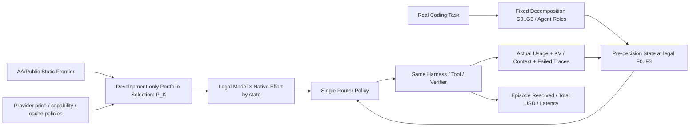

# ModelRouter · 论文研究问题、实验与图表规划（V7）

> **更新日期**：2026-10-13；**研究设计**：5 个 RQ、8 张图、12 张空白表
>
> 本次整合候选模型池、任务拆分、可变候选动作泛化、稀疏反馈与完整任务经济收益；保留 V5 的前沿迁移思想，恢复任务粒度作为独立 RQ。所有实验结果图与表仍为空白；实际模型/预算/执行授权沿用现有正式决策。
>
> **展示入口**：[交互式原型](交互式原型/index.html)

## 0. 研究定位与版本

### 0.1 新的统一思路

**先选择值得路由的模型集合，再决定在什么任务粒度、对哪个子 Agent、以什么推理档位调用，以及当前节省是否会在未来缓存重读、失败或重试中被抵消，最后用真实 Agent Benchmark 检验动态策略是否创造新的非支配策略点。**

- **配置层**：`provider / model / revision / native_effort`；同一模型的不同原生 Effort 是不同可执行动作，同模型不同 Provider 属部署/价格/可用性差异。
- **模型池层**：公开能力—成本 Pareto 仅用于初选；与 Agent 开发集实际能力、互补模型、前沿外模型对照。**等 K 选池**与**同池对比 Router**必须分开。
- **工作流层**：同一原任务可按 G0–G3 固定分解（单 Agent、阶段、功能、可验证细粒度），路由 F0–F3（任务、阶段、子任务、合法调用）；两维不能混淆，不新增 Agent 架构搜索。
- **决策层**：单一 Router 在真实执行前观测状态与合法动作，选择 `Model×Native Effort`。执行后的真实费用、缓存和成败反馈成为下一决策输入。
- **经济层**：主指标是同任务完整 Episode 成功率与平均实际成本。目标是**在观测到的固定/随机混合前沿之外获得新有效点**，不是宣称超越理论所有策略的最优边界。
- **学术层**：模型池、任务粒度、Model×Effort、缓存历史各自建立可否证对照；最终端到端结果作为总评，不以 Laya/Kev 的训练 Accuracy 替代。

**主线总结**：Pool Selection → Task Granularity → Joint Model/Effort → Cache/History-Aware Sequential Decision → Real Episode Success–Cost Frontier.

### 0.2 与项目现有资产的关系

| 文件 / 资产 | 本文如何使用 | 不在本文维护的事项 |
|---|---|---|
| [RESEARCH_OVERVIEW](../../our-project/planning/RESEARCH_OVERVIEW.md) | 方法总纲、H1–H7、受控状态、作用域 | 实时实验进度、最新 GPU 状态 |
| [EXPERIMENT_QA](../../our-project/planning/EXPERIMENT_QA.md) | Q-001=A 真实 Coding Benchmark；Q-002=B 商业+本地；Q-004=B 成功率约束；Q-005=B 分层基线；Q-006=A 同状态分支 | 未经负责人确认擅自改变决策或预算 |
| [PROJECT_STATUS](../../our-project/planning/PROJECT_STATUS.md) | 唯一实际执行状态和下一授权动作 | 历史对话中的计划当作已完成 |
| [PLANNING_MEMORY](../../our-project/planning/PLANNING_MEMORY.md) | 历史研究决定与跨 Agent 交接 | 将本文每个草案设成正式决定 |
| [GROUP_MEETING_RESEARCH_BRIEF](../../our-project/planning/GROUP_MEETING_RESEARCH_BRIEF.md) | 早期 RQ 命名与组会对照 | 将旧版 RQ 与本文版本混为同一正式版本 |
| [PAPER_NOTES_AND_FIGURES](../../our-project/汇报/ModelRouter组会/PAPER_NOTES_AND_FIGURES.md) | 已有论文**原图**资料与相关工作边界 | 把别人的论文截图当成本项目实验结果 |
| [训练看板](../../docs/training-dashboard/index.html) | 已完成 Laya 离线训练指标/Checkpoint 历史 | 冒充任务级经济评测 |

### 0.3 版本演进

| 版本 | 五个 RQ 的主要划分 | 关系 |
|---|---|---|
| V3 | 整体收益、任务结构、联合分配、长期成本、泛化 | 保留原任务粒度问题 |
| V4 讨论建议 | 任务级目标、决策粒度、联合分配、缓存、状态/复杂度 | 未单独落库 |
| V5 | 模型池前沿、全局收益、联合分配、缓存、重新路由 | 增加模型池，但任务拆分降为附属 |
| **V6 当前草案** | **模型池、任务拆分/频率、联合分配、缓存/历史、端到端前沿收益** | 同时保留模型池新意与多子代理核心，5 个 RQ 不扩张 |

**运行时反馈、学习型 Router 开销、跨仓库泛化**分别是 RQ2/4/5 的受控对照与全 RQ 补充实验，不再人为挤占一个主题性 RQ。正式 Q-ID/H1–H7 不随论文 RQ 编号自动修改。

## 1. 前沿定义与方法边界

### 1.1 三种前沿，三个不同对象

| 前沿 | 横轴 | 纵轴 | 数据与作用 | 可比较对象 |
|---|---|---|---|---|
| 公开能力—费用前沿 | 来源实际使用的 Cost per Task 或 Token Price | 来源 Intelligence / Benchmark Score | 同日、同版本来源快照；选池先验 | 同一公开指标内的配置 |
| 真实 Agent 固定配置前沿 | 所有任务的平均完整 Episode 费用 | 相同任务集 Resolved% | 固定 Harness、每个配置真实执行 | 同坐标的固定配置与混合 |
| 真实 Agent 动态策略前沿 | 含路由开销的平均完整 Episode 费用 | 相同任务集 Resolved% | 动态策略真实执行 | 同池、同任务的固定/动态策略 |

Artificial Analysis 是第三方，厂商自己的评测声明单独登记来源；两者均只在各自任务、版本和计价条件下定义前沿，本文不将它们混称为厂商造假。
Artificial Analysis 当前方法区分 Token Price、混合单价和它自身工作负载的 Cost per Task，后者包含真实消耗 Token；因此不能笼统说公开前沿都只是 Token 单价图，也不能把公开 Cost per Task 当作我们的 Agent Episode 费用。
两个面板的模型标签可以对齐，坐标数值与纵轴不能直接合并；实验证明的是外部指标迁移性和本任务域的策略增益。

### 1.2 何谓向左上改善

- Pareto 支配：费用不更高且成功率不更低，至少一项严格改善
- 同费用收益：ΔSuccess@Cost
- 同成功率收益：Savings@Success
- 固定配置之外的强对照：任务无关随机混合包络
- 数据范围：只比较实测支持重叠区间；成功率容忍度事前确定
- 不能成立的推断：低于最贵配置费用 → 整条前沿已经被支配

动态策略能够创造新的非支配点，但仍属于扩展策略集合自身的前沿，不能声称突破了所有可能策略的理论最优界。

### 1.3 最小方法闭环

Pool 在开发阶段冻结。RQ2 只改变已有 Harness 的可复现任务拆分粒度与路由频率；RQ3 比较固定/动态 Model×Effort；RQ4 在相同环境下改变缓存/历史信息；RQ5 在完整 Benchmark 上统一对照。单一路由入口，不引入第二个在线 Router、学习型拆分器或跨模型 KV 迁移功能。

### 1.4 证据要求

- `E0` 公共能力/价格表：只支持公开静态指标，不能直接推断 Agent Episode 结局。
- `E1` CCH/Blog 观察调用：支持已记录的单次成本/缓存/Token；缺少真实 task_id 的不能推断整任务成功。
- `E2` 历史 Agent 轨迹：只支持已执行动作的观察结果，不能给未执行动作伪造未来标签。
- `E3` 真实同任务 Episode：支持路由策略成本—成功率比较。
- `E4` 同一决策前状态的可恢复分支：支持受控动作间后续费用/成功差异。
- `E5` 冻结策略的独立 held-out：支持预设质量约束下的泛化与置信区间。

### 1.5 成本边界

完整任务 API USD 必须包含全部真实模型调用的输入/输出、缓存读写与失败/重试费用；重试成本不可在已计价的调用费用上重复累加。本地 GPU-hours、估计本地美元费用、路由延迟、工具费用等分列报告。单位必须相同才能绘制 Pareto。QuotaUnits ≠ USD；prefix overlap ≠ Provider 报告的物理 KV 命中；不能假设 KV 可跨模型移植。

## 2. 五个研究问题（V7：3 核心 + 2 方法支撑）

**调整理由**：旧 RQ3（Model×Effort）与旧 RQ4（KV/History）不是独立于总体路由的研究对象，而是旧 RQ5 主实验的机制子问题。保留模型池 RQ1、任务结构 RQ2、最终任务经济性 RQ5 作为三个核心问题；新增两个相互独立的方法挑战：可变长候选评分（RQ3）与部分反馈/反事实缺失的学习可靠性（RQ4）。

| RQ | 层级 | 科学问题 | Figure | Table |
|---|---|---|---|---|
| RQ1 | 核心 | 模型池选择与公开前沿迁移 | Fig. 3 | Table 3 |
| RQ2 | 核心 | 任务拆分与路由决策粒度 | Fig. 4 | Table 4 |
| RQ3 | 方法支撑 | 动态候选集的组合泛化 | Fig. 5 | Table 5 |
| RQ4 | 方法支撑 | 稀疏历史反馈的决策可靠性 | Fig. 6 | Table 6 |
| RQ5 | 核心 | 完整路由的真实任务级经济收益 | Fig. 7 | Table 7 |

### 理清模型池、合法动作和运行状态

- **Pool**：K 个不同模型身份（Provider / Model / Revision）；每模型有能力、原生 Effort 档位、上下文、价格、缓存政策与可用性元数据。
- **Action**：`a_t=(model,native_effort)`，必须通过当时上下文、预算、工具与连续性硬约束。对一个池，候选动作总数为真实合法 `sum_m |E_m|`，不等于 K。
- **State**：任务/子任务、Agent 角色、KV 缓存与上下文、历史 Trace、已发生验证失败、剩余预算、Provider 可用性等。**不是**“模型×Effort×KV×历史”个互不相干的固定标签。
- **Router**：同一个 `score(s_t, candidate_features(a_t,s_t))` 对可变长动作逐项或批量评价，选择下一个合法动作；不枚举全部未来轨迹。
- **Metrics**：同任务真实 Episode Success 与 Mean Complete Episode USD（含失败、重试、Provider KV 折扣与 Router 开销），另报 P95、Cost/Resolved 与置信区间。

### RQ1 · 模型池选择与公开前沿迁移

**科学问题**：哪些模型应进入候选池，池应有多大；静态 AA Pareto 成员是否对长程 Agent 任务有效？

**主要对照**：AA Frontiers / Agent-dev Frontier / Complementarity / Price tiers / Random 等 K；再看前沿外模型边际加入。

**必须控制**：固定K、Router实现、开发预算、任务/Harness；公开成本指标不和真实Episode成本同坐标。

**所需数据**：同版本AA/Provider配置、开发集/held-out相同任务的模型固定运行、模型池成员和动作数。

**可能被证伪的情况**：公开池已足够，模型互补或增加K未带来净收益。

**配图**：Fig. 3；**空白结果表**：Table 3。

### RQ2 · 任务拆分与路由决策粒度

**科学问题**：任务拆成什么粒度、什么时候重新路由，怎样使子代理协作成本与路由收益平衡？

**主要对照**：G0–G3 任务分解与 F0–F3 路由频率；Fixed vs Dynamic；仅合法格子。

**必须控制**：固定原始任务、工具、预算与模型池；G与F分别控制，Handoff/Context/Router开销入账。

**所需数据**：同一原任务的可复现G0–G3、F0–F3；真实子代理handoff/context和费用账本。

**可能被证伪的情况**：粗任务粒度最优，更细拆分造成更多重复上下文与通信开销。

**配图**：Fig. 4；**空白结果表**：Table 4。

### RQ3 · 动态候选集的组合泛化

**科学问题**：同一共享评分器能否在新增模型、不同原生 Effort、不同合法动作数时仍正确选择，而不是固定有限分类标签？

**主要对照**：Fixed combination classifier vs Model→Effort hierarchy vs Shared Candidate Scorer；测试未见/扩展动作。

**必须控制**：相同训练信号/成本与合法动作；可变输入≠新模型已能零样本泛化。

**所需数据**：合法真实Native Effort动作、候选模型特征、未见池评测、共享评分器的推理时间。

**可能被证伪的情况**：可变候选评分器不能有效处理未见模型，甚至不及固定分类/层次基线。

**配图**：Fig. 5；**空白结果表**：Table 5。

### RQ4 · 稀疏历史反馈的决策可靠性

**科学问题**：只有 S1 偏好、S2 观察性单轨迹、S3 辅助缓存和少量真实同状态动作分支时，怎样获得可信路由监督？

**主要对照**：静态偏好、单轨迹观察、缓存辅助、少量同状态真分支的监督可靠性和样本效率。

**必须控制**：观察性轨迹只能证明已执行动作；未执行动作不产生伪反事实；按任务/仓库隔离。

**所需数据**：按监督原义清点独立任务、记录可恢复同状态真实分支及已执行动作结果。

**可能被证伪的情况**：少量真实分支没有稳定增益、采集成本太高、旧观察记录偏差影响动作排名。

**配图**：Fig. 6；**空白结果表**：Table 6。

### RQ5 · 完整路由的真实任务级经济收益

**科学问题**：Model×Effort、KV/History、Trace、失败恢复、实时反馈联合选择后，完整 Agent 成本—成功率前沿是否被扩展？

**主要对照**：固定模型、任务无关随机混合、Task-only、Greedy、Rule/Sticky、Lightweight、Full ModelRouter。

**必须控制**：冻结池/G/F/模型版本，统一真实任务、终局验证、价格、失败/重试和Router开销。

**所需数据**：真实固定模型/随机混合/简单路由/Full Episode；各策略相同任务、预算、Verifier与成本口径。

**可能被证伪的情况**：Full没有超过已测简单/随机混合前沿，或改善被质量下降、Router开销抵消。

**配图**：Fig. 7；**空白结果表**：Table 7。

### RQ5 内部机制章节（原 RQ3、RQ4 合并于此）

- **RQ5a Model×Effort**：Fixed Model/Effort、Model-only、Effort-only、Joint，追踪原生推理档位、Trace、成功率和完整成本。
- **RQ5b KV/History**：Cache-unaware、Sticky、Cache-aware、History-aware；真实Provider cached-read/write与prefix复用估计分开。
- **RQ5c Short-sighted vs Task-level**：Per-call Greedy 与面向 Episode 的策略比较，拆解失败/恢复、剩余Trace和实际费用。
- **RQ5d Feedback/Router Overhead**：Task-only、Progress、Tool/Verifier Feedback，规则/轻量/Laya/Kev公平比较，包含决策推理开销。

**RQ5 的主图不预设Full一定在左上**；AA 静态 Intelligence 坐标与我们的 Agent 成功率坐标不同，不能合并出一个“超越第三方前沿”的点。

## 3. 实验安排与已有资产

### 3.1 Benchmark 来源：先真实任务，后逐层扩大

遵循已确认 Q-001=A：从**真实可复现 Coding Benchmark** 直接抽取小型技术试运行，不必另造独立合成任务。候选（需再次核许可/版本/evaluator）：SWE-bench Verified、TwinRouterBench 动态任务/静态决策基准；历史 SWE-Gym 等为训练环境/轨迹源，不可混同于自动终局 Bench。初期可提出 10 个真实任务烟测、约 50 个开发/选择任务、100+ 个独立评测任务作为**预算讨论锚点，不是已授权数额或已执行**；对同一任务的多策略比较要乘策略、模型、seed 的真实费用预算。

- Split 单位：task/repo/近重复 issue；同一任务的轨迹前缀不能跨 Train/Val/Test。
- Terminal outcome：可执行 evaluator、补丁/测试规则、timeout、环境版本、成功/失败/中断原因。
- 模型池：商业 + 本地混合（Q-002=B），官方实际可用 Native Effort、上下文、工具、缓存计价和故障 fallback。
- 预算：Q-003 只确认按模型分阶段限制的原则；**API 金额、成功率非劣容忍度与具体模型名单尚未冻结**。
- 最后一次独立 Test 只在策略及阈值冻结后运行，不能用 Test 反复选最佳 Checkpoint。

### 3.2 执行顺序（依赖而非额外执行链）

| 顺序 | 做什么 | 对应 RQ | 数据与产物 |
|---|---|---|---|
| A | 同日 AA 指标与 Provider 能力/定价/缓存快照；固定模型真实任务成本 | Motivation / RQ1 | Fig. 1、T1/T2 |
| B | 固定 Harness，在开发集比较 K=3 等规模模型池和少量 K 扩展 | RQ1 | Fig. 4、T4 |
| C | 在同池内固定模型/固定路由，比较 G0–G3 与 F0–F3 可能的组合 | RQ2 | Fig. 7、T8 |
| D | 固定 G/F，在同池比较 Model-only、Effort-only 与 Joint | RQ3 | Fig. 5、T5 |
| E | 固定池/G/F/动作，对照缓存历史和受控 Stay/Switch | RQ4 | Fig. 6、T6/T7 |
| F | 在冻结协议下，和固定配置、无条件随机混合及简单策略比较端到端前沿 | RQ5 | **Fig. 3 主结果**、T3 |
| G | 用独立任务/真实案例和负面结果界定贡献适用范围 | 全 RQ | Fig. 8、T9/T12 |

模型池搜索与 Router 策略效果必须分开归因；实时 Benchmark GPU/API 消耗仍按原 `EXPERIMENT_QA` 的正式授权和预算执行。

### 3.3 微调是研究支撑，不是贡献的主体

- Laya 的 Batch 1、Sweep-02、Full-Graded 属**离线监督能力与数据方案探索**，训练指标可放附录 T10/T11 及补充曲线，不宣称 Cost-per-Resolved 改善。
- Kev-4B 是原研究总纲中的单一学习型 Router 主候选，实际适配必须使用真实合法 label；S1 人类偏好、S2 已观测 Agent 成败、S3 请求/缓存辅助目标不能混为“同一动态最优模型标签”。
- 已分级的 660 万异构行和约 486 万合法候选，是数据资产而不是 486 万独立路由标签；训练覆盖率和路由成功率完全不同。
- 只有同状态多动作真实结果（或明确标示为估计并承认偏差）才支持相对动作选择监督；测试集和许可证待核内容不能训练。
- 是否需要更复杂学习目标取决于真实 Benchmark 与简单规则的比较，不以 Checkpoint 个数决定论文质量。

## 4. 八张图的 V7 设计

| 图 | 章节 | 结构与坐标 |
|---|---|---|
| Fig. 1 | Motivation | 静态AA Intelligence–Cost 与 Agent Success–Episode USD **双面板独立坐标** |
| **Fig. 2** | **方法主图** | **模型资源登记、G/F任务树、可变长合法 Model×Effort 候选、单一共享 Scorer、KV/历史/执行账本反馈** |
| Fig. 3 | RQ1 | 等规模模型池组合/K/前沿外模型的边际价值与成功率—成本结果 |
| Fig. 4 | RQ2 | Task/Agent DAG + 拆分G0–G3 × 路由频率F0–F3响应矩阵 |
| Fig. 5 | RQ3 | 固定组合分类 vs 候选条件化共享评分，动态可变池的新动作泛化 |
| Fig. 6 | RQ4 | S1静态偏好、S2历史观察、S3辅助缓存、真实同状态分支的证据层级与可靠性曲线 |
| **Fig. 7** | **RQ5 论文主结果** | **固定/随机整任务混合/简单/Full，真实任务 Success–Mean Episode USD Pareto** |
| Fig. 8 | RQ5机制与案例 | 固定vs动态真实同任务轨迹：Model×Effort、真实KV、Trace、失败恢复、累计成本 |

**所有数据点、曲线与结果数值待真实Benchmark**；不得画预设Full优于基线的虚构点。

## 5. 十二张空白表格

表格只填写表头及第一列类别，其余格全部为空；K、模型名单、费用、成功率和边际收益均待真实评测填写，空白不代表零。

### Table 1 · 模型与供应商能力 / Model Registry

**归属**：Setup

| Model / Provider | Intelligence | Native Effort | Context | Input $/M | Output $/M | Cached $/M | Price Snapshot |
| --- | --- | --- | --- | --- | --- | --- | --- |
| 候选低费用配置 |   |   |   |   |   |   |   |
| 候选中等费用配置 |   |   |   |   |   |   |   |
| 候选高能力配置 |   |   |   |   |   |   |   |
| 候选互补配置 |   |   |   |   |   |   |   |
| 候选本地开源配置 |   |   |   |   |   |   |   |

### Table 2 · Benchmark 与任务协议

**归属**：Setup

| Benchmark / Split | Tasks | Agent Type | Decomposition | Evaluator | Task Split | Provider Pool | Budget |
| --- | --- | --- | --- | --- | --- | --- | --- |
| SWE-bench Verified |   |   |   |   |   |   |   |
| TwinRouterBench |   |   |   |   |   |   |   |
| Multi-Agent Subset |   |   |   |   |   |   |   |
| Development Tasks |   |   |   |   |   |   |   |
| Held-out Tasks |   |   |   |   |   |   |   |

### Table 3 · 模型池组成与公开前沿迁移

| Pool Rule | K | Legal Actions | Success | Episode USD | Marginal Gain | Selection Cost | 95% CI |
| --- | --- | --- | --- | --- | --- | --- | --- |
| Public Pareto |   |   |   |   |   |   |   |
| Agent-dev Pareto |   |   |   |   |   |   |   |
| Complementary |   |   |   |   |   |   |   |
| Price Tiered |   |   |   |   |   |   |   |
| Random |   |   |   |   |   |   |   |
| Off-frontier Add |   |   |   |   |   |   |   |
| K=3/5/8 |   |   |   |   |   |   |   |

### Table 4 · 任务分解与路由边界

| G×F / Policy | Subtasks | Agents | Handoffs | Router Calls | Context Copy | Success | Episode USD |
| --- | --- | --- | --- | --- | --- | --- | --- |
| G0/F0 |   |   |   |   |   |   |   |
| G1/F1 |   |   |   |   |   |   |   |
| G1/F3 |   |   |   |   |   |   |   |
| G2/F2 |   |   |   |   |   |   |   |
| G2/F3 |   |   |   |   |   |   |   |
| G3/F2 |   |   |   |   |   |   |   |
| G3/F3 |   |   |   |   |   |   |   |

### Table 5 · 可变候选动作与模型泛化

| Action Scorer | Legal Action Count | New Action Coverage | Ranking Quality | Success | Episode USD | Router Time | 95% CI |
| --- | --- | --- | --- | --- | --- | --- | --- |
| Fixed Joint Classifier |   |   |   |   |   |   |   |
| Model→Effort Hierarchy |   |   |   |   |   |   |   |
| Shared Candidate Scorer |   |   |   |   |   |   |   |
| Expanded Pool |   |   |   |   |   |   |   |
| Unseen Model |   |   |   |   |   |   |   |
| New Native Effort |   |   |   |   |   |   |   |

### Table 6 · 监督证据与可靠性

| Evidence Regime | Independent Units | Observed Actions | Paired Branches | Calibration | Choice Stability | Episode USD | Collection Cost |
| --- | --- | --- | --- | --- | --- | --- | --- |
| S1 Preference |   |   |   |   |   |   |   |
| S2 Observed Trajectories |   |   |   |   |   |   |   |
| S3 Cache Aux |   |   |   |   |   |   |   |
| S1+S2 |   |   |   |   |   |   |   |
| Few Real Branches |   |   |   |   |   |   |   |
| More Real Branches |   |   |   |   |   |   |   |

### Table 7 · 真实任务成功率—成本主结果

| Policy | Success | Mean Episode USD | Cost/Resolved | Savings@Success | ΔSuccess@Cost | Router Overhead | 95% CI |
| --- | --- | --- | --- | --- | --- | --- | --- |
| Always-Strong |   |   |   |   |   |   |   |
| Always-Cheap |   |   |   |   |   |   |   |
| Random Whole-task Mix |   |   |   |   |   |   |   |
| Task-only |   |   |   |   |   |   |   |
| Greedy |   |   |   |   |   |   |   |
| Rule/Sticky |   |   |   |   |   |   |   |
| Lightweight |   |   |   |   |   |   |   |
| Full ModelRouter |   |   |   |   |   |   |   |

### Table 8 · Joint Model×Effort 机制

| Action Policy | Valid Actions | Success | Reasoning Tokens | Trace | Cache Read | Episode USD | P95 Latency |
| --- | --- | --- | --- | --- | --- | --- | --- |
| Fixed Model/Effort |   |   |   |   |   |   |   |
| Model-only |   |   |   |   |   |   |   |
| Effort-only |   |   |   |   |   |   |   |
| Joint |   |   |   |   |   |   |   |
| Role-aware Joint |   |   |   |   |   |   |   |

### Table 9 · KV 与历史机制

| Sequential Policy | Physical Cache Read | Cache Write | Switches | Retries | Future Trace | Success | Episode USD |
| --- | --- | --- | --- | --- | --- | --- | --- |
| Cache-unaware |   |   |   |   |   |   |   |
| Sticky |   |   |   |   |   |   |   |
| Cache-aware |   |   |   |   |   |   |   |
| History-aware |   |   |   |   |   |   |   |
| Task-level Cost |   |   |   |   |   |   |   |

### Table 10 · 反馈与路由器开销

| Feedback / Scorer | Router Calls | Router Time | GPU Cost | Success | Episode USD | Net Gain | P95 |
| --- | --- | --- | --- | --- | --- | --- | --- |
| Task-only |   |   |   |   |   |   |   |
| Task+Progress |   |   |   |   |   |   |   |
| Tool/Verifier Feedback |   |   |   |   |   |   |   |
| Rule |   |   |   |   |   |   |   |
| Lightweight |   |   |   |   |   |   |   |
| Laya |   |   |   |   |   |   |   |
| Kev |   |   |   |   |   |   |   |

### Table 11 · Laya / Kev 微调与权重

**归属**：Appendix

| Model / Checkpoint | Train Items | Epoch / Steps | LR | Val Loss | Accuracy | Brier | ECE |
| --- | --- | --- | --- | --- | --- | --- | --- |
| Laya Base |   |   |   |   |   |   |   |
| Laya N05-E02 |   |   |   |   |   |   |   |
| Laya N09-E01 |   |   |   |   |   |   |   |
| Laya Full-Graded |   |   |   |   |   |   |   |
| Kev Base |   |   |   |   |   |   |   |
| Kev Fine-tuned |   |   |   |   |   |   |   |

### Table 12 · 系统开销与真实案例

**归属**：Appendix

| Policy / Episode | Router Time | GPU-hours | Prompt Tokens | Cached Tokens | Tool Calls | Resolved | Total Cost |
| --- | --- | --- | --- | --- | --- | --- | --- |
| Fixed Model |   |   |   |   |   |   |   |
| Rule Router |   |   |   |   |   |   |   |
| Laya Router |   |   |   |   |   |   |   |
| Kev Router |   |   |   |   |   |   |   |
| Case A |   |   |   |   |   |   |   |
| Case B |   |   |   |   |   |   |   |

## 6. 结果关联字段（按真实观测，不制造反事实）

| 粒度 | 必需字段 |
|---|---|
| Model Registry | provider/model/revision/native_efforts/pricing/cache_policy |
| Pool | pool_id/K/members/legal_actions/selection_split |
| G/F | task_id/decomposition_id/granularity/route_frequency/handoffs |
| Candidate | pre_decision_state/action_model/action_effort/validity |
| Evidence | supervision_regime/independent_task/observed_action/branch_pair |
| Cost | actual input/output/cache reads/writes/retries/router overhead |
| Episode | task_id/pool_id/policy/seed/resolved/total USD/P95/evaluator version |

空白结果≠零；没有已执行动作和可恢复真实分支时，不把历史单轨迹标为未执行候选的最优结果。

## 7. 论文章节

| 章节 | Figure | Table |
|---|---|---|
| Introduction / Motivation | Fig.1 | T1 |
| Method + Setup | **Fig.2** | T2 |
| RQ1 Pool | Fig.3 | T3 |
| RQ2 Task G×F | Fig.4 | T4 |
| RQ3 Dynamic Candidate | Fig.5 | T5 |
| RQ4 Reliable Evidence | Fig.6 | T6 |
| **RQ5 Main Task Economy** | **Fig.7/8** | **T7–10** |
| Appendix Laya/Kev / Out-of-domain | Extra | T11/12 |

## 8. 适用边界与结果填写

- 开发集选择模型、池成员与阈值，独立任务只用于评估，不根据最终测试结果重新选池。
- 沿用既有实验授权与费用记录，本轮只更新研究材料，不运行付费 API、GPU 或训练任务。
- 泛化补充覆盖未见仓库/任务、模型池变化、供应商故障、缓存 TTL，选择必要场景，失败和费用一并报告。
- 即使公开前沿可以迁移、前沿外模型无增量或动态路由收益不成立，也记录结果并收紧贡献，不把预期写成事实。
- 后续填表直接使用同口径实测，不要求新增 PR、CI、审批或反复复核流程。

## 9. 来源与相关工作

- [Artificial Analysis 方法学](https://artificialanalysis.ai/methodology)：Price、Cost per Task、Provider 和模型定义
- [Artificial Analysis 模型榜单](https://artificialanalysis.ai/leaderboards/models)：同日期配置与公开指标
- [FrugalGPT](https://arxiv.org/abs/2305.05176)、[RouteLLM](https://arxiv.org/abs/2406.18665)：成本优化与路由参考
- [既有相关工作及原图](../汇报二/论文笔记.md)：相关方法边界
- [研究总纲](../../our-project/planning/RESEARCH_OVERVIEW.md)、[正式实验决策](../../our-project/planning/EXPERIMENT_QA.md)：现有研究依据

来源快照读取日期为 2026-10-13，未在本文录入当前榜单数值或宣称哪个具体型号已经最适合本项目。

- [Artificial Analysis 当前模型指数方法与 Cost per Task 定义](https://artificialanalysis.ai/zh/methodology/intelligence-benchmarking)：公开指标并非相同 Coding Harness 的完整任务费用。
- [Claude Haiku 5.5 / GPT-6.1 Sol 档位与费用](https://artificialanalysis.ai/models/comparisons/claude-haiku-5-5-high-vs-gpt-6-1-sol-low)、[Claude Opus 5.5 不同推理档位](https://artificialanalysis.ai/models/comparisons/claude-opus-5-5-vs-claude-opus-5)：仅作候选池调研入口，正式采样时以同日可用性及价格为准。
