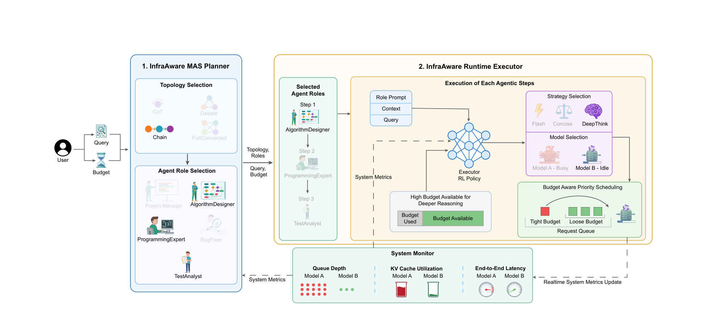
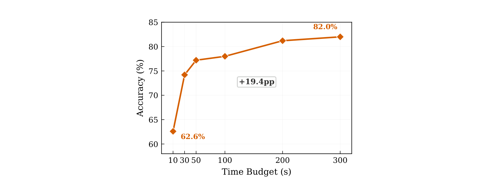

# INFRAMIND: Infrastructure-Aware Multi-Agent Orchestration（基础设施感知的多智能体编排）

> + 发表：arXiv 2606.11440v1 [cs.AI]，2026-06-09，Preprint
> + 作者：Ahasan Kabir, Jiaqi Xue, Mengxin Zheng, Qian Lou（University of Central Florida）
> + 官方页面：[https://arxiv.org/abs/2606.11440](https://arxiv.org/abs/2606.11440)
> + 本地 PDF：`39_InfraMind_Infrastructure-Aware_Multi-Agent_Orchestration.pdf`（12 页）

## 0. 一句话定位

把**服务基础设施的运行时状态**（队列深度、KV Cache 占用、端到端延迟）接进多 Agent 编排的三个决策点——规划、逐步路由、调度——用分层约束 MDP + 端到端 RL 联合训练，在共享 GPU 集群并发负载下同时保住质量、延迟和 SLO。

## 1. 它解决什么问题：infrastructure blindness（基础设施盲视）

现有编排方法（MoA → GPTSwarm → MasRouter）选模型和拓扑时**只看任务和模型特征**，不看服务端运行时状态。作者在共享 5 模型池上用 Poisson 负载压测 MasRouter（MATH，1000 样本），发现三种反复出现的失效模式（Figure 1，p.1–2）：

1. **极端负载不均衡**：偏好小模型队列超过 **130 个请求**，同能力大模型闲置（Fig.1a）；
2. **可避免的延迟**：拥堵模型端到端延迟 **>30s**，而闲置替代模型 10s 内可答完（Fig.1b）；
3. **低负载反转**：大模型 GPU 容量 **67% 闲置**，本可用更深推理换质量（Fig.1c：Small 3-8B 29% 在忙，Large 14-32B 67% Idle）。

通俗说：路由器是在"训练时的信息条件"下做决策的，和部署时的真实运行状态完全脱节。模型"隔离时快"不代表"现在快"——它可能正排着几百个请求的长队。

为什么难：三个决策**相互耦合**——规划选的拓扑改变每步的负载，每步路由改变队列状态，调度又改变延迟；逐层独立调启发式会把跨层交互全部漏掉。

## 2. 方法总览：三个决策点全部基础设施感知

### 2.1 对比：传统 MAS 路由 vs InfraMind 路由

左图（传统）只看质量标准：Model A 质量高就永远选 A，哪怕它 KV-Cache 满、队列深，最后延迟爆炸、资源浪费、还没有推理深度适配。右图（InfraMind）读实时系统指标：发现 A 忙、B 空闲，就把请求改派给 B，并且把省下来的排队时间投资到 DeepThink 深度推理上——用"不排队"补偿"模型小"，最终延迟更低、准确率相当。

### 2.2 形式化：分层约束 MDP

+ N 个 LLM 服务 M = {m₁,…,m_N}（共享 GPU），3 种提示策略 S = {Flash, Concise, DeepThink}（基于 CoT 的深度调制：Flash 直答 / Concise 2–3 步 / DeepThink 深思+验证）。
+ 每步观测 $s_k = [\underbrace{e_q, e_{r_k}}_{任务}, \underbrace{b_k}_{剩余预算}, \underbrace{d_{queue}, d_{e2e}, d_{kv}}_{系统负载}]$，其中 $e_q, e_{r_k} \in \mathbb{R}^{384}$ 是 Sentence-BERT 的 query/角色嵌入，三个系统向量**从 vLLM 的 /metrics 端点轮询**。
+ 动作是联合动作 $a_k \in \{0,…,N|S|−1\}$，解码为 (model, strategy) 对。
+ 目标（Eq.2）：质量最大化，约束 $\mathbb{E}[\sum_k C_k] \le 1$，$C_k = \ell_k / \beta$（步延迟占预算比例）；用单拉格朗日乘子 λ 转成可学习权衡（Eq.3）。
+ 分层：规划器 $\pi_{plan}(\tau, K, r \mid e_q, z_0)$ 在 t=0 一次性选拓扑/Agent 数/角色；执行器 $\pi_{exec}(a_k \mid s_k)$ 每步选 (model, strategy)。

## 3. 三个组件

### 3.1 Infra-Aware Planner（规划器）

沿用 MasRouter 的级联控制器（task classifier → collaboration → agent count → roles），但**每个头都用 FiLM 调制**注入系统摘要 $z_0 = [b_0, d_{queue}, d_{e2e}, d_{kv}]$：$\tilde{e}_q = \gamma(z_0) \odot e_q + \beta(z_0)$（Eq.4）。

一个小 MLP 把系统状态映射成缩放和平移系数，作用在 query 嵌入上，于是四个级联头都继承了同一个"系统现在的拥挤程度"视图：拥堵时偏向简单 Chain 拓扑，空闲时偏向丰富的 Debate 全连接拓扑。

### 3.2 Infra-Aware Executor（执行器）

双通路合并：

+ **语义通路**：$h_{sem} = LN(ReLU(W_{sem}[e_q \| e_{r_k}])) \in \mathbb{R}^{128}$（任务需要什么）；
+ **资源通路**：预算头 $h_{bud} = ReLU(W_{bud} b_k)$ + 系统头 $h_{sys} = ReLU(W_{sys}[d_{queue} \| d_{e2e} \| d_{kv}])$，合并为 $h_{res} \in \mathbb{R}^{64}$（系统当前能给什么）；
+ **决策**：$h = ReLU(W_{merge}[h_{sem} \| h_{res}])$，输出 $\pi(a_k|s_k) = softmax(W_{act} h)$，动作空间 5 模型 × 3 策略。

### 3.3 Budget-Aware EDF 调度器

每个 query 附上 deadline $t_{arrive} + \beta$，Agent 产生的每次 LLM 调用继承该 deadline，每个模型队列按 **Earliest-Deadline-First** 服务。

路由负责"跨模型"的负载均衡，EDF 负责"模型内"的期限排序——两层覆盖正交的等待轴。没有它，预算紧的请求会排在预算宽松的请求后面，错过 SLO。

### 3.4 联合分层 RL 训练

+ 执行器：PPO clipped surrogate（Eq.5），逐步轨迹；
+ 规划器：baseline 归一化 REINFORCE（Eq.6），回报为 episode 效用，另继承任务分类损失 $\mathcal{L}_{task}$ 和 VAE 正则 $\mathcal{L}_{VAE}$；
+ 共享惩罚：$r_k = \mathbb{1}[solved] − \lambda \ell_k/\beta$，$U_i = \mathbb{1}[solved] − \lambda L_{total}/\beta$；
+ **对偶更新**（Eq.7）：$\lambda \leftarrow clip(\lambda + \eta_\lambda(\bar{C}−1), 0, \lambda_{max})$——超支就推 λ 上去逼策略选快动作，有富余就降下来投资质量；
+ 训练 episode 扫过预算档 {10,…,300}s × 到达率 {10,…,200} req/min，sweep 间清空队列。总参数量约 **471K**。

## 4. 实验与结果

+ **基准**：MBPP、HumanEval、GSM-Hard、MATH、MMLU-Pro（代码/数学/知识问答）；
+ **模型池**（10× 参数跨度，2×B200，vLLM）：DeepSeek-R1-Distill-Qwen-32B、Mistral-Small-24B、Qwen2.5-Coder-14B、Llama-3.1-8B、Llama-3.2-3B；
+ **基线**：MoA（暴力集成）、GPTSwarm（学习拓扑、测试时冻结）、MasRouter（任务自适应、无基础设施感知）；
+ **协议**：Poisson 到达 {10, 50, 100} req/min，指标 = 准确率 / 平均延迟 / SLO 达标率（300s 预算）。

**核心结果（Table 2 + Figure 4，p.7–8）**：

+ 低负载：五个基准准确率全部最高——MATH **+7.6pp**（82.0 vs MoA 74.4）、GSM-Hard +7.4pp，同时比 MasRouter 快至 **14×**（HumanEval 5s vs 70s）、6.3×（MBPP 40s vs 253s）；
+ 高负载（100 req/min）：SLO 达标率最高 **99.9%**（HumanEval），基线崩溃——MoA/GPTSwarm 多数基准 <12%，MasRouter 五分之四基准 <50%；
+ 消融（Table 3，p.7）：去掉 infra-aware 路由 → 步延迟 +2.3–3.6×；EDF→FCFS → 平均延迟 68→134s、P90 207→366s；固定 Flash → MMLU-Pro 掉 **9.5pp**——三个机制修的是三种不同失效模式。

**预算感知是涌现出来的（Figure 5，p.8）**：

预算从 10s 给到 300s，准确率 62.6% → 82.0%（+19.4pp）：执行器自发地把大预算花在大模型和 DeepThink 上。这不是任何手工规则，是端到端约束 RL 学出来的。

**黑盒/混合池扩展（§5.4，Table 4，p.9）**：API-only 场景没有服务端遥测，用两个客户端代理替代——端到端延迟的指数滑动平均 + 人造拥堵信号 $d_i^{queue} = recent\_requests_i / RPM\_limit_i$（用量达到 RPM 限额 90% 就视同"深队列"）。混合池（3 白盒 + 2 OpenRouter）低负载偏用白盒、队列堆积时溢出到 API；纯 API 池按异构 RPM 限额在提供商间重分配。

## 5. 作者自己声明的局限

+ 规划时**一次性提交拓扑**，执行中不修改；
+ **固定模型池**假设；未来方向是运行时拓扑修订和弹性硬件池（自动扩缩、热换模型）。

## 6. 与 ModelRouter 的关系（重合与可证伪差异）

+ **重合**：其执行器状态 $s_k$ 与我们状态表的 Provider/Availability、KV Cache/Continuity、Temporal/Execution 状态组高度同源（队列、缓存占用、剩余预算）；"运行时状态应进入路由决策"被它正面证明，**不能当作我们的空白**。
+ **可证伪差异**：
    1. 它是**多 Agent 编排**（拓扑/角色/调度），我们是任务级 Model × Effort 决策 + 整任务成本记账；
    2. 它的推理深度是 Flash/Concise/DeepThink 提示策略，**不等同于 Provider 原生 reasoning_effort 档位**，PPT 中不得画等号；
    3. 它优化的是延迟/SLO（时间预算），不是整任务美元费用的事前预测；
    4. 它用分层 RL 在线训练（~471K 参数），我们的主线是 Kev-4B 风格 typed decision 模型。
+ **可复用**：vLLM /metrics 作为状态源、EDF 与路由的正交分工、黑盒客户端代理（EMA 延迟 + RPM 比率）都可直接借鉴到我们的 Harness 状态设计。

## 相关笔记

- [[Route to Reason_ Adaptive Routing for LLM and Reasoning Strategy Selection]] — `汇报/汇报二/笔记/Route-to-Reason`
- [[ProgRouter_ Online Progress-Guided Orchestration]] — `汇报/汇报二/笔记/ProgRouter`
- [[路由方法及指标与成本 RouteLLM_ Learning to Route LLMs with Preference Data]] — `论文/调研/参考文献2（路由与成本`
