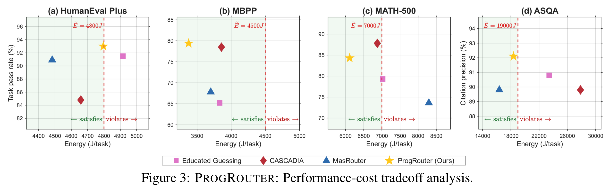

# PROGROUTER: 多 Agent LLM 工作流中质量-成本权衡下的在线进度引导编排

> + 发表：arXiv 2608.25992v2 [cs.AI]，2026-08-30
> + 作者：Songyuan Li（Aston University）、Ahmed M. Abdelmoniem（Queen Mary University of London）、Shiqiang Wang（University of Exeter）
> + 官方页面：[https://arxiv.org/abs/2608.25992](https://arxiv.org/abs/2608.25992)
> + 本地 PDF：`05_PROGROUTER_…Quality-Cost_Tradeoffs.pdf`（16 页）

## 0. 一句话定位

多 Agent 工作流里**每一次 agent dispatch 都在线选一次 LLM**：用"多视图任务进度评分 + 双路径进度预测器"估计每个候选 LLM 的边际进度增益，再用 Lyapunov 虚拟队列 + 预算感知惩罚做在线路由决策，在满足每任务时间/成本预算和长期平均运营成本约束下最大化任务质量。

## 1. 它解决什么问题

多 Agent LLM 工作流（协调者 + 专业 worker 反复协作）因为**反复调用**和**长程上下文累积**而产生高运营成本。现有级联路由是**一次性、query 级**决策：任务开始前定好模型就不再变。但多步工作流里"这一步该用哪个 LLM"取决于三件不断变化的事——任务进度、剩余难度、成本效率要求。

直觉：工作流被错误卡住时，调强模型收益巨大；任务接近完成时，再上强模型边际收益很小。所以选模型的依据不是"模型多强"，而是"当前状态下它能带来多少进度增益"。

三大挑战（§1）：① 任务最终得分 P(w) 要等工作流跑完才能观测，实时评估每步路由的贡献不平凡；② 中间工作流状态嘈杂、部分解决，关键进度因素隐式；③ 未来步骤和子任务难度先验未知，贪心选最强模型会提前烧完预算，保守策略又浪费强模型。

## 2. 问题设定

工作流 $w = \{C, R, M\}$：协调者 Agent C（推理型 LLM 驱动）、worker 角色 R（analyst/coder…）、模型动物园 M（$M_r \subseteq M$ 为角色 r 的合格模型）。优化问题（Eq.1）：

$$ \max_\pi \frac{1}{W}\sum_w P(w) \quad s.t.\quad \sum_t E(m_t) \le E_w,\ \sum_t \Gamma(m_t) \le \Gamma_w\ (\forall w),\quad \frac{1}{W}\sum_w\sum_t E(m_t) \le \bar{E} $$

即：最大化平均任务表现，同时满足**每任务成本/时间预算**和**长期平均运营成本** $\bar{E}$（论文用焦耳计能耗成本）。

**Ledger 驱动的协调者**：C 维护结构化工作流状态账本 $s_t$（任务目标、当前进度、中间推理轨迹、worker 输出），据此监控状态、检测失败、动态重排执行计划（direct-evidence p.3：结构化 workflow ledger 表示目标、进度和中间状态）。

## 3. 核心方法

整体链路：协调者管理协作多 Agent 工作流并派发 worker → 在线任务进度预测器从"结构化 + 语义"两条路径估计多视图进度 → 进度引导路由器结合"预测进度增益 + 剩余任务难度 + 成本预算约束"从 Model Zoo 选模型 → 选中模型执行 dispatch，状态回流。

### 3.1 多视图任务进度评分器（§3.2）

把中间工作流状态 $s_t$ 编码为归一化进度分 $g(s_t) \in [0,1]$，四个互补视图层级聚合（Eq.2）：

$$ g(s_t) = b(c_t) + \alpha_{c_t} r_t + \beta_{c_t} d_t + \gamma_{c_t} e_t $$

1. **整体结局视图**：规则条件把状态映射到四种粗粒度状态 $c_t \in$ {invalid, recoverable, partial success, complete}，给基础分 $b(c_t)$；
2. **子任务完成视图** $r_t$：协调者账本中已满足的任务要求占比；
3. **进度趋势视图** $d_t$：最近几步进度增量的平均值（改善/停滞/回退）；
4. **状态质量视图** $e_t$：相邻状态摘要的语义相似度（MiniLM 句向量）+ 结构差异（新解决子任务/新证据/新失败）。

设计要点：粗锚点（整体结局）保证可靠，三个细粒度视图捕捉"隐蔽进度"。它是轻量级领域适配器——换新任务域只需重定义"可观测里程碑"和"粗结局状态"，下游预测器和路由算法不用改。

### 3.2 双路径任务进度预测器（§3.3）

对每个候选 LLM $m_t \in M_{r_t}$ 预测调用它的步级进度增益 $\hat{y}_t = P_\Theta(s_t, m_t)$（Eq.3）：

+ **结构化路径**：表格特征 $x^{str}_t$（当前 $g(s_t)$ 及其分量、dispatch 历史、候选决策）→ 树回归器（XGBoost/随机森林），擅长异构低维表格特征（Eq.4）；
+ **语义路径**：协调者生成的工作流状态自然语言摘要 → MiniLM 嵌入 $x^{sem}_t$ → 树回归器，捕捉表格特征表达不了的微妙定性线索（Eq.5）；
+ **自适应元门控**：$ \hat{y}_t = P_{meta}(\hat{y}^{str}_t, \hat{y}^{sem}_t)$（Eq.6，同为树模型）——显式进度信号可靠时多信结构化路径；状态微妙、反馈稀疏时多信语义路径。

两个路径都很轻（句编码器 + 树模型），所以每一步能在线评估该角色的全部候选 LLM，开销可忽略。

### 3.3 在线路由决策（§3.4，Lyapunov 框架）

+ **虚拟成本队列**（Eq.7）：$Q_{w+1} = \max\{0, Q_w + \sum_t E(m_t) − \bar{E}\}$——追踪长期成本约束的超支量；
+ **进度差距感知价值**（Eq.9）：$\hat{P}(m_t, s_t) = V \cdot (1 − g(s_t)) \cdot \hat{y}_t(m_t)$——任务离完成越远，进度增益越值钱；
+ **预算感知成本惩罚**（Eq.10/11）：$c^\Gamma_t = \exp\left(\frac{\Gamma(m_t)+\sum_{i<t}\Gamma(m_i)}{\Gamma_w}\right)$，$c^E_t$ 同理——已花的预算占比越高，同一模型的惩罚越重，防止后期反复上贵模型；
+ **最终路由分**（Eq.12）：$score(m_t) = \hat{P}(m_t) − Q_w\cdot(E(m_t) − \bar{E}) − c^\Gamma_t \Gamma(m_t) − c^E_t E(m_t)$，取 argmax；
+ **在线学习**：ε-greedy 探索收集无偏样本；执行后用**实际进度增益** $y_t = g(s_{t+1}) − g(s_t)$ 作监督信号更新预测器；ε 随样本累积衰减，从探索过渡到预测引导的利用。**不需要离线训练数据**。

## 4. 实验与结果

+ **基准**：HumanEval Plus（164 题）、MBPP（200）、MATH-500（200）、ASQA（100，检索增强长式问答，用引用精度评价）；
+ **模型动物园**：代码——Qwen2.5-Coder 0.5B/7B/14B/32B + Qwen3.5 2B/4B/9B/27B/35B（9 个）；数学——Granite 4.1 3B/8B/30B + Gemma 4 2B/4B/26B/31B（7 个）；ASQA——Qwen3.5/3.6（7 个）；
+ **成本单位**：能耗（焦耳），每任务预算如 4,800J（HumanEval+）、7,000J（MATH-500）、19,000J（ASQA），另有长期约束 $\bar{E}$；
+ **基线**：MasRouter（query 级一次性路由）、CASCADIA（reactive 级联升级）、Educated Guessing（历史最优模型）。

**主要结果（Table 1，p.7–8）**：在满足 $\bar{E}$ 的方法中质量-成本权衡最优——

+ HumanEval Plus：**93.0%** 通过率（4,796J 内），超 MasRouter +2.1%、CASCADIA +8.2%；
+ MBPP：**79.4%** 通过 + 最低能耗 3,376J + 最短时间 10.3s，全指标占优；
+ MATH-500：84.3% 通过（比 CASCADIA 低 3.5pp），但能耗 6,112J vs CASCADIA 6,875J、时间 19.0s vs 24.6s；
+ ASQA：最高引用精度 **92.1%**（预算内），超两个基线 +2.3%；
+ 单模型策略全部不可行：小模型因反复失败重试能耗反超预算，大模型单次调用成本超预算（Gemma 4 31B 在 MATH-500 达 26,276J）。

四个子图里 ProgRouter（黄星）都落在"满足预算"的绿色区且质量最高或接近最高；红色虚线右边是违反长期成本约束的区域。这就是论文说的"在 Pareto 前沿上或附近"。

**路由分布的规律（Figure 4/5，p.9）**：大部分 dispatch 集中在高效小模型（HumanEval Plus 上 84.3% 给 Qwen2.5-Coder 0.5B；MATH-500 上 91.0% 给 Granite 4.1 3B），只在进度预测器预期大增益时才调大模型——这正是 Eq.9 里 $(1−g(s_t))$ 项的直接体现。

## 5. 作者声明的局限（p.10）

+ 只评了四个基准；开放式 web 导航、工具增强 QA 等场景泛化待验证；
+ 多视图进度评分器需要**轻量领域适配**（里程碑和结局状态要按任务手工定义），全自动端到端学习进度表示是未来方向。

## 6. 与 ModelRouter 的关系（重合与可证伪差异）

+ **重合**：状态/进度/成本进入在线模型选择已被它正面覆盖（RESEARCH_OVERVIEW 列为强对照）；"选 stronger LLM 当且仅当预期进度增益足够大"与我们的 H3（任务级回报目标优于单次调用价格目标）精神相通。
+ **可证伪差异**：
    1. 它面向**多 Agent 工作流的逐步 dispatch**，且"不改变执行策略"（direct-evidence）；我们做**不改变执行策略的整任务资源分布预测与一次性（admission）选择 + 运行时重选**的对照；
    2. 它的成本单位是**能耗/时间预算**，不是任务级美元费用与真实 provider 账单；
    3. 它的进度预测靠**执行后实际增益**在线学习（执行回放式标签），我们主张执行前（ex-ante）预测尚未开始的整条轨迹；
    4. 它没有 Model × Effort 联合维度（模型动物园只有模型大小，无推理档位）。
+ **可复用**：多视图进度评分的"粗锚点 + 细视图"分层、虚拟队列做长期预算约束、双路径（表格 + 语义）预测器，都可借鉴到我们的辅助任务设计（须先有可信监督信号）。

## 相关笔记

- [[INFRAMIND_ Infrastructure-Aware Multi-Agent Orchestration]] — `汇报/汇报二/笔记/INFRAMIND`
- [[Route to Reason_ Adaptive Routing for LLM and Reasoning Strategy Selection]] — `汇报/汇报二/笔记/Route-to-Reason`
- [[MasRouter]] — 论文内部基线（ACL 2025，query 级一次性多 Agent 路由）
