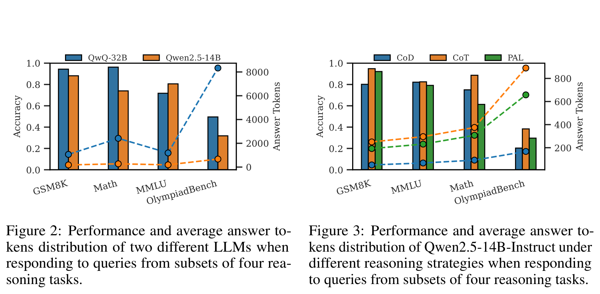
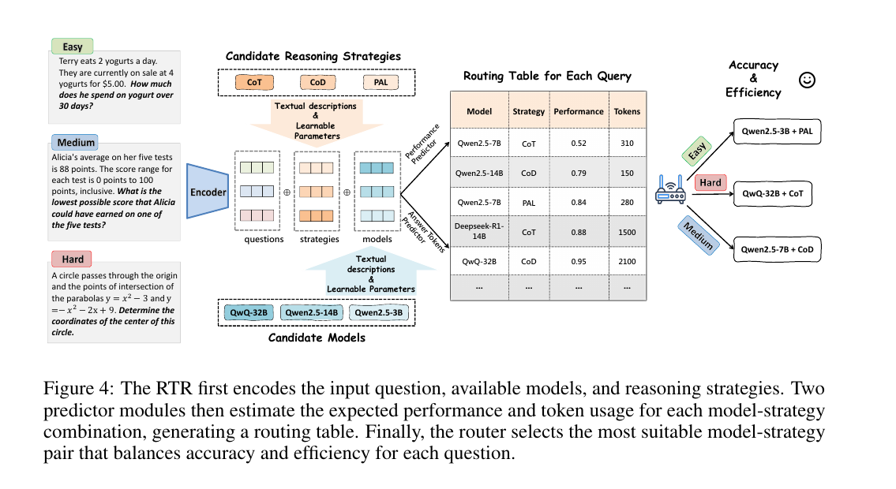
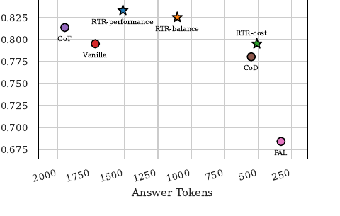

# Route to Reason (RTR): LLM 与推理策略的自适应联合路由

> + 发表：arXiv 2505.19435v1 [cs.CL]，2025-05-26（Preprint, Under review；RESEARCH_OVERVIEW 记录为 WWW 2026）
> + 作者：Zhihong Pan, Kai Zhang, Yuze Zhao, Yupeng Han（中国科学技术大学，认知智能全国重点实验室）
> + 官方页面：[https://arxiv.org/abs/2505.19435](https://arxiv.org/abs/2505.19435)｜代码：[github.com/goodmanpzh/Route-To-Reason](https://github.com/goodmanpzh/Route-To-Reason)
> + 本地 PDF：`12_Route_to_Reason_…Strategy_Selection.pdf`（18 页）

## 0. 一句话定位

**同时路由"模型"和"推理策略"**：把每个候选模型和每种推理策略表示成"文本描述嵌入 + 可学习嵌入"的双分量向量，对每个 query 预测所有 (model, strategy) 组合的**准确率**和**输出 token 数**，构建 routing table 后按权衡系数选最优组合——这是 Model × Effort 联合选择的**最直接近邻**。

## 1. 它解决什么问题

直觉上"强模型 + 强策略（如 o3 + CoT）"总是更好，但实际有两个坑：

1. **性能瓶颈**：overthinking 把推理困在局部路径里，反而降低表现；
2. **预算低效**：简单任务上高性能模型 + 复杂策略没有显著收益，纯属浪费。

两个动机实验（p.3）：

+ **Figure 2（模型维度）**：思考型 QwQ-32B 在 Math/OlympiadBench 上远超 Qwen2.5-14B，但在 GSM8K/MMLU 上提升微弱甚至略降，而 token 消耗最高到 **10 倍**（OlympiadBench 上 QwQ 平均 8762 tokens vs Qwen2.5-14B 一两百）；
+ **Figure 3（策略维度）**：同一模型 Qwen2.5-14B 下，CoD 在简单任务上用短得多的输出达到与 CoT 相当的准确率；PAL 在算术密集任务上表现好且输出更稳定。

结论："less is more"——更轻的专家-策略组合往往有更好的性价比。只选模型或只选策略都不够，必须联合选。

## 2. 问题形式化（§2.2）

+ 模型集合 $M = \{m_j\}$（大小/能力不同），策略集合 $S = \{s_k\}$；query $x_i$ 用模型 $m_j$ + 策略 $s_k$ 回答，产生性能分 $a_{i,j,k}$（准确率等）和输出 token 数 $l_{i,j,k}$（推理成本代理）；
+ 学路由函数 $\pi: X \to M \times S$，目标：$\max_\pi \sum_i a_{i,j^*,k^*} − \lambda \sum_i l_{i,j^*,k^*}$（λ 权衡性能与成本）。

## 3. 核心方法（§2.3）

流程：把问题、候选模型的描述、候选策略的描述都编码成向量 → 拼接后送进两个 MLP 预测器（一个预测准确率，一个预测输出 token 数）→ 生成这张 query 专属的 routing table（每个 model-strategy 组合的预期性能和预期 token）→ 按分数选最优组合。

### 3.1 模型与策略的双分量表示

每个模型/策略用两部分拼接：

1. **文本描述编码**（辅助 LLM 生成，描述能力与适用场景；预训练编码器 all-mpnet-base-v2，768 维；训练中**冻结**）——外部知识；
2. **可学习嵌入**（随机初始化，训练中更新）——捕捉文本描述说不清的细粒度行为差异。

消融（Figure 5，p.7）：仅文本 73.6% / 仅可学习嵌入 75.0% / 两者结合 **76.1%** 预测准确率——互补。

### 3.2 双预测模块

+ 性能预测：$\hat{a}_{i,j,k} = MLP_{perf}(z_{i,j,k})$，二元交叉熵损失（Eq.1）；
+ token 预测：$\hat{l}_{i,j,k} = MLP_{len}(z_{i,j,k})$，MSE 损失（Eq.2）；
+ 其中 $z_{i,j,k} = [q_i; z_j; z_k]$（query、模型、策略三个表示拼接）。

### 3.3 Routing Table 与路由策略

评分（Eq.3）：$score_{i,j,k} = \lambda \hat{a}_{i,j,k} − (1−\lambda)\hat{l}_{i,j,k}$，选 argmax（Eq.4）。λ∈[0,1]：高 λ 质量优先，低 λ 成本优先，可按应用调。

## 4. 实验与结果

+ **候选模型（6 个开源）**：非思考型 Qwen2.5-3B/7B/14B；思考型 DeepSeek-R1-7B/14B、QwQ-32B；
+ **策略（4 种）**：Vanilla（原始问题）、CoT（链式思考）、PAL（生成可执行代码解题）、CoD（草稿链，显式限制输出长度）；
+ **数据**：域内 GSM8K(600)/Math(600)/MMLU-STEM(600)/OlympiadBench(300)，70/30 划分；域外 SciQ/PIQA/ARC-C 各 300；
+ **基线**：单模型（Qwen2.5-3B、QwQ-32B）、Random、KNN-Router、RouteLLM、EmbedLLM。

**域内结果（Table 2，p.7）**：RTR 平均准确率 **82.5%**、平均 1091.3 tokens——

+ 比 EmbedLLM（81.9%）准确率持平略高，**token 省 39.6%**；
+ 比最强单模型 QwQ-32B（80.0%，2745 tokens）：**准确率 +2.5pp，token −60%**；
+ MMLU（82.5%）和 OlympiadBench（45.5%）上全场最高。

**域外结果（Table 3，p.7）**：平均准确率 94.2%，是唯一超过 QwQ（93.7%）的路由方法，token 只有其 28%（393.9 vs 1387.3）。

**单一固定策略 vs 动态选策略（Figure 7，p.8）**：

固定任何一个单一策略（Vanilla/CoT/CoD/PAL）都只能得到次优点：推理深的策略准确但贵，轻策略便宜但有天花板。RTR 的三种配置（performance/balance/cost-first）形成了可调的权衡曲线，全部优于 Vanilla，且覆盖了单策略到不了的 Pareto 区域。

**案例（Figure 8，p.8）**：一道 Subway 午餐算术题——QwQ+CoT 思考了 4000+ tokens 还答错（$100，应为 $160）；RTR 路由到 Qwen2.5-7B+CoD，**32 个 token** 答对。

**When-to-Think 扩展（Table 4，p.8）**：把 Qwen3-4B 的 thinking/non-thinking 两个模式当两个候选，RTR 二选一路由：准确率 83.8%（超过 thinking 常开 82.4%），token 1321 vs 3112（省 58%）。

## 5. 作者声明的局限（§5）

+ 目前只做**单模型选择**，多模型协作决策是未来工作；
+ 实验集中在推理任务，向更广问题域扩展待验证。

## 6. 与 ModelRouter 的关系（重合与可证伪差异）

+ **重合**：这就是我们 **Model × Effort 联合选择（H2）的最直接近邻**——它证明了"模型 × 推理策略"是有效且必要的联合路由维度，routing table + 双预测器的结构可参考。
+ **可证伪差异**：
    1. **粒度**：RTR 是 query-level 单轮决策；我们面向长程 Agent 的工具交互、失败重试与任务级成本；
    2. **成本单位**：RTR 用输出 token 数作成本代理，不是整任务美元费用（无 cache read/write、无多轮累计）；
    3. **语义边界**：其策略是 CoT/PAL/CoD 等**论文自定义提示策略**，不等同于 Provider 原生 reasoning_effort 档位，PPT 中不得画等号；其 When-to-Think 的 thinking on/off 也只是二元档，不能推广为多档 effort；
    4. **状态**：RTR 只看 query 文本，不看 Agent 运行时状态（工具、验证、缓存）。
+ **可复用**：双分量表示（冻结描述 + 可学习嵌入）可用于我们的候选 (model, effort) 编码；"预测性能 + 预测成本双头"与我们的 outcome/cost-to-go 辅助任务设计同构；其域外泛化评测协议（SciQ/PIQA/ARC-C）是候选外推测试设计。

## 相关笔记

- [[路由方法及指标与成本 RouteLLM_ Learning to Route LLMs with Preference Data]] — `论文/调研/参考文献2（路由与成本`
- [[模型路由策略 HYBRID LLM_ COST-EFFICIENT AND QUALITY-AWARE QUERY ROUTING]] — `论文/调研/参考文献2（路由与成本`
- [[ProgRouter_ Online Progress-Guided Orchestration]] — `汇报/汇报二/笔记/ProgRouter`
- [[INFRAMIND_ Infrastructure-Aware Multi-Agent Orchestration]] — `汇报/汇报二/笔记/INFRAMIND`
