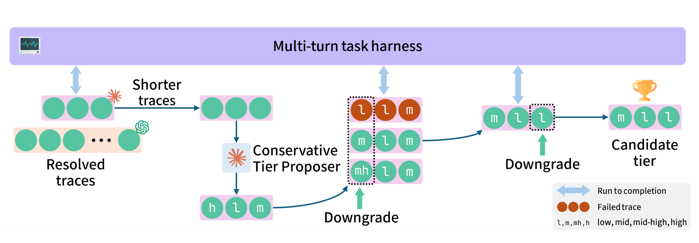

# TwinRouterBench: 面向真实 Agent 路由的快静态 + 活动态双轨评测基准

> + 发表：arXiv 2605.18859v2 [cs.LG]，2026-05-22（Gradient 等 16 个机构合作）
> + 作者：Pei Yang、Wanyi Chen（共同一作）、Tongyun Yang 等 16 人（Gradient / 苏州大学 / USC / Rice / CMU / SJTU / UC Berkeley / UCLA 等）
> + 官方页面：[https://arxiv.org/abs/2605.18859](https://arxiv.org/abs/2605.18859)｜代码与数据：[github.com/CommonstackAI/TwinRouterBench](https://github.com/CommonstackAI/TwinRouterBench)
> + 本地 PDF：`07_TwinRouterBench_…Agentic_LLM_Routing.pdf`（24 页）

## 0. 一句话定位

第一个 **step-level（每次 LLM 调用粒度）** 的路由评测基准：静态轨提供 970 个带"执行验证 target tier"标签的 router-visible 前缀（离线开发，毫秒级确定性评分、零 API 花费），动态轨在 SWE-bench Verified 上真实执行（按 official resolution + realized API spend + cache 计账打分）。

## 1. 它解决什么问题

路由在长程应用（coding agent、深度研究、computer-use）中最有价值——一次用户请求触发大量模型调用，每次都路由到"最便宜的够用模型"可以省钱不降质。但现有 router benchmark（RouterBench 405k 结果、LLMRouterBench 400k+、RouterArena）全是 **one-shot prompt 粒度**：

1. 从不暴露**中间 Agent 步骤的 router-visible prefix**（聊天历史、检索片段、工具输出、shell 日志、部分代码编辑）；
2. 从不验证"第 i 步换便宜模型**是否破坏第 i+1 步及之后的下游成功**"；
3. 评测常依赖在线 LLM judge（贵且不稳）。

关键观察：现代应用里"贵的东西"很少是一次性 query——coding agent 要多轮探索、打补丁、验证；文件查找用便宜模型就够，但后面的补丁编写步可能需要最强档。一个有用的 step-level 基准必须把"每一步调用前路由器看到的完整前缀"当作一等公民，并且用执行结果（而非模型打分）来定标签。

另一个动机诊断：用 Claude Opus 4.6 当 LLM-router（单模板），在 147 个已验证为 high 的 SWE-bench 步骤里只把 7 个预测为 high，40 条 SWE 轨迹**全部失败**——前沿模型提示代替不了执行验证的步级监督。

## 2. 核心设计：双轨

+ **静态轨（FAST STATIC TRACK，离线开发）**：五类工作负载（Long-Context=QMSum、Tool-use=BFCL、RAG=mtRAG、Coding=SWE-bench/PinchBench、Openclaw），970 个 step-level 行（来自 520 个实例），每行 = {id, benchmark, instance_id, step_index, total_steps, messages(完整前缀), target_tier}；标签为四档 tier（low/mid/mid_high/high），**公开数据只有 tier 标签、无厂商模型 ID**；评分是 tier 标签 + 轨迹成员 + token 成本的确定性算术（毫秒级、无在线 judge、零花费）；
+ **动态轨（LIVE DYNAMIC TRACK，端到端验证）**：harness 支持完整 500 题 SWE-bench Verified，论文报告与静态轨不重叠的 100 题 held-out；每次 LLM 调用从**锁定模型池**（11 模型 × 四档）选具体模型；按 official SWE-bench resolution predicate + realized provider spend + cache accounting 打分；榜单账单加统一未解决罚金。

## 3. 标签构造：执行验证的降档搜索（§4）

流程：从强模型成功轨迹出发（SWE-bench 用 Claude Opus 4.6/GPT-5.4 过 mini-swe-agent，必须通过官方 FAIL_TO_PASS 测试；失败种子直接丢弃，避免把"任务难"和"路由错"混在一起）→ Opus 给降档提示（只是剪枝设备，不是标签）→ 贪心 sequential-locking 降档搜索。

关键机制：

1. **因果前缀下的搜索**：第 i 步降档时，之前已锁定的步保持已验证 tier，未来的步用 strong tier；候选从便宜到强试起；**只有整条轨迹仍以相同步数通过，才接受降档**（推断被替换的步被正确处理了）；
2. **tier 按池验证而非单模型**：非 low 标签跑三模型级联，池内任一模型在混合轨迹下通过即接受——单代表搜索太脆（SWE-bench 末步审计：级联找回 28/33 个可降档标签 vs 单模型 15/33）；
3. **加固开放式判据**：mtRAG/QMSum 的 LLM-judge 默认 rubric 太松，发现大量伪通过；换成结构化 judge（先判断当前轮是否解决，再评 Faithfulness/Appropriateness/Completeness，证据冲突硬失败、不确定即失败）；
4. **人工审计**：三个多步工作负载抽 ~10%（64 步），63 步判定 already-tight，1 步可再降档（已修改后发布）。

**语料分布（Table A2/A3，p.16）**：SWE-bench 40 实例/336 步（中位前缀 ~5,300 tokens，贡献了 168/170 个 high 标签）；BFCL 130/248；mtRAG 193/193；QMSum 145/145；PinchBench 12/48。low:mid:mid_high:high = 689:62:49:170。

## 4. 评测协议（§5）

+ **静态四指标**：ROWPASS（$\tilde{t}_i \ge \hat{t}_i$）、ROWEXACT（相等）、TRAJPASS（轨迹内每一步都过才算过）、**COSTSAVE**（相对 always-high 的省钱率，**只给通过轨迹记省钱，失败轨迹的 API 花费按烧掉计**）；
+ COMBINED = 四者等权平均；四桶计费 $c_i(t) = (n^{in}p^{in} + n^{cr}p^{cr} + n^{cw}p^{cw} + n^{out}p^{out})/10^6$，显式建模 cache_write/cache_read 与 5 分钟 TTL（对齐 Anthropic 等实际策略），**换档的 cache_write 按高档费率收**——把"切换模型的缓存代价"定价进去而不是假设无害；
+ **动态榜单**：$bill_j = A_j + (1 − resolved_j)\gamma$，γ=$0.60（略高于 unrouted Opus 平均 API 成本 $0.55），统一适用于所有策略；静态分和动态分**永不平均**（覆盖面不同）。

## 5. 主要结果

**静态轨（Table 2，p.10，970 行）**：

| 路由器 | ROWPASS | ROWEXACT | TRAJPASS | COSTSAVE | COMBINED |
|---|---:|---:|---:|---:|---:|
| SR-KNN（in-sample 上界） | 91.86 | 78.76 | 84.74 | 56.18 | **77.89** |
| ClawRouter（规则） | 80.82 | 11.75 | 64.64 | 53.82 | 52.76 |
| UncommonRoute（规则） | 88.35 | 61.13 | 62.37 | 15.99 | 56.96 |
| Opus 4.6（always-high 参照） | 100.00 | 17.53 | 100.00 | 0.00 | 54.38 |

规则路由器的失效模式很典型：ClawRouter 大多路由到比验证标签高一档——exact match 很差但比 always-high 便宜；UncommonRoute 在非 high 行跳到 high 217 次还把 39/40 条 SWE 轨迹搞挂，SWE 切片的 COSTSAVE 被拉到 −86。失败感知计费保证"失败轨迹上的便宜调用"不会被记成功劳。

**动态轨（Table 3，p.10，100 题 held-out SWE-bench Verified）**：UncommonRoute (trained)——**唯一用静态标签训练的策略**（冻结 bge-small-en-v1.5 句嵌入 + 路由元数据 + 多项逻辑回归）——resolve 75/100 与 unrouted Opus（74/100）持平，但 API 成本 **$25.66 vs $54.73（省 53.1%）**，榜单账单 $40.66 vs $70.33；规则版 UncommonRoute 则要 $188.76。

这条结果最关键：静态轨标签不仅能评测，还能训练出在真实执行中省一半钱的实用路由器——静态监督 → 动态验证的开发闭环成立。

## 6. 作者声明的局限（§7）

+ 970 步/520 实例**规模有限**，不足以覆盖所有 Agent 负载、领域和路由模式；
+ 标签是**固定模型池 + 级联协议 + 价格快照**下的估计——出现"又便宜又强"的新模型就需要重新标注；换了池/协议就是新版本基准；
+ 动态轨目前只覆盖 SWE-bench Verified。

## 7. 与 ModelRouter 的关系（重合与可证伪差异）

+ **重合**：已覆盖"真实 Agent 逐步路由 + 真实费用 + 缓存计账"的**评测**——RESEARCH_OVERVIEW 明确"不能声称这一点新"；它也是我们的标签构造近邻（强模型轨迹 → 调用前缀 → 降档实验 → 执行验证 tier 标签）。
+ **可证伪差异**：
    1. 它是**评测基准而非路由方法**；我们做的是路由决策模型与训练协议；
    2. target tier 是**固定池/协议下的局部估计**，不是任何 model × effort 的全局最优（作者自己声明）；其 tier 是四档抽象，不是 provider 原生 reasoning_effort；
    3. 其标签来自**执行回放**（downgrade 后重跑验证），仍属行为策略条件下的观察性结果，与我们"执行前预测 + 同状态分支反事实"的路线不同（RESEARCH_OVERVIEW 6.2 边界）；
    4. 规模小（970 行），RESEARCH_OVERVIEW 亦提醒其 970 个标签**不可混进训练**后还当独立泛化测试。
+ **可复用**：静态轨 970 前缀可作 held-out 泛化测试集（Stage 1 规划已如此约定）；其失败感知计费（COSTSAVE）、四桶 token 计费、cache_write 惩罚切换的定价思想，可直接搬进我们的任务账本设计；动态轨的 "realized cost + 未解决罚金" 榜单公式可参考。

## 相关笔记

- [[INFRAMIND_ Infrastructure-Aware Multi-Agent Orchestration]] — `汇报/汇报二/笔记/INFRAMIND`
- [[Unified AI Gateway_ A Framework for Joint Model Routing and KV Cache Management]] — `汇报/汇报二/笔记/Unified-AI-Gateway`
- [[Route to Reason_ Adaptive Routing for LLM and Reasoning Strategy Selection]] — `汇报/汇报二/笔记/Route-to-Reason`
