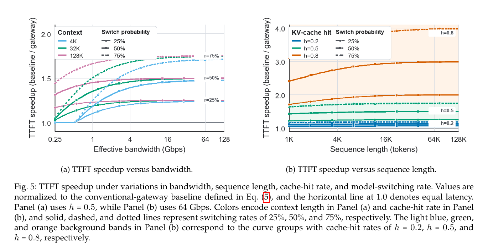

# Unified AI Gateway: 模型路由与 KV Cache 管理的联合框架

> + 发表：arXiv 2609.06940v1 [cs.DC]，2026-09-07（华为，深圳）
> + 作者：Jiaxun Lu, Xiang Zhang, Yunfeng Shao（通信作者）
> + 官方页面：[https://arxiv.org/abs/2609.06940](https://arxiv.org/abs/2609.06940)
> + 本地 PDF：`38_Unified_AI_Gateway_A_Framework_for_Joint_Model_Routing_and_KV_Cache_Management.pdf`（15 页）

## 0. 一句话定位

把 **AI Gateway 从"请求路由器"升级成"请求路由 + KV Cache 管理 + 计算放置"的联合控制器**（端-边-云三层），核心论点：模型切换的隐藏成本来自 KV Cache 不可用/不兼容导致的重复 prefill，路由决策必须感知缓存状态。

## 1. 它解决什么问题

模型生态扩张后，开发者面对两类成本：

1. **集成成本**：在大量不同大小/能力/价格/提供商的模型之间选择与切换；
2. **推理成本**：路由切换目标模型后，已积累的 KV Cache 可能**不可用或不兼容**，目标模型被迫做全上下文重复 prefill——这笔重复计算可能**抵消切换模型本身的能力/价格优势**。

现状是碎片化的：统一 API（集成层）、vLLM/SGLang（运行时）、LMCache/Mooncake（缓存系统）各自优化一段，**没有任何一层把"提供商与模型选择"和"KV Cache 处理"联合协调**。于是出现：路由决策丢弃有用缓存状态 → TTFT 和输入成本上升 → **缓存导致的模型锁定**（cache-induced model lock-in，明明该换模型却因为缓存舍不得换）。

举论文里的例子：长上下文 coding agent 的规划、编码、执行、审查各步可能偏好不同模型，但对话历史、工具输出、仓库状态这些上下文在轮与轮之间反复出现——每次换模型都把这些全量重新 prefill 一遍，太贵了。

## 2. 系统设定：End–Edge–Cloud 三层架构

+ **端侧**：终端设备发起请求、消费结果；在 PD 分离形态下也可承担解码；
+ **边侧**：托管 **Global Control Plane**（控制核心）+ 边缘设备（推理、prefill、跨模型映射）；
+ **云侧**：模型提供商的推理服务集群（商业 API 或自托管）。

核心设计：**把 KV Cache 管理放到请求数据路径上**——控制平面不仅决定路由到哪个模型，还决定对应的缓存如何存储、复用、转换、传输。缓存管理依赖 Mooncake/LMCache 这类分布式缓存系统提供底层存储与迁移，Gateway 决定"何时何地用这些能力"。

## 3. 核心方法

### 3.1 常规 Gateway vs Unified Gateway

左图：请求来了直接路由，KV Cache 各管各的，谁也不协调——换模型就要全量重算。右图：Unified Gateway 在路由的同时协调缓存复用和跨模型映射，只要映射有效，目标端就不用全量 re-prefill。

### 3.2 Global Control Plane：联合决策空间

请求时联合选择三元组 **(目标模型 j，执行位置 e，KV Cache 动作 a)**，五个候选缓存路径（Fig.4，p.5）：**缓存命中直用、跨模型映射、远程缓存传输、边缘 prefill、目标端 re-prefill**。每条路径按四个维度评估（Unified Cache Selector）：

1. **可用性**：缓存是否存在、可查、或在当前放置/授权策略下可生成；
2. **保真度**：跨模型兼容性、映射/压缩误差、是否满足质量与 SLO 约束；
3. **成本**：查找、传输延迟与 RTT、压缩/解压、映射、prefill/重算、内存拷贝、缓存恢复；
4. **资源**：链路带宽、端/边/云算力、内存与存储容量、排队状况。

形式化（Eq.2）：

$$ (j_t^*, e_t^*, a_t^*) = \arg\min_{(j,e,a)\in\mathcal{F}_t(P_t)} \tilde{\lambda}_L \tilde{L}_{tjea} + \tilde{\lambda}_C \tilde{C}_{tjea} \quad s.t.\quad L_{tjea} \le \underline{L}_t,\ Q_{tjea} \ge \underline{Q}_t $$

其中跨模型映射写作 $\hat{K}_j(c_t) = f_{i\to j}(K_i(c_t))$，传输延迟模型（Eq.1）为 $T_{transfer} \approx S^{compressed}/B + T_{RTT} + T_{queue} + T_{copy} + T_{restore}$。

映射 vs 重算的判据（Eq.3）：

$$ T^{P_t\to e}_{cache}(c) + T^{i\to j}_{map}(c) < T^{e,M_j}_{recompute}(c), \quad \varepsilon_{i\to j} \le \delta $$

白话：只有当"搬缓存 + 做映射"的总时间小于"目标模型全量重算"，且映射误差不超过允许的质量损失 δ 时，才走映射路径。映射开销随缓存体积增长，重算开销随上下文长度和模型大小增长——所以长上下文场景映射往往更划算。

请求流层面还有一组**后台缓存管理动作**（与请求时决策解耦）：决定缓存存哪里、热点缓存是否复制到可能的请求源/解码目的地附近、何时迁移或淘汰——它们塑造后续请求可用的 $P_t$。

### 3.3 四个能力组的组件需求（§4）

| 能力组 | 关键需求 |
|---|---|
| 跨粒度缓存复用 | 精确前缀匹配扩容、语义相似匹配、非前缀分段复用、多 Agent 偏移校准、动态热度管理 |
| 压缩与传输 | 低比特量化 / 层感知混合压缩 / 低秩，权衡传输延迟、存储、保真、算力 |
| 跨模型 KV 映射 | 同架构映射、跨架构映射、零样本/少样本映射（不可能为每对模型训练专用 mapper） |
| 分布式缓存管理 | 按地理/访问模式放置、高效检索、带宽约束下的传输调度、模型更新时的一致性 |

## 4. 证据综合（§5，供引用的关键数字）

+ **精确前缀复用**：vLLM（PagedAttention + block hashing）吞吐 2–4×；SGLang（radix tree）吞吐至 6.4×，生产命中率 52.4–74.1%；KVFlow 工作流感知淘汰 1.83×/2.19×；
+ **非前缀复用**：CacheBlend TTFT 降 2.2–3.3×；KVCOMM 五 Agent 工作负载复用率 >70%、prefill 加速至 7.8×；RelayCaching 复用率 >80%、TTFT 降 4.7×；
+ **语义复用**：SemShareKV 加速 6.25×、省 42% 内存；
+ **跨模型映射**：闭式线性映射比 re-prefill 快 **2.7–25×**；低秩重建 + 稀疏修补 TTFT 加速至 2.65×（质量损失 ≤5%）；
+ **分布式存储与传输**：LMCache+vLLM 多轮场景吞吐至 15×；SmartGen：48K token 缓存经 25Gbps 传输要花 6.5× prefill 时间——传输本身可能成为瓶颈；FlowKV 传输延迟降 96%；
+ **模型路由**：RouteLLM 省 >50% 调用成本、FrugalGPT 省至 98%，但都在数据中心内部，没测 Gateway 层的跨模型映射 + 跨层放置的额外收益。

## 5. 评估：workload 级解析仿真（§6）

+ **方法**：8 个典型负载 profile，$\theta_w = (L_{in}, L_{out}, h, r_{switch}, B)$；缓存命中直用、切换命中走映射+传输、未命中全量 prefill（Eq.5）；缓存输入折扣 η=0.10（OpenAI/Anthropic 实际价目）、输出/未缓存输入价格比 λ=5.0；带宽 8 GB/s，15 KB/token 足迹，4× 压缩；
+ **重点 profile**：长程 coding agent——**80K token 上下文（第 30 轮）、131:1 输入输出比、94.2% 命中率**（来自 vLLM-Mooncake trace）；
+ **结果（Table 4，p.11）**：切换率 25%/50%/75% 下，TTFT 加速分别 **1.25×–5.39× / 1.49×–9.48× / 1.74×–13.28×**；输入成本收益 1.20×–6.16×；coding agent 的 TTFT 加速 5.01×→12.87× 随切换率放大；
+ **规律**：高命中 + 长上下文 + 长输入短输出的 agentic 负载受益最大。

注意边界：这是 workload-level analytical simulation（解析仿真），不是在线 Agent 实测；比较时传统 Gateway 的模型选择策略保持固定，切换率是外生参数。跨模型 KV 映射是论文提出的系统级设计与仿真评估，不能表述为我们已实现的能力。

## 6. 部署缺口（§7，研究方向）

1. 跨模型语义对齐（逐层误差累积，C2C/MoT 需要成对训练）；
2. 异构边缘硬件（NPU/FPGA/ASIC 不能直接搬 GPU 算子）；
3. 分布式缓存一致性（陈旧元数据 → miss → 重复 prefill，还好不会给错结果）；
4. **安全与隐私**：KV Cache 编码了用户 prompt 和生成内容，边侧存储与共享有重建风险与时序信道风险（PROMPTPEEK、Splice-Leak、KV-Cloak 等攻击面）；
5. 系统经济学（缓存/压缩/映射/迁移同时改变算力、存储、网络成本）；
6. 标准与生态（引擎间页大小、缓存布局、精度不同，点对点连接器成本高）。

## 7. 与 ModelRouter 的关系（重合与可证伪差异）

+ **重合**：模型切换的隐藏成本（缓存失效 → 重 prefill → TTFT/成本上升）正是我们 KV/Continuity 状态组和切换代价 $switch\_penalty\_estimate$ 的动机来源；其"路由必须缓存感知"的论证直接支持 H4（缓存与连续性状态减少无效切换和总成本）。
+ **可证伪差异**：
    1. 它是**系统/请求级** KV 优化（网关、放置、传输），我们是**任务级 Agent** 的 Model × Effort 决策；
    2. 它不学习路由策略——仿真中模型选择策略固定，切换率是外生参数；我们要学决策模型；
    3. 跨模型 KV 映射是它的设计/仿真，**不是我们已实现的能力**，PPT 表述必须用"论文提出的系统方案"；
    4. 我们不假定 KV 跨模型可直接共享（RESEARCH_OVERVIEW 明确边界）。
+ **可复用**：80K/131:1/94.2% 的 coding agent 缓存 profile 可作为我们缓存收益估算的参照系；η=0.10、λ=5.0 的计价口径可参考其引用的官方价目。

## 相关笔记

- [[INFRAMIND_ Infrastructure-Aware Multi-Agent Orchestration]] — `汇报/汇报二/笔记/INFRAMIND`
- [[TwinRouterBench_ Fast Static and Live Dynamic Evaluation]] — `汇报/汇报二/笔记/TwinRouterBench`
- [[KVFlow_Efficient_Prefix_Caching]] — `research/task-level-cost-routing/literature/pdfs/44_…pdf`
