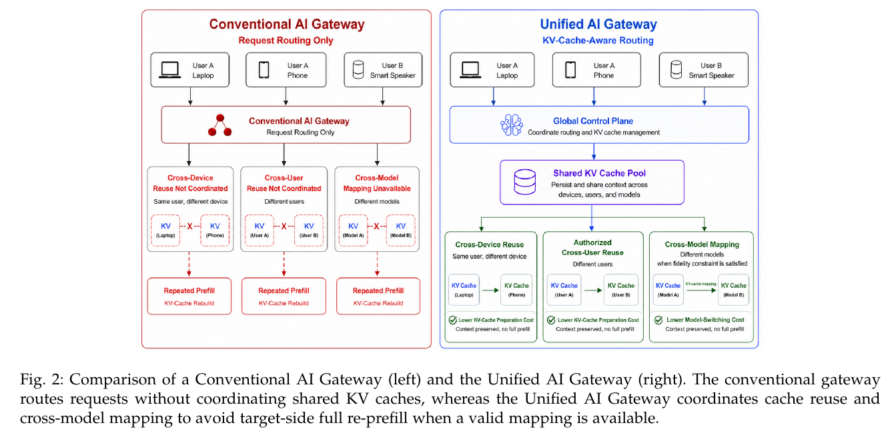
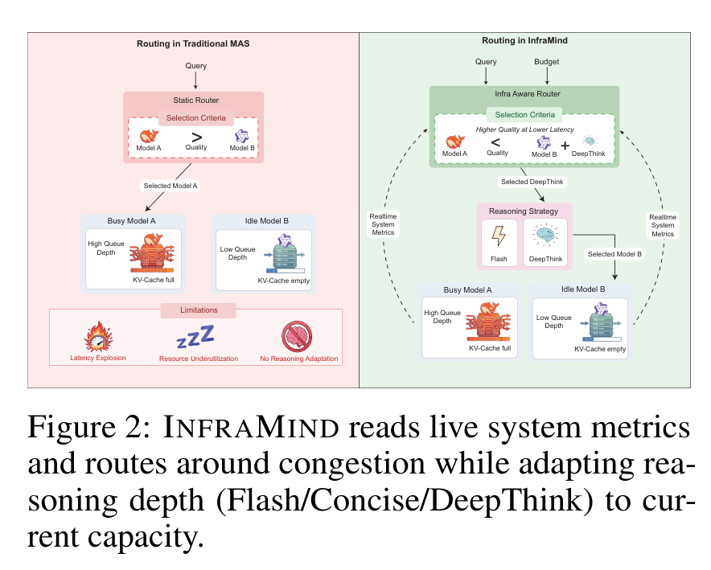
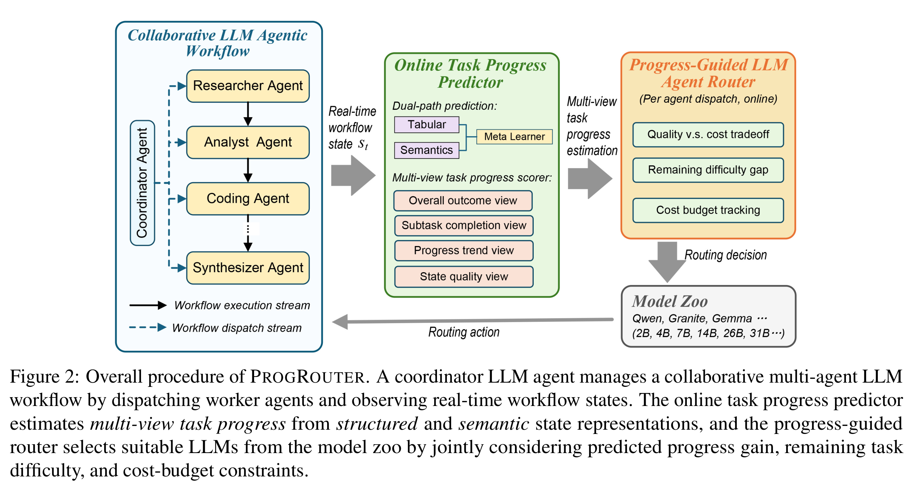
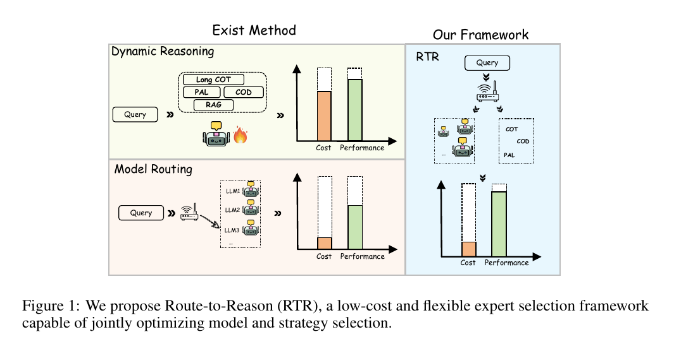
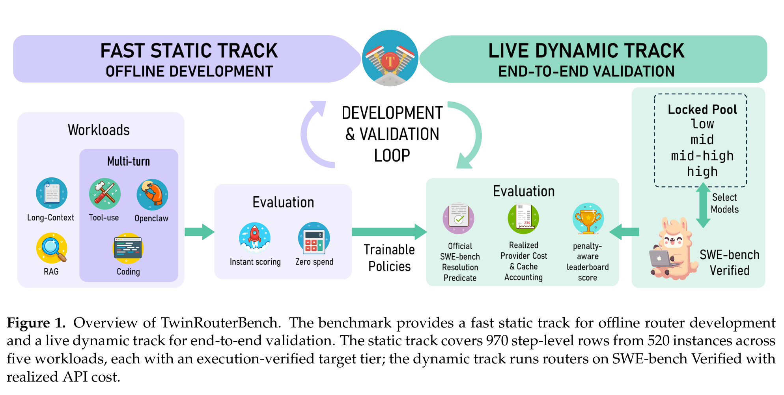

# 组会论文简读笔记（汇报二）

> 日期：2026-10-12｜性质：论文原文简读笔记，服务于后续组会 PPT 制作。延续"汇报一"《19 页论文与数据汇报规划》的讲法：**每篇按"它解决什么问题 → 核心方法（论文原图）→ 主要结果 → 能支持什么 / 不能支持什么 → 与 ModelRouter 的关系"组织**。
> 五张配图均为论文原图裁剪（含图注），存于本目录 `图片/`；原始高清版与完整出处见同目录《论文原图提取清单.md》。图中数字全部属于论文实验/仿真结果，不代表本地数据实测。

> **详细版笔记（2026-10-12 新增，按语雀/Obsidian 论文笔记格式，含 PDF 与截图，可通读全文后使用）**：
> - `笔记/Unified-AI-Gateway/`——模型路由 × KV Cache 管理联合网关
> - `笔记/INFRAMIND/`——基础设施感知的多 Agent 编排
> - `笔记/ProgRouter/`——进度引导的多 Agent 工作流在线路由
> - `笔记/Route-to-Reason/`——模型 × 推理策略联合路由
> - `笔记/TwinRouterBench/`——step-level 双轨路由评测基准
> - 每个论文目录内含：论文 PDF 一份、`笔记.md`（含 YAML 元数据、公式、通俗解释、嵌入截图）、`截图/` 目录。

---

## 1. Unified AI Gateway：模型切换为什么有隐藏成本

**论文**：Unified AI Gateway: A Framework for Joint Model Routing and KV Cache Management（arXiv [2609.06940](https://arxiv.org/abs/2609.06940)，本地 `38_…pdf`，15 页）

- **它解决什么问题**：LLM 推理跨大小、能力、价格、提供商各异的模型，带来两类成本——选型/切换的**集成成本**，以及 KV Cache 不可用或不兼容时的**重建（re-prefill）成本**。论文定义了边缘部署 AI 流量枢纽的系统设定：请求时联合选择目标模型、执行位置（端-边-云）和 KV Cache 动作，后台再做缓存放置/复制/检索/生命周期管理。
- **核心方法（Fig.2，物理页 p.3）**：左图常规 Gateway 只按请求路由，KV Cache 不跨设备、跨用户、跨模型复用，三种种类的切换都导致重复 prefill；右图 Unified Gateway 用 Global Control Plane + Shared KV Cache Pool，做跨设备复用、授权跨用户复用、以及"有效性概率满足时"的跨模型 KV 映射。
- **主要结果**：TTFT 加速约 1.25×–13.28×，输入成本收益约 1.20×–6.16×（旧素材 Fig.5，p.12）。
- **能支持 / 不能支持**：✅ 证明模型切换与 KV Cache 状态强相关，缓存连续性是路由必须考虑的变量。❌ 结果来自 **workload-level analytical simulation**，不是在线 Agent 实测；**跨模型 KV 映射是论文的系统级设计，不能表述为我们已实现的能力**。
- **与 ModelRouter 的关系**：系统/请求级 KV 优化的近邻对照。本项目是任务级 Agent 的 Model × Effort 决策，其"缓存状态影响切换成本"的观察支撑我们状态表中的 KV Cache/Continuity 状态组与切换代价建模。

---

## 2. INFRAMIND：不看基础设施状态的路由在并发下失效

**论文**：INFRAMIND: Infrastructure-Aware Multi-Agent Orchestration（arXiv [2606.11440](https://arxiv.org/abs/2606.11440)，本地 `39_…pdf`，12 页）

- **它解决什么问题**：现有多 Agent 编排（从暴力 ensemble 到学习型 router）只看任务与模型特征，不看服务基础设施的运行时状态。共享 GPU 集群并发负载下出现系统性资源错配：偏好小模型队列超 130 请求、队列延迟超 30 秒，而同等能力的大模型闲置，**约 67% 的大模型 GPU 容量被浪费**；多 Agent 流水线中这些延迟逐步复合。难点是三个决策（规划、逐步路由、调度）都需动态且嘈杂的基础设施信号驱动。
- **核心方法（Figure 2，物理页 p.2）**：左图传统 MAS——静态 Router 只按 Query 与质量标准选模型，Busy Model A 队列深、KV-Cache 满，Idle Model B 闲置，导致延迟爆炸、资源利用不足、无推理适配；右图 InfraMind——Query + Budget 进入 Infra Aware Router，读取实时系统指标，按"更高质量更低延迟"选择，并联合调整推理深度（Flash/Concise/DeepThink）， Busy/Idle 模型间动态改派。
- **主要结果**：质量–延迟权衡见论文 Figure 4（p.8）；MATH 上（µ=10 r/m）准确率 62.6%→82.0%（Figure 5，p.8）。
- **能支持 / 不能支持**：✅ 证明队列深度、KV-Cache 压力、延迟等运行时指标应进入路由决策，且推理深度是有效路由维度。❌ 其 reasoning strategy（Flash/Concise/DeepThink）是论文自定义机制，**不等同于 Provider 原生 reasoning_effort 档位**；它是多 Agent 编排框架，不做任务级整轨迹成本的事前预测。
- **与 ModelRouter 的关系**：运行时状态感知路由的直接近邻之一，支撑我们"Provider/可用性 + KV/连续性"状态组的价值论证；差异在于我们做任务级 Model × Effort 联合决策与整任务成本记账。

---

## 3. ProgRouter：多 Agent 工作流的进度引导在线路由

**论文**：PROGROUTER: Online Progress-Guided Orchestration for Multi-Agent LLM Workflows under Quality-Cost Tradeoffs（arXiv [2608.25992](https://arxiv.org/abs/2608.25992)，本地 `05_…pdf`，16 页）

- **它解决什么问题**：多 Agent LLM 工作流因反复调用与长程上下文累积产生高运营成本；现有级联路由是一次性、query 级决策，无法适应多步工作流——每一步"正确的 LLM"取决于不断演化的任务进度、剩余难度与成本效率要求。
- **核心方法（Figure 2，物理页 p.4）**：协调者 Agent 管理协作多 Agent 工作流（Researcher/Analyst/Coding/Synthesizer），观察实时工作流状态 s_t；在线任务进度预测器用双路径预测（Tabular + Semantics → Meta Learner）产出**多视图进度评分**：整体结局视图、子任务完成视图、进度趋势视图、状态质量视图；进度引导 LLM Agent Router 联合考虑质量-成本权衡、剩余难度差距、成本预算跟踪，从 Model Zoo（Qwen/Granite/Gemma，2B–31B）为每次 dispatch 选模型，路由动作回流工作流。
- **主要结果**：性能–成本权衡分析见论文 Figure 3（p.9）；按模型大小的路由分布见 Figure 5（p.9）。
- **能支持 / 不能支持**：✅ 证明工作流状态/进度可以显式进入在线模型选择并约束成本。❌ 面向多 Agent workflow 编排的逐步选择（论文 p.3 用结构化 workflow ledger 表示目标、进度与中间状态）；不改变执行策略、不做整任务资源分布的事前预测。
- **与 ModelRouter 的关系**：强对照——"状态/进度/成本已被研究"不能当作我们的空白；我们的差异主张是执行前的整任务成本预测与 Model × Effort 联合静态选择，需与 ProgRouter 正面比较。

---

## 4. Route to Reason：只选模型不够，还要选推理策略

**论文**：Route to Reason: Adaptive Routing for LLM and Reasoning Strategy Selection（arXiv [2505.19435](https://arxiv.org/abs/2505.19435)，WWW 2026，本地 `12_…pdf`，18 页）

- **它解决什么问题**：模型固有能力与所采用的推理策略共同决定推理任务表现；test-time scaling 虽有效但计算成本高，常陷入"overthinking / thought pitfalls"。
- **核心方法（Figure 1，物理页 p.2）**：左半"Exist Method"——Dynamic Reasoning（对同一 Query 在 Long CoT/PAL/COD/RAG 中切换）与 Model Routing（在 LLM1/2/3 中选择）各自只优化一个维度，Cost 与 Performance 都不理想；右半"Our Framework"——RTR 对 Query 联合选择模型与推理策略（CoT/COD/PAL…），以更低成本拿到更高性能。联合选择靠编码问题、候选模型、候选策略后预测 performance 与输出 token，形成 routing table（旧素材 Fig.4，p.4）。
- **主要结果**：performance–token 权衡见论文 Figure 7（p.8，旧素材已有 plot-only 局部）；成本主要以 token / 输出长度为代理。
- **能支持 / 不能支持**：✅ 证明"模型 × 推理策略"联合选择是有效且必要的路由变量，固定高强度推理造成浪费。❌ 主要是 **query-level** 决策；成本用 token 代理而非整任务美元；其 reasoning strategy 是 CoT/PAL/COD 等论文自定义策略，**不等同于 Provider 原生 reasoning_effort**。
- **与 ModelRouter 的关系**：Model × Effort 联合选择的**最直接近邻**。我们须证明加入 Agent/Harness 状态、长程工具交互、失败重试与任务级真实费用后，相对 RTR 的 query-level 联合选择仍有增量。

---

## 5. TwinRouterBench：真实费用的 Agent 路由评测基准

**论文**：TwinRouterBench: Fast Static and Live Dynamic Evaluation for Realistic Agentic LLM Routing（arXiv [2605.18859](https://arxiv.org/abs/2605.18859)，本地 `07_…pdf`，24 页）

- **它解决什么问题**：路由在长程应用（coding agent、深度研究、computer-use）中最重要——单个请求触发大量模型调用，把每次调用路由到"最便宜的够用模型"可以省钱不降质；但现有 router benchmark 只评 one-shot prompt：从不暴露中间 Agent 步骤的 router-visible prefix，不验证更便宜的替换能否保住下游任务成功，且评测常依赖在线 LLM judge。
- **核心方法（Figure 1，物理页 p.2）**：双轨设计。**静态轨（FAST STATIC TRACK，离线开发）**：覆盖 Long-Context（QMSum）、Tool-use（BFCL）、Openclaw、RAG（mtRAG）、Coding（SWE-bench/PinchBench）五类工作负载，提供 970 个 router-visible step-level 前缀（来自 520 个实例），带执行验证的 target tier，Instant scoring、Zero spend；**动态轨（LIVE DYNAMIC TRACK，端到端验证）**：在 SWE-bench Verified 上用锁定模型池（low/mid/mid-high/high）真实执行，按 realized provider cost 与 cache 记账产出 penalty-aware leaderboard score。
- **主要结果**：标签来自执行验证而非模型判定；静态评分确定性、毫秒级、无需在线 judge（细节见论文 Figure 2 构造流程，p.6）。
- **能支持 / 不能支持**：✅ 提供"真实 Agent 逐步路由 + 真实费用"的现成评测协议与标签构造方式，是我们的**重要评测基线**。❌ 它是**评测基准而非路由方法**；target tier 只是固定模型池/协议下的局部估计，不是任何 model × effort 的全局最优。
- **与 ModelRouter 的关系**：已覆盖"真实 Agent 逐步路由评测"，**我们不能声称这一点是新的**；其前缀构造、执行验证 tier 与防泄漏划分可复用为我们的泛化/对照测试协议（RESEARCH_OVERVIEW 亦将其列为标签构造近邻）。

---

## 五篇合看：覆盖了什么变量，我们站在哪里

| 论文 | 决策时点 | 决策对象 | 成本单位 | 是否完整轨迹 |
|---|---|---|---|---|
| Unified AI Gateway | 请求时（系统级） | 模型 + 位置 + KV 动作 | TTFT / 输入成本（解析仿真） | 否（请求级） |
| INFRAMIND | 查询到达 + 每步 | 拓扑/模型/推理深度 + 调度 | 延迟 / 质量 | 多 Agent 流水线内 |
| ProgRouter | 每次工作流 dispatch | 模型（Model Zoo） | 时间/费用预算约束 | 工作流逐步在线 |
| Route to Reason | query 级 | 模型 × 推理策略 | token / 输出长度代理 | 否 |
| TwinRouterBench | （评测，非方法） | 路由器/策略 | realized API cost + cache 记账 | 是（step-level） |

**共同缺口 → 我们的位置**：五篇工作分别覆盖了缓存状态、基础设施状态、进度状态、推理策略与真实费用评测，但都没有做"**执行前预测一个 (model, effort) 配置的整条轨迹是否值得**"的事前（ex-ante）任务级联合决策。这与汇报一第 19 页提出的研究问题一致。

**表述红线（PPT 与笔记均须遵守）**：
1. INFRAMIND 与 Route-to-Reason 的 reasoning strategy ≠ Provider 原生 reasoning_effort；
2. Unified AI Gateway 的跨模型 KV 映射不能表述为我们已实现的能力；
3. 各图数字均为论文结果，不代表本地数据实测；所有假设（H1–H7）尚未由本项目实验验证。
